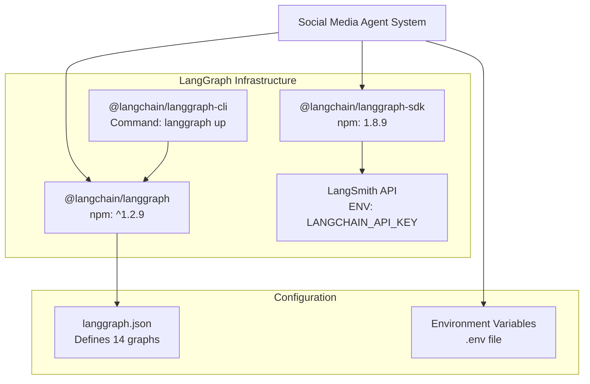
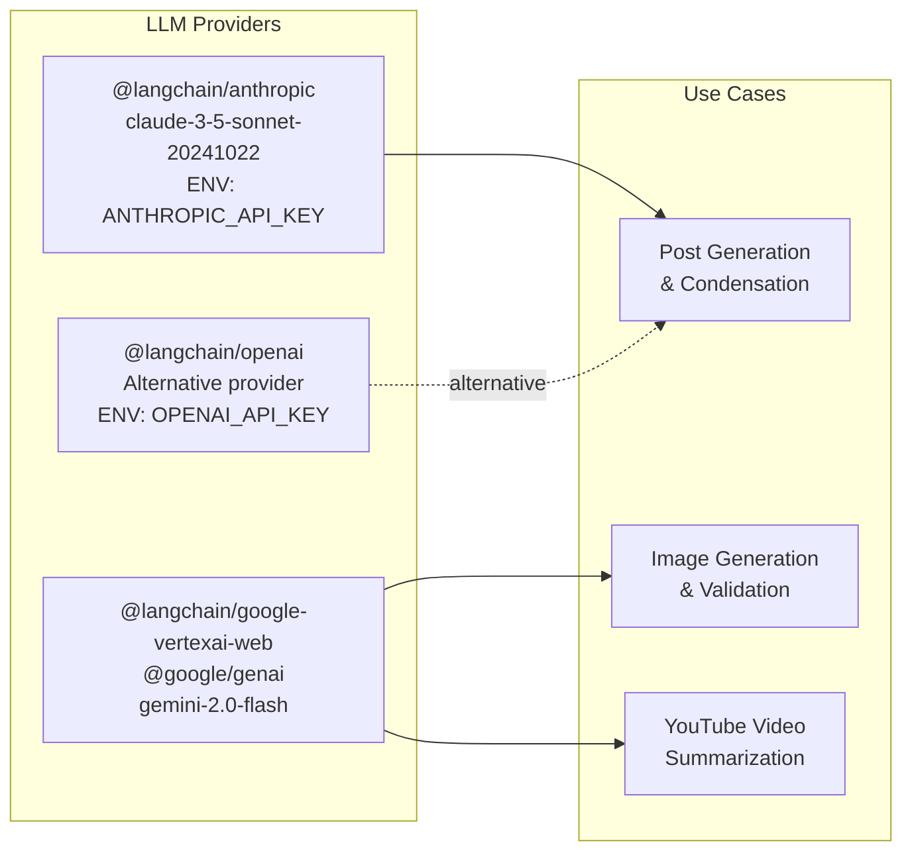
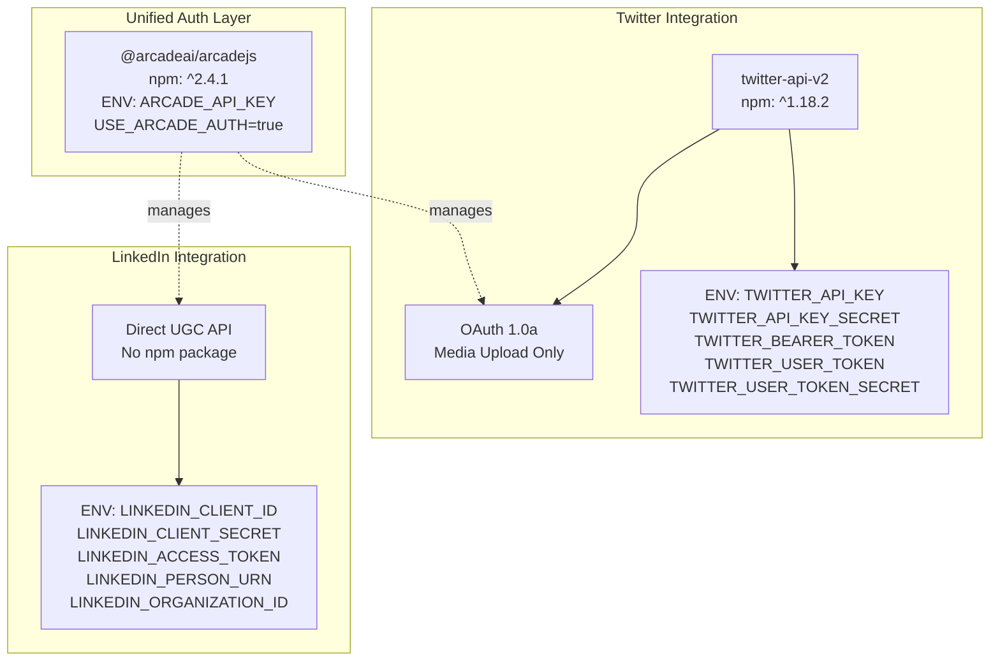
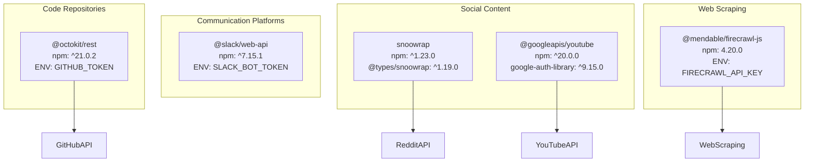
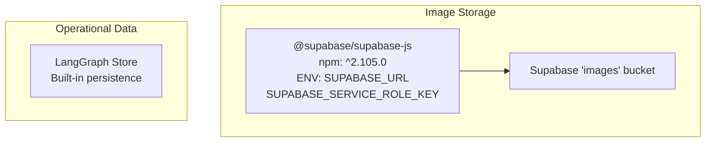

<!-- source: DeepWiki mcp.deepwiki.com · repo langchain-ai/social-media-agent · page 1.3 Key Dependencies · fetched 2026-10-26 -->

# Key Dependencies

Relevant source files

The following files were used as context for generating this wiki page:

- [memory-v2/poetry.lock](memory-v2/poetry.lock)
- [memory-v2/pyproject.toml](memory-v2/pyproject.toml)
- [package.json](package.json)
- [pyproject.toml](pyproject.toml)
- [uv.lock](uv.lock)
- [yarn.lock](yarn.lock)

This document catalogs the external dependencies and services that power the social media automation system. It covers npm packages, API integrations, and required infrastructure components, along with their specific roles and configuration requirements.

For information about configuring these dependencies through environment variables, see [Environment Variables](#4.1). For details on authentication setup, see [Arcade Authentication](#3.6).

---

## Core Orchestration Dependencies

The system's foundation is built on LangGraph, which provides the graph-based workflow orchestration and execution runtime.

**LangGraph Core Components:**

| Package/Service | Version | Purpose |
|----------------|---------|---------|
| `@langchain/langgraph` | ^1.2.9 | Core graph orchestration, state management, and workflow definition |
| `@langchain/langgraph-sdk` | 1.8.9 | Client SDK for interacting with LangGraph server (threads, runs, crons) |
| LangGraph CLI | Latest | Development server and deployment tooling (`langgraph up` command) |
| LangSmith | ^0.5.25 | Tracing, monitoring, and API authentication for LangGraph runtime |

The LangGraph SDK is used throughout the codebase to manage workflow execution and scheduled tasks. For example, scripts utilize the `Client` from `@langchain/langgraph-sdk` to interact with the runtime.

**Sources:** [package.json:45-46](), [package.json:61](), [package.json:34-35]()

---

## LLM Provider Dependencies

The system integrates with three primary LLM providers, each serving distinct roles in content generation and analysis.

**LLM Provider Packages:**

| Package | Version | Primary Use Cases |
|---------|---------|------------------|
| `@langchain/anthropic` | ^1.3.28 | Post generation, text condensation, content analysis |
| `@langchain/openai` | ^1.4.5 | Alternative LLM provider for text operations |
| `@langchain/google-vertexai-web` | ^1.0.0 | Image generation validation, multimodal tasks |
| `@google/genai` | ^1.50.1 | Google Generative AI models (Gemini series) |

**Model Selection by Task:**
- **Text Generation:** Anthropic's `claude-3-5-sonnet-20241022` is a primary model for post generation and content report creation.
- **Image Tasks:** Google Vertex AI models are utilized for image validation and multimodal analysis.
- **Video Analysis:** YouTube transcript analysis and summarization leverage multimodal capabilities.

**Sources:** [package.json:39](), [package.json:41](), [package.json:44](), [package.json:47]()

---

## Social Media API Dependencies

Integration with Twitter and LinkedIn for content publishing is handled through a combination of direct API clients and OAuth abstraction layers.

**Twitter API:**

| Package/Component | Version | Purpose |
|------------------|---------|---------|
| `twitter-api-v2` | ^1.18.2 | Twitter API v2 client for posting tweets, searching, and thread management |
| OAuth 1.0a | Required | Authentication for media uploads (images/videos) |
| Arcade (optional) | ^2.4.1 | Unified OAuth for simplified posting |

**LinkedIn API:**

| Component | Configuration | Purpose |
|-----------|--------------|---------|
| Direct UGC API | No npm package | LinkedIn's User Generated Content API for posting |
| Personal Posting | `LINKEDIN_ACCESS_TOKEN` | Posting as individual user |
| Organization Posting | `LINKEDIN_ORGANIZATION_ID` | Posting as company page |
| Arcade (optional) | `USE_ARCADE_AUTH=true` | Simplified OAuth abstraction |

**Sources:** [package.json:38](), [package.json:68]()

---

## Content Source API Dependencies

The system ingests content from multiple platforms, requiring specialized API clients.

**Content Source Packages:**

| Package | Version | Platform | Purpose |
|---------|---------|----------|---------|
| `@slack/web-api` | ^7.15.1 | Slack | Message ingestion and notification delivery |
| `@octokit/rest` | ^21.0.2 | GitHub | Repository metadata and content extraction |
| `snoowrap` | ^1.23.0 | Reddit | Subreddit post and comment extraction |
| `@googleapis/youtube` | ^20.0.0 | YouTube | Video metadata and transcript retrieval |
| `@mendable/firecrawl-js` | 4.20.0 | Web | General web page scraping and content extraction |
| `google-auth-library` | ^9.15.0 | Google | Authentication for Google/YouTube APIs |

**Sources:** [package.json:40](), [package.json:48-50](), [package.json:60](), [package.json:67]()

---

## Storage and Persistence Dependencies

The system uses Supabase for image hosting and LangGraph's store for operational data.

**Storage Packages:**

| Package/Service | Version | Purpose |
|----------------|---------|---------|
| `@supabase/supabase-js` | ^2.105.0 | Supabase client for image storage operations |
| LangGraph Store | Built-in | Key-value store for reflection rules and processed URLs |

**Sources:** [package.json:51]()

---

## Supporting Utility Dependencies

The system relies on utility libraries for data transformation, validation, and operational tasks.

**Utility Package Table:**

| Category | Package | Version | Purpose |
|----------|---------|---------|---------|
| **Validation** | `zod` | ^4.1.12 | Schema validation for state and API responses |
| **HTML/XML** | `cheerio` | ^1.0.0 | HTML parsing and DOM manipulation |
| **HTML/XML** | `xml2js` | ^0.6.2 | XML to JavaScript object conversion |
| **Date/Time** | `date-fns` | ^4.1.0 | Date arithmetic and formatting |
| **Date/Time** | `date-fns-tz` | ^3.2.0 | Timezone-aware date operations |
| **Date/Time** | `moment` | ^2.30.1 | Date formatting utilities |
| **Images** | `sharp` | ^0.34.5 | Image processing and optimization |
| **Browser** | `playwright` | ^1.59.1 | Browser automation for content extraction |
| **IDs** | `uuid` | ^14.0.0 | UUID generation for unique identifiers |
| **Environment** | `dotenv` | ^16.4.7 | Environment variable loading |

**Sources:** [package.json:53-71]()

---

## Dependency Version Management

The project uses Yarn for Node.js dependencies and includes specialized Python-based components (like `memory-v2`) managed via Poetry or UV.

**Version Management Strategy:**

| Aspect | Implementation |
|--------|---------------|
| **Package Manager** | Yarn 1.22.22 (Main) / Poetry (Memory V2) / UV (Slack module) |
| **Lock Files** | `yarn.lock`, `poetry.lock`, `uv.lock` |
| **TypeScript** | Version ^6.0.3 |

**Sources:** [package.json:5](), [package.json:106](), [memory-v2/poetry.lock:1](), [uv.lock:1]()

---

