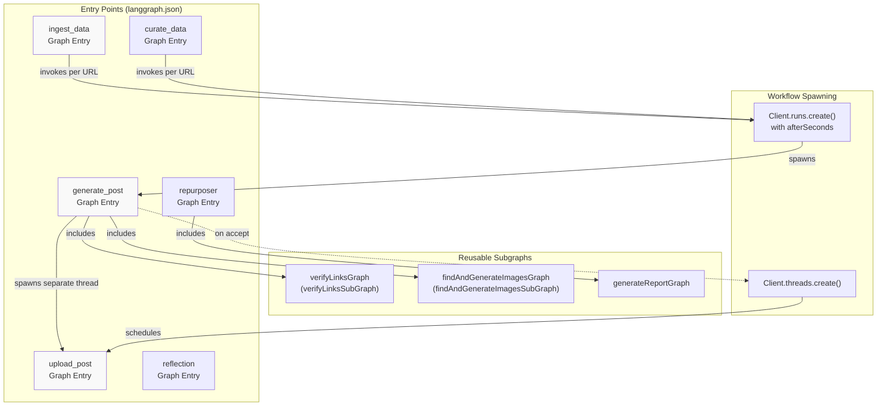
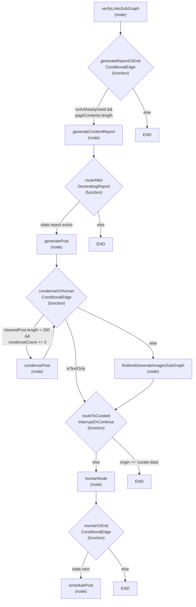
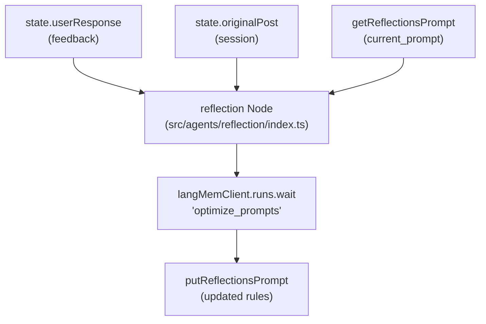

<!-- source: DeepWiki mcp.deepwiki.com · repo langchain-ai/social-media-agent · page 2 Core Workflows · fetched 2026-10-26 -->

# Core Workflows

<details>
<summary>Relevant source files</summary>

The following files were used as context for generating this wiki page:

- [langgraph.json](langgraph.json)
- [src/agents/generate-post/generate-post-graph.ts](src/agents/generate-post/generate-post-graph.ts)
- [src/agents/generate-post/generate-post-state.ts](src/agents/generate-post/generate-post-state.ts)
- [src/agents/reflection/index.ts](src/agents/reflection/index.ts)
- [src/agents/utils.ts](src/agents/utils.ts)
- [src/utils/reflections.ts](src/utils/reflections.ts)

</details>


This document provides an introduction to the primary operational workflows in the Social Media Agent system. These workflows are implemented as LangGraph state graphs that orchestrate AI-powered content curation, generation, and publishing. Each workflow represents a complete end-to-end process with defined state, nodes, and conditional edges that route execution based on runtime conditions.

For detailed information about individual workflow components, see:
- Data ingestion mechanisms: [Data Ingestion](#2.1)
- Content verification logic: [Content Verification](#2.2) 
- Post generation process: [Post Generation](#2.3)
- Image discovery and generation: [Image Processing](#2.4)
- Human review interface: [Human Review Process](#2.5)
- Post scheduling and publishing: [Post Scheduling and Upload](#2.6)
- Feedback loops and prompt optimization: [Reflection and Learning](#2.7)
- Content batching and campaigns: [Content Repurposing](#2.8)

## Workflow Architecture

The system defines 14 named graphs in [langgraph.json:1-24](), each representing a distinct workflow or reusable subgraph. These workflows coordinate to form the complete social media automation pipeline.

### Primary Workflow Types

| Workflow Type | Graphs | Purpose |
|--------------|--------|---------|
| **Main Pipeline** | `ingest_data`, `generate_post`, `upload_post` | Core end-to-end automation from content discovery to publishing |
| **Content Curation** | `curate_data`, `verify_reddit_post`, `verify_tweet` | Multi-source content aggregation and verification |
| **Interrupt Handlers** | `curated_post_interrupt`, `repurposer_post_interrupt` | Human-in-the-loop review interfaces |
| **Learning & Optimization** | `reflection`, `repurposer` | Feedback processing and content repurposing |
| **Utilities** | `supervisor`, `generate_report`, `generate_thread`, `ingest_repurposed_data` | Supporting workflows for specific tasks |

**Workflow Execution Flow**



Sources: [langgraph.json:1-24](), [src/agents/generate-post/generate-post-graph.ts:157-243]()

### State Graph Implementation

Each workflow is implemented using LangGraph's `StateGraph` class with typed state annotations. The pattern follows:

```typescript
// State definition with Annotation.Root
const StateAnnotation = Annotation.Root({
  field: Annotation<Type>({
    reducer: (_state, update) => update,
    default: () => defaultValue
  })
});

// Graph construction
const builder = new StateGraph(StateAnnotation, ConfigurableAnnotation)
  .addNode("nodeName", nodeFunction)
  .addEdge(START, "nodeName")
  .addConditionalEdges("nodeName", routingFunction, ["target1", "target2", END]);

export const graphName = builder.compile();
```

Sources: [src/agents/generate-post/generate-post-graph.ts:184-241](), [src/agents/generate-post/generate-post-state.ts:26-108](), [src/agents/reflection/index.ts:98-103]()

## Main Pipeline Workflow

The primary automation pipeline consists of three sequential graphs that process content from discovery through publishing.

**Pipeline State Flow**

```mermaid
stateDiagram-v2
    direction LR
    
    [*] --> ingestSlackData
    
    state ingest_data {
        ingestSlackData --> generatePostFromMessages
        generatePostFromMessages --> links_array
        links_array --> spawns_threads
    }
    
    spawns_threads --> generate_post_threads: creates thread per URL
    
    state generate_post_threads {
        state generate_post {
            authSocialsPassthrough --> verifyLinksSubGraph
            verifyLinksSubGraph --> generateReportOrEndConditionalEdge
            generateReportOrEndConditionalEdge --> generateContentReport
            generateContentReport --> generatePost
            generatePost --> condenseOrHumanConditionalEdge
            condenseOrHumanConditionalEdge --> condensePost
            condensePost --> findAndGenerateImagesSubGraph
            findAndGenerateImagesSubGraph --> humanNode
            humanNode --> rewriteOrEndConditionalEdge
            rewriteOrEndConditionalEdge --> schedulePost
        }
    }
    
    schedulePost --> upload_scheduled: afterSeconds delay
    
    state upload_post {
        upload_scheduled --> uploadToTwitter
        upload_scheduled --> uploadToLinkedIn
        uploadToTwitter --> notifySlack
        uploadToLinkedIn --> notifySlack
    }
    
    notifySlack --> [*]
```



Sources: [src/agents/generate-post/generate-post-graph.ts:184-241]()

### Workflow Orchestration Pattern

The system uses a spawning pattern where upstream graphs create new threads and scheduled runs for downstream graphs:

1. **Ingestion Phase**: `ingestSlackData` node extracts URLs from Slack messages into `state.links` array.
2. **Thread Spawning**: Upstream nodes create separate threads via `Client.threads.create()` [src/agents/generate-post/generate-post-graph.ts:169]().
3. **Scheduled Execution**: Each thread invokes the next graph (e.g., `generate_post`) with `afterSeconds` for rate limiting.
4. **Human Review**: `humanNode` creates an interrupt requiring user action via the Agent Inbox [src/agents/generate-post/generate-post-graph.ts:198]().
5. **Scheduling**: `schedulePost` node spawns an `upload_post` run [src/agents/generate-post/generate-post-graph.ts:200]().
6. **Publishing**: `upload_post` graph handles final platform delivery.

Sources: [src/agents/generate-post/generate-post-graph.ts:157-243]()

## Conditional Routing

State graphs use conditional edges to implement dynamic routing based on state and configuration.

**Generate Post Graph Conditional Routing**



Sources: [src/agents/generate-post/generate-post-graph.ts:34-155](), [src/agents/generate-post/generate-post-graph.ts:184-241]()

### Key Routing Functions

**`generateReportOrEndConditionalEdge`** [src/agents/generate-post/generate-post-graph.ts:128-151]()
- Checks if URLs were previously used via `checkIfUrlsArePreviouslyUsed()`.
- Returns `END` if `urlsAlreadyUsed || !state.pageContents?.length`.
- Otherwise routes to `"generateContentReport"`.

**`routeAfterGeneratingReport`** [src/agents/generate-post/generate-post-graph.ts:62-69]()
- Returns `"generatePost"` if `state.report` exists.
- Returns `END` if report generation failed.

**`condenseOrHumanConditionalEdge`** [src/agents/generate-post/generate-post-graph.ts:90-106]()
- Uses `removeUrls()` to strip URLs from post text for character counting [src/agents/utils.ts:81-84]().
- Routes to `"condensePost"` if length > 280 and `condenseCount <= 3`.
- Routes to `routeToCuratedInterruptOrContinue()` if `isTextOnly(config)` is true.
- Otherwise routes to `"findAndGenerateImagesSubGraph"`.

**`rewriteOrEndConditionalEdge`** [src/agents/generate-post/generate-post-graph.ts:71-88]()
- Routes to `state.next` value set by human review node.
- Possible values: `"rewritePost"`, `"schedulePost"`, `"updateScheduleDate"`, `"rewriteWithSplitUrl"`, `"humanNode"`, `END`.

## Reflection and Learning Workflow

The system includes a dedicated `reflectionGraph` [src/agents/reflection/index.ts:103]() that learns from human feedback. When a user provides feedback on a generated post, this graph analyzes the delta between the original and new post to update persistent "reflection rules" stored in the LangGraph Store [src/utils/reflections.ts:32-43]().

**Reflection Logic Space**



Sources: [src/agents/reflection/index.ts:52-96](), [src/utils/reflections.ts:14-43]()

## Configuration Propagation

Configuration flows through the graph execution hierarchy via `LangGraphRunnableConfig.configurable` objects.

| Configuration Key | Type | Effect |
|-------------------|------|--------|
| `POST_TO_LINKEDIN_ORGANIZATION` | `boolean` | Routes LinkedIn posts to organization page vs personal profile [src/agents/generate-post/generate-post-state.ts:118]() |
| `TEXT_ONLY_MODE` | `boolean` | Disables image processing pipeline [src/agents/generate-post/generate-post-state.ts:125]() |
| `SKIP_CONTENT_RELEVANCY_CHECK` | `boolean` | Bypasses content validation [src/agents/generate-post/generate-post-state.ts:137]() |
| `SKIP_USED_URLS_CHECK` | `boolean` | Allows duplicate URL processing [src/agents/generate-post/generate-post-state.ts:142]() |

Configuration values are read via utility functions that check both `config.configurable` and environment variables (e.g., `isTextOnly` in [src/agents/utils.ts:512-519]()).

## Error Handling and Early Termination

Workflows terminate early under specific conditions to prevent unnecessary processing:

1. **Duplicate URLs**: `generateReportOrEndConditionalEdge` returns `END` if URLs were already processed [src/agents/generate-post/generate-post-graph.ts:139]().
2. **Empty Content**: Terminates if `pageContents` length is 0 [src/agents/generate-post/generate-post-graph.ts:139]().
3. **Curated Origin**: `routeToCuratedInterruptOrContinue` spawns a separate `curated_post_interrupt` thread and returns `END` to the current thread [src/agents/generate-post/generate-post-graph.ts:179]().
4. **Condense Limit**: Condensation stops after 3 attempts to prevent infinite loops [src/agents/generate-post/generate-post-graph.ts:97]().

Sources: [src/agents/generate-post/generate-post-graph.ts:34-183]()

---

