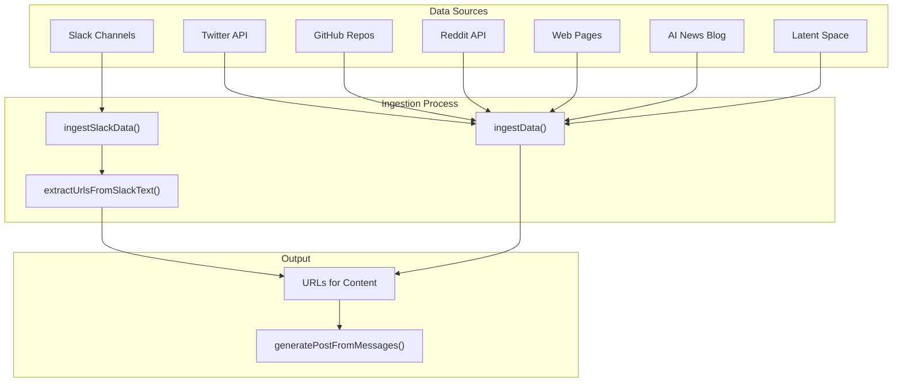
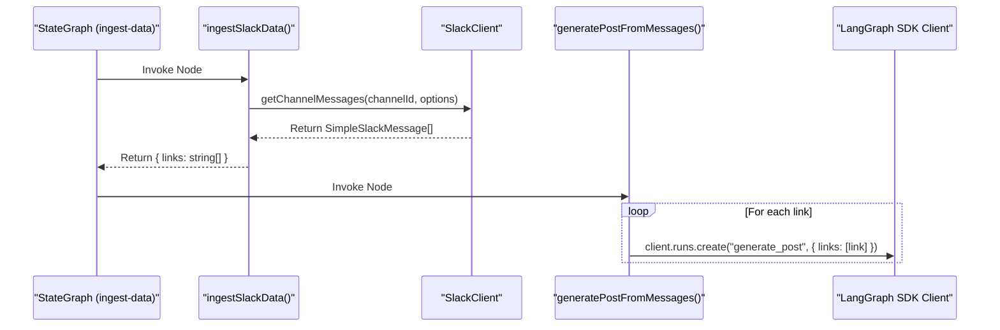
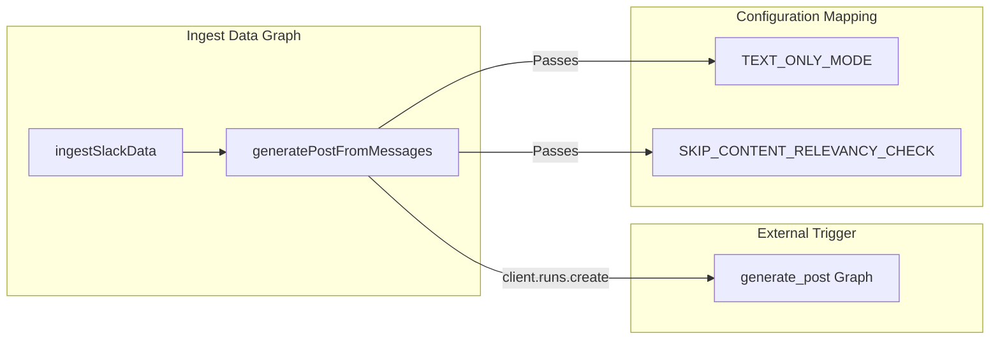

<!-- source: DeepWiki mcp.deepwiki.com · repo langchain-ai/social-media-agent · page 2.1 Data Ingestion · fetched 2026-10-26 -->

# Data Ingestion

Relevant source files

The following files were used as context for generating this wiki page:

- [scripts/get-scheduled-runs.ts](scripts/get-scheduled-runs.ts)
- [src/agents/curate-data/loaders/ai-news-blog.ts](src/agents/curate-data/loaders/ai-news-blog.ts)
- [src/agents/curate-data/loaders/github/langchain.ts](src/agents/curate-data/loaders/github/langchain.ts)
- [src/agents/curate-data/loaders/github/trending.ts](src/agents/curate-data/loaders/github/trending.ts)
- [src/agents/curate-data/loaders/latent-space.ts](src/agents/curate-data/loaders/latent-space.ts)
- [src/agents/curate-data/loaders/reddit.ts](src/agents/curate-data/loaders/reddit.ts)
- [src/agents/curate-data/loaders/twitter.ts](src/agents/curate-data/loaders/twitter.ts)
- [src/agents/curate-data/nodes/ingest-data.ts](src/agents/curate-data/nodes/ingest-data.ts)
- [src/agents/ingest-data/ingest-data-graph.ts](src/agents/ingest-data/ingest-data-graph.ts)
- [src/agents/ingest-data/ingest-data-state.ts](src/agents/ingest-data/ingest-data-state.ts)
- [src/agents/ingest-data/nodes/ingest-slack.ts](src/agents/ingest-data/nodes/ingest-slack.ts)
- [src/agents/ingest-data/nodes/ingest-twitter.ts](src/agents/ingest-data/nodes/ingest-twitter.ts)
- [src/agents/ingest-repurposed-data/nodes/ingest-slack.ts](src/agents/ingest-repurposed-data/nodes/ingest-slack.ts)
- [src/tests/slack.int.test.ts](src/tests/slack.int.test.ts)

The Data Ingestion component is responsible for collecting content from various sources to generate social media posts. It serves as the entry point for the Social Media Agent system, providing a structured way to gather information from platforms like Slack, Twitter, GitHub, Reddit, and web pages.

For information about content verification after ingestion, see [Content Verification](#2.2). For post generation using the ingested data, see [Post Generation](#2.3).

## Overview

The Social Media Agent's data ingestion system collects content from multiple sources, extracts and validates URLs, and prepares the data for the post generation process. The system is designed to avoid duplicate content and to ensure relevance to the desired topics.

Sources: [src/agents/ingest-data/ingest-data-graph.ts:64-80](), [src/agents/ingest-data/nodes/ingest-slack.ts:12-47](), [src/agents/curate-data/nodes/ingest-data.ts:17-108]()

## Ingestion Workflows

The system supports two primary ingestion workflows defined in different graphs:

1.  **Slack Data Ingestion (`ingest_data` graph)**: Extracts links from messages in a specified Slack channel [src/agents/ingest-data/ingest-data-graph.ts:64-82]().
2.  **Curated Data Ingestion (`curate_data` graph)**: Collects content from various sources including Twitter, GitHub, and Reddit [src/agents/curate-data/nodes/ingest-data.ts:17-108]().

### Slack Ingestion Process

The `ingestSlackData` node fetches messages from a specified channel using the `SlackClient`, extracts URLs, and returns them in the `links` state [src/agents/ingest-data/nodes/ingest-slack.ts:12-47](). These links are then passed to `generatePostFromMessages`, which triggers a new `generate_post` run for each link [src/agents/ingest-data/ingest-data-graph.ts:27-60]().

Sources: [src/agents/ingest-data/ingest-data-graph.ts:27-61](), [src/agents/ingest-data/nodes/ingest-slack.ts:12-47]()

### Curated Data Ingestion

The `ingestData` node in the curation workflow selects loaders based on the `sources` configuration and the `useLangChainPrompts()` feature flag [src/agents/curate-data/nodes/ingest-data.ts:36-100]().

| Source | LangChain-Specific Loader | General Loader |
| :--- | :--- | :--- |
| **Twitter** | `twitterLoaderWithLangChain` | `twitterLoader` |
| **GitHub** | `langchainDependencyReposLoader` | `githubTrendingLoader` |
| **Reddit** | `getLangChainRedditPosts` | `getRedditPosts` |
| **RSS/Web** | N/A | `aiNewsBlogLoader`, `latentSpaceLoader` |

Sources: [src/agents/curate-data/nodes/ingest-data.ts:36-100]()

## Data Sources and Loaders

### Twitter Data Loader

The system uses `TwitterClient` to interact with the X API. `twitterLoaderWithLangChain` searches for mentions of `@LangChainAI` while excluding employees to find high-signal community content [src/agents/curate-data/loaders/twitter.ts:85-118](). It persists the `lastIngestedTweetId` in the `BaseStore` to avoid duplicates [src/agents/curate-data/loaders/twitter.ts:114-116]().

Sources: [src/agents/curate-data/loaders/twitter.ts:85-124]()

### GitHub Loaders

The `langchainDependencyReposLoader` uses `Octokit` to search for repositories created or pushed within the last 30 days that mention "langchain" or "langgraph" [src/agents/curate-data/loaders/github/langchain.ts:15-32](). It specifically targets repositories with a minimum star count (e.g., >10 stars for new repos) [src/agents/curate-data/loaders/github/langchain.ts:78-80]().

Sources: [src/agents/curate-data/loaders/github/langchain.ts:15-103]()

### Reddit Loader

The Reddit loader fetches posts from subreddits like `r/LocalLLaMA` (general) or `r/LangChain` and `r/LangGraph` (LangChain-specific) [src/agents/curate-data/loaders/reddit.ts:16-69](). It also fetches the top 10 comments for each post to provide context for generation [src/agents/curate-data/loaders/reddit.ts:19-22]().

Sources: [src/agents/curate-data/loaders/reddit.ts:12-93]()

## Configuration and State

### Ingest Data State
The `IngestDataAnnotation` defines the state schema for the ingestion graph:
*   `links`: `string[]` - Collected URLs [src/agents/ingest-data/ingest-data-state.ts:19-22]().
*   `report`: `string` - Analysis of the content [src/agents/ingest-data/ingest-data-state.ts:27-30]().

### Configurable Parameters
The `IngestDataConfigurableAnnotation` allows runtime control [src/agents/ingest-data/ingest-data-state.ts:47-90]():
*   `maxMessages`: Limit for Slack ingestion (default 100) [src/agents/ingest-data/ingest-data-state.ts:48-51]().
*   `slackChannelId`: Source channel for Slack messages [src/agents/ingest-data/ingest-data-state.ts:57]().
*   `skipIngest`: If true, requires links to be provided in the initial state [src/agents/ingest-data/ingest-data-state.ts:59-63]().
*   `TEXT_ONLY_MODE`: Disables image extraction and processing [src/agents/ingest-data/ingest-data-state.ts:75-78]().

## Integration with Post Generation

The ingestion graph bridges to the generation graph by acting as a scheduler. `generatePostFromMessages` calculates staggered delays using `getAfterSecondsFromLinks` to ensure posts are not published all at once [src/agents/ingest-data/ingest-data-graph.ts:36-58]().

Sources: [src/agents/ingest-data/ingest-data-graph.ts:44-60]()

## Monitoring Scheduled Runs

The `get-scheduled-runs.ts` script allows developers to monitor ingestion results by searching for "busy" threads in the `upload_post` graph [scripts/get-scheduled-runs.ts:24-29](). It formats and sends a summary of pending posts to Slack [scripts/get-scheduled-runs.ts:73-85]().

Sources: [scripts/get-scheduled-runs.ts:18-91]()

---

