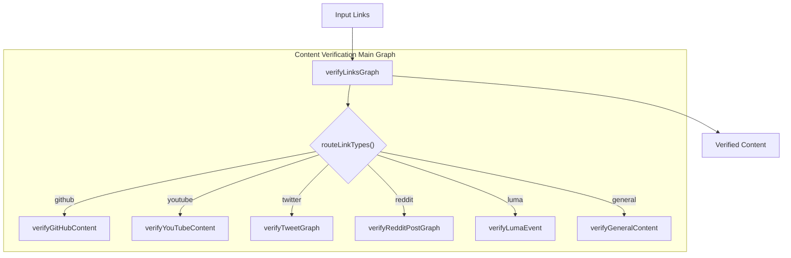
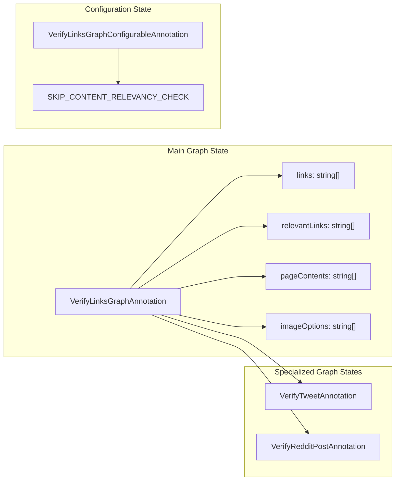
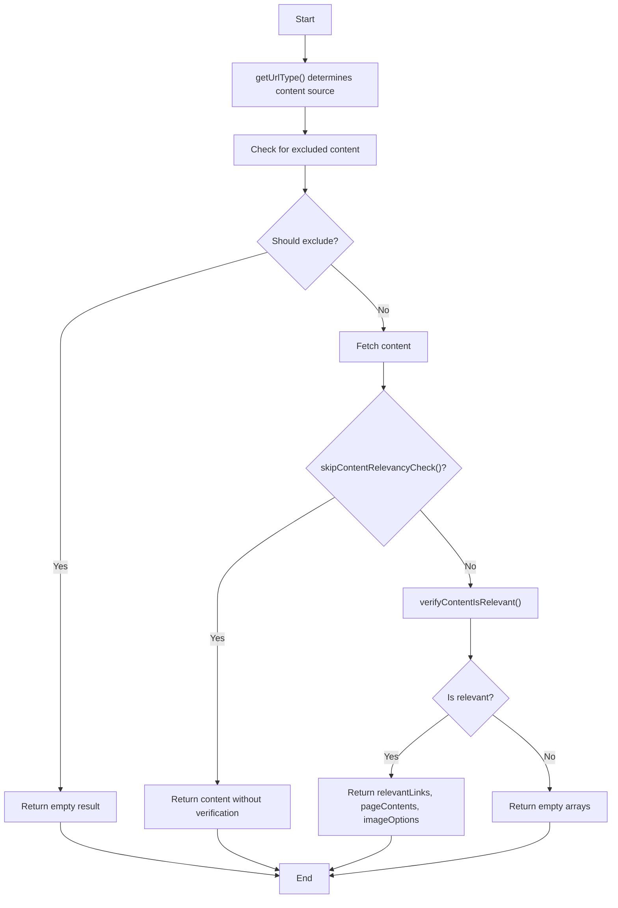
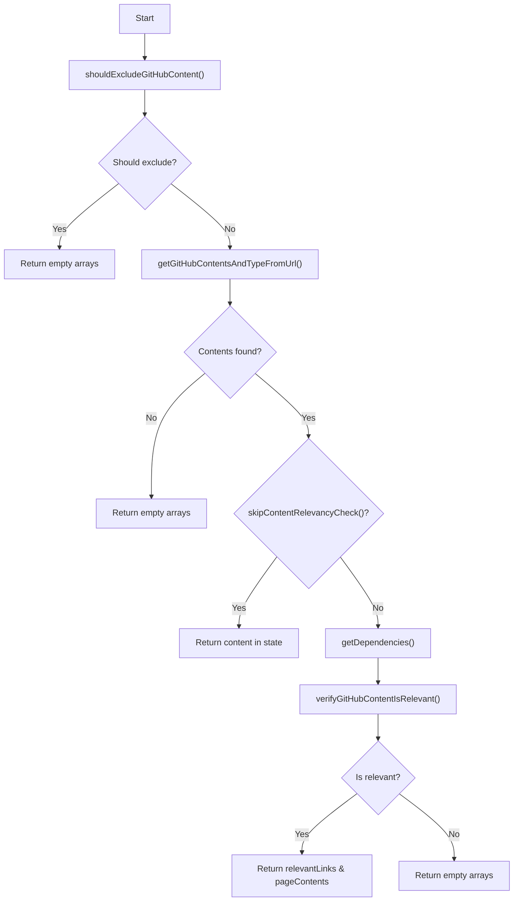
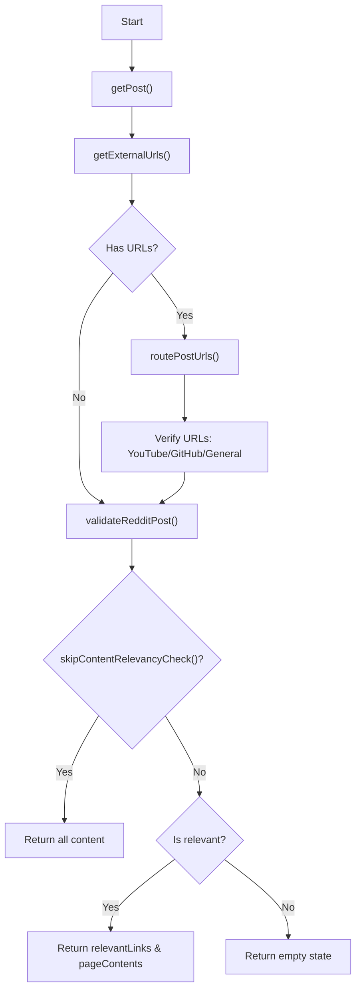
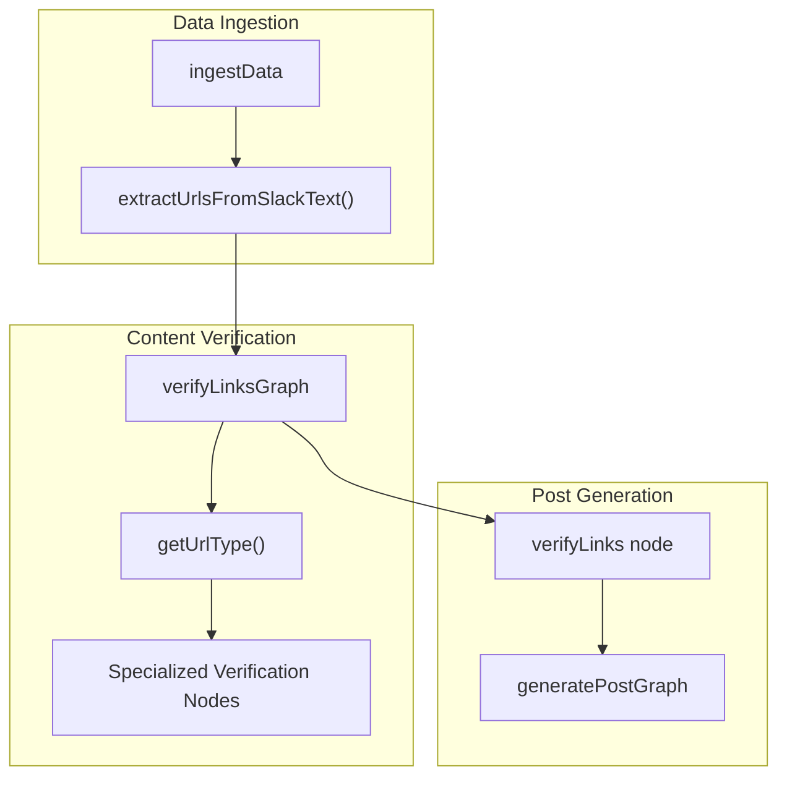

<!-- source: DeepWiki mcp.deepwiki.com · repo langchain-ai/social-media-agent · page 2.2 Content Verification · fetched 2026-10-26 -->

# Content Verification

Relevant source files

The following files were used as context for generating this wiki page:

- [src/agents/generate-post/nodes/rewrite-with-split-url.ts](src/agents/generate-post/nodes/rewrite-with-split-url.ts)
- [src/agents/ingest-repurposed-data/nodes/extract.ts](src/agents/ingest-repurposed-data/nodes/extract.ts)
- [src/agents/shared/nodes/verify-content.ts](src/agents/shared/nodes/verify-content.ts)
- [src/agents/shared/nodes/verify-general.ts](src/agents/shared/nodes/verify-general.ts)
- [src/agents/shared/nodes/verify-github.ts](src/agents/shared/nodes/verify-github.ts)
- [src/agents/shared/nodes/verify-luma.ts](src/agents/shared/nodes/verify-luma.ts)
- [src/agents/shared/nodes/verify-youtube.ts](src/agents/shared/nodes/verify-youtube.ts)
- [src/agents/verify-links/verify-links-state.test.ts](src/agents/verify-links/verify-links-state.test.ts)
- [src/agents/verify-links/verify-links-state.ts](src/agents/verify-links/verify-links-state.ts)
- [src/agents/verify-reddit-post/nodes/validate-reddit-post.ts](src/agents/verify-reddit-post/nodes/validate-reddit-post.ts)
- [src/agents/verify-reddit-post/utils.ts](src/agents/verify-reddit-post/utils.ts)
- [src/agents/verify-reddit-post/verify-reddit-post-graph.ts](src/agents/verify-reddit-post/verify-reddit-post-graph.ts)
- [src/agents/verify-reddit-post/verify-reddit-post-state.ts](src/agents/verify-reddit-post/verify-reddit-post-state.ts)
- [src/agents/verify-tweet/nodes/validate-tweet.ts](src/agents/verify-tweet/nodes/validate-tweet.ts)

Content Verification is a critical component of the Social Media Agent that sits between data ingestion and post generation. Its purpose is to validate content from various sources (Slack, Twitter, GitHub, Reddit, web pages) to ensure it's relevant to the desired context before investing resources in generating posts about it. 

For information about how data is collected for verification, see [Data Ingestion](#2.1). For details on how verified content is used to create posts, see [Post Generation](#2.3).

## System Architecture

The Content Verification system is built around a LangGraph workflow (`verifyLinksGraph`) that routes links to specialized verification nodes based on URL type. The architecture is designed for modularity, with separate verification processes for different content sources.

**Content Verification Workflow Architecture**

Sources: [src/agents/verify-links/verify-links-graph.ts:1-30]()

### State Management

Content Verification uses LangGraph annotations to track and transform state as it flows through the verification process. The `sharedLinksReducer` ensures that updates are prioritized while maintaining a unique set of URLs.

Sources: [src/agents/verify-links/verify-links-state.ts:5-60](), [src/agents/verify-reddit-post/verify-reddit-post-state.ts:9-31]()

## Verification Process

The verification system follows a standard pattern across content types:

1. Determine the URL type using `getUrlType()`.
2. Route to a specialized verification node.
3. Check if content is relevant to the business context using `verifyContentIsRelevant`.
4. Return relevant links, page contents, and optional image URLs if relevant.

**Standard Verification Flow**

Sources: [src/agents/shared/nodes/verify-content.ts:20-60](), [src/agents/utils.ts:614-632]()

### URL Type Detection

URL type detection is handled by the `getUrlType` function, which analyzes the URL structure to determine its type:

| URL Pattern | Detected Type |
|-------------|---------------|
| github.com (not github.io) | github |
| youtube.com, youtu.be | youtube |
| twitter.com, x.com | twitter |
| reddit.com, redd.it | reddit |
| lu.ma | luma |
| All others | general |

Sources: [src/agents/utils.ts:382-427]()

## Specialized Verification Processes

### Website Content Verification

General web content verification uses `FireCrawlLoader` to scrape content and `verifyContentIsRelevant` to check against the business context.

Sources: [src/agents/shared/nodes/verify-general.ts:85-122]()

### GitHub Content Verification

GitHub verification focuses on repository READMEs and dependency files (e.g., `package.json`, `requirements.txt`). It uses `getOctokit` [src/agents/shared/nodes/verify-github.ts:16-27]() to interact with the GitHub API.

Sources: [src/agents/shared/nodes/verify-github.ts:172-226]()

### YouTube Content Verification

YouTube verification analyzes video summaries extracted via `getVideoSummary`.

Sources: [src/agents/shared/nodes/verify-youtube.ts:45-75]()

### Twitter Content Verification

Twitter verification processes both tweet content and any links within tweets. It constructs a context combining the tweet text and scraped webpage content [src/agents/verify-tweet/nodes/validate-tweet.ts:35-53]().

Sources: [src/agents/verify-tweet/nodes/validate-tweet.ts:58-95]()

### Reddit Post Verification

Reddit verification uses a subgraph to process the post, comments, and any external URLs found in the post body.

Sources: [src/agents/verify-reddit-post/verify-reddit-post-graph.ts:25-89](), [src/agents/verify-reddit-post/nodes/validate-reddit-post.ts:69-101]()

## Configuration Options

### Skip Content Relevancy Check

You can bypass the content relevancy verification with the `SKIP_CONTENT_RELEVANCY_CHECK` option. This is useful for testing or when content has been pre-validated.

Sources: [src/agents/utils.ts:614-632](), [src/agents/verify-links/verify-links-state.ts:62-67]()

## Content Relevancy Verification

The heart of the verification system is the content relevancy check. Each verification node uses a specialized prompt and a structured output schema (`RELEVANCY_SCHEMA`) to determine if content is relevant to the business context.

**Verification Prompts by Content Type**

| Content Type | Prompt Variable | File Reference |
|-------------|-----------------|----------------|
| General Web | `VERIFY_COMPANY_RELEVANT_CONTENT_PROMPT` | [src/agents/shared/nodes/verify-general.ts:28-37]() |
| GitHub | `VERIFY_LANGCHAIN_RELEVANT_CONTENT_PROMPT` | [src/agents/shared/nodes/verify-github.ts:54-65]() |
| YouTube | `VERIFY_RELEVANT_CONTENT_PROMPT` | [src/agents/shared/nodes/verify-youtube.ts:15-25]() |
| Reddit | `VALIDATE_REDDIT_POST_PROMPT` | [src/agents/verify-reddit-post/nodes/validate-reddit-post.ts:9-19]() |
| Luma | `VERIFY_LUMA_RELEVANT_CONTENT_PROMPT` | [src/agents/shared/nodes/verify-luma.ts:26-36]() |

Sources: [src/agents/shared/nodes/verify-content.ts:5-18]()

## Integration with Other Components

Content Verification integrates with other system components:

Sources: [src/agents/verify-links/verify-links-state.ts:26-52](), [src/agents/shared/nodes/verify-github.ts:29-32]()

---

