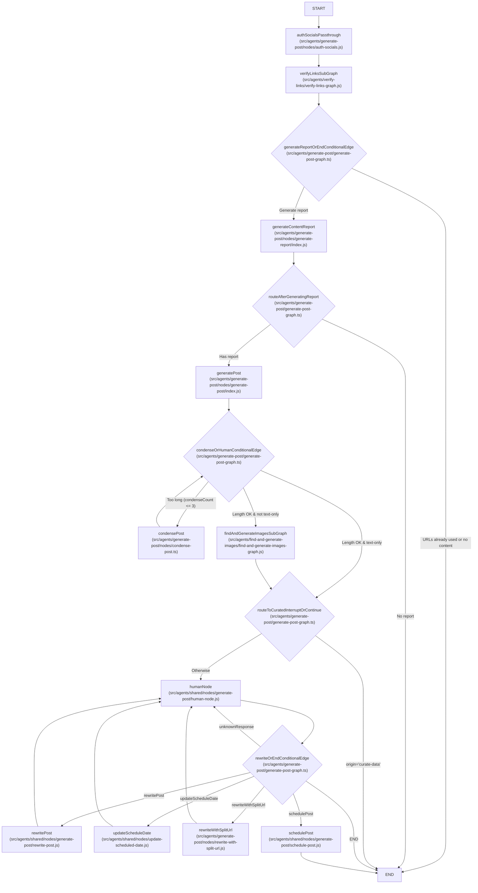
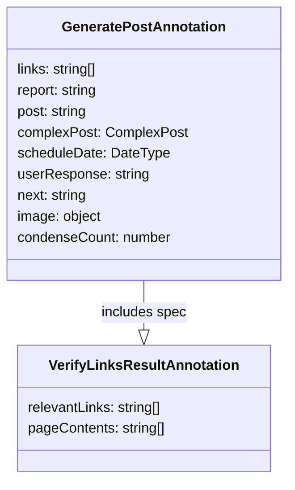

<!-- source: DeepWiki mcp.deepwiki.com · repo langchain-ai/social-media-agent · page 2.3 Post Generation · fetched 2026-10-26 -->

# Post Generation

Relevant source files

The following files were used as context for generating this wiki page:

- [src/agents/curate-data/nodes/validate-bulk-tweets.ts](src/agents/curate-data/nodes/validate-bulk-tweets.ts)
- [src/agents/generate-post/constants.ts](src/agents/generate-post/constants.ts)
- [src/agents/generate-post/generate-post-graph.ts](src/agents/generate-post/generate-post-graph.ts)
- [src/agents/generate-post/generate-post-state.ts](src/agents/generate-post/generate-post-state.ts)
- [src/agents/generate-post/nodes/condense-post.ts](src/agents/generate-post/nodes/condense-post.ts)
- [src/agents/generate-post/nodes/generate-post/index.ts](src/agents/generate-post/nodes/generate-post/index.ts)
- [src/agents/generate-post/nodes/generate-post/prompts.ts](src/agents/generate-post/nodes/generate-post/prompts.ts)
- [src/agents/generate-post/nodes/generate-report/index.ts](src/agents/generate-post/nodes/generate-report/index.ts)
- [src/agents/generate-post/nodes/generate-report/prompts.ts](src/agents/generate-post/nodes/generate-report/prompts.ts)
- [src/agents/generate-post/prompts/index.ts](src/agents/generate-post/prompts/index.ts)
- [src/agents/generate-post/prompts/prompts.langchain.ts](src/agents/generate-post/prompts/prompts.langchain.ts)
- [src/agents/generate-report/nodes/extract-key-details.ts](src/agents/generate-report/nodes/extract-key-details.ts)
- [src/agents/generate-report/nodes/generate-report.ts](src/agents/generate-report/nodes/generate-report.ts)
- [src/agents/generate-report/state.ts](src/agents/generate-report/state.ts)
- [src/agents/generate-thread/nodes/generate-thread-plan.ts](src/agents/generate-thread/nodes/generate-thread-plan.ts)
- [src/agents/should-exclude.ts](src/agents/should-exclude.ts)
- [src/agents/utils.ts](src/agents/utils.ts)
- [src/tests/utils.int.test.ts](src/tests/utils.int.test.ts)
- [src/utils/screenshot.ts](src/utils/screenshot.ts)

The Post Generation component is a critical part of the Social Media Agent system, responsible for transforming verified content from various sources into engaging social media posts. This component uses advanced language models to analyze relevant content, generate appropriate messaging, and ensure posts meet platform-specific requirements. This page details the architecture, workflow, and key components of the post generation system.

For information about how posts are uploaded to social media platforms, see **2.6 Post Scheduling and Upload**. For details on how humans review generated content, see **2.5 Human Review Process**.

## Workflow Overview

The `generate_post` graph transforms verified content into platform-ready social media posts. The graph is defined using `StateGraph` and includes specialized nodes for report generation, post creation, and iterative refinement.

### Graph Architecture (Natural Language to Code Entity Space)

Sources: [src/agents/generate-post/generate-post-graph.ts:185-246]()

## State Schema and Configuration

The `GeneratePostAnnotation` defines the state schema, while `GeneratePostConfigurableAnnotation` provides runtime configuration via `config.configurable`.

### State Entity Space

**State Fields** (from `GeneratePostAnnotation`):

| Field | Type | Purpose |
|-------|------|---------|
| `links` | `string[]` | Initial URLs to process [src/agents/generate-post/generate-post-state.ts:30-33]() |
| `report` | `string` | Marketing report used as context for the post [src/agents/generate-post/generate-post-state.ts:38]() |
| `post` | `string` | The generated social media post text [src/agents/generate-post/generate-post-state.ts:43-46]() |
| `complexPost` | `ComplexPost` | Split format with main body and reply URL [src/agents/generate-post/generate-post-state.ts:54-57]() |
| `scheduleDate` | `DateType` | Target publication time [src/agents/generate-post/generate-post-state.ts:61-63]() |
| `condenseCount` | `number` | Tracks condensation attempts to prevent loops [src/agents/generate-post/generate-post-state.ts:104-107]() |

**Configuration Options** (from `GeneratePostConfigurableAnnotation`):

| Option | Type | Default | Purpose |
|--------|------|---------|---------|
| `TEXT_ONLY_MODE` | `boolean` | `false` | Bypasses image extraction and generation [src/agents/generate-post/generate-post-state.ts:125-128]() |
| `SKIP_USED_URLS_CHECK` | `boolean` | `undefined` | Bypasses the LangGraph Store check for duplicate URLs [src/agents/generate-post/generate-post-state.ts:142]() |

Sources: [src/agents/generate-post/generate-post-state.ts:26-153]()

## Content Report Generation

Before a post is written, the system generates a content report using the `generateContentReport` node. This node extracts summaries or entire pages from the input `pageContents`.

- **Implementation**: Uses `ChatAnthropic` with `claude-sonnet-4-5` [src/agents/generate-post/nodes/generate-report/index.ts:39-42]().
- **Logic**: Formats page contents into a structured prompt wrapped in `<Content>` tags [src/agents/generate-post/nodes/generate-report/index.ts:24-27]().
- **Parsing**: Extracts the report from the model's response using the `<report>` XML tag [src/agents/generate-post/nodes/generate-report/index.ts:12-22]().

Sources: [src/agents/generate-post/nodes/generate-report/index.ts:1-58]()

## Post Creation Node

The `generatePost` node creates the actual social media content based on the report.

- **Style Inspiration**: Uses `TWEET_EXAMPLES` to maintain brand voice [src/agents/generate-post/nodes/generate-post/prompts.ts:8-10]().
- **Structure**: Follows `POST_STRUCTURE_INSTRUCTIONS`, typically consisting of a header/hook, main body (max 3 sentences), and a call to action [src/agents/generate-post/prompts/index.ts:21-37]().
- **Iterative Thinking**: The model is instructed to write thoughts in `<thinking>` tags before outputting the final post in `<post>` tags [src/agents/generate-post/nodes/generate-post/prompts.ts:25-30]().

Sources: [src/agents/generate-post/nodes/generate-post/index.ts](), [src/agents/generate-post/nodes/generate-post/prompts.ts:3-32]()

## Post Condensation Process

If a post exceeds 280 characters (excluding URLs), the `condensePost` node is triggered.

- **Length Calculation**: The system uses `removeUrls()` to strip links before measuring character count, as social platforms handle links differently [src/agents/generate-post/nodes/condense-post.ts:73]().
- **Prompting**: The `CONDENSE_POST_PROMPT` directs the model to reduce length while preserving the core structure and at least one relevant link [src/agents/generate-post/nodes/condense-post.ts:12-52]().
- **Termination**: The `condenseOrHumanConditionalEdge` limits this process to 3 attempts [src/agents/generate-post/generate-post-graph.ts:97-99]().

Sources: [src/agents/generate-post/nodes/condense-post.ts:59-111](), [src/agents/generate-post/generate-post-graph.ts:90-106]()

## Human-in-the-Loop and Refinement

The workflow incorporates a `humanNode` that creates an interrupt, allowing users to review and modify the post via the Agent Inbox.

- **Routing**: After human input, `rewriteOrEndConditionalEdge` determines the next step based on `state.next` [src/agents/generate-post/generate-post-graph.ts:71-88]().
- **Refinement Nodes**:
    - `rewritePost`: Updates the post based on natural language feedback [src/agents/shared/nodes/generate-post/rewrite-post.js]().
    - `updateScheduleDate`: Parses requested changes to the publication time [src/agents/shared/nodes/update-scheduled-date.js]().
    - `rewriteWithSplitUrl`: Formats the post into a `ComplexPost` where the URL is moved to a separate reply [src/agents/generate-post/nodes/rewrite-with-split-url.js]().

Sources: [src/agents/generate-post/generate-post-graph.ts:71-88](), [src/agents/shared/nodes/generate-post/human-node.js]()

## Prompt Management

Prompts are managed centrally to support both generic AI content and LangChain-specific branding.

- **LangChain Prompts**: When `useLangChainPrompts()` is true, the system uses `LANGCHAIN_POST_CONTENT_RULES` and `LANGCHAIN_BUSINESS_CONTEXT` [src/agents/generate-post/prompts/index.ts:90-97]().
- **Business Context**: Defines the types of content the agent should prioritize (e.g., AI Research, Agents, Multi-modal AI) [src/agents/generate-post/prompts/index.ts:60-71]().
- **Structure Instructions**: Enforces a consistent 3-section format for all generated posts [src/agents/generate-post/prompts/index.ts:21-37]().

Sources: [src/agents/generate-post/prompts/index.ts:1-107](), [src/agents/generate-post/prompts/prompts.langchain.ts:1-120]()

---

