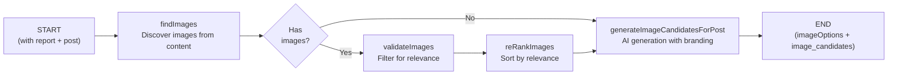
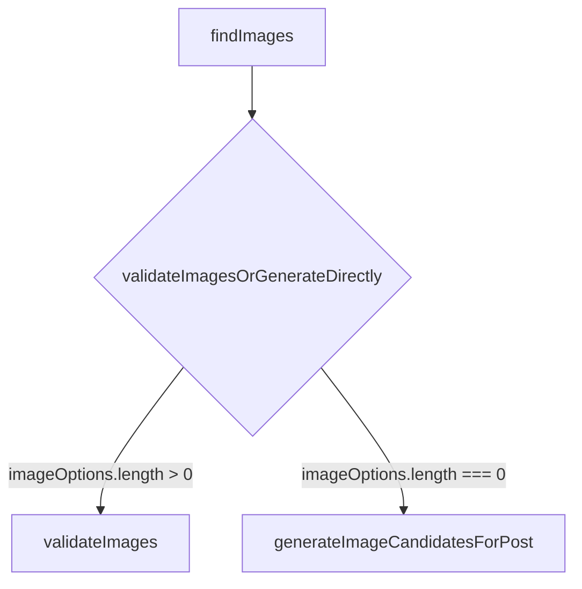
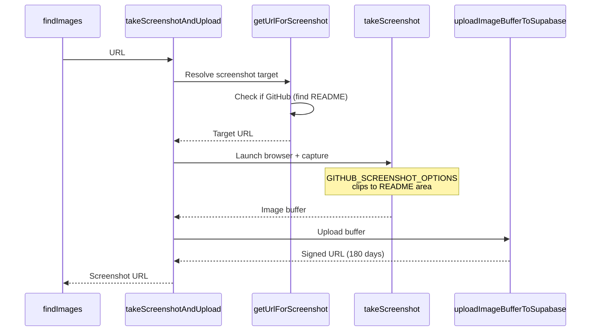
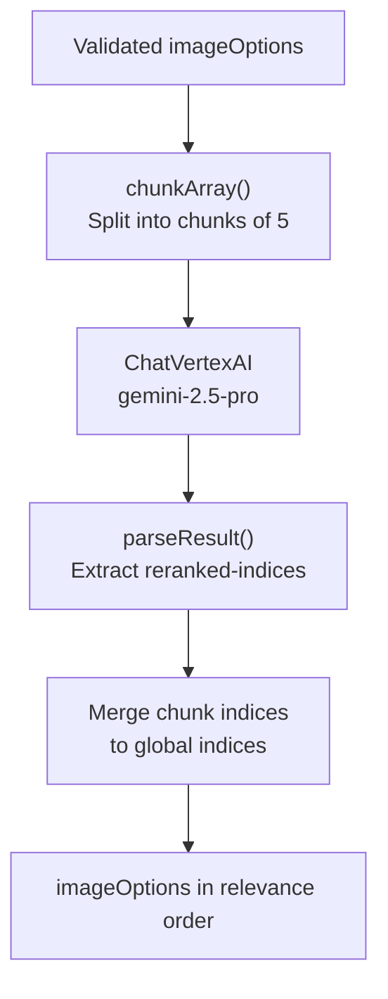
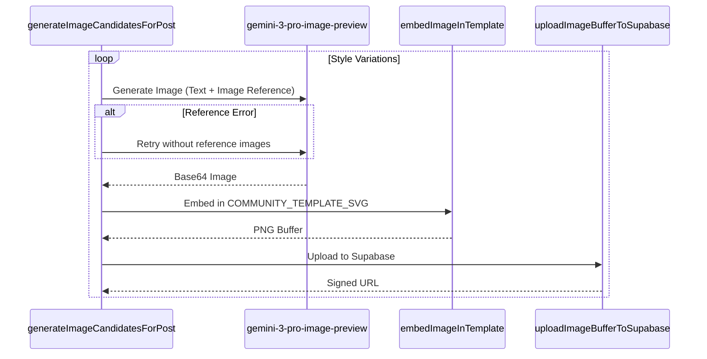

<!-- source: DeepWiki mcp.deepwiki.com · repo langchain-ai/social-media-agent · page 2.4 Image Processing · fetched 2026-10-26 -->

# Image Processing

Relevant source files

The following files were used as context for generating this wiki page:

- [src/agents/find-and-generate-images/community-template.ts](src/agents/find-and-generate-images/community-template.ts)
- [src/agents/find-and-generate-images/find-and-generate-images-graph.ts](src/agents/find-and-generate-images/find-and-generate-images-graph.ts)
- [src/agents/find-and-generate-images/helpers.ts](src/agents/find-and-generate-images/helpers.ts)
- [src/agents/find-and-generate-images/nodes/find-images.ts](src/agents/find-and-generate-images/nodes/find-images.ts)
- [src/agents/find-and-generate-images/nodes/generate-images.ts](src/agents/find-and-generate-images/nodes/generate-images.ts)
- [src/agents/find-and-generate-images/nodes/re-rank-images.ts](src/agents/find-and-generate-images/nodes/re-rank-images.ts)
- [src/agents/find-and-generate-images/nodes/validate-images.ts](src/agents/find-and-generate-images/nodes/validate-images.ts)
- [src/agents/find-and-generate-images/screenshot.ts](src/agents/find-and-generate-images/screenshot.ts)

## Purpose and Scope

This document describes the image processing pipeline implemented in the `findAndGenerateImagesSubGraph`, which discovers, validates, ranks, and generates images for social media posts. The pipeline operates as a reusable subgraph invoked during post generation to attach optimal visual content.

For information about the overall post generation workflow that invokes this subgraph, see [Post Generation](#2.3). For details on how images are uploaded to platforms, see [Post Scheduling and Upload](#2.6).

---

## Pipeline Overview

The image processing pipeline executes four sequential operations:

1. **Discovery**: Extract images from source content (README files, screenshots, reference images).
2. **Validation**: Filter images for relevance using multimodal AI analysis.
3. **Re-ranking**: Sort validated images by relevance to post content.
4. **Generation**: Create branded AI-generated images as alternatives.

### Image Processing Graph Flow

**Sources:** [src/agents/find-and-generate-images/find-and-generate-images-graph.ts:39-62]()

---

## Graph Structure and State

### State Annotation

The `FindAndGenerateImagesAnnotation` extends `VerifyLinksResultAnnotation` with image-specific fields:

| Field | Type | Purpose |
|-------|------|---------|
| `report` | `string` | Marketing report used as context for generation |
| `post` | `string` | Generated social media post text |
| `image_candidates` | `Image[]` | Array of validated images with metadata |
| `image` | `Image \| undefined` | Selected image to attach (defaults to first generated image) |
| `imageOptions` | `string[]` | URLs of available images (inherited) |
| `pageContents` | `string[]` | Markdown content for extraction (inherited) |
| `relevantLinks` | `string[]` | Source URLs for discovery (inherited) |

**Sources:** [src/agents/find-and-generate-images/find-and-generate-images-graph.ts:9-28]()

### Graph Node Routing

The graph uses a conditional edge `validateImagesOrGenerateDirectly` to skip validation when no images are found:

**Sources:** [src/agents/find-and-generate-images/find-and-generate-images-graph.ts:30-37](), [src/agents/find-and-generate-images/find-and-generate-images-graph.ts:49-52]()

---

## Image Discovery Process

### Discovery Sources

The `findImages` node aggregates images from multiple sources:

| Source | Method | Priority |
|--------|--------|----------|
| Page screenshots | Playwright automation via `takeScreenshotAndUpload()` | High |
| GitHub sub-links | Screenshots of referenced repositories | Medium |
| Existing `imageOptions` | Pre-provided URLs from upstream nodes | High |
| Markdown images | Extracted via `extractAllImageUrlsFromMarkdown()` | Low |

**Sources:** [src/agents/find-and-generate-images/nodes/find-images.ts:35-124]()

### Screenshot Capture

For non-YouTube and non-Twitter URLs, the system captures screenshots using Playwright.

### Screenshot Orchestration

**Sources:** [src/agents/find-and-generate-images/screenshot.ts:19-82](), [src/agents/find-and-generate-images/nodes/find-images.ts:49-65]()

### GitHub Image Handling

When encountering GitHub URLs, the system resolves `download_url` for raw image access using `getFileContents`. Special handling in `checkIsGitHubImageUrl` identifies GitHub-hosted assets by checking for `user-attachments/assets` or specific path patterns.

**Sources:** [src/agents/find-and-generate-images/nodes/find-images.ts:13-33](), [src/agents/find-and-generate-images/nodes/find-images.ts:83-102]()

---

## Image Validation

### Validation Strategy

The `validateImages` node uses `gemini-2.5-pro` to analyze images against post content in chunks of 10.

### Protected URLs

Certain image URLs bypass validation:
- **Supabase-hosted images**: URLs matching `process.env.SUPABASE_URL`.
- **YouTube thumbnails**: URLs starting with `https://i.ytimg.com/`.

**Sources:** [src/agents/find-and-generate-images/nodes/validate-images.ts:59-77]()

### Validation Logic

The AI receives the post, the report, and image chunks. It returns a list of relevant indices. If validation fails for a chunk, the system defaults to including all images from that chunk to prevent loss of potential content.

**Sources:** [src/agents/find-and-generate-images/nodes/validate-images.ts:6-43](), [src/agents/find-and-generate-images/nodes/validate-images.ts:154-200]()

---

## Image Re-ranking

### Re-ranking Logic

The `reRankImages` node sorts validated images by relevance. If fewer than 2 images exist, it returns early.

### Re-ranking Data Flow

**Sources:** [src/agents/find-and-generate-images/nodes/re-rank-images.ts:60-164]()

---

## AI Image Generation

### Generation Model

The `generateImageCandidatesForPost` node uses `gemini-3-pro-image-preview` to create branded images.

### Style Variations

The system cycles through 7 predefined color schemes (e.g., `Violet 100` background with `Orange` accents or `Blue 500` with `Green` accents) to ensure visual diversity.

**Sources:** [src/agents/find-and-generate-images/nodes/generate-images.ts:290-298]()

### Brand Guidelines

The `GENERATE_IMAGE_PROMPT_TEMPLATE` enforces strict constraints:
- **Flat 2D Only**: Strictly forbids 3D shapes, drop shadows, and gradients on shapes.
- **No Parenthetical Labels**: Forbids labels like `(AI)` or `(Code)`.
- **No Logo Imagery**: Explicitly forbids the LangChain pinwheel or parrot logos.
- **No All Caps**: Requires sentence case or title case for all text.

**Sources:** [src/agents/find-and-generate-images/nodes/generate-images.ts:16-118]()

### Generation Process Flow

**Sources:** [src/agents/find-and-generate-images/nodes/generate-images.ts:426-496]()

---

## Brand Template System

### Template Structure

The `COMMUNITY_TEMPLATE_SVG` provides a consistent frame for generated content. It is a 3000x3000px SVG with a violet background and "LangChain Community" branding.

**Sources:** [src/agents/find-and-generate-images/community-template.ts:1-33]()

### Template Embedding

The `embedImageInTemplate` function uses `sharp` to composite the generated image into the SVG. It replaces a placeholder image URL, updates dimensions to 16:9 (1376x768), and applies a transformation matrix to scale the image.

**Sources:** [src/agents/find-and-generate-images/helpers.ts:15-51]()

### Supabase Storage

The `uploadImageBufferToSupabase` function:
1. Detects MIME type using `fileTypeFromBuffer`.
2. Generates a unique filename with a random suffix.
3. Uploads to the `images` bucket.
4. Returns a signed URL valid for 180 days.

**Sources:** [src/agents/find-and-generate-images/helpers.ts:59-101]()

---

## Error Handling and Retries

- **Generation Retries**: Uses `retryWithTimeout` with a 120s timeout and 3 attempts for image generation.
- **Fallback Logic**: If generation with reference images fails (common with strict safety filters), it retries with a text-only prompt.
- **Validation Failures**: If the validation model fails to return valid indices, the system defaults to keeping all images to ensure the user has options.

**Sources:** [src/agents/find-and-generate-images/nodes/generate-images.ts:390-415](), [src/agents/find-and-generate-images/nodes/validate-images.ts:183-197]()

---

