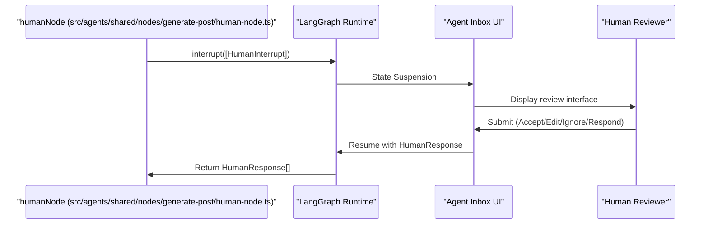
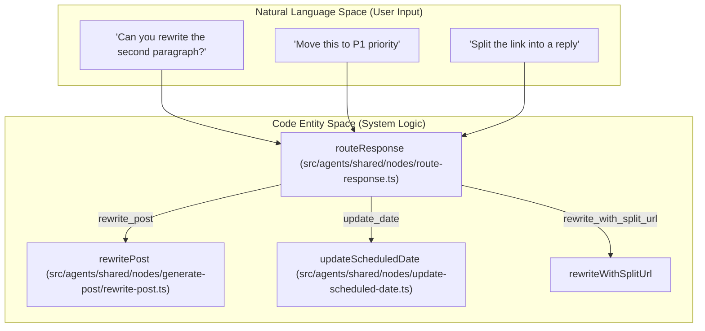
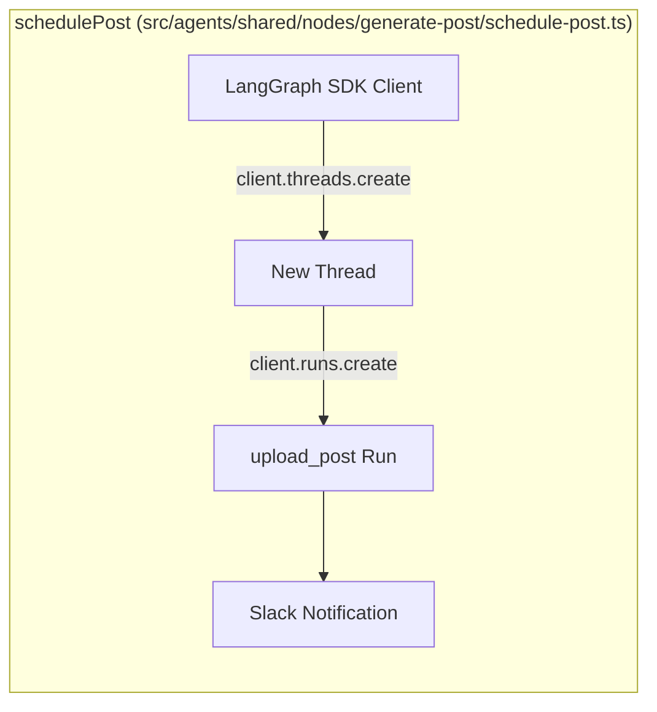

<!-- source: DeepWiki mcp.deepwiki.com · repo langchain-ai/social-media-agent · page 2.5 Human Review Process · fetched 2026-10-26 -->

# Human Review Process

<details>
<summary>Relevant source files</summary>

The following files were used as context for generating this wiki page:

- [src/agents/curated-post-interrupt/index.ts](src/agents/curated-post-interrupt/index.ts)
- [src/agents/curated-post-interrupt/types.ts](src/agents/curated-post-interrupt/types.ts)
- [src/agents/generate-thread/nodes/generate-thread-posts.ts](src/agents/generate-thread/nodes/generate-thread-posts.ts)
- [src/agents/generate-thread/nodes/rewrite-thread.ts](src/agents/generate-thread/nodes/rewrite-thread.ts)
- [src/agents/shared/nodes/generate-post/human-node.ts](src/agents/shared/nodes/generate-post/human-node.ts)
- [src/agents/shared/nodes/generate-post/rewrite-post.ts](src/agents/shared/nodes/generate-post/rewrite-post.ts)
- [src/agents/shared/nodes/generate-post/schedule-post.ts](src/agents/shared/nodes/generate-post/schedule-post.ts)
- [src/agents/shared/nodes/generate-post/types.ts](src/agents/shared/nodes/generate-post/types.ts)
- [src/agents/shared/nodes/route-response.ts](src/agents/shared/nodes/route-response.ts)
- [src/agents/shared/nodes/update-scheduled-date.ts](src/agents/shared/nodes/update-scheduled-date.ts)

</details>


This document describes the human-in-the-loop review process that allows users to review, modify, and schedule social media posts generated by the system. The human review process is a critical component that ensures quality control while still providing significant efficiency gains in social media content creation.

For information about post generation before the human review stage, see [Post Generation](2.3). For details on what happens after approval, see [Post Scheduling and Upload](2.6).

## Overview

The human review process occurs after the system has generated a social media post based on analyzed content. It presents the generated post, related content information, and available options to a human reviewer who can then approve, reject, edit, or request changes to the post before scheduling it for publication.

### Human-in-the-Loop Workflow

The primary orchestration for this process is found in the `curatedPostInterruptGraph`, which manages the transitions between human interaction and automated refinement.

```mermaid
flowchart TD
    subgraph "Curated Post Interrupt Graph"
        [START] --> HN["humanNode"]
        HN --> COND{"rewriteOrEndConditionalEdge"}
        
        COND -->|"schedulePost"| SP["schedulePost"]
        COND -->|"rewritePost"| RP["rewritePost"]
        COND -->|"updateScheduleDate"| USD["updateScheduledDate"]
        COND -->|"humanNode"| HN
        COND -->|"END"| E["END"]
        
        RP --> HN
        USD --> HN
        SP --> E
    end
```

Sources: [src/agents/curated-post-interrupt/index.ts:32-68](), [src/agents/shared/nodes/generate-post/human-node.ts:111-177]()

## Interrupt Mechanism

The human review process utilizes LangGraph's `interrupt` function to pause execution and await human input. When the workflow reaches the `humanNode`, it creates an interrupt that displays the post content and awaits a response through the Agent Inbox interface.



Sources: [src/agents/shared/nodes/generate-post/human-node.ts:145-177]()

## Interrupt Content Structure

The `HumanInterrupt` object constructed in `humanNode` contains comprehensive information to help make an informed decision:

| Content Element | Description | Code Reference |
|-----------------|-------------|----------------|
| **Post** | The generated social media post text (or `complexPost` with main/reply) | [src/agents/shared/nodes/generate-post/human-node.ts:136-143]() |
| **Report** | A marketing report about the content used as context | [src/agents/shared/nodes/generate-post/human-node.ts:162]() |
| **Relevant URLs** | Original and extracted links used for generation | [src/agents/shared/nodes/generate-post/human-node.ts:163-164]() |
| **Image Options** | Available images and instructions for modification | [src/agents/shared/nodes/generate-post/human-node.ts:34-54]() |
| **Schedule Date** | The proposed date/time or priority level (P1, P2, P3) | [src/agents/shared/nodes/generate-post/human-node.ts:121-134]() |

Sources: [src/agents/shared/nodes/generate-post/human-node.ts:24-96](), [src/agents/shared/nodes/generate-post/human-node.ts:145-170]()

## Response Types and Handling

The `humanNode` processes the `HumanResponse` array returned by the interrupt. It supports four primary response types:

### 1. Accept
The `accept` action triggers immediate scheduling of the post as currently configured.
*   **Action**: Sets `next` to `"schedulePost"`.
*   **Source**: [src/agents/shared/nodes/generate-post/human-node.ts:224-227]()

### 2. Ignore
The `ignore` action terminates the workflow without scheduling.
*   **Action**: Returns `{ next: END }`.
*   **Source**: [src/agents/shared/nodes/generate-post/human-node.ts:184-188]()

### 3. Edit
Allows direct manual modification of the state via the UI.
*   **Action**: Parses `response.args` to update `post`, `complexPost`, `scheduleDate`, and `image`.
*   **Logic**: Validates the date using `parseDateResponse` and image using `processImageInput`.
*   **Source**: [src/agents/shared/nodes/generate-post/human-node.ts:229-290]()

### 4. Response (Natural Language)
The reviewer provides feedback (e.g., "Make it shorter" or "Schedule for Monday").
*   **Action**: Calls `routeResponse` to classify intent.
*   **Source**: [src/agents/shared/nodes/generate-post/human-node.ts:195-222]()

## Natural Language Space to Code Entity Space

The system bridges human natural language feedback to specific graph nodes using an LLM-based router.



Sources: [src/agents/shared/nodes/route-response.ts:4-30](), [src/agents/shared/nodes/route-response.ts:98-105]()

## Refinement Nodes

### rewritePost
This node uses `claude-sonnet-4-5` to modify the post based on `state.userResponse`.
*   **Reflections**: It incorporates previous learning via `getReflectionsPrompt`.
*   **Learning**: It triggers a background `reflection` run by calling `runReflections` with the `originalPost`, `newPost`, and `userResponse`.
*   **Source**: [src/agents/shared/nodes/generate-post/rewrite-post.ts:52-101]()

### updateScheduledDate
Extracts structured timing data from natural language.
*   **Priority Levels**: Maps "P1", "P2", "P3" to specific time windows (e.g., P1 is weekend 8-10 AM PST).
*   **Extraction**: Converts relative dates (e.g., "next Tuesday") to `'MM/dd/yyyy hh:mm a z'` format.
*   **Source**: [src/agents/shared/nodes/update-scheduled-date.ts:7-30](), [src/agents/shared/nodes/update-scheduled-date.ts:40-85]()

## Post Scheduling Integration

Once a post is accepted or edited, the `schedulePost` node creates a new LangGraph run for the `upload_post` graph.



*   **Delayed Execution**: If a `scheduleDate` is present, it calculates `afterSeconds` using `getScheduledDateSeconds` to delay the `upload_post` run.
*   **Slack Feedback**: Sends a confirmation message to Slack containing the Run ID, Thread ID, and the scheduled time.
*   **Source**: [src/agents/shared/nodes/generate-post/schedule-post.ts:81-147]()

## State Management

The process relies on the `BaseGeneratePostState` (and its specialized version `CuratedPostInterruptState`) to maintain context across interrupts.

| State Property | Type | Role |
|----------------|------|------|
| `post` | `string` | The current text of the post. |
| `complexPost` | `ComplexPost` | Holds `main_post` and `reply_post` if split. |
| `scheduleDate` | `DateType` | Either a specific ISO string or a priority (p1/p2/p3). |
| `userResponse` | `string` | The raw text from the user's last "Respond" action. |
| `next` | `string` | Controls the conditional routing after an interrupt. |

Sources: [src/agents/shared/nodes/generate-post/types.ts:17-63](), [src/agents/curated-post-interrupt/types.ts:11-72]()

## URL Tracking and Duplication Prevention

To ensure the agent doesn't process the same content twice, the `humanNode` calls `saveUsedUrls` before the interrupt occurs. This persists all links associated with the current generation (from `state.links` and `state.relevantLinks`) into the `Post Subject URLs Store`.

Sources: [src/agents/shared/nodes/generate-post/human-node.ts:173](), [src/agents/shared/stores/post-subject-urls.ts:10]()

---

