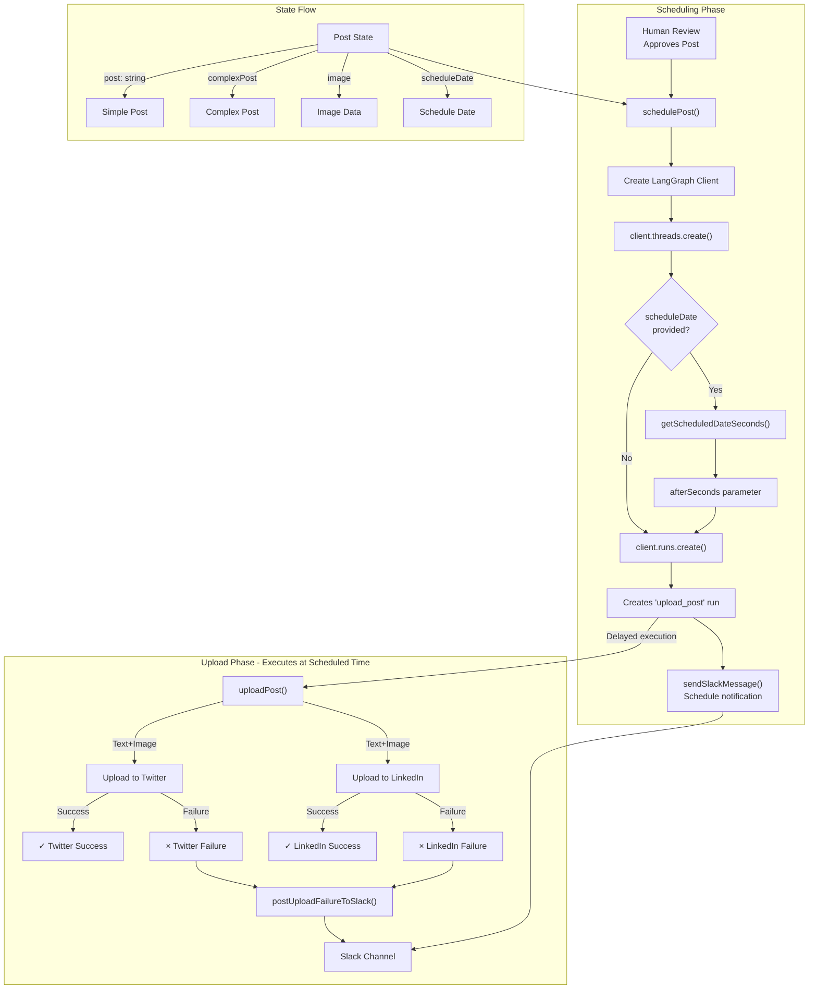
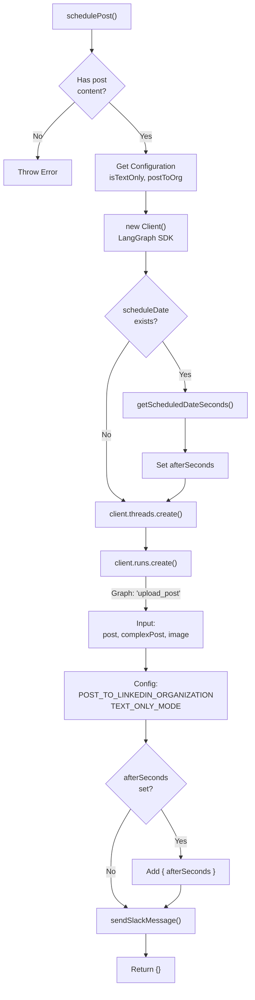
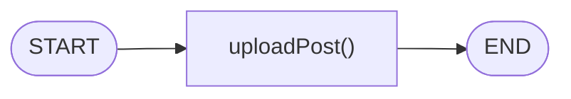
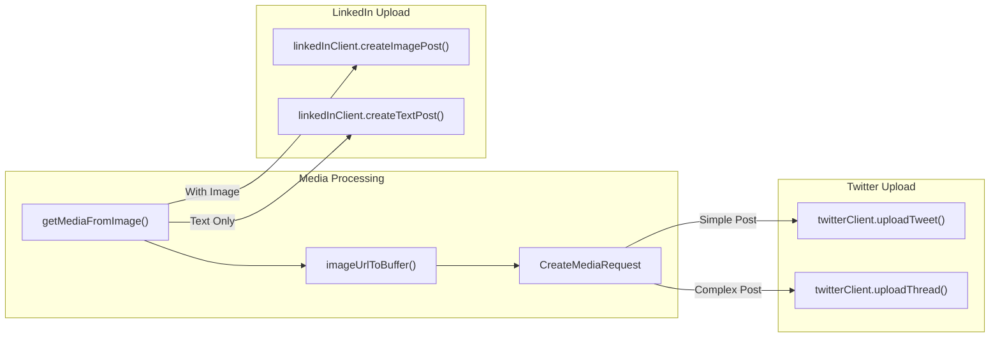
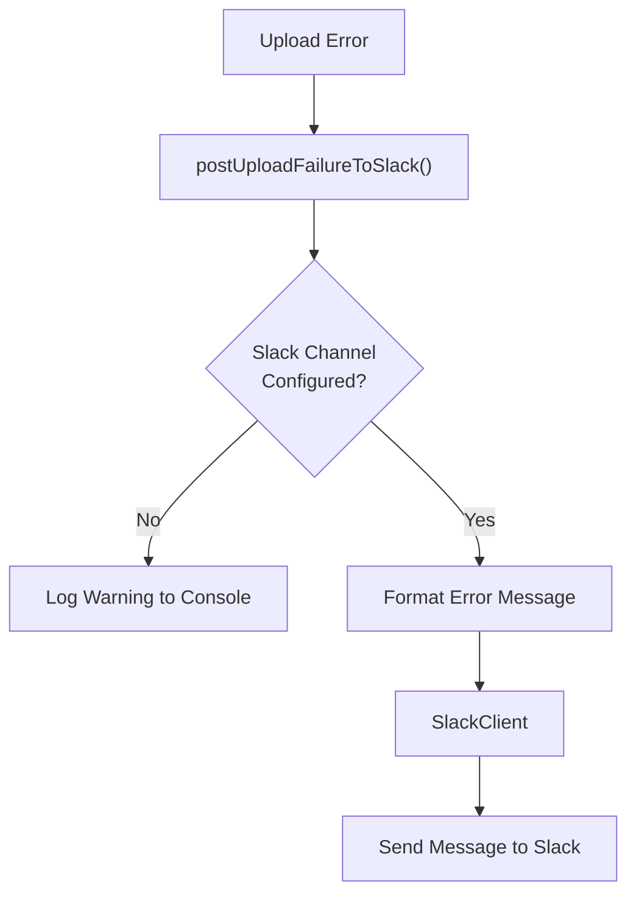

<!-- source: DeepWiki mcp.deepwiki.com · repo langchain-ai/social-media-agent · page 2.6 Post Scheduling and Upload · fetched 2026-10-26 -->

# Post Scheduling and Upload

<details>
<summary>Relevant source files</summary>

The following files were used as context for generating this wiki page:

- [src/agents/shared/nodes/generate-post/human-node.ts](src/agents/shared/nodes/generate-post/human-node.ts)
- [src/agents/shared/nodes/generate-post/rewrite-post.ts](src/agents/shared/nodes/generate-post/rewrite-post.ts)
- [src/agents/shared/nodes/generate-post/schedule-post.ts](src/agents/shared/nodes/generate-post/schedule-post.ts)
- [src/agents/upload-post/index.ts](src/agents/upload-post/index.ts)
- [src/agents/verify-tweet/nodes/get-tweet-content.ts](src/agents/verify-tweet/nodes/get-tweet-content.ts)
- [src/clients/twitter/client.ts](src/clients/twitter/client.ts)
- [src/clients/twitter/types.ts](src/clients/twitter/types.ts)
- [src/utils/schedule-date/constants.ts](src/utils/schedule-date/constants.ts)
- [src/utils/schedule-date/helpers.ts](src/utils/schedule-date/helpers.ts)
- [src/utils/schedule-date/index.ts](src/utils/schedule-date/index.ts)
- [src/utils/schedule-date/tests/schedule-date.test.ts](src/utils/schedule-date/tests/schedule-date.test.ts)
- [src/utils/schedule-date/types.ts](src/utils/schedule-date/types.ts)

</details>


This document describes the Post Scheduling and Upload system, which handles the final stages of the social media agent's workflow: scheduling approved content for future publication and executing the actual upload to social media platforms. The system consists of two main components: the scheduling mechanism that creates delayed execution runs, and the upload process that authenticates with and publishes to Twitter and LinkedIn.

For information about how posts are generated and processed before reaching this stage, see [Post Generation](2.3) and [Human Review Process](2.5).

## Overview

The Post Scheduling and Upload system operates in two distinct phases:

1.  **Scheduling Phase** (`schedulePost`): After human approval, creates a new LangGraph thread and run for the `upload_post` graph with optional delayed execution using the `afterSeconds` parameter. Sends Slack notifications about scheduled posts.
2.  **Upload Phase** (`uploadPost`): Executes at the scheduled time, authenticating with social media platforms and publishing content to Twitter and LinkedIn. Supports text-only posts, posts with images, and complex posts split into multiple parts.

The system integrates with the LangGraph SDK to manage scheduled execution and provides comprehensive error handling with Slack notifications for failures.

**Complete Scheduling and Upload Flow**



Sources: [src/agents/shared/nodes/generate-post/schedule-post.ts:81-147](), [src/agents/upload-post/index.ts:236-281]()

## Post Scheduling System

The scheduling system enables delayed execution of post uploads, allowing posts to be published at optimal times. This is implemented through the `schedulePost` function, which creates scheduled LangGraph runs.

### Scheduling Process

**Scheduling Workflow**



Sources: [src/agents/shared/nodes/generate-post/schedule-post.ts:81-147]()

### Schedule Date Calculation

The system calculates the delay in seconds from the current time to the scheduled date. Priority levels (P1, P2, P3) are converted to specific time slots in the future using the LangGraph Store to track "taken" dates.

| Helper Function | Purpose |
| :--- | :--- |
| `getScheduledDateSeconds()` | Converts a priority (P1-P3) or date string to seconds delay from now. |
| `getTakenScheduleDates()` | Retrieves already scheduled dates from the `taken_schedule_dates` store namespace. |
| `putTakenScheduleDates()` | Updates the store with a newly reserved date. |
| `getNextAvailableDate()` | Logic to find the next valid UTC hour for a specific priority level. |

Sources: [src/utils/schedule-date/index.ts:67-116](), [src/utils/schedule-date/index.ts:133-221](), [src/agents/shared/nodes/generate-post/schedule-post.ts:96-102]()

### LangGraph Run Creation

The scheduling system uses the LangGraph SDK to create delayed execution runs:

```typescript
const run = await client.runs.create(thread.thread_id, "upload_post", {
  input: {
    post: state.post,
    complexPost: state.complexPost,
    image: state.image,
  },
  config: {
    configurable: {
      [POST_TO_LINKEDIN_ORGANIZATION]: postToLinkedInOrg,
      [TEXT_ONLY_MODE]: isTextOnlyMode,
    },
  },
  ...(afterSeconds ? { afterSeconds } : {}),
});
```

Key parameters:
*   `thread.thread_id`: New thread created for the upload execution [src/agents/shared/nodes/generate-post/schedule-post.ts:107-108]().
*   `"upload_post"`: The graph to execute [src/agents/shared/nodes/generate-post/schedule-post.ts:109]().
*   `input`: Post content, complex post structure, and image data [src/agents/shared/nodes/generate-post/schedule-post.ts:110-114]().
*   `config.configurable`: Configuration flags for the upload process [src/agents/shared/nodes/generate-post/schedule-post.ts:115-120]().
*   `afterSeconds`: Delay in seconds before execution (optional) [src/agents/shared/nodes/generate-post/schedule-post.ts:121]().

Sources: [src/agents/shared/nodes/generate-post/schedule-post.ts:106-123]()

### Slack Notifications

The scheduling system sends Slack notifications when a post is scheduled via `sendSlackMessage`.

**Notification Contents:**
*   Scheduled execution time (calculated from `afterSeconds`).
*   Run ID and Thread ID for tracking.
*   Post content (simple or complex format).
*   Image information (if not in text-only mode).

Sources: [src/agents/shared/nodes/generate-post/schedule-post.ts:31-79]()

## Post Upload System

The upload system executes at the scheduled time, handling authentication and publishing to social media platforms.

### Upload Post Graph

The upload process is orchestrated by a LangGraph workflow called `uploadPostGraph`.



Sources: [src/agents/upload-post/index.ts:333-342]()

### Upload Post Function

The `uploadPost` function is the core logic that executes the publishing. It supports cross-platform retweeting and resharing from main accounts after the initial post is successful.

**Retweet and Reshare Logic**
*   `retweetFromMainAccount`: Uses `TWITTER_MAIN_USER_TOKEN` to retweet the new post from a primary brand account [src/agents/upload-post/index.ts:60-90]().
*   `reshareFromMainLinkedInAccount`: Uses `LINKEDIN_MAIN_ACCESS_TOKEN` to reshare the post to a main organization page [src/agents/upload-post/index.ts:92-141]().

Sources: [src/agents/upload-post/index.ts:60-141]()

## Authentication Methods

The system supports two authentication modes for both Twitter and LinkedIn.

### Basic Authentication

Basic authentication uses direct API credentials from environment variables.
*   **Twitter**: Requires `TWITTER_USER_TOKEN`, `TWITTER_USER_TOKEN_SECRET`, `TWITTER_API_KEY`, and `TWITTER_API_KEY_SECRET` [src/clients/twitter/client.ts:153-187]().
*   **LinkedIn**: Requires `LINKEDIN_ACCESS_TOKEN` and `LINKEDIN_PERSON_URN` or `LINKEDIN_ORGANIZATION_ID` [src/agents/upload-post/index.ts:17-28]().

### Arcade Authentication

Arcade authentication uses OAuth flow through Arcade's service.
*   **Twitter**: Requires `ARCADE_API_KEY` and `TWITTER_USER_ID` [src/clients/twitter/client.ts:198-228]().
*   **LinkedIn**: Managed through the `LinkedInClient` using Arcade's auth status [src/agents/upload-post/index.ts:270-276]().

Sources: [src/clients/twitter/client.ts:45-60](), [src/agents/upload-post/index.ts:247-253]()

## Post Types and Media Handling

The system supports different types of post content:

### Simple Text Posts
Basic posts containing only text, uploaded as single tweets on Twitter and text posts on LinkedIn.

### Complex Posts (Split Posts)
Posts where the content is split into a `main_post` and a `reply_post`. These are uploaded as tweet threads on Twitter using `twitterClient.uploadThread` [src/agents/upload-post/index.ts:258-262]().

### Posts with Images
The system handles media processing via `getMediaFromImage`, which uses `imageUrlToBuffer` to fetch and convert images for upload [src/agents/upload-post/index.ts:33-43]().



Sources: [src/agents/upload-post/index.ts:33-43](), [src/agents/upload-post/index.ts:245-281]()

## Error Handling

When post uploads fail, the system captures errors and sends detailed notifications to a configured Slack channel via `postUploadFailureToSlack`.



The error notification includes the Thread ID and the full post content to facilitate manual recovery [src/agents/upload-post/index.ts:202-233]().

Sources: [src/agents/upload-post/index.ts:187-234]()

## Technical Implementation Details

### State Schema

The Upload Post system defines its state using Annotations:

| Property | Type | Description |
| :--- | :--- | :--- |
| `post` | `string` | The primary text of the post. |
| `complexPost` | `ComplexPost` | Optional structure for multi-part posts (main and reply). |
| `image` | `object` | Optional `imageUrl` and `mimeType`. |

Sources: [src/agents/upload-post/index.ts:143-160]()

### Signature Enforcement
The system includes an `ensureSignature` utility to enforce the "LangChain Community Spotlight:" prefix on posts, ensuring brand consistency [src/agents/upload-post/index.ts:45-58]().

### Configuration Constants
The system relies on several constants for platform-specific IDs and feature flags:
*   `POST_TO_LINKEDIN_ORGANIZATION` [src/agents/upload-post/index.ts:163]()
*   `TEXT_ONLY_MODE` [src/agents/upload-post/index.ts:170]()
*   `TWITTER_MAIN_USER_TOKEN` [src/agents/upload-post/index.ts:24]()

Sources: [src/agents/upload-post/index.ts:18-31]()

---

