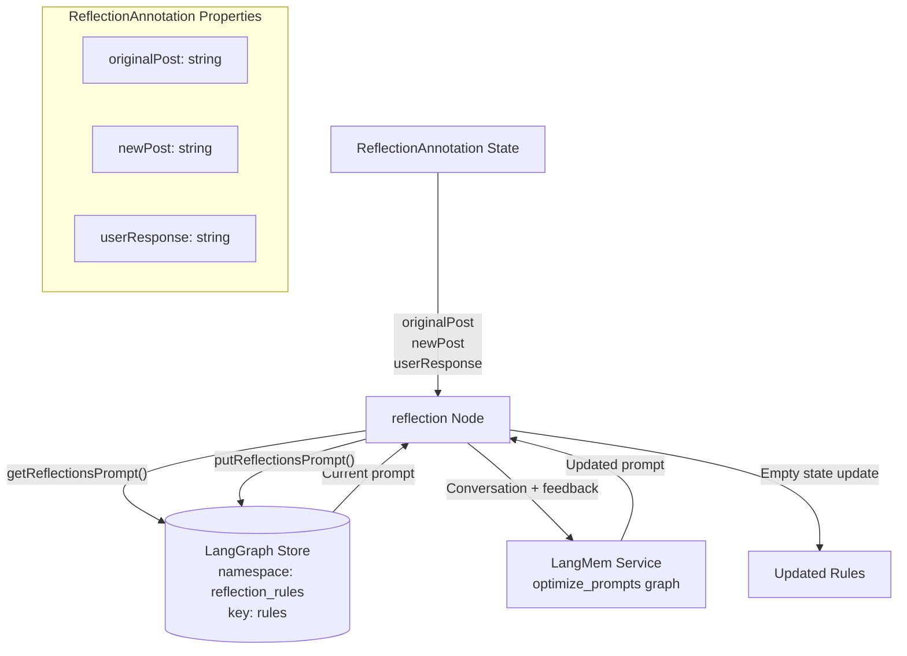
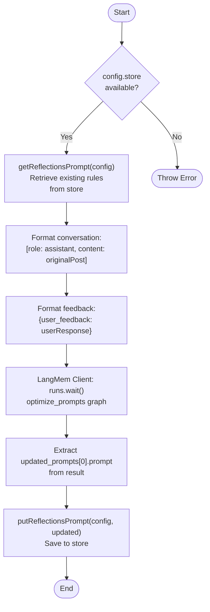
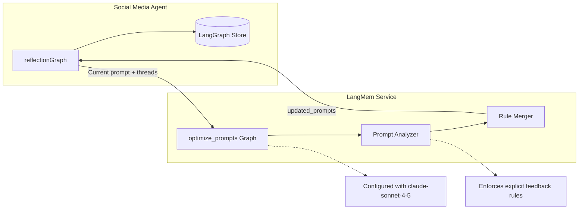
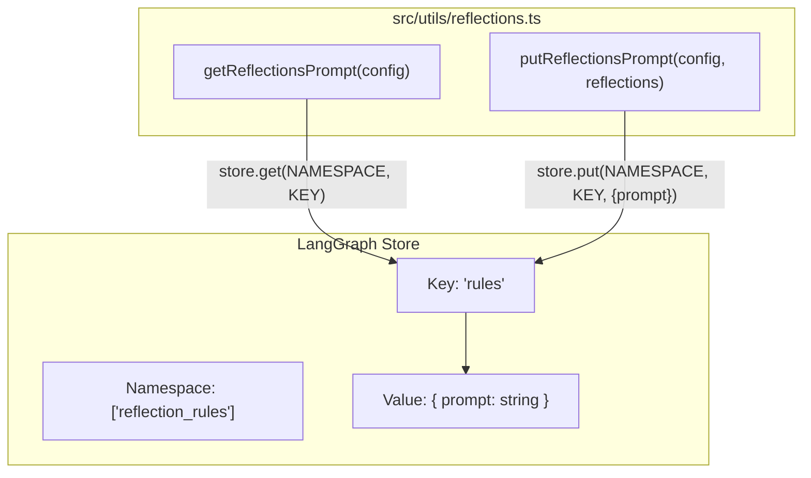
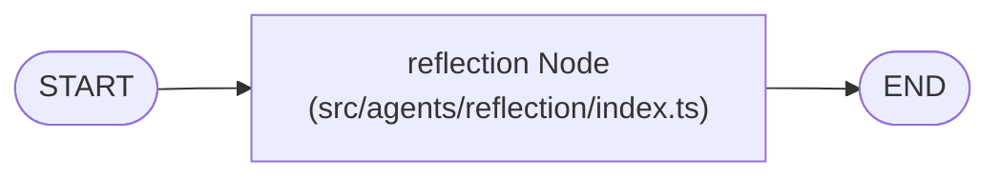

<!-- source: DeepWiki mcp.deepwiki.com · repo langchain-ai/social-media-agent · page 2.7 Reflection and Learning · fetched 2026-10-26 -->

# Reflection and Learning

<details>
<summary>Relevant source files</summary>

The following files were used as context for generating this wiki page:

- [langgraph.json](langgraph.json)
- [src/agents/reflection/index.ts](src/agents/reflection/index.ts)
- [src/agents/reflection/prompts.ts](src/agents/reflection/prompts.ts)
- [src/utils/reflections.ts](src/utils/reflections.ts)

</details>


This document describes the reflection system that enables the social media agent to learn from user feedback and improve future post generation. When users edit posts during human-in-the-loop review, the system analyzes these changes to extract generalizable rules that can be automatically applied to subsequent posts.

For information about the human review process that triggers reflection, see [Human Review Process](#2.5). For details on how reflection rules are applied during post generation, see [Post Generation](#2.3).

---

## Overview

The reflection system implements a continuous learning mechanism that captures user preferences and editorial patterns from post modifications. Rather than treating each human edit as a one-time correction, the system identifies patterns in feedback and codifies them into persistent rules.

The reflection workflow is defined in [src/agents/reflection/index.ts:98-104]() as a standalone LangGraph that can be invoked after user edits. It leverages LangMem, a specialized service for prompt optimization, to analyze the difference between original and edited posts alongside user feedback, then updates a stored prompt that guides future generations.

**Core Capabilities:**
- Extract generalizable rules from specific feedback
- Update rule prompts without overwriting unrelated rules
- Persist learned rules across sessions using LangGraph Store
- Prevent rule bloat by merging similar or conflicting rules

**Key Files:**
- Graph definition: [src/agents/reflection/index.ts]()
- Storage utilities: [src/utils/reflections.ts]()
- Legacy prompts: [src/agents/reflection/prompts.ts]() (deprecated in favor of LangMem)

Sources: [src/agents/reflection/index.ts:1-105](), [src/utils/reflections.ts:1-137](), [src/agents/reflection/prompts.ts:1-82]()

---

## Reflection State and Data Flow

The reflection graph operates on a simple state structure defined by `ReflectionAnnotation` that captures the before/after comparison needed for learning.


**Diagram: Reflection State Flow and External Dependencies**

The state annotation consists of three string fields defined in [src/agents/reflection/index.ts:14-28]():

| Field | Type | Description |
|-------|------|-------------|
| `originalPost` | `string` | The AI-generated post before user modifications |
| `newPost` | `string` | The post after user edits have been applied |
| `userResponse` | `string` | The natural language feedback that triggered the edit |

The reflection node itself returns an empty state update (`{}`) because its primary effect is the side effect of updating the stored rules [src/agents/reflection/index.ts:95]().

Sources: [src/agents/reflection/index.ts:14-28](), [src/agents/reflection/index.ts:52-96](), [src/utils/reflections.ts:14-23]()

---

## The Reflection Process

The reflection process is implemented in a single node that coordinates between stored rules, the LangMem optimization service, and persistent storage.


**Diagram: Reflection Node Execution Flow**

The implementation in [src/agents/reflection/index.ts:52-96]() follows these steps:

1. **Validation**: Ensures a `store` is provided in the LangGraph config, throwing an error otherwise [src/agents/reflection/index.ts:56-58]().
2. **Rule Retrieval**: Calls `getReflectionsPrompt(config)` to fetch the current rules prompt from namespace `["reflection_rules"]` and key `"rules"` [src/agents/reflection/index.ts:66]().
3. **Data Preparation**: Formats the original post as an assistant message and the user response as feedback [src/agents/reflection/index.ts:68-72]().
4. **LangMem Invocation**: Sends the conversation and feedback to the LangMem service using the `optimize_prompts` graph [src/agents/reflection/index.ts:74-89]().
5. **Prompt Update**: Receives the optimized prompt and saves it back to the store via `putReflectionsPrompt(config, updated)` [src/agents/reflection/index.ts:91-93]().

**LangMem Configuration:**
The LangMem service is configured with specific instructions defined in [src/agents/reflection/index.ts:30-50]():

| Parameter | Value | Purpose |
|-----------|-------|---------|
| `name` | `"Update Prompt"` | Identifier for the optimization task |
| `prompt` | Current rules from store | The baseline prompt to update |
| `when_to_update` | `WHEN_TO_UPDATE_INSTRUCTIONS` | Criteria for whether to update (explicit, generalizable feedback) |
| `update_instructions` | `UPDATE_INSTRUCTIONS` | How to perform the update (merge, conflict resolution, specificity requirements) |
| `model` | `"claude-sonnet-4-5"` | LLM to use for optimization |
| `kind` | `"metaprompt"` | Optimization strategy |

The `UPDATE_INSTRUCTIONS` constant [src/agents/reflection/index.ts:30-47]() enforces strict constraints, such as only adding rules explicitly mentioned in feedback and avoiding overgeneralization.

Sources: [src/agents/reflection/index.ts:30-96](), [src/utils/reflections.ts:14-23]()

---

## Prompt Optimization with LangMem

The reflection system delegates the task of prompt analysis and merging to LangMem. This approach separates the concern of learning from the core social media agent logic.


**Diagram: LangMem Integration Architecture**

The LangMem client is initialized in [src/agents/reflection/index.ts:60-64]() with the specific API URL and key. The service receives an input structure containing the prompt and the "threads" representing the feedback loop [src/agents/reflection/index.ts:74-85]().

**When Updates Occur:**
Per `WHEN_TO_UPDATE_INSTRUCTIONS` [src/agents/reflection/index.ts:49-50](), updates only happen when:
- User feedback is explicit (not implied).
- Changes can be generalized to all future posts.
- Requested changes are clear and specific enough for consistent application.

Sources: [src/agents/reflection/index.ts:49-50](), [src/agents/reflection/index.ts:60-91]()

---

## Storage and Persistence

Reflection rules are persisted using LangGraph's built-in store, ensuring they remain available across all graph runs and system restarts.


**Diagram: Reflection Storage Schema**

The storage interface is defined in [src/utils/reflections.ts:1-137]() with two main functions:

| Function | Parameters | Returns | Purpose |
|----------|-----------|---------|---------|
| `getReflectionsPrompt` | `config: LangGraphRunnableConfig` | `Promise<string>` | Retrieves the prompt string from `store.get(NAMESPACE, KEY)` [src/utils/reflections.ts:14-23]() |
| `putReflectionsPrompt` | `config: LangGraphRunnableConfig`<br/>`reflections: string` | `Promise<void>` | Stores the prompt string at `store.put(NAMESPACE, KEY, ...)` [src/utils/reflections.ts:32-43]() |

**Storage Constants** [src/utils/reflections.ts:3-6]():
- `NAMESPACE`: `["reflection_rules"]`
- `KEY`: `"rules"`
- `PROMPT_KEY`: `"prompt"`

**Deprecated Storage API:**
Earlier versions used a different schema with an array of rules stored under `RULESET_KEY` [src/utils/reflections.ts:52-82](), but this has been replaced by the string-based prompt approach.

**Thread-Specific Rules:**
The storage module also supports thread-specific reflection rules [src/utils/reflections.ts:89-127]() using key `"thread_rules"` and field `THREAD_RULESET_KEY`.

Sources: [src/utils/reflections.ts:3-43](), [src/utils/reflections.ts:52-82](), [src/utils/reflections.ts:89-127]()

---

## Integration with Post Generation

The reflection graph is intended to be invoked following user edits during the human-in-the-loop workflow.

**Using Reflected Rules in Generation:**
The updated rules are retrieved during post generation via `getReflectionsPrompt(config)` and injected into the generation prompt using the template defined in [src/utils/reflections.ts:84-87]():

```
You have also been provided with a handful of reflections based on previous 
requests the user has made. Be sure to follow these rules when writing this 
new post so the user does not need to repeat their requests:
<reflections>
{reflections}
</reflections>
```

This ensures that learned preferences automatically apply to all subsequent posts without requiring repeated user corrections.

Sources: [src/utils/reflections.ts:84-87](), [src/agents/reflection/index.ts:98-104]()

---

## Graph Definition and Compilation

The reflection workflow is compiled into a standalone LangGraph as defined in [langgraph.json:8]().


**Diagram: Reflection Graph Structure**

The graph is defined in [src/agents/reflection/index.ts:98-104]():

```typescript
const reflectionWorkflow = new StateGraph(ReflectionAnnotation)
  .addNode("reflection", reflection)
  .addEdge(START, "reflection")
  .addEdge("reflection", END);

export const reflectionGraph = reflectionWorkflow.compile();
reflectionGraph.name = "Reflection Graph";
```

This simple linear structure reflects the fact that reflection is a single-purpose operation with no branching logic. The complexity lies within the `reflection` node's interaction with the LangMem service.

Sources: [src/agents/reflection/index.ts:98-105](), [langgraph.json:8]()

---

