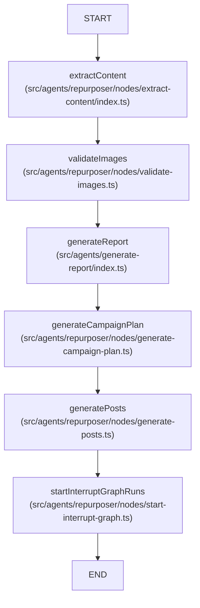
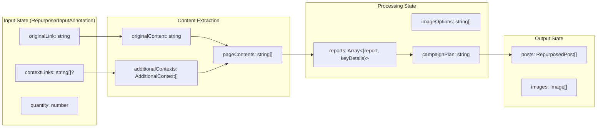

<!-- source: DeepWiki mcp.deepwiki.com · repo langchain-ai/social-media-agent · page 2.8 Content Repurposing · fetched 2026-10-26 -->

# Content Repurposing

Relevant source files

The following files were used as context for generating this wiki page:

- [src/agents/ingest-repurposed-data/index.ts](src/agents/ingest-repurposed-data/index.ts)
- [src/agents/ingest-repurposed-data/types.ts](src/agents/ingest-repurposed-data/types.ts)
- [src/agents/repurposer-post-interrupt/index.ts](src/agents/repurposer-post-interrupt/index.ts)
- [src/agents/repurposer-post-interrupt/nodes/human-node/index.ts](src/agents/repurposer-post-interrupt/nodes/human-node/index.ts)
- [src/agents/repurposer-post-interrupt/nodes/human-node/utils.ts](src/agents/repurposer-post-interrupt/nodes/human-node/utils.ts)
- [src/agents/repurposer-post-interrupt/types.ts](src/agents/repurposer-post-interrupt/types.ts)
- [src/agents/repurposer/index.ts](src/agents/repurposer/index.ts)
- [src/agents/repurposer/nodes/extract-content/get-url-contents.ts](src/agents/repurposer/nodes/extract-content/get-url-contents.ts)
- [src/agents/repurposer/nodes/extract-content/index.ts](src/agents/repurposer/nodes/extract-content/index.ts)
- [src/agents/repurposer/nodes/generate-campaign-plan.ts](src/agents/repurposer/nodes/generate-campaign-plan.ts)
- [src/agents/repurposer/nodes/generate-posts.ts](src/agents/repurposer/nodes/generate-posts.ts)
- [src/agents/repurposer/nodes/start-interrupt-graph.ts](src/agents/repurposer/nodes/start-interrupt-graph.ts)
- [src/agents/repurposer/tests/graph.int.test.ts](src/agents/repurposer/tests/graph.int.test.ts)
- [src/agents/repurposer/types.ts](src/agents/repurposer/types.ts)
- [src/agents/repurposer/utils.ts](src/agents/repurposer/utils.ts)
- [src/agents/types.ts](src/agents/types.ts)
- [src/utils/date.ts](src/utils/date.ts)

## Purpose and Scope

The content repurposing system creates multiple social media posts from a single source URL, enabling campaign-style content distribution over an extended period. This workflow is managed by the `repurposerGraph`, which extracts content from multiple sources, generates a campaign plan, creates multiple posts, and schedules them with appropriate intervals.

The system supports extracting content from standard web pages, Twitter threads (including replies and media), and YouTube videos (summarized). It is designed to take existing content and build a "marketing campaign" that provides new context rather than just repeating the original post.

**Sources:** [src/agents/repurposer/index.ts:14-39](), [src/agents/repurposer/types.ts:1-120](), [src/agents/repurposer/nodes/extract-content/get-url-contents.ts:136-151]()

---

## Repurposer Graph Architecture

The `repurposerGraph` orchestrates a multi-stage workflow that transforms a single content source into a series of scheduled social media posts. The graph processes the original content, optionally combines it with additional context, generates a strategic campaign plan, and produces multiple posts that are individually reviewed and scheduled.

### Graph Flow

**Sources:** [src/agents/repurposer/index.ts:14-36](), [src/agents/repurposer/nodes/extract-content/index.ts:4-59]()

### Node Responsibilities

| Node | Function | Output State Fields |
|------|----------|-------------------|
| `extractContent` | Scrapes original link and optional context links using `getUrlContents`. | `originalContent`, `additionalContexts`, `pageContents`, `imageOptions` |
| `validateImages` | Extracts and validates image URLs from content sources. | `imageOptions` |
| `generateReport` | Invokes `generateReportGraph` to analyze content and extract key details. | `reports` |
| `generateCampaignPlan` | Uses `ChatOpenAI` (o1) to create a strategic plan for the post series. | `campaignPlan` |
| `generatePosts` | Generates specified quantity of posts using `ChatAnthropic` (Claude 3.5 Sonnet). | `posts` |
| `startInterruptGraphRuns` | Spawns `repurposer_post_interrupt` threads for individual human review. | (External runs) |

**Sources:** [src/agents/repurposer/index.ts:21-34](), [src/agents/repurposer/nodes/generate-campaign-plan.ts:72-93](), [src/agents/repurposer/nodes/generate-posts.ts:78-139]()

---

## State Schema and Configuration

### RepurposerGraphAnnotation

The `RepurposerGraphAnnotation` defines the complete state structure for the repurposer workflow:

**Sources:** [src/agents/repurposer/types.ts:8-93](), [src/agents/repurposer/types.ts:98-111]()

### Key State Fields

| Field | Type | Purpose | Reducer Behavior |
|-------|------|---------|-----------------|
| `originalLink` | `string` | Primary content source URL. | Default |
| `contextLinks` | `string[] \| undefined` | Additional URLs for context. | Default |
| `quantity` | `number` | Number of posts to generate. | Replace (default: `DEFAULT_POST_QUANTITY`) |
| `reports` | `Array<{report, keyDetails}>` | Content analysis results. | `state.concat(update)` |
| `campaignPlan` | `string` | Strategic plan for post series. | Default |
| `posts` | `RepurposedPost[]` | Generated posts with index. | Default |
| `images` | `Image[]` | Images paired with posts by index. | `state.concat(update)` |
| `numWeeksBetween` | `number` | Weeks between scheduled posts. | Replace (default: 1) |

**Sources:** [src/agents/repurposer/types.ts:8-93](), [src/agents/ingest-repurposed-data/constants.ts:3]()

---

## Content Extraction and Preparation

### URL Content Processing

The `getUrlContents` function in `src/agents/repurposer/nodes/extract-content/get-url-contents.ts` acts as the primary ingestion engine, supporting multiple media types:

*   **Twitter**: Uses `getTwitterClient` to fetch the tweet, resolves thread replies via `getThreadReplies`, and extracts media URLs. It also recursively scrapes links found within the tweet text. [src/agents/repurposer/nodes/extract-content/get-url-contents.ts:65-131]()
*   **YouTube**: Uses `getVideoSummary` to retrieve a transcript-based summary and the video thumbnail. [src/agents/repurposer/nodes/extract-content/get-url-contents.ts:50-63]()
*   **General Web**: Uses `FireCrawlLoader` in `scrape` mode to convert web pages to Markdown and extract images from metadata. [src/agents/repurposer/nodes/extract-content/get-url-contents.ts:17-48]()

### Content Preparation Logic

The `extractContent` node combines the `originalLink` and `contextLinks` into a master prompt. The `originalContent` is wrapped in `<original-post-content>` tags, while additional context is provided in an `<additional-contexts>` block to distinguish between what has already been shared and what is new information. [src/agents/repurposer/nodes/extract-content/index.ts:10-45]()

---

## Campaign Planning and Generation

### Strategic Planning

The `generateCampaignPlan` node uses a reasoning model (OpenAI `o1`) to determine how to distribute information across the requested number of posts. It ensures that the campaign flows seamlessly without repeating content. The output is structured with `<post>`, `<header>`, `
`, and `<index>` tags. [src/agents/repurposer/nodes/generate-campaign-plan.ts:14-70]()

### Post Creation

The `generatePosts` node takes the campaign plan and the marketing report to generate the final copy. It uses `ChatAnthropic` (Claude 3.5 Sonnet) with a specific tool call `write_posts` to ensure the output is a valid array of strings. [src/agents/repurposer/nodes/generate-posts.ts:78-139]()

The prompt enforces a strict three-section structure:
1.  **Header**: Short (max 5 words) with emojis.
2.  **Body**: Concise overview (max 3 sentences) focusing on the "what" and "why" of the product.
3.  **Call to Action**: Encourages clicking the original link. [src/agents/repurposer/nodes/generate-posts.ts:7-24]()

---

## Scheduling and Distribution

### The Ingest Pipeline

The `ingest_repurposed_data` graph is the entry point for batch processing, often triggered by Slack messages. It uses the `extract` node to parse links and quantities from the input and then iterates through the `contents` array to spawn individual `repurposer` graph runs using the LangGraph SDK `Client`. [src/agents/ingest-repurposed-data/index.ts:18-45]()

### Post-Generation Interrupts

Once posts are generated, they are not immediately published. The `startInterruptGraphRuns` node creates a new thread for **every individual post** in the series. [src/agents/repurposer/nodes/start-interrupt-graph.ts:4-36]()

These threads run the `repurposer_post_interrupt` graph, which:
1.  Provides a human-in-the-loop interface via the Agent Inbox. [src/agents/repurposer-post-interrupt/nodes/human-node/utils.ts:80-165]()
2.  Allows editing the post content, selecting from `imageOptions`, or modifying the `scheduleDate`. [src/agents/repurposer-post-interrupt/nodes/human-node/utils.ts:127-150]()
3.  Supports priority levels (`r1`, `r2`, `r3`) for repurposed content scheduling. [src/agents/repurposer-post-interrupt/nodes/human-node/utils.ts:140-146]()

**Sources:** [src/agents/repurposer/nodes/start-interrupt-graph.ts:12-30](), [src/agents/repurposer-post-interrupt/nodes/human-node/utils.ts:1-167]()

---

