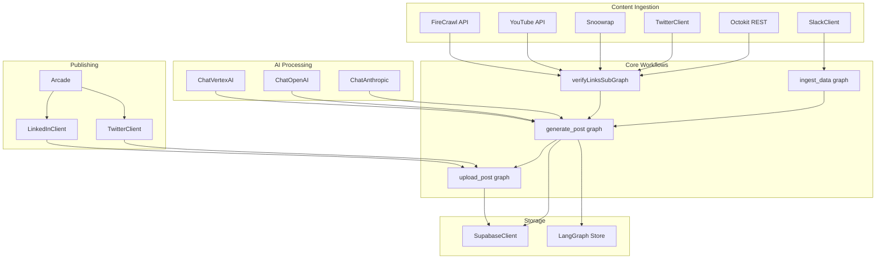
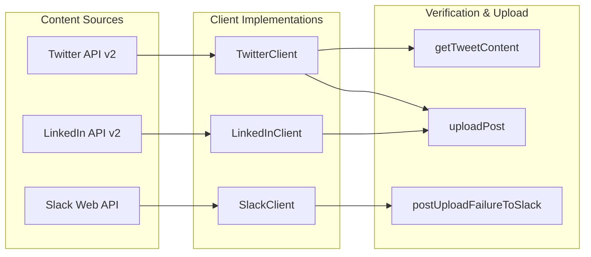
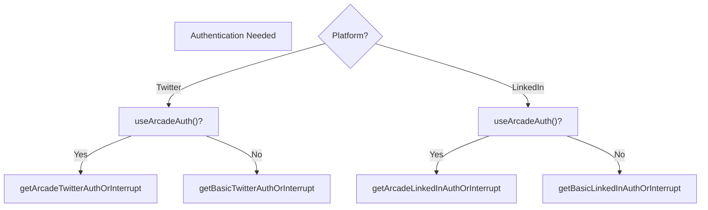

<!-- source: DeepWiki mcp.deepwiki.com · repo langchain-ai/social-media-agent · page 3 External Integrations · fetched 2026-10-26 -->

# External Integrations

Relevant source files

The following files were used as context for generating this wiki page:

- [src/agents/generate-post/nodes/auth-socials.ts](src/agents/generate-post/nodes/auth-socials.ts)
- [src/agents/shared/auth/linkedin.ts](src/agents/shared/auth/linkedin.ts)
- [src/agents/shared/auth/twitter.ts](src/agents/shared/auth/twitter.ts)
- [src/agents/upload-post/index.ts](src/agents/upload-post/index.ts)
- [src/agents/verify-tweet/nodes/get-tweet-content.ts](src/agents/verify-tweet/nodes/get-tweet-content.ts)
- [src/clients/linkedin.ts](src/clients/linkedin.ts)
- [src/clients/twitter/client.ts](src/clients/twitter/client.ts)
- [src/clients/twitter/types.ts](src/clients/twitter/types.ts)
- [src/clients/types.ts](src/clients/types.ts)
- [src/tests/linkedin.int.test.ts](src/tests/linkedin.int.test.ts)

This page provides an overview of how the Social Media Agent integrates with external services and APIs. The system depends on 15+ external services across content sources, AI providers, publishing platforms, storage, and authentication.

For detailed configuration of these integrations, see [Configuration](#4). For detailed implementation of specific integrations, refer to the child pages of this section.

## Integration Categories

The system integrates with external services in five main categories:

| Category | Services | Primary Purpose | Configuration Page |
|----------|----------|----------------|-------------------|
| **AI/LLM Providers** | Anthropic Claude, OpenAI, Google Vertex AI | Text generation, image generation, content analysis | [LLM Providers](#3.4) |
| **Content Sources** | Slack, GitHub, Twitter, YouTube, Reddit, FireCrawl | Content ingestion and verification | [Slack Integration](#3.3), [Twitter Integration](#3.1) |
| **Publishing Platforms** | Twitter, LinkedIn | Post publishing and scheduling | [Twitter Integration](#3.1), [LinkedIn Integration](#3.2) |
| **Storage & Persistence** | Supabase, LangGraph Store | Image storage, state tracking, reflection rules | [Storage and Persistence](#3.5) |
| **Authentication** | Arcade | OAuth abstraction for social media platforms | [Arcade Authentication](#3.6) |
| **Monitoring** | LangSmith | Tracing, debugging, observability | N/A (required infrastructure) |

Sources: [package.json:37-72](), [src/agents/upload-post/index.ts:1-31]()

## System Integration Architecture

The following diagram shows how external services integrate into the system's workflow:

Sources: [src/clients/twitter/client.ts:61-105](), [src/clients/linkedin.ts:51-82](), [src/agents/upload-post/index.ts:1-31](), [src/agents/verify-tweet/nodes/get-tweet-content.ts:12-71]()

## AI and LLM Providers

The system uses three AI providers for different tasks:

| Provider | Models | Use Cases | Client Implementation |
|----------|--------|-----------|----------------------|
| **Anthropic Claude** | `claude-3-5-sonnet` | Post generation, condensation, content analysis | `ChatAnthropic` |
| **OpenAI** | Configurable | Alternative LLM provider | `ChatOpenAI` |
| **Google Vertex AI** | `gemini-1.5-pro` | Image validation, YouTube video summaries | `ChatVertexAI` |

For detailed configuration and usage, see [LLM Providers](#3.4).

Sources: [package.json:41-47](), [src/agents/upload-post/index.ts:1-20]()

## Content Source Integrations

The system ingests and verifies content from multiple sources:

### Platform-Specific Clients

**Content Source Details**:

| Source | Client | Primary Operations | Implementation |
|--------|--------|-------------------|----------------|
| **Slack** | `SlackClient` | Notification delivery, error reporting | [src/agents/upload-post/index.ts:200-233]() |
| **Twitter** | `TwitterClient` | Tweet retrieval, media upload, thread posting | [src/clients/twitter/client.ts:61-572]() |
| **LinkedIn** | `LinkedInClient` | Text/Image post creation, media registration | [src/clients/linkedin.ts:51-337]() |

For detailed Slack integration, see [Slack Integration](#3.3). For Twitter content reading, see [Twitter Integration](#3.1).

Sources: [src/clients/twitter/client.ts:61-105](), [src/clients/linkedin.ts:51-82](), [src/agents/verify-tweet/nodes/get-tweet-content.ts:12-71]()

## Publishing Platform Integrations

The system publishes content to Twitter and LinkedIn through dedicated client implementations:

**Publishing Capabilities**:

| Platform | Features | Authentication Options | Details |
|----------|----------|----------------------|---------|
| **Twitter** | Single tweets, threads, media uploads, retweets | Arcade OAuth or Basic Auth (API Keys) | [Twitter Integration](#3.1) |
| **LinkedIn** | Text posts, image posts, personal/org posting | Arcade OAuth or Basic Auth (Access Tokens) | [LinkedIn Integration](#3.2) |

Both platforms support text-only and image-attached posts. The system handles authentication through either Arcade's unified OAuth flow or direct API credentials. For media uploads to Twitter, OAuth 1.0a credentials are required even when using Arcade for text posting.

For authentication details, see [Arcade Authentication](#3.6).

Sources: [src/agents/upload-post/index.ts:236-278](), [src/clients/twitter/client.ts:61-105](), [src/clients/linkedin.ts:51-82]()

## Storage and Persistence

The system uses two storage solutions for different purposes:

| System | Purpose | Data Types | Access Pattern |
|--------|---------|------------|----------------|
| **Supabase** | Public image hosting | Generated images for social posts | `imageUrlToBuffer` in [src/agents/utils.js]() |
| **LangGraph Store** | State tracking | Processed content, reflection rules | Accessed via graph state and `Annotation` |

For detailed storage implementation and configuration, see [Storage and Persistence](#3.5).

Sources: [src/agents/upload-post/index.ts:10-15](), [src/agents/upload-post/index.ts:143-160]()

## Authentication and Authorization

Authentication is handled through two mechanisms:

1. **Arcade Authentication**: Uses Arcade's OAuth flow to get user tokens. See [Arcade Authentication](#3.6).
2. **Basic Authentication**: Uses direct API keys and tokens from environment variables.

The system uses environment variables like `USE_ARCADE_AUTH` and `USE_TWITTER_API_ONLY` to route authentication logic.

Sources: [src/agents/shared/auth/twitter.ts:135-156](), [src/agents/shared/auth/linkedin.ts:157-182](), [src/clients/twitter/client.ts:47-60]()

## Monitoring and Observability

The system uses **LangSmith** for tracing and debugging. This provides real-time visibility into the multi-step graph executions and LLM interactions.

Sources: [package.json:61]()

## Integration Error Handling

The system uses Slack for error reporting across integrations. The `postUploadFailureToSlack` function in [src/agents/upload-post/index.ts:187-234]() formats error details, including thread IDs and post content, and sends them to a configured Slack channel.

Sources: [src/agents/upload-post/index.ts:187-234]()

## Authentication Decision Tree

Sources: [src/agents/shared/auth/twitter.ts:135-156](), [src/agents/shared/auth/linkedin.ts:157-182](), [src/agents/generate-post/nodes/auth-socials.ts:8-35]()

---

