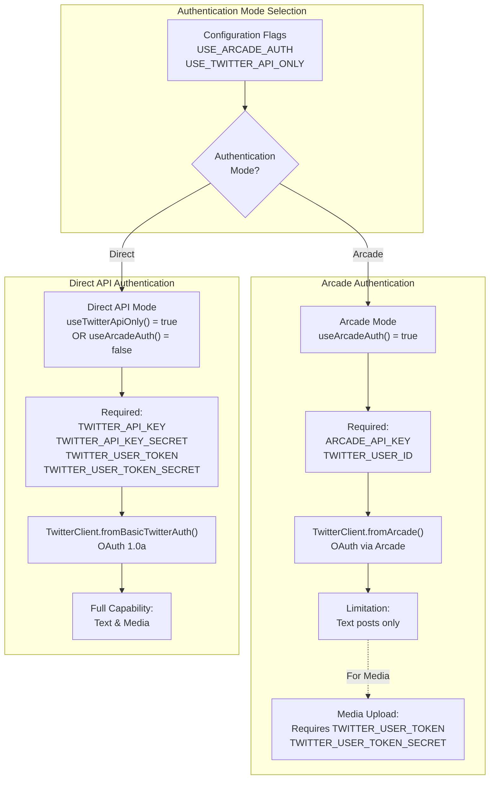
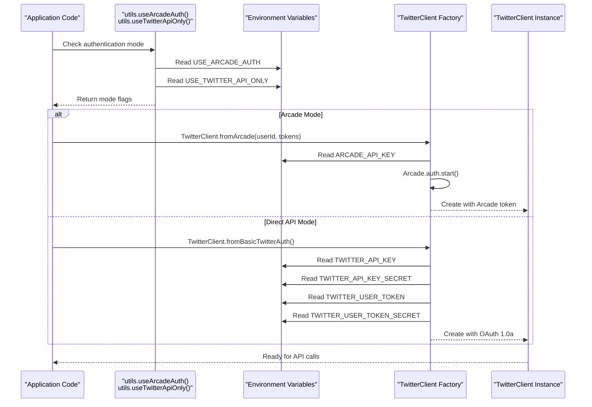
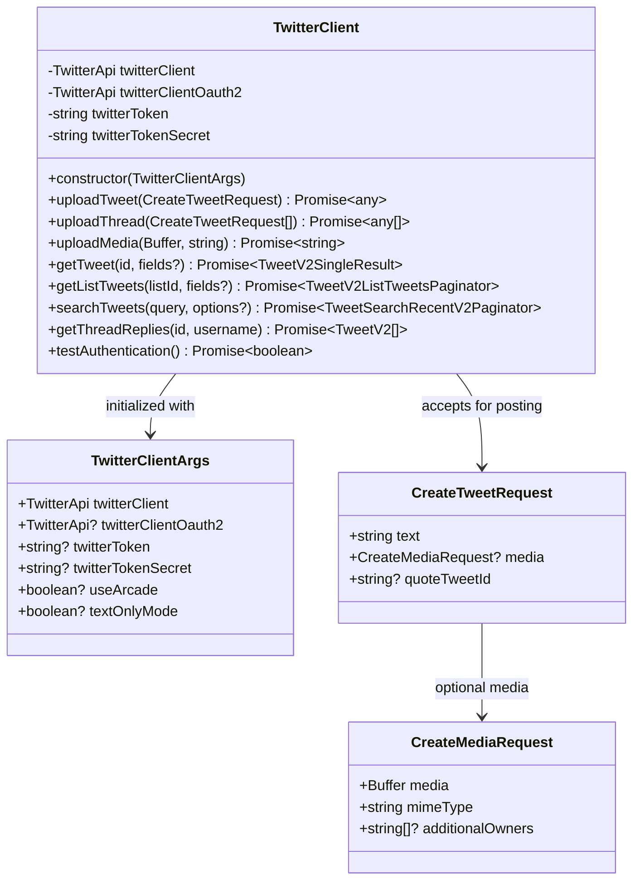
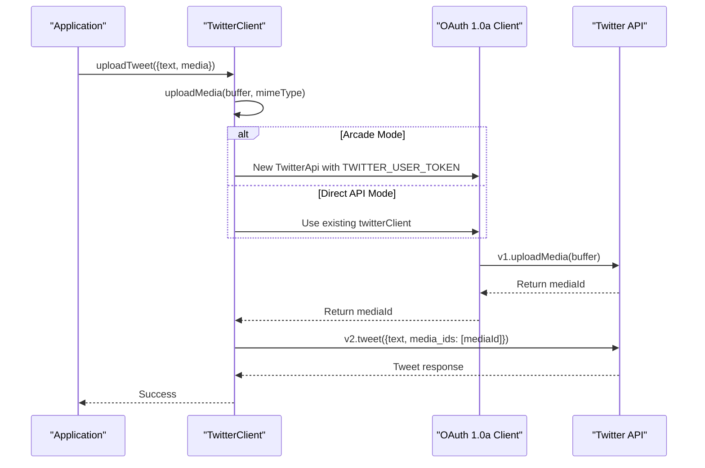
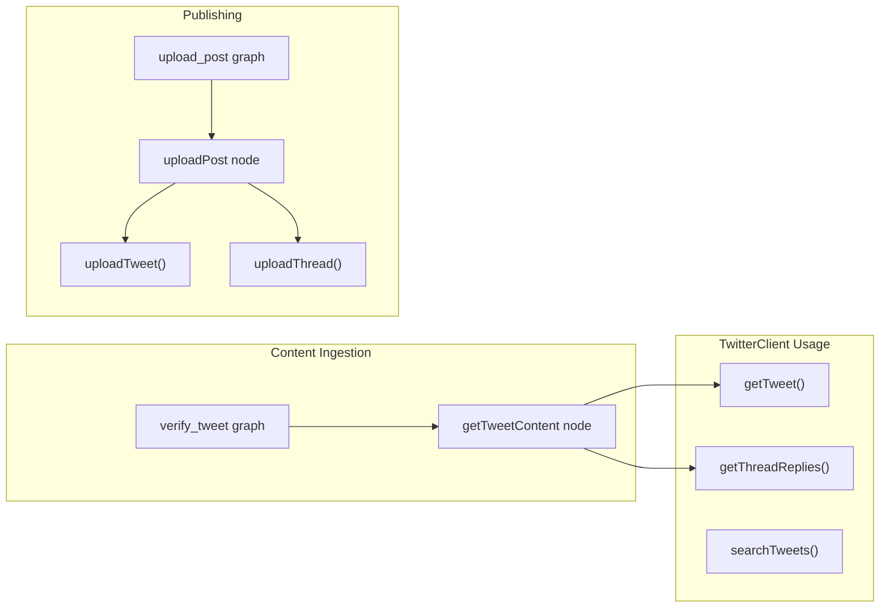

<!-- source: DeepWiki mcp.deepwiki.com · repo langchain-ai/social-media-agent · page 3.1 Twitter Integration · fetched 2026-10-26 -->

# Twitter Integration

<details>
<summary>Relevant source files</summary>

The following files were used as context for generating this wiki page:

- [src/agents/upload-post/index.ts](src/agents/upload-post/index.ts)
- [src/agents/verify-tweet/nodes/get-tweet-content.ts](src/agents/verify-tweet/nodes/get-tweet-content.ts)
- [src/clients/twitter/client.ts](src/clients/twitter/client.ts)
- [src/clients/twitter/tests/arcade.int.test.ts](src/clients/twitter/tests/arcade.int.test.ts)
- [src/clients/twitter/tests/twitter.int.test.ts](src/clients/twitter/tests/twitter.int.test.ts)
- [src/clients/twitter/types.ts](src/clients/twitter/types.ts)
- [src/clients/twitter/utils.ts](src/clients/twitter/utils.ts)

</details>


This document describes the Twitter API integration, including the `TwitterClient` class implementation, authentication strategies, media upload handling, and API usage patterns. For LinkedIn integration, see [LinkedIn Integration](#3.2). For general authentication configuration, see [Environment Variables](#4.1).

## Purpose and Scope

The system integrates with Twitter (X) API v2 to:
- Read tweet content, including threads and media [src/clients/twitter/client.ts:379-571]()
- Publish tweets and threads with optional media attachments [src/clients/twitter/client.ts:230-311]()
- Search tweets and fetch lists [src/clients/twitter/client.ts:480-537]()
- Verify tweet URLs during content ingestion [src/agents/verify-tweet/nodes/get-tweet-content.ts:12-71]()

The integration supports two authentication modes: Arcade OAuth (simplified) and direct Twitter API credentials (required for media uploads).

## Authentication Architecture

The system provides two authentication strategies with different capabilities and setup requirements.



**Sources:** [src/clients/twitter/client.ts:45-105](), [src/clients/twitter/client.ts:143-207]()

### Arcade Authentication Mode

Arcade mode simplifies OAuth by delegating authentication to the Arcade service. It is enabled when `USE_ARCADE_AUTH="true"` and `USE_TWITTER_API_ONLY="false"`.

| Feature | Requirement | Purpose |
|---------|-------------|---------|
| Environment Variable | `ARCADE_API_KEY` | Authenticate with Arcade service [src/clients/twitter/client.ts:58]() |
| User Identifier | `TWITTER_USER_ID` | User email/ID for OAuth flow [src/clients/twitter/client.ts:199]() |
| Scope | `tweet.write`, `users.read`, `tweet.read`, `offline.access` | API permissions [src/clients/twitter/client.ts:121]() |
| Limitation | Text-only posts without media | Arcade tokens insufficient for media upload [src/clients/twitter/client.ts:88-104]() |
| Media Workaround | `TWITTER_USER_TOKEN`, `TWITTER_USER_TOKEN_SECRET` | OAuth 1.0a credentials for media [src/clients/twitter/client.ts:89-93]() |

The `TwitterClient.authorizeUser()` method handles the Arcade authorization flow, returning either a completed token or an authorization URL for the user to visit [src/clients/twitter/client.ts:116-140]().

**Sources:** [src/clients/twitter/client.ts:106-139](), [src/clients/twitter/client.ts:188-207]()

### Direct API Authentication Mode

Direct mode uses standard Twitter API credentials with OAuth 1.0a, providing full functionality including media uploads.

| Environment Variable | Purpose |
|---------------------|---------|
| `TWITTER_API_KEY` | Application API key (Consumer Key) [src/clients/twitter/client.ts:54]() |
| `TWITTER_API_KEY_SECRET` | Application API secret (Consumer Secret) [src/clients/twitter/client.ts:55]() |
| `TWITTER_USER_TOKEN` | User access token [src/clients/twitter/client.ts:52]() |
| `TWITTER_USER_TOKEN_SECRET` | User access token secret [src/clients/twitter/client.ts:53]() |
| `TWITTER_BEARER_TOKEN` | Optional, for OAuth 2.0 read operations [src/clients/twitter/client.ts:179]() |

The `TwitterClient.fromBasicTwitterAuth()` factory method initializes the client with these credentials [src/clients/twitter/client.ts:153-187]().

**Sources:** [src/clients/twitter/client.ts:142-186]()

### Configuration Flow



**Sources:** [src/clients/twitter/client.ts:153-187](), [src/clients/twitter/client.ts:188-207]()

## TwitterClient Implementation

The `TwitterClient` class encapsulates all Twitter API interactions, using the `twitter-api-v2` library for API calls [src/clients/twitter/client.ts:10-12]().

### Class Structure



**Sources:** [src/clients/twitter/client.ts:61-105](), [src/clients/twitter/types.ts:6-49]()

### Factory Methods

The client provides static factory methods for each authentication mode:

| Method | Authentication | Usage |
|--------|----------------|-------|
| `fromBasicTwitterAuth()` | Direct API credentials | Reads env vars, creates OAuth 1.0a client [src/clients/twitter/client.ts:153-187]() |
| `fromArcade(userId, tokens, options)` | Arcade OAuth | Starts Arcade auth flow, creates client [src/clients/twitter/client.ts:188-207]() |
| `authorizeUser(id, client)` | Arcade OAuth helper | Returns auth URL or completed token [src/clients/twitter/client.ts:116-140]() |

**Sources:** [src/clients/twitter/client.ts:116-207]()

## Reading Tweet Content

The client supports multiple methods for retrieving tweet data, with automatic fallback between authentication modes.

### getTweet Method

Retrieves a single tweet by ID with rich metadata including media, author, and thread context [src/clients/twitter/client.ts:379-478]().

The method includes these fields via `BASE_FETCH_TWEET_OPTIONS`:
- `tweet.fields`: `note_tweet`, `created_at`, `id`, `author_id`, `in_reply_to_user_id`, `referenced_tweets`, `public_metrics` [src/clients/twitter/client.ts:21-29]()
- `user.fields`: `username` [src/clients/twitter/client.ts:30]()
- `expansions`: `referenced_tweets.id`, `referenced_tweets.id.author_id`, `attachments.media_keys` [src/clients/twitter/client.ts:31-35]()
- `media.fields`: `type`, `url` [src/clients/twitter/client.ts:36]()

**Sources:** [src/clients/twitter/client.ts:20-37](), [src/agents/verify-tweet/nodes/get-tweet-content.ts:12-71]()

### getThreadReplies Method

Retrieves all replies in a thread where the author replies to themselves [src/clients/twitter/client.ts:539-571]().

The method constructs a search query: `conversation_id:${tweetId} from:${authorUsername} to:${authorUsername}` and uses `searchAll` with recency sorting [src/clients/twitter/client.ts:554-558]().

**Important:** This requires `twitterClientOauth2` (bearer token) which is only available in direct API mode [src/clients/twitter/client.ts:543-548]().

**Sources:** [src/clients/twitter/client.ts:539-571]()

## Publishing Tweets

The client supports posting single tweets and multi-tweet threads, with optional media attachments.

### Media Upload Requirements

Media upload requires OAuth 1.0a credentials due to Twitter API limitations. The upload flow differs based on authentication mode:



**Key Point:** The v1 API endpoint (`uploadMedia`) requires OAuth 1.0a, while v2 endpoints (`tweet`) can use OAuth 2.0 tokens from Arcade [src/clients/twitter/client.ts:329-376]().

**Sources:** [src/clients/twitter/client.ts:329-376]()

### uploadTweet Method

Posts a single tweet with optional media [src/clients/twitter/client.ts:230-265]().

```typescript
// Usage in upload-post graph
const result = await twitterClient.uploadTweet({
  text: ensureSignature(state.post),
  media: mediaData,
});
```

The method:
1. Uploads media (if provided) to get `mediaId` [src/clients/twitter/client.ts:237-241]()
2. Calls `twitterClient.v2.tweet()` with text and media IDs [src/clients/twitter/client.ts:251-255]()

**Sources:** [src/clients/twitter/client.ts:230-265](), [src/agents/upload-post/index.ts:236-289]()

### uploadThread Method

Posts a sequence of tweets as a thread, with optional media for each tweet [src/clients/twitter/client.ts:267-311]().

```typescript
// Usage from upload-post graph with complex posts
if (state.complexPost) {
  await twitterClient.uploadThread([
    {
      text: ensureSignature(state.complexPost.main_post),
      media: mediaData,
    },
    {
      text: state.complexPost.reply_post,
    },
  ]);
}
```

**Sources:** [src/clients/twitter/client.ts:267-311](), [src/agents/upload-post/index.ts:269-278]()

## Integration Points

The `TwitterClient` is used throughout the system in multiple workflows.



**Sources:** [src/agents/verify-tweet/nodes/get-tweet-content.ts:12-71](), [src/agents/upload-post/index.ts:236-289]()

## API Limitations and Considerations

### Media Upload Constraints
- Supported formats: Images (JPEG, PNG, GIF, WebP) [src/clients/twitter/utils.ts:204]()
- Media upload uses v1 API endpoint, requiring OAuth 1.0a [src/clients/twitter/client.ts:360]()
- Maximum media attachments per tweet: 4 [src/clients/twitter/client.ts:39-43]()

### Thread Retrieval Limitations
- Requires OAuth 2.0 bearer token (not available in Arcade-only mode) [src/clients/twitter/client.ts:543-548]()
- Only retrieves self-replies (author replying to themselves) [src/clients/twitter/client.ts:556-557]()

### Text-Only Mode Behavior
When `TEXT_ONLY_MODE="true"`:
- Media upload methods are skipped [src/clients/twitter/client.ts:88-104]()
- `uploadTweet()` and `uploadThread()` ignore media parameters [src/agents/upload-post/index.ts:243-245]()

**Sources:** [src/clients/twitter/client.ts:88-104](), [src/agents/upload-post/index.ts:243-245]()

---

