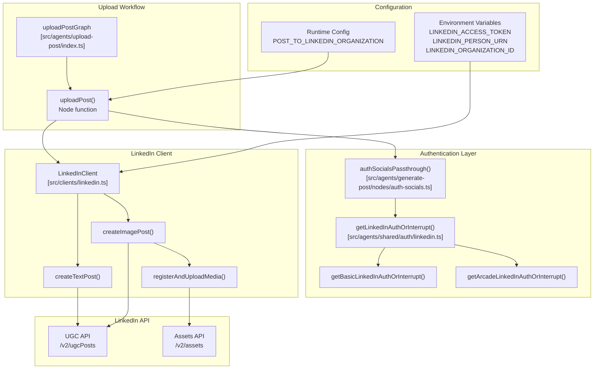
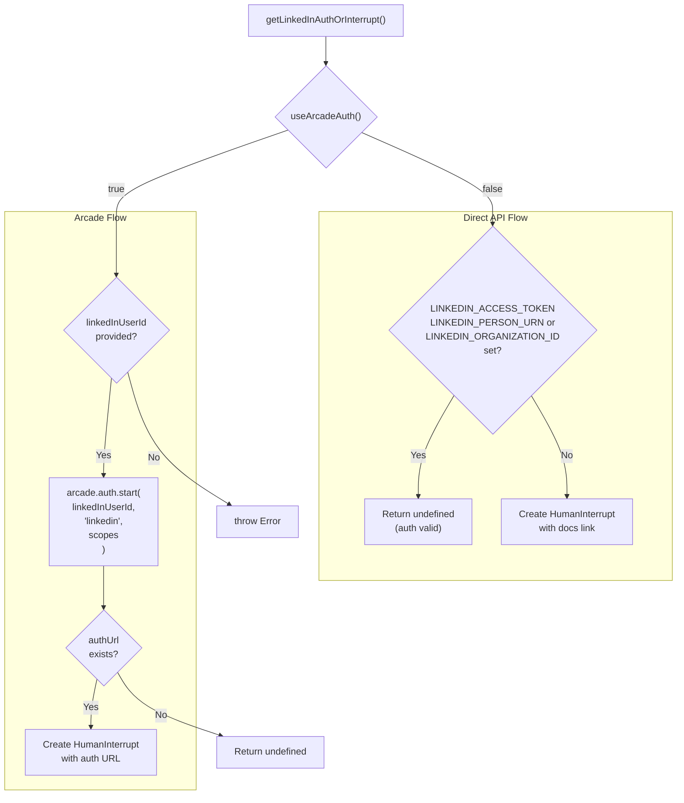
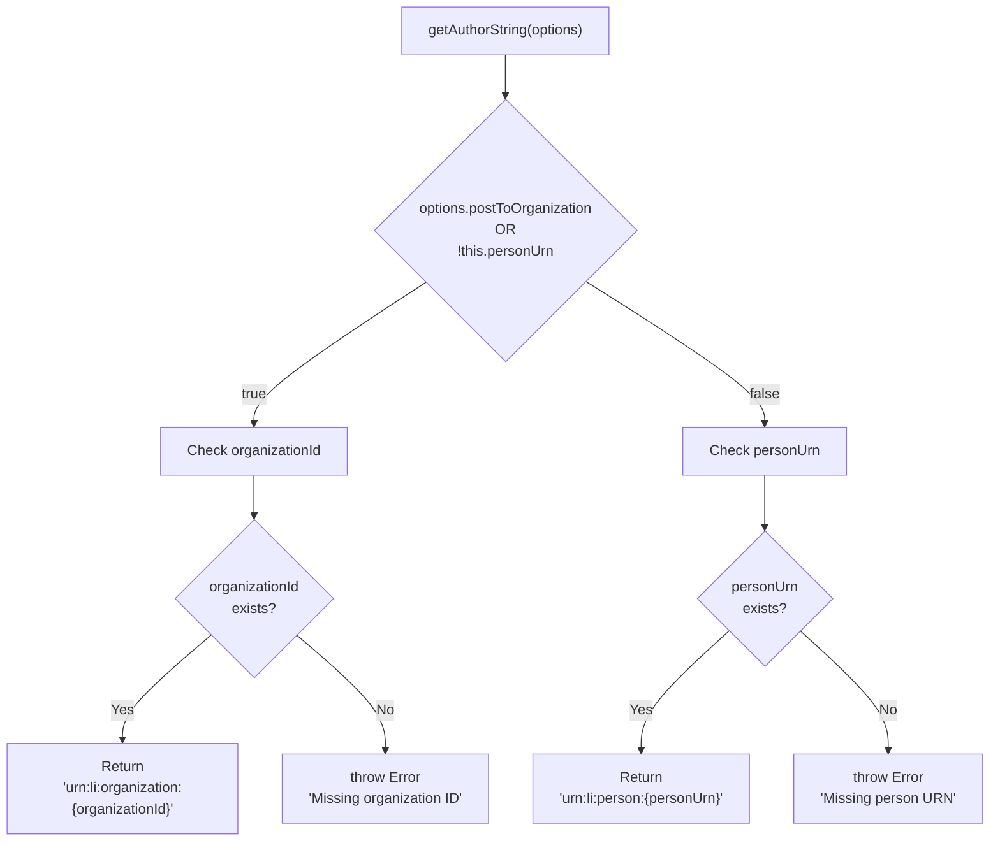
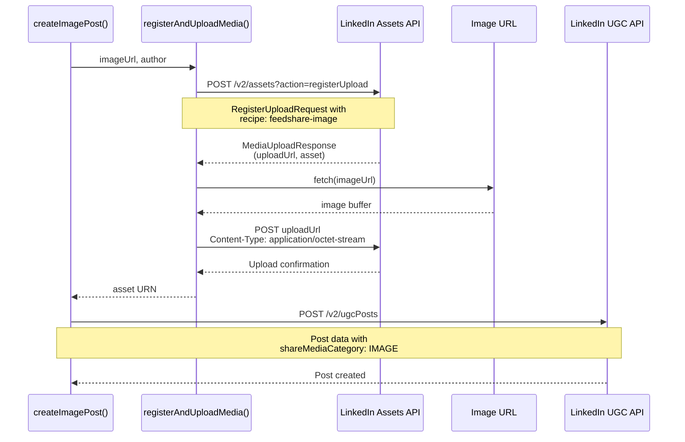

<!-- source: DeepWiki mcp.deepwiki.com · repo langchain-ai/social-media-agent · page 3.2 LinkedIn Integration · fetched 2026-10-26 -->

# LinkedIn Integration

<details>
<summary>Relevant source files</summary>

The following files were used as context for generating this wiki page:

- [src/agents/generate-post/nodes/auth-socials.ts](src/agents/generate-post/nodes/auth-socials.ts)
- [src/agents/shared/auth/linkedin.ts](src/agents/shared/auth/linkedin.ts)
- [src/agents/shared/auth/twitter.ts](src/agents/shared/auth/twitter.ts)
- [src/clients/linkedin.ts](src/clients/linkedin.ts)
- [src/clients/types.ts](src/clients/types.ts)
- [src/tests/linkedin.int.test.ts](src/tests/linkedin.int.test.ts)

</details>


## Purpose and Scope

This document describes the LinkedIn API integration in the social media agent system. It covers the `LinkedInClient` implementation, authentication methods (direct API and Arcade), posting modes (personal profile vs organization page), and the integration with the post upload workflow. For Twitter integration details, see [Twitter Integration (3.1)](#). For general authentication configuration, see [Environment Variables (4.1)](#).

---

## System Architecture

The LinkedIn integration consists of three main components: the `LinkedInClient` class that handles API communication, authentication modules that manage OAuth flows, and the upload workflow that orchestrates post publishing.



**Sources:** [src/clients/linkedin.ts:1-337](), [src/agents/shared/auth/linkedin.ts:1-183](), [src/agents/generate-post/nodes/auth-socials.ts:8-76]()

---

## LinkedInClient Class

The `LinkedInClient` class provides methods for posting to LinkedIn through the UGC (User Generated Content) API. It is located at [src/clients/linkedin.ts:51-82]() and supports both personal profile and organization page posting.

### Class Structure

| Property | Type | Description |
|----------|------|-------------|
| `baseURL` | string | LinkedIn API base URL (`https://api.linkedin.com/v2`) [src/clients/linkedin.ts:52-52]() |
| `accessToken` | string | OAuth 2.0 access token [src/clients/linkedin.ts:53-53]() |
| `personUrn` | string \| undefined | LinkedIn person URN for personal posting [src/clients/linkedin.ts:54-54]() |
| `organizationId` | string \| undefined | Organization ID for company page posting [src/clients/linkedin.ts:55-55]() |

**Sources:** [src/clients/linkedin.ts:51-56]()

### Constructor

The constructor accepts optional parameters or falls back to environment variables:

```typescript
constructor(input?: {
  accessToken: string | undefined;
  personUrn: string | undefined;
  organizationId: string | undefined;
})
```

It requires `accessToken` and at least one of `personUrn` or `organizationId` [src/clients/linkedin.ts:68-77](). If `accessToken` is missing, it throws an error [src/clients/linkedin.ts:69-72](). The constructor validates that at least one author identifier (person or organization) is provided [src/clients/linkedin.ts:73-77]().

**Sources:** [src/clients/linkedin.ts:57-82]()

---

## Authentication Methods

The system supports two authentication approaches: direct API authentication using LinkedIn developer credentials, and Arcade authentication for simplified OAuth management.



**Sources:** [src/agents/shared/auth/linkedin.ts:157-182](), [src/agents/shared/auth/linkedin.ts:93-155]()

### Direct API Authentication

Direct API authentication requires environment variables:
- `LINKEDIN_ACCESS_TOKEN`: OAuth 2.0 access token [src/agents/shared/auth/linkedin.ts:38-38]()
- `LINKEDIN_PERSON_URN`: Person URN for personal posting [src/agents/shared/auth/linkedin.ts:40-40]()
- `LINKEDIN_ORGANIZATION_ID`: Organization ID for company page posting [src/agents/shared/auth/linkedin.ts:39-39]()

The `getBasicLinkedInAuthOrInterrupt()` function checks if required credentials are set [src/agents/shared/auth/linkedin.ts:43-43](). If missing, it creates a `HumanInterrupt` [src/agents/shared/auth/linkedin.ts:56-70]() with documentation instructions [src/agents/shared/auth/linkedin.ts:44-54]().

**Sources:** [src/agents/shared/auth/linkedin.ts:33-91]()

### Arcade Authentication

Arcade authentication handles the authorization flow through the Arcade service. If `useArcadeAuth()` is true [src/agents/shared/auth/linkedin.ts:163-163](), the system uses `getArcadeLinkedInAuthOrInterrupt()`.

The method calls `arcade.auth.start()` [src/agents/shared/auth/linkedin.ts:104-106]() with scopes based on whether the post is for an organization [src/agents/shared/auth/linkedin.ts:101-103](). If an authorization URL is returned, it triggers a `HumanInterrupt` [src/agents/shared/auth/linkedin.ts:120-134]().

**Sources:** [src/agents/shared/auth/linkedin.ts:93-155]()

---

## Posting Modes

LinkedIn posting supports two target modes: personal profile posting and organization page posting. The mode is determined by the `postToOrganization` option and available credentials.

### Author String Resolution

The `getAuthorString()` private method determines which author to use:



**Sources:** [src/clients/linkedin.ts:89-106]()

### Personal Profile Posting

Personal posting uses the `personUrn` to create posts on the authenticated user's profile. The post appears as authored by the individual user (`urn:li:person:{id}`) [src/clients/linkedin.ts:105-105]().

**Sources:** [src/clients/linkedin.ts:100-106]()

### Organization Page Posting

Organization posting requires the `organizationId`. If `postToOrganization` is requested [src/clients/linkedin.ts:91-91](), the client returns the organization URN (`urn:li:organization:{id}`) [src/clients/linkedin.ts:97-97]().

**Sources:** [src/clients/linkedin.ts:91-98]()

---

## Post Types

The `LinkedInClient` supports two post types: text-only posts and posts with images. Both use the LinkedIn UGC API endpoint at `/v2/ugcPosts` [src/clients/linkedin.ts:133-133]().

### Text Posts

The `createTextPost()` method creates text-only posts:

```typescript
async createTextPost(
  text: string,
  options?: {
    postToOrganization?: boolean;
  }
): Promise<Response>
```

It constructs a `LinkedInPost` object with `shareMediaCategory: "NONE"` [src/clients/linkedin.ts:144-144]() and `lifecycleState: "PUBLISHED"` [src/clients/linkedin.ts:138-138]().

**Sources:** [src/clients/linkedin.ts:127-156]()

### Image Posts

The `createImagePost()` method creates posts with image attachments:



**Sources:** [src/clients/linkedin.ts:215-264](), [src/clients/linkedin.ts:158-212]()

#### Media Registration and Upload

The `registerAndUploadMedia()` private method handles the process:
1. **Register Upload**: POST to `/v2/assets?action=registerUpload` [src/clients/linkedin.ts:165-165]() with recipe `feedshare-image` [src/clients/linkedin.ts:169-169]().
2. **Fetch Image**: Downloads image from the provided URL [src/clients/linkedin.ts:189-190]().
3. **Upload Media**: POST image buffer to the provided `uploadUrl` [src/clients/linkedin.ts:198-205]() with `Content-Type: application/octet-stream` [src/clients/linkedin.ts:202-202]().

**Sources:** [src/clients/linkedin.ts:158-212]()

---

## Configuration

### Environment Variables

| Variable | Required | Description |
|----------|----------|-------------|
| `LINKEDIN_ACCESS_TOKEN` | Yes (Direct) | OAuth 2.0 access token [src/clients/linkedin.ts:63-63]() |
| `LINKEDIN_PERSON_URN` | Yes* (Direct) | Person identifier [src/clients/linkedin.ts:66-66]() |
| `LINKEDIN_ORGANIZATION_ID` | Yes* (Direct) | Organization identifier [src/clients/linkedin.ts:64-65]() |
| `LINKEDIN_USER_ID` | Yes (Arcade) | User ID for Arcade auth [src/agents/shared/auth/linkedin.ts:162-162]() |

**Sources:** [src/clients/linkedin.ts:62-67](), [src/agents/shared/auth/linkedin.ts:162-162]()

### Scopes

Scopes are selected based on the target:
- **Personal**: `["w_member_social"]` [src/agents/shared/auth/linkedin.ts:103-103]()
- **Organization**: `["w_member_social", "w_organization_social"]` [src/agents/shared/auth/linkedin.ts:102-102]()

**Sources:** [src/agents/shared/auth/linkedin.ts:101-103]()

---

