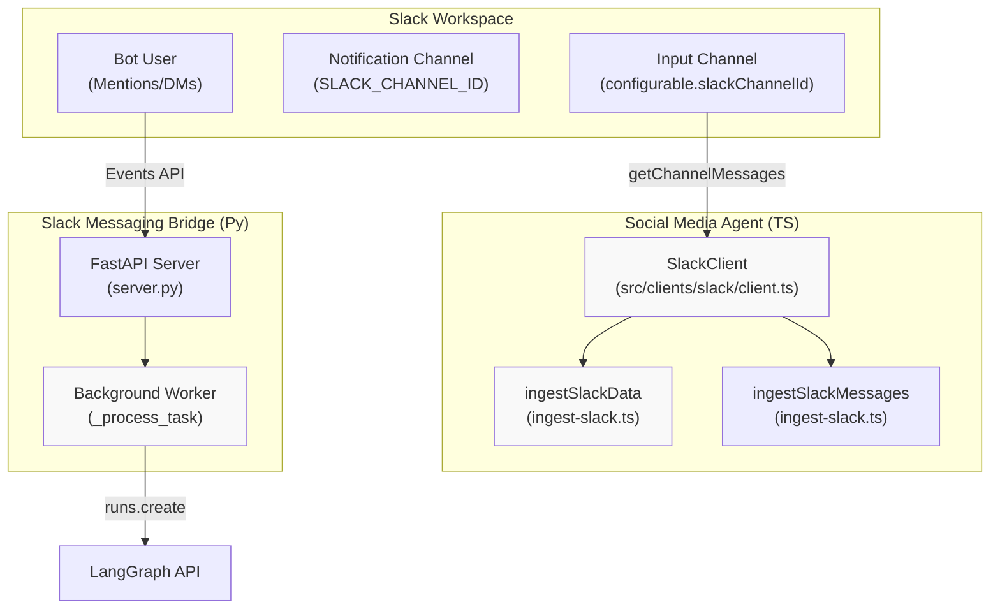

<!-- source: DeepWiki mcp.deepwiki.com · repo langchain-ai/social-media-agent · page 3.3 Slack Integration · fetched 2026-10-26 -->

# Slack Integration

Relevant source files

The following files were used as context for generating this wiki page:

- [scripts/get-scheduled-runs.ts](scripts/get-scheduled-runs.ts)
- [slack-messaging/.gitignore](slack-messaging/.gitignore)
- [slack-messaging/README.md](slack-messaging/README.md)
- [slack-messaging/src/langgraph_slack/__init__.py](slack-messaging/src/langgraph_slack/__init__.py)
- [slack-messaging/src/langgraph_slack/__main__.py](slack-messaging/src/langgraph_slack/__main__.py)
- [slack-messaging/src/langgraph_slack/auth.py](slack-messaging/src/langgraph_slack/auth.py)
- [slack-messaging/src/langgraph_slack/config.py](slack-messaging/src/langgraph_slack/config.py)
- [slack-messaging/src/langgraph_slack/server.py](slack-messaging/src/langgraph_slack/server.py)
- [src/agents/ingest-data/nodes/ingest-slack.ts](src/agents/ingest-data/nodes/ingest-slack.ts)
- [src/agents/ingest-repurposed-data/nodes/ingest-slack.ts](src/agents/ingest-repurposed-data/nodes/ingest-slack.ts)
- [src/clients/slack/client.ts](src/clients/slack/client.ts)
- [src/clients/slack/types.ts](src/clients/slack/types.ts)
- [src/clients/slack/utils.ts](src/clients/slack/utils.ts)
- [src/tests/slack.int.test.ts](src/tests/slack.int.test.ts)

## Purpose and Scope

This page documents the Slack integration in the social media agent system. Slack serves three primary functions: (1) ingesting URLs and messages from Slack channels for post generation, (2) sending notifications about scheduled posts and system status, and (3) providing a standalone bridge (`slack-messaging`) to connect LangGraph applications directly to Slack workspaces for interactive chat.

## Overview

The Slack integration provides a bidirectional communication channel. The system can read messages from configured Slack channels to extract URLs for content generation and send notifications back to Slack when posts are scheduled. Additionally, a specialized Python-based module allows the system to act as a Slack bot, responding to mentions and DMs by proxying messages to LangGraph assistants.

**Sources:** [src/clients/slack/client.ts:62-96](), [slack-messaging/src/langgraph_slack/server.py:1-40]()

## Architecture

The integration consists of a TypeScript `SlackClient` used within LangGraph nodes and a standalone Python `slack-messaging` service.

**Sources:** [src/agents/ingest-data/nodes/ingest-slack.ts:12-47](), [slack-messaging/src/langgraph_slack/server.py:59-109]()

## Slack Client Implementation

The `SlackClient` class [src/clients/slack/client.ts:62-245]() wraps the official `@slack/web-api`. It is instantiated using `SLACK_BOT_OAUTH_TOKEN` [src/clients/slack/client.ts:66-71]().

### Key Methods

| Method | Description |
|--------|-------------|
| `getChannelMessages` | Fetches history from a channel, filtered by `maxMessages` and `maxHoursHistory` [src/clients/slack/client.ts:144-196](). |
| `sendMessage` | Posts a plain text message to a specific channel [src/clients/slack/client.ts:209-218](). |
| `makeFilePublic` | Enables public sharing for a file and retrieves its public URL [src/clients/slack/client.ts:238-244](). |
| `getReplies` | Retrieves a message thread for a given parent timestamp [src/clients/slack/client.ts:198-207](). |

### Data Normalization
The client converts raw Slack messages into a `SimpleSlackMessage` interface [src/clients/slack/client.ts:23-32]() to simplify downstream processing in the graphs. This includes extracting text, user IDs, and file/attachment IDs [src/clients/slack/client.ts:122-142]().

**Sources:** [src/clients/slack/client.ts:23-32](), [src/clients/slack/client.ts:144-245]()

## Message Ingestion Workflows

The system utilizes Slack ingestion in two distinct graphs:

### 1. Data Curation Ingestion
The `ingestSlackData` function [src/agents/ingest-data/nodes/ingest-slack.ts:12-47]() fetches messages from a channel specified by `configurable.slackChannelId`. It uses `extractUrlsFromSlackText` to identify links within the message text [src/agents/ingest-data/nodes/ingest-slack.ts:36-42]().

### 2. Content Repurposing Ingestion
The `ingestSlackMessages` function [src/agents/ingest-repurposed-data/nodes/ingest-slack.ts:15-37]() fetches full message objects for the repurposer graph. It retrieves the channel ID from `config.configurable.repurposerSlackChannelId` [src/agents/ingest-repurposed-data/nodes/ingest-slack.ts:8-13]().

**Sources:** [src/agents/ingest-data/nodes/ingest-slack.ts:12-47](), [src/agents/ingest-repurposed-data/nodes/ingest-slack.ts:15-37]()

## Standalone Messaging Bridge (`slack-messaging`)

The `slack-messaging` module is a Python FastAPI application that acts as a bridge between Slack's Events API and the LangGraph SDK.

### Event Processing Flow
1. **Endpoint**: Slack sends events to `/events/slack` [slack-messaging/src/langgraph_slack/server.py:181-183]().
2. **Filtering**: `handle_message` ignores messages from bots or those not mentioning the agent [slack-messaging/src/langgraph_slack/server.py:139-150]().
3. **Queueing**: Valid events are put into an `asyncio.Queue` [slack-messaging/src/langgraph_slack/server.py:149]().
4. **Worker**: The `_process_task` function creates a new run in LangGraph using `LANGGRAPH_CLIENT.runs.create` [slack-messaging/src/langgraph_slack/server.py:81-107]().
5. **Callback**: When the LangGraph run completes, it hits the `/callbacks/{thread_id}` endpoint [slack-messaging/src/langgraph_slack/server.py:203-210](), which triggers the worker to post the response back to Slack via `chat_postMessage` [slack-messaging/src/langgraph_slack/server.py:123-131]().

### Authentication
The bridge includes a custom authenticator [slack-messaging/src/langgraph_slack/auth.py:7-12]() that allows requests with a `Slackbot` User-Agent to access the LangGraph API with `read` and `write` permissions.

**Sources:** [slack-messaging/src/langgraph_slack/server.py:59-136](), [slack-messaging/src/langgraph_slack/auth.py:7-12]()

## Notification and Reporting

The script `scripts/get-scheduled-runs.ts` provides a mechanism for reporting the status of scheduled posts back to Slack.

### Scheduled Run Reporting
The `getScheduledRuns` function:
1. Searches for active threads in the `upload_post` graph [scripts/get-scheduled-runs.ts:24-29]().
2. Extracts post content and scheduled dates from run metadata [scripts/get-scheduled-runs.ts:32-48]().
3. Formats a summary message including the total count and details for each post [scripts/get-scheduled-runs.ts:57-77]().
4. Sends the report to the channel defined in `process.env.SLACK_CHANNEL_ID` [scripts/get-scheduled-runs.ts:79-85]().

**Sources:** [scripts/get-scheduled-runs.ts:18-89]()

## Configuration Summary

### Environment Variables
| Variable | Context | Purpose |
|----------|---------|---------|
| `SLACK_BOT_OAUTH_TOKEN` | TypeScript | Primary token for `SlackClient` [src/clients/slack/client.ts:66](). |
| `SLACK_BOT_USER_OAUTH_TOKEN` | TypeScript | Token used specifically for `makeFilePublic` [src/clients/slack/client.ts:241](). |
| `SLACK_CHANNEL_ID` | Scripts | Destination for status reports and notifications [scripts/get-scheduled-runs.ts:79](). |
| `SLACK_BOT_TOKEN` | Python | Token for the Slack Messaging bridge [slack-messaging/src/langgraph_slack/config.py:9](). |
| `SLACK_BOT_USER_ID` | Python | ID used to filter mentions [slack-messaging/src/langgraph_slack/config.py:8](). |

### Runtime Configuration
Nodes expect channel IDs in the `configurable` object of the `LangGraphRunnableConfig`:
- `slackChannelId`: Used by `ingestSlackData` [src/agents/ingest-data/nodes/ingest-slack.ts:9]().
- `repurposerSlackChannelId`: Used by `ingestSlackMessages` [src/agents/ingest-repurposed-data/nodes/ingest-slack.ts:8]().

**Sources:** [src/agents/ingest-data/nodes/ingest-slack.ts:6-10](), [src/agents/ingest-repurposed-data/nodes/ingest-slack.ts:5-13](), [slack-messaging/src/langgraph_slack/config.py:1-24]()

---

