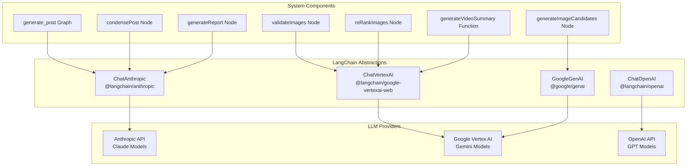
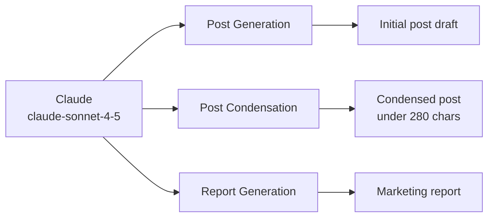

<!-- source: DeepWiki mcp.deepwiki.com · repo langchain-ai/social-media-agent · page 3.4 LLM Providers · fetched 2026-10-26 -->

# LLM Providers

<details>
<summary>Relevant source files</summary>

The following files were used as context for generating this wiki page:

- [package.json](package.json)
- [src/agents/find-and-generate-images/community-template.ts](src/agents/find-and-generate-images/community-template.ts)
- [src/agents/find-and-generate-images/helpers.ts](src/agents/find-and-generate-images/helpers.ts)
- [src/agents/find-and-generate-images/nodes/generate-images.ts](src/agents/find-and-generate-images/nodes/generate-images.ts)
- [src/agents/repurposer/nodes/validate-images.ts](src/agents/repurposer/nodes/validate-images.ts)
- [src/agents/shared/youtube/video-summary.ts](src/agents/shared/youtube/video-summary.ts)
- [yarn.lock](yarn.lock)

</details>


## Purpose and Scope

This document describes how the social media agent integrates with AI model providers to power content generation, image processing, and content analysis workflows. The system uses multiple LLM providers, each optimized for specific tasks: Anthropic Claude for text generation, Google Vertex AI for multimodal operations and image generation, and OpenAI as an alternative provider.

For information about specific workflows that use these providers, see [Post Generation](./2.3) and [Image Processing](./2.4).

---

## Architecture Overview

The system integrates three primary LLM providers through LangChain's abstraction layer, allowing it to leverage specialized capabilities from each:



**Sources:** [package.json:37-47](), [src/agents/generate-post/nodes/condense-post.ts:89-92](), [src/agents/find-and-generate-images/nodes/generate-images.ts:316-338](), [src/agents/find-and-generate-images/nodes/validate-images.ts:172-175](), [src/agents/shared/youtube/video-summary.ts:23-26]()

---

## Provider Dependencies

The system declares its LLM provider dependencies in `package.json`:

| Package | Version | Purpose |
|---------|---------|---------|
| `@langchain/anthropic` | ^1.3.28 | Anthropic Claude integration |
| `@langchain/openai` | ^1.4.5 | OpenAI GPT integration |
| `@langchain/google-vertexai-web` | ^1.0.0 | Google Vertex AI integration (LangChain wrapper) |
| `@google/genai` | ^1.50.1 | Google Generative AI SDK (direct API) |

The system uses two different approaches for Google's services:
- **LangChain wrapper** (`ChatVertexAI`) for chat/text and multimodal analysis.
- **Native SDK** (`GoogleGenAI`) for advanced image generation with multimodal inputs.

**Sources:** [package.json:39-47]()

---

## Anthropic Claude Integration

### Usage Pattern

Anthropic Claude serves as the primary text generation engine, specifically the `claude-sonnet-4-5` model. The system instantiates it through LangChain's `ChatAnthropic` class:

```typescript
// Example from condensePost node
const condensePostModel = new ChatAnthropic({
  model: "claude-sonnet-4-5",
  temperature: 0.5,
});
```

### Tasks Powered by Claude



**Sources:** [src/agents/generate-post/nodes/condense-post.ts:89-92]()

---

## Google Vertex AI Integration

### Dual Integration Strategy

The system uses Google's AI services through two distinct clients:

#### 1. ChatVertexAI (LangChain Wrapper)

Used for multimodal tasks like image validation and video summarization:

```typescript
// Example from video-summary.ts
const model = new ChatVertexAI({
  model: "gemini-2.5-pro",
  temperature: 0,
});
```

**Use Cases:**
- **Image Validation:** Identifying relevant images from web content [src/agents/repurposer/nodes/validate-images.ts:172-175]().
- **Image Re-ranking:** Sorting discovered images by relevance.
- **Video Summarization:** Processing YouTube video content directly via URI [src/agents/shared/youtube/video-summary.ts:23-40]().

#### 2. GoogleGenAI (Native SDK)

Used for brand-aligned image generation:

```typescript
// Example from generate-images.ts
const GEMINI_MODEL = "gemini-3-pro-image-preview";
```

**Use Cases:**
- **Image Generation:** Creating professional developer-focused images following strict `GENERATE_IMAGE_PROMPT_TEMPLATE` rules [src/agents/find-and-generate-images/nodes/generate-images.ts:14-118]().

### Model Selection

| Model | Task | Client |
|-------|------|--------|
| `gemini-2.5-pro` | Video Summary, Image Validation | `ChatVertexAI` |
| `gemini-3-pro-image-preview` | Image Generation | `GoogleGenAI` |

**Sources:** [src/agents/find-and-generate-images/nodes/generate-images.ts:14](), [src/agents/shared/youtube/video-summary.ts:24](), [src/agents/repurposer/nodes/validate-images.ts:173]()

---

## Authentication and Credentials

### Anthropic Authentication
Uses standard LangChain environment variable handling for `ANTHROPIC_API_KEY`.

### Google Vertex AI Authentication
Google services require structured credentials, typically passed as a JSON object via environment variables. The `GoogleGenAI` client is initialized with `vertexai: true` and the project ID [src/agents/find-and-generate-images/nodes/generate-images.ts:323-338]().

---

## Model Selection by Task

| Task | Provider | Model | Temperature | Rationale |
|------|----------|-------|-------------|-----------|
| Post Generation | Anthropic | claude-sonnet-4-5 | ~0.5 | Creative but structured |
| Video Summary | Google | gemini-2.5-pro | 0 | High accuracy for media analysis |
| Image Validation | Google | gemini-2.5-pro | 0 | Deterministic filtering |
| Image Generation | Google | gemini-3-pro-image-preview | 1.2-1.8 | High visual variety |

**Sources:** [src/agents/shared/youtube/video-summary.ts:25](), [src/agents/repurposer/nodes/validate-images.ts:174](), [src/agents/find-and-generate-images/nodes/generate-images.ts:384]()

---

## Image Generation Pipeline

### Brand Template Integration
The system doesn't just generate a raw image. It uses a post-processing pipeline to embed the AI output into a brand-compliant SVG template:

1. **Generation:** `gemini-3-pro-image-preview` generates an image based on `GENERATE_IMAGE_PROMPT_TEMPLATE` [src/agents/find-and-generate-images/nodes/generate-images.ts:16-118]().
2. **Embedding:** `embedImageInTemplate` replaces placeholders in `COMMUNITY_TEMPLATE_SVG` with the generated base64 data [src/agents/find-and-generate-images/helpers.ts:15-25]().
3. **Rendering:** `sharp` converts the modified SVG into a high-resolution PNG buffer [src/agents/find-and-generate-images/helpers.ts:45-50]().
4. **Persistence:** `uploadImageBufferToSupabase` stores the final branded image and returns a signed URL [src/agents/find-and-generate-images/helpers.ts:59-100]().

**Sources:** [src/agents/find-and-generate-images/helpers.ts:15-50](), [src/agents/find-and-generate-images/community-template.ts:1-5]()

---

## Optimization Strategies

### Multimodal Batching
When validating images extracted from a page, the system chunks images into groups of 10 to manage prompt size and provider limits [src/agents/repurposer/nodes/validate-images.ts:187-198]().

### Video Length Constraints
To optimize performance and cost, the system limits video summarization to videos under 30 minutes (1800 seconds) [src/agents/shared/youtube/video-summary.ts:85-90]().

### Error Handling
The image generation logic includes `retryWithTimeout` with 3 retries and a 120-second timeout to handle transient API failures [src/agents/find-and-generate-images/nodes/generate-images.ts:387-390]().

**Sources:** [src/agents/repurposer/nodes/validate-images.ts:187](), [src/agents/shared/youtube/video-summary.ts:85](), [src/agents/find-and-generate-images/nodes/generate-images.ts:387-390]()

---

