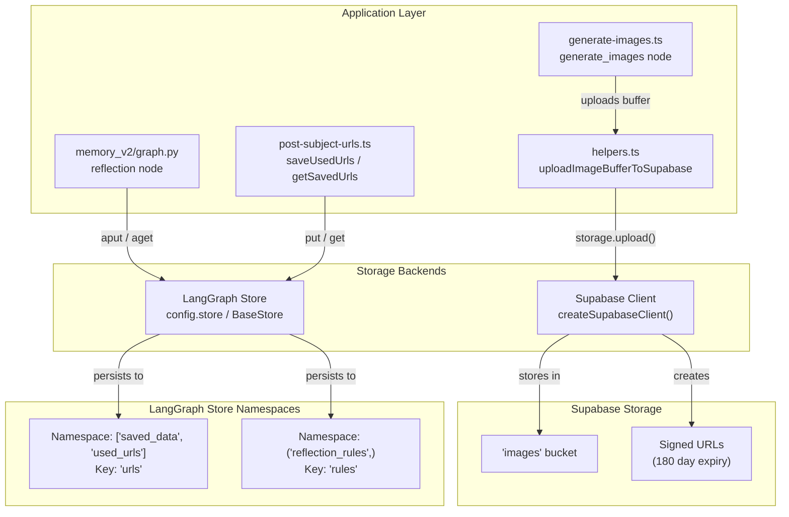
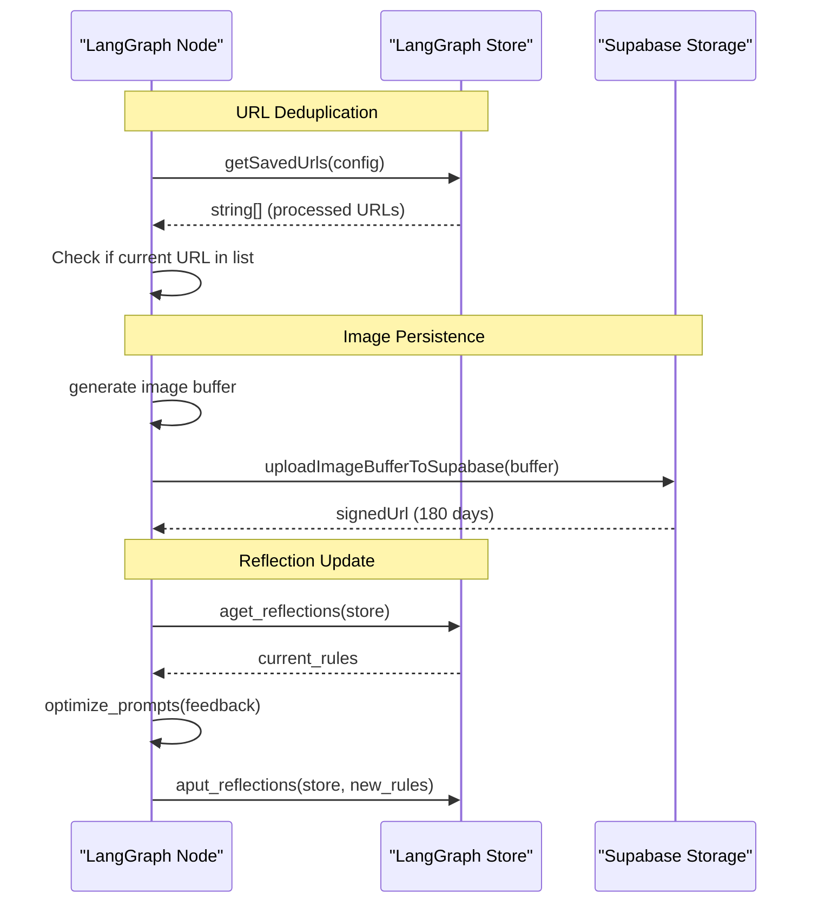

<!-- source: DeepWiki mcp.deepwiki.com · repo langchain-ai/social-media-agent · page 3.5 Storage and Persistence · fetched 2026-10-26 -->

# Storage and Persistence

Relevant source files

The following files were used as context for generating this wiki page:

- [.env.full.example](.env.full.example)
- [.env.quickstart.example](.env.quickstart.example)
- [FEATURES.md](FEATURES.md)
- [memory-v2/Makefile](memory-v2/Makefile)
- [memory-v2/README.md](memory-v2/README.md)
- [memory-v2/langgraph.json](memory-v2/langgraph.json)
- [memory-v2/memory_v2/graph.py](memory-v2/memory_v2/graph.py)
- [memory-v2/memory_v2/state.py](memory-v2/memory_v2/state.py)
- [src/agents/find-and-generate-images/community-template.ts](src/agents/find-and-generate-images/community-template.ts)
- [src/agents/find-and-generate-images/helpers.ts](src/agents/find-and-generate-images/helpers.ts)
- [src/agents/find-and-generate-images/nodes/generate-images.ts](src/agents/find-and-generate-images/nodes/generate-images.ts)
- [src/agents/shared/stores/post-subject-urls.ts](src/agents/shared/stores/post-subject-urls.ts)

This page documents the storage and persistence mechanisms used by the social media agent system. The system uses two primary storage backends: **Supabase** for image storage and **LangGraph Store** for metadata, processed content tracking, and reflection rules.

---

## Overview

The system persists data across several categories to ensure idempotency, brand consistency, and continuous learning.

| Data Type | Storage Backend | Purpose | Expiration |
|-----------|----------------|---------|------------|
| Generated Images | Supabase Storage | Public hosting of AI-generated social media images | 180 days (signed URLs) |
| Screenshots | Supabase Storage | Captured screenshots of content URLs | 180 days (signed URLs) |
| Processed URLs | LangGraph Store | Tracking of previously used content to prevent duplicates | Persistent |
| Reflection Rules | LangGraph Store | User feedback-based prompt optimizations | Persistent |
| Scheduled Posts | LangGraph Runs | Delayed execution of post uploads | Until execution |

**Sources:** [src/agents/find-and-generate-images/helpers.ts:6-6](), [src/agents/shared/stores/post-subject-urls.ts:4-6](), [memory-v2/memory_v2/graph.py:16-18]()

---

## Storage Architecture Diagram

**Sources:** [src/agents/find-and-generate-images/helpers.ts:59-101](), [src/agents/shared/stores/post-subject-urls.ts:17-64](), [memory-v2/memory_v2/graph.py:21-40]()

---

## Supabase Image Storage

### Implementation

The system uses Supabase to host images generated during the workflow. The primary utility for this is `uploadImageBufferToSupabase`, which handles the lifecycle from buffer validation to signed URL generation.

**Key functions:**
- `uploadImageBufferToSupabase`: Uploads a buffer and returns a signed URL. [src/agents/find-and-generate-images/helpers.ts:59-101]()
- `embedImageInTemplate`: Combines generated image data with the LangChain brand SVG template using `sharp`. [src/agents/find-and-generate-images/helpers.ts:15-51]()

| Aspect | Detail |
|--------|--------|
| **Bucket** | `images` [src/agents/find-and-generate-images/helpers.ts:75-75]() |
| **Signed URL Expiry** | 180 days (15,552,000 seconds) [src/agents/find-and-generate-images/helpers.ts:6-6]() |
| **File Naming** | `{prefix}-{Date.now()}-{randomSuffix}.{extension}` [src/agents/find-and-generate-images/helpers.ts:72-72]() |

### Image Processing Flow

When the `generate-images` node executes, it performs the following:
1. Generates an image via `gemini-3-pro-image-preview`. [src/agents/find-and-generate-images/nodes/generate-images.ts:14-14]()
2. Calls `embedImageInTemplate` to wrap the image in the `COMMUNITY_TEMPLATE_SVG`. [src/agents/find-and-generate-images/helpers.ts:15-43]()
3. Uses `sharp` to render the SVG to a PNG buffer. [src/agents/find-and-generate-images/helpers.ts:45-48]()
4. Uploads the final PNG to Supabase. [src/agents/find-and-generate-images/helpers.ts:59-62]()

**Sources:** [src/agents/find-and-generate-images/helpers.ts:1-101](), [src/agents/find-and-generate-images/nodes/generate-images.ts:1-14]()

---

## LangGraph Store Usage

The system utilizes the LangGraph `BaseStore` for cross-thread persistence of non-state data.

### 1. Processed Content Tracking (Idempotency)

To prevent generating duplicate posts for the same source material, the system tracks URLs that have already reached the human review stage.

- **Namespace:** `["saved_data", "used_urls"]` [src/agents/shared/stores/post-subject-urls.ts:4-4]()
- **Key:** `"urls"` [src/agents/shared/stores/post-subject-urls.ts:5-5]()

**Logic Flow:**
1. Before post generation, `getSavedUrls` is called to retrieve the list of processed links. [src/agents/shared/stores/post-subject-urls.ts:48-64]()
2. If the current URL is in this list, the graph routes to `END`. [FEATURES.md:20-22]()
3. When a post reaches the `humanNode`, `saveUsedUrls` adds the new URLs to the store. [src/agents/shared/stores/post-subject-urls.ts:17-40]()

**Configurable Overrides:**
- `SKIP_USED_URLS_CHECK`: If set to `true`, the system bypasses this check and does not save URLs. [src/agents/shared/stores/post-subject-urls.ts:22-24](), [FEATURES.md:26-31]()

### 2. Reflection and Learning

The `reflection_v2` graph uses the store to persist optimized prompt rules derived from user feedback.

- **Namespace:** `("reflection_rules",)` [memory-v2/memory_v2/graph.py:16-16]()
- **Key:** `"rules"` [memory-v2/memory_v2/graph.py:17-17]()

**Implementation:**
- `aget_reflections`: Retrieves current rules from the store. [memory-v2/memory_v2/graph.py:21-32]()
- `aput_reflections`: Updates the store with new rules generated by the `optimizer`. [memory-v2/memory_v2/graph.py:35-37]()
- `reflection` node: Uses `ChatAnthropic` and `langmem`'s `create_prompt_optimizer` to analyze user feedback and update the stored rules. [memory-v2/memory_v2/graph.py:40-82]()

**Sources:** [src/agents/shared/stores/post-subject-urls.ts:1-65](), [memory-v2/memory_v2/graph.py:1-92](), [FEATURES.md:18-31]()

---

## Data Flow: Storage Integration

**Sources:** [src/agents/shared/stores/post-subject-urls.ts:48-64](), [src/agents/find-and-generate-images/helpers.ts:59-101](), [memory-v2/memory_v2/graph.py:40-82]()

---

## Configuration Requirements

To enable these persistence features, the following environment variables must be configured:

| Variable | Role | Source |
|----------|------|--------|
| `SUPABASE_URL` | API endpoint for Supabase project | [.env.full.example:72]() |
| `SUPABASE_SERVICE_ROLE_KEY` | Auth key for storage uploads | [.env.full.example:73]() |
| `SKIP_USED_URLS_CHECK` | Flag to disable URL tracking | [.env.full.example:100]() |

**Sources:** [.env.full.example:71-74](), [.env.full.example:99-101]()

---

