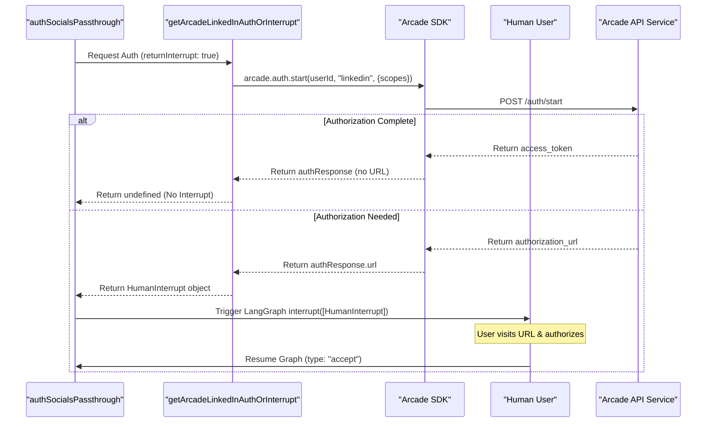
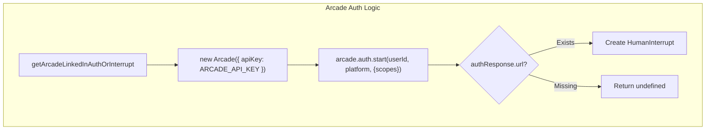

<!-- source: DeepWiki mcp.deepwiki.com · repo langchain-ai/social-media-agent · page 3.6 Arcade Authentication · fetched 2026-10-26 -->

# Arcade Authentication

<details>
<summary>Relevant source files</summary>

The following files were used as context for generating this wiki page:

- [.eslintrc.cjs](.eslintrc.cjs)
- [src/agents/generate-post/nodes/auth-socials.ts](src/agents/generate-post/nodes/auth-socials.ts)
- [src/agents/shared/auth/linkedin.ts](src/agents/shared/auth/linkedin.ts)
- [src/agents/shared/auth/twitter.ts](src/agents/shared/auth/twitter.ts)
- [src/clients/auth-server.ts](src/clients/auth-server.ts)
- [src/clients/linkedin.ts](src/clients/linkedin.ts)
- [src/clients/reddit/snoowrap.ts](src/clients/reddit/snoowrap.ts)
- [src/clients/types.ts](src/clients/types.ts)
- [src/tests/linkedin.int.test.ts](src/tests/linkedin.int.test.ts)

</details>


## Purpose and Scope

This document covers the Arcade authentication system, which provides unified OAuth handling for Twitter and LinkedIn publishing in the social media agent. Arcade serves as an authentication abstraction layer that simplifies the OAuth flow for social media platforms by providing a managed authorization interface.

For information about the direct API authentication alternative, see the Twitter Integration (3.1) and LinkedIn Integration (3.2) pages. For details on how authentication is triggered during post generation, see Human Review Process (2.5).

---

## Overview

### What is Arcade

Arcade is a third-party service that provides unified OAuth management for social media platforms. The system uses Arcade to handle authorization flows for both Twitter and LinkedIn, eliminating the need to implement platform-specific OAuth flows directly within the agent's codebase.

**Key Benefits:**
- Simplified OAuth implementation across multiple platforms.
- Single API key manages multiple social media authentications.
- Automatic token management and refresh via the Arcade service.
- Human-in-the-loop authorization prompts integrated into LangGraph.

**Trade-offs:**
- Twitter media uploads still require direct Twitter API credentials for OAuth 1.0a compatibility.
- Cannot be used simultaneously with direct API authentication mode.
- Adds dependency on the Arcade service.

Sources: [src/agents/shared/auth/linkedin.ts:104-107](), [src/agents/shared/auth/twitter.ts:31-33](), [src/clients/linkedin.ts:281-309]()

---

## Configuration

### Environment Variables

Arcade authentication requires specific environment variables to be set. The system checks the `USE_ARCADE_AUTH` flag to determine which authentication path to execute.

| Variable | Required | Purpose |
|----------|----------|---------|
| `ARCADE_API_KEY` | Yes | API key for the Arcade service. |
| `TWITTER_USER_ID` | Yes* | User identifier for Twitter authentication within Arcade. |
| `LINKEDIN_USER_ID` | Yes* | User identifier for LinkedIn authentication within Arcade. |
| `USE_ARCADE_AUTH` | Yes | Feature flag to enable Arcade mode (must be `true`). |

*\*Required when posting to the respective platform.*

Sources: [src/agents/shared/auth/linkedin.ts:162-170](), [src/agents/shared/auth/twitter.ts:139-145](), [src/agents/shared/auth/linkedin.ts:9-9]()

---

## Authentication Flow

### OAuth Authorization Process

The Arcade authentication flow follows a sequence where the system requests an authorization status. If the user has not yet authorized the application, Arcade returns a URL which is then presented to the user via a LangGraph `interrupt`.

**Authorization Sequence:**



Sources: [src/agents/shared/auth/linkedin.ts:93-155](), [src/agents/shared/auth/twitter.ts:24-82](), [src/agents/generate-post/nodes/auth-socials.ts:8-76]()

### Human Interrupt Mechanism

When authorization is required, the system creates a `HumanInterrupt` object. This object contains the description and metadata necessary for the frontend or user to complete the OAuth handshake.

**Interrupt Logic:**
1. **Check Status:** The node calls `arcade.auth.start()`.
2. **Handle URL:** If a `url` is returned, the user must authorize.
3. **Interrupt:** The graph execution pauses. The `HumanInterrupt` includes the `authorizeLinkedInURL` or `authorizeTwitterURL` in the `action_request.args`.
4. **Resume:** Once the user clicks "Accept" in the interface, the graph continues.

Sources: [src/agents/shared/auth/linkedin.ts:109-134](), [src/agents/shared/auth/twitter.ts:35-60]()

---

## Code Architecture

### Key Authentication Functions

#### Platform-Specific Auth Helpers

The system provides platform-specific helpers that abstract the choice between "Basic" (direct API) and "Arcade" authentication based on the `USE_ARCADE_AUTH` flag.

**LinkedIn Auth Routing:**
`getLinkedInAuthOrInterrupt` [src/agents/shared/auth/linkedin.ts:157-182]()
- Checks `useArcadeAuth()`.
- If true, calls `getArcadeLinkedInAuthOrInterrupt`.
- If false, calls `getBasicLinkedInAuthOrInterrupt` (which uses `LINKEDIN_ACCESS_TOKEN`).

**Twitter Auth Routing:**
`getTwitterAuthOrInterrupt` [src/agents/shared/auth/twitter.ts:135-156]()
- Checks `useArcadeAuth()`.
- If true, calls `getArcadeTwitterAuthOrInterrupt`.
- If false, calls `getBasicTwitterAuthOrInterrupt`.

#### Arcade Implementation Details

The Arcade-specific functions initialize the `Arcade` client and manage the interaction with the SDK.



Sources: [src/agents/shared/auth/linkedin.ts:93-107](), [src/agents/shared/auth/twitter.ts:24-33]()

### Combined Authorization Node

The `authSocialsPassthrough` node in the `generate-post` graph is responsible for checking both Twitter and LinkedIn authorization in a single step before content is published.

**Functionality:**
- It calls both platform helpers with `returnInterrupt: true` [src/agents/generate-post/nodes/auth-socials.ts:16-30]().
- It aggregates the results into a single `combinedArgs` object [src/agents/generate-post/nodes/auth-socials.ts:37-40]().
- It presents a single, combined `HumanInterrupt` to the user if either platform requires authorization [src/agents/generate-post/nodes/auth-socials.ts:52-64]().

Sources: [src/agents/generate-post/nodes/auth-socials.ts:8-76]()

---

## Client Integration

### LinkedInClient Arcade Methods

The `LinkedInClient` class includes static and instance logic for Arcade.

- **`LinkedInClient.authorizeUser`**: A static method that wraps `arcade.auth.start`. It dynamically sets scopes to `["w_member_social", "w_organization_social"]` if `postToOrganization` is requested [src/clients/linkedin.ts:281-309]().
- **`LinkedInClient.fromArcade`**: A factory method that authenticates via Arcade, extracts the `access_token` and `user_urn`, and returns a fully initialized `LinkedInClient` instance [src/clients/linkedin.ts:311-337]().

### TwitterClient Arcade Methods

The `TwitterClient` uses a similar pattern. It calls `TwitterClient.authorizeUser(twitterUserId, arcade)` to retrieve either the bearer token or the authorization URL [src/agents/shared/auth/twitter.ts:31]().

---

## Error Handling

The authentication logic includes specific error states to prevent the graph from continuing without valid credentials:

| Error Condition | Behavior |
|-----------------|----------|
| **Missing User ID** | Throws "Must provide [Platform] User ID when using Arcade auth" if IDs are not provided in Arcade mode [src/agents/shared/auth/linkedin.ts:165](). |
| **User Ignores Interrupt** | If the user selects "ignore" on the authorization interrupt, the graph throws "Authorization denied by user" and terminates [src/agents/shared/auth/linkedin.ts:151](), [src/agents/shared/auth/twitter.ts:77](). |
| **Incomplete Auth** | If a user "accepts" the interrupt but the Arcade check still returns a URL, the system throws "User accepted authorization, but authorization is still needed" [src/agents/shared/auth/linkedin.ts:146-148](). |

---

## Limitations and Considerations

### Twitter Media Uploads
While Arcade handles the OAuth flow for text posting, the `TwitterClient` still requires direct API credentials (API Key and Secret) for certain operations, particularly those involving media uploads or legacy OAuth 1.0a requirements not fully covered by the Arcade managed token.

### Scopes and Organization Posting
When using Arcade for LinkedIn, the requested scopes are conditional. If `postToOrg` is true, the system requests `w_organization_social` in addition to `w_member_social` [src/agents/shared/auth/linkedin.ts:101-103](). Users must ensure their LinkedIn App has these permissions enabled.

### Type Safety
The system uses a discriminated union `AuthorizeUserResponse` to handle the dual-nature of the Arcade response (either a token or a URL).

```typescript
export type AuthorizeUserResponse =
  | {
      token: string;
      authorizationUrl?: never;
    }
  | {
      token?: never;
      authorizationUrl: string;
    };
```

Sources: [src/clients/types.ts:4-24]()

---

