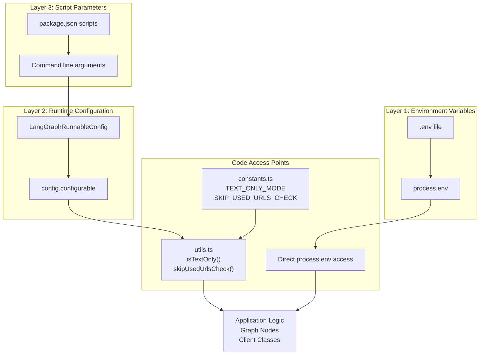
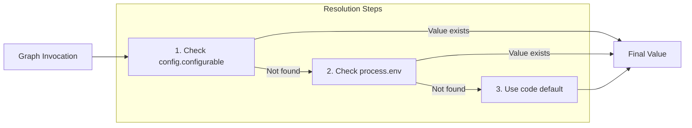

<!-- source: DeepWiki mcp.deepwiki.com · repo langchain-ai/social-media-agent · page 4 Configuration · fetched 2026-10-26 -->

# Configuration

<details>
<summary>Relevant source files</summary>

The following files were used as context for generating this wiki page:

- [.env.full.example](.env.full.example)
- [.env.quickstart.example](.env.quickstart.example)
- [FEATURES.md](FEATURES.md)
- [langgraph.json](langgraph.json)
- [src/agents/reflection/index.ts](src/agents/reflection/index.ts)
- [src/agents/shared/stores/post-subject-urls.ts](src/agents/shared/stores/post-subject-urls.ts)
- [src/utils/reflections.ts](src/utils/reflections.ts)

</details>


## Purpose and Scope

This document describes the configuration system for the social media agent, including environment variables, feature flags, runtime configuration options, and prompt customization. Configuration controls system behavior across three layers: environment variables (system-wide defaults), runtime configuration (per-graph-run overrides), and script parameters (one-off executions).

For information about setting up external service integrations and authentication, see [External Integrations](#3). For details on LangGraph graph definitions, see [LangGraph Configuration](#4.3). For prompt engineering and customization, see [Prompt Customization](#4.4).

---

## Configuration Architecture

The system implements a three-layer configuration hierarchy that determines behavior at runtime. Each layer serves a distinct purpose and has different precedence rules.

### Configuration Layers Overview



**Sources:** [langgraph.json:20](), [.env.full.example:1-101](), [src/agents/shared/stores/post-subject-urls.ts:22]()

### Configuration Resolution Order

Configuration values are resolved with the following precedence (highest to lowest):

1. **Runtime Configuration** (`config.configurable`) - Per-run overrides passed when creating a graph run.
2. **Environment Variables** (`process.env`) - System-wide defaults from `.env` file.
3. **Code Defaults** - Hardcoded fallback values in the application.



**Sources:** [src/agents/shared/stores/post-subject-urls.ts:22](), [FEATURES.md:27-31](), [FEATURES.md:55-57]()

---

## Environment Variables

Environment variables are defined in the `.env` file and provide system-wide default configuration. The system uses `dotenv` to load these values into `process.env` at startup.

### Environment Variable Categories

The system requires environment variables across functional categories:

| Category | Purpose | Required |
|----------|---------|----------|
| LangGraph Infrastructure | LangGraph server connection and LangSmith tracing | Yes |
| LLM Providers | API keys for Anthropic, Google Vertex AI | Yes |
| Social Media APIs | Authentication for Twitter and LinkedIn | Conditional |
| Content Sources | APIs for GitHub, FireCrawl, Slack | Conditional |
| Storage & Data | Supabase storage, LangGraph Store | Conditional |
| Authentication | Arcade API or direct OAuth credentials | Yes |

### LangGraph Infrastructure Variables

```bash
# LangGraph server endpoint
LANGGRAPH_API_URL="http://localhost:54367"

# LangSmith API key for tracing
LANGCHAIN_API_KEY=
LANGCHAIN_TRACING_V2=true

# Graph/Assistant ID for Slack messaging
LANGGRAPH_ASSISTANT_ID="ingest_repurposed_data"
```

**Sources:** [.env.full.example:2-7](), [.env.full.example:94]()

### LLM Provider Variables

```bash
# Anthropic Claude (primary LLM)
ANTHROPIC_API_KEY=

# Google Vertex AI (optional)
GOOGLE_VERTEX_AI_WEB_CREDENTIALS=
```

**Sources:** [.env.full.example:61-63](), [src/agents/reflection/index.ts:87]()

### Authentication Variables

The system supports two authentication modes: Arcade (unified OAuth) or direct API credentials.

#### Arcade Authentication Mode

```bash
# Arcade API key
ARCADE_API_KEY=

# Feature flag to enable Arcade
USE_ARCADE_AUTH="true"

# User identifiers for Arcade
TWITTER_USER_ID=
LINKEDIN_USER_ID=
```

**Sources:** [.env.full.example:13-20]()

#### Direct API Authentication Mode

The system can use direct developer credentials for Twitter and LinkedIn.

```bash
# LinkedIn secrets
LINKEDIN_CLIENT_ID=
LINKEDIN_CLIENT_SECRET=
LINKEDIN_ACCESS_TOKEN=

# Twitter secrets
TWITTER_API_KEY=
TWITTER_API_KEY_SECRET=
TWITTER_USER_TOKEN=
TWITTER_USER_TOKEN_SECRET=

# Feature flag to disable Arcade
USE_ARCADE_AUTH="false"
```

**Sources:** [.env.full.example:22-52]()

---

## Feature Flags

Feature flags control major system behaviors and can be toggled via environment variables or runtime configuration.

### System-Wide Feature Flags

| Flag | Default | Purpose | Impact |
|------|---------|---------|--------|
| `USE_ARCADE_AUTH` | `"true"` | Use Arcade for OAuth instead of direct API | Switches authentication flow for Twitter/LinkedIn |
| `USE_TWITTER_API_ONLY` | `false` | Force direct Twitter API usage | Overrides Arcade for Twitter operations |
| `SKIP_CONTENT_RELEVANCY_CHECK` | `"false"` | Bypass AI-based link verification | Assumes all links are valid/relevant |
| `SKIP_USED_URLS_CHECK` | `"false"` | Disable duplicate URL detection | Prevents saving/checking URLs in LangGraph Store |
| `POST_TO_LINKEDIN_ORGANIZATION` | `false` | Post to company page instead of personal | Changes target LinkedIn URN |
| `USE_LANGCHAIN_PROMPTS` | `false` | Enable LangChain-specific filtering | Checks `shouldExcludeContent` logic |

**Sources:** [.env.full.example:15](), [.env.full.example:36](), [.env.full.example:56](), [.env.full.example:97](), [.env.full.example:100](), [FEATURES.md:92-95]()

### Used URLs Check Logic

When `SKIP_USED_URLS_CHECK` is false, the system stores URLs in the LangGraph Store under the `["saved_data", "used_urls"]` namespace. If a URL is found in this store during a subsequent run, the graph routes to `END`.

**Sources:** [src/agents/shared/stores/post-subject-urls.ts:4-5](), [FEATURES.md:20-24]()

---

## Runtime Configuration

Runtime configuration provides per-graph-run overrides through the `configurable` object in the graph config.

### Passing Runtime Configuration

```typescript
// Example of passing configuration during a run creation
const res = await client.runs.create(thread_id, "generate_post", {
  input: { links: ["https://example.com"] },
  config: {
    configurable: {
      "skipUsedUrlsCheck": true,
      "skipContentRelevancyCheck": true
    },
  },
});
```

**Sources:** [FEATURES.md:41-51](), [FEATURES.md:67-77]()

---

## Prompt and Rule Configuration

The system uses the LangGraph Store to persist and evolve "reflection rules" that guide content generation based on user feedback.

### Reflection Store Configuration

The `reflection` graph analyzes user feedback and updates a ruleset stored in the LangGraph Store. These rules are then retrieved by the `generate_post` and `generate_thread` graphs to ensure consistent output style.

| Config Key | Store Namespace | Purpose |
|------------|-----------------|---------|
| `PROMPT_KEY` | `["reflection_rules"]` | Stores the actual text of the evolved rules prompt |
| `THREAD_RULESET_KEY` | `["reflection_rules"]` | Stores rules specific to thread generation |

**Sources:** [src/utils/reflections.ts:3-6](), [src/agents/reflection/index.ts:93]()

---

## LangGraph Configuration

The `langgraph.json` file defines the system's entry points, dependencies, and environment.

### Graph Definitions

The system defines 14 distinct graphs, each mapping a name to a specific entry point in the code:

```json
"graphs": {
  "ingest_data": "./src/agents/ingest-data/ingest-data-graph.ts:graph",
  "generate_post": "./src/agents/generate-post/generate-post-graph.ts:generatePostGraph",
  "upload_post": "./src/agents/upload-post/index.ts:uploadPostGraph",
  "reflection": "./src/agents/reflection/index.ts:reflectionGraph"
  // ... (see file for full list)
}
```

**Sources:** [langgraph.json:4-19]()

---

## Related Pages
- [Environment Variables](#4.1) — Detailed list of all supported variables.
- [Feature Flags](#4.2) — Detailed explanation of behavioral toggles.
- [LangGraph Configuration](#4.3) — Technical details of the `langgraph.json` structure.
- [Prompt Customization](#4.4) — How to modify the AI's persona and rules.

---

