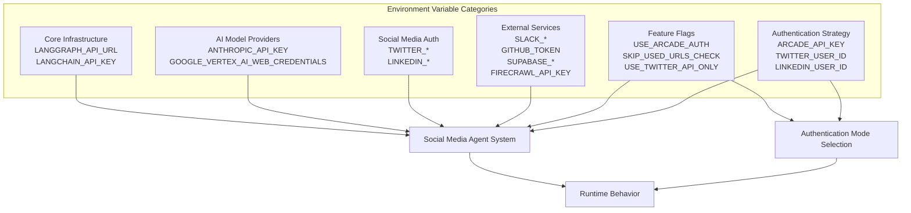
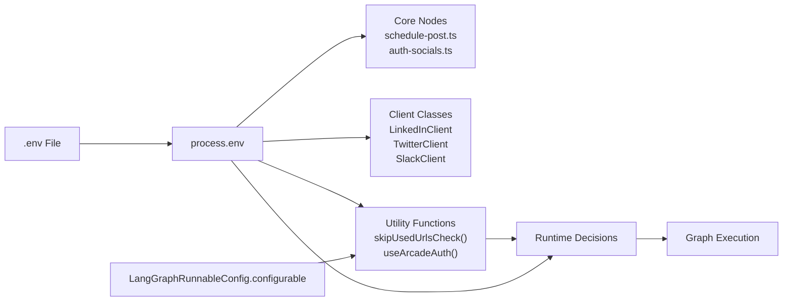
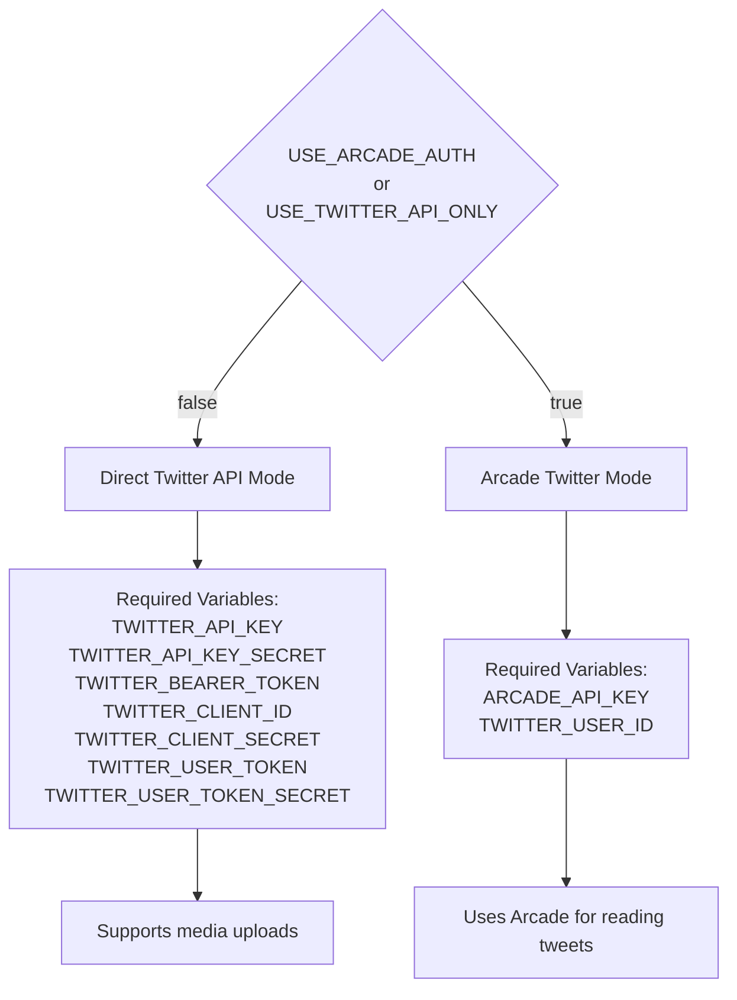
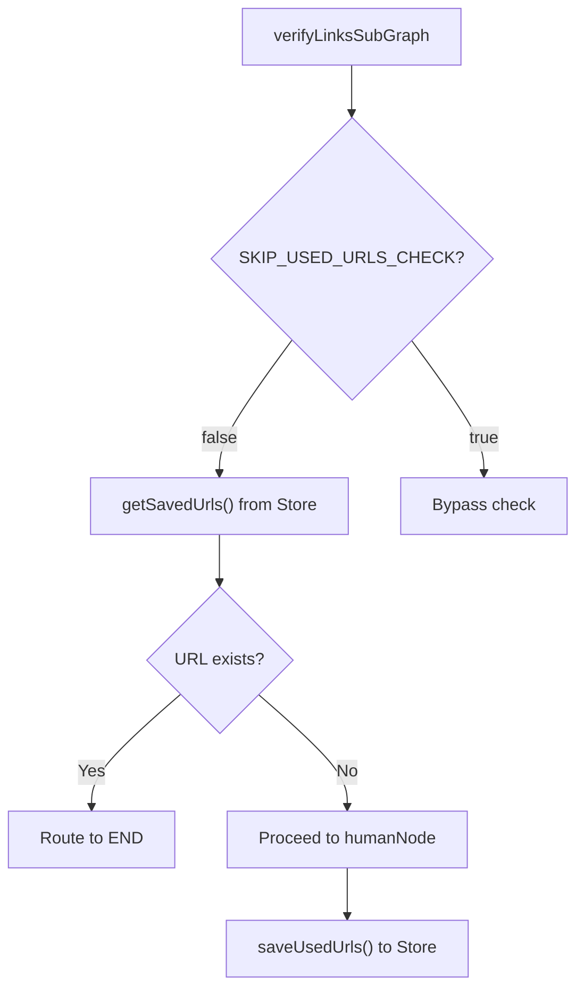

<!-- source: DeepWiki mcp.deepwiki.com · repo langchain-ai/social-media-agent · page 4.1 Environment Variables · fetched 2026-10-26 -->

# Environment Variables

Relevant source files

The following files were used as context for generating this wiki page:

- [.env.full.example](.env.full.example)
- [.env.quickstart.example](.env.quickstart.example)
- [FEATURES.md](FEATURES.md)
- [src/agents/shared/stores/post-subject-urls.ts](src/agents/shared/stores/post-subject-urls.ts)

This page documents all environment variables used by the social media agent system. Environment variables serve as system-wide configuration defaults that control API integrations, authentication methods, feature flags, and operational behavior.

For information about runtime configuration options that override these defaults on a per-run basis, see [Feature Flags](#4.2). For details on LangGraph-specific configuration, see [LangGraph Configuration](#4.3).

## Overview

The system uses environment variables from a `.env` file in the project root. Two example files are provided:

- `.env.quickstart.example` - Minimal configuration for basic functionality [.env.quickstart.example:1-30]()
- `.env.full.example` - Complete configuration for all features [.env.full.example:1-101]()

Environment variables fall into six primary categories:

1. **Core Infrastructure** - LangGraph server and LangSmith tracing
2. **AI Model Providers** - Anthropic, OpenAI, Google Vertex AI
3. **Social Media Authentication** - Twitter and LinkedIn credentials
4. **External Service APIs** - Slack, GitHub, Supabase, FireCrawl
5. **Feature Flags** - Behavioral switches that control system modes
6. **Authentication Strategy** - Arcade vs. Direct API credentials

### System Variable Flow

The following diagram maps environment variables to their primary code entities and roles.

**Sources:** [.env.full.example:1-101](), [.env.quickstart.example:1-30]()

## Configuration Flow

Environment variables are loaded at multiple points in the system lifecycle and interact with runtime configuration:

**Sources:** [src/agents/shared/stores/post-subject-urls.ts:22-24](), [.env.full.example:1-101]()

## Core Infrastructure Variables

These variables are required for the LangGraph server and tracing:

| Variable | Required | Description | Default |
|----------|----------|-------------|---------|
| `LANGCHAIN_API_KEY` | Yes | LangSmith API key for tracing and server authentication [.env.full.example:2]() | None |
| `LANGGRAPH_API_URL` | Yes | URL of the LangGraph server API [.env.full.example:7]() | `http://localhost:54367` |
| `LANGCHAIN_TRACING_V2` | No | Enable LangSmith tracing [.env.full.example:3]() | `true` |
| `SESSION_SECRET` | No | Randomly generated string for Twitter OAuth flow [.env.full.example:81]() | None |

**Sources:** [.env.full.example:1-81]()

## AI Model Provider Variables

The system uses multiple LLM providers for different tasks:

| Variable | Required | Provider | Description |
|----------|----------|----------|-------------|
| `ANTHROPIC_API_KEY` | Yes | Anthropic | Primary key for Claude models used in generation [.env.full.example:61]() |
| `GOOGLE_VERTEX_AI_WEB_CREDENTIALS` | No | Google | Credentials for Vertex AI (optional setup) [.env.full.example:63]() |

**Sources:** [.env.full.example:60-64]()

## Social Media Authentication Variables

Authentication configuration depends on whether you're using Arcade or direct API credentials.

### Twitter Authentication Strategy

| Variable | Mode | Description |
|----------|------|-------------|
| `TWITTER_API_KEY` | Direct | App-level API key [.env.full.example:41]() |
| `TWITTER_API_KEY_SECRET` | Direct | App-level API key secret [.env.full.example:42]() |
| `TWITTER_BEARER_TOKEN` | Direct | App-level bearer token [.env.full.example:43]() |
| `TWITTER_CLIENT_ID` | Direct | OAuth 2.0 client ID [.env.full.example:45]() |
| `TWITTER_CLIENT_SECRET` | Direct | OAuth 2.0 client secret [.env.full.example:46]() |
| `TWITTER_USER_TOKEN` | Direct | User OAuth 1.0a token [.env.full.example:48]() |
| `TWITTER_USER_TOKEN_SECRET` | Direct | User OAuth 1.0a token secret [.env.full.example:49]() |
| `TWITTER_USER_ID` | Arcade | User ID for Arcade authorization [.env.full.example:19]() |

**Sources:** [.env.full.example:10-56]()

### LinkedIn Authentication Strategy

| Variable | Mode | Description |
|----------|------|-------------|
| `LINKEDIN_CLIENT_ID` | Direct | LinkedIn developer app client ID [.env.full.example:25]() |
| `LINKEDIN_CLIENT_SECRET` | Direct | LinkedIn developer app client secret [.env.full.example:26]() |
| `LINKEDIN_ACCESS_TOKEN` | Direct | User access token for personal posting [.env.full.example:28]() |
| `LINKEDIN_PERSON_URN` | Direct | User's LinkedIn Person URN [.env.full.example:29]() |
| `LINKEDIN_ORGANIZATION_ID` | Both | Numeric ID for company page posting [.env.full.example:31]() |
| `LINKEDIN_USER_ID` | Arcade | User ID for Arcade authorization [.env.full.example:20]() |

**Sources:** [.env.full.example:22-36]()

## External Service Variables

### Slack Integration

| Variable | Required | Description |
|----------|----------|-------------|
| `SLACK_BOT_OAUTH_TOKEN` | Yes* | Required if running `ingest-data` graph [.env.full.example:66]() |
| `SLACK_SIGNING_SECRET` | Yes | Found in Slack App OAuth section [.env.full.example:89]() |
| `SLACK_BOT_TOKEN` | Yes | Token for Slack messaging integration [.env.full.example:90]() |
| `SLACK_CHANNEL_ID` | Yes | Specific channel to ingest messages from [.env.full.example:84]() |

### Content & Storage

| Variable | Required | Description |
|----------|----------|-------------|
| `FIRECRAWL_API_KEY` | Yes | Used for scraping web pages [.env.full.example:69]() |
| `GITHUB_TOKEN` | No | Used for fetching GitHub repo contents [.env.full.example:76]() |
| `SUPABASE_URL` | No | URL for Supabase image storage [.env.full.example:72]() |
| `SUPABASE_SERVICE_ROLE_KEY` | No | Role key for Supabase operations [.env.full.example:73]() |

**Sources:** [.env.full.example:65-76]()

## Feature Flag Variables

These flags control the logic flow within graphs like `generate_post`.

| Variable | Default | Description |
|----------|---------|-------------|
| `USE_ARCADE_AUTH` | `"true"` | If `"false"`, direct API credentials are used [.env.full.example:15]() |
| `USE_TWITTER_API_ONLY` | `false` | Overrides `USE_ARCADE_AUTH` for Twitter [.env.full.example:56]() |
| `POST_TO_LINKEDIN_ORGANIZATION` | `false` | Post to company account instead of person [.env.full.example:36]() |
| `SKIP_CONTENT_RELEVANCY_CHECK` | `"false"` | If `"true"`, bypasses business relevance validation [FEATURES.md:56]() |
| `SKIP_USED_URLS_CHECK` | `"false"` | If `"true"`, prevents duplicate link detection [FEATURES.md:28]() |

### Duplicate Content Prevention

The `SKIP_USED_URLS_CHECK` variable directly affects the `saveUsedUrls` and `getSavedUrls` functions. When set to `"false"` (default), the system uses the LangGraph `store` to track URLs in the `["saved_data", "used_urls"]` namespace [src/agents/shared/stores/post-subject-urls.ts:4-17]().

**Sources:** [src/agents/shared/stores/post-subject-urls.ts:1-64](), [FEATURES.md:18-31](), [FEATURES.md:54-57]()

---

**Sources:** [.env.full.example:1-101](), [.env.quickstart.example:1-30](), [src/agents/shared/stores/post-subject-urls.ts:1-64](), [FEATURES.md:1-95]()

---

