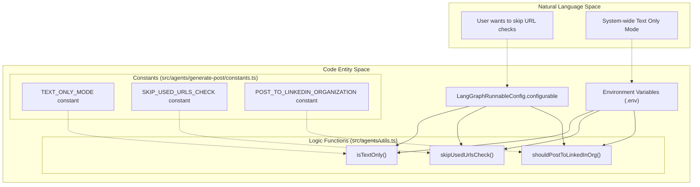
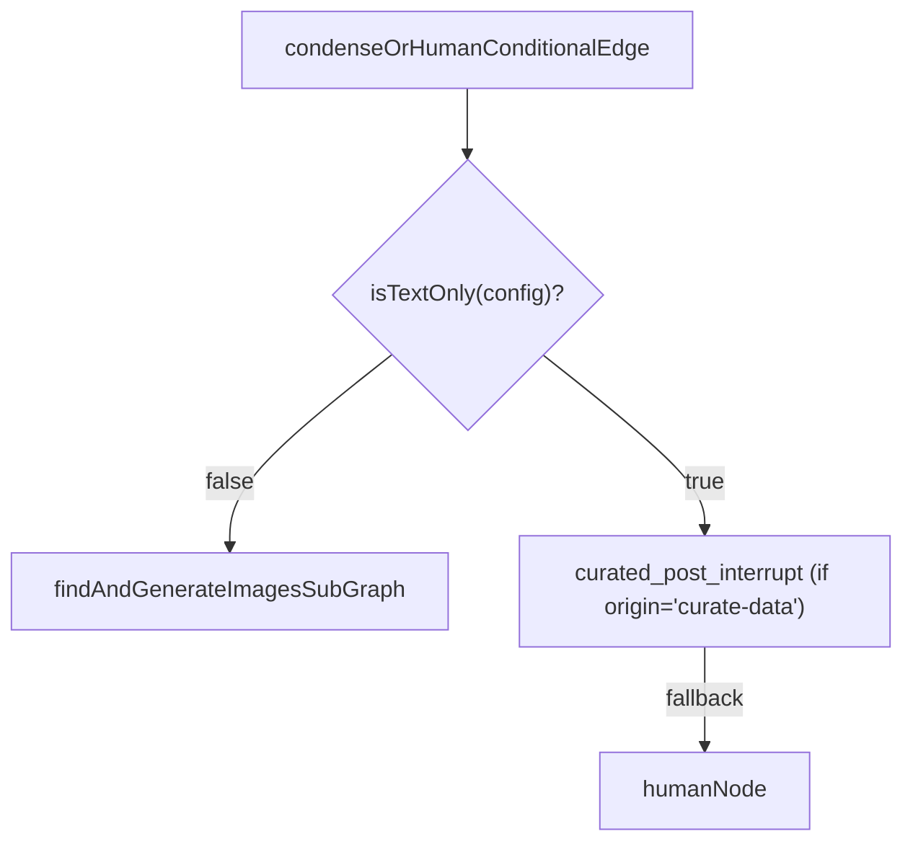

<!-- source: DeepWiki mcp.deepwiki.com · repo langchain-ai/social-media-agent · page 4.2 Feature Flags · fetched 2026-10-26 -->

# Feature Flags

Relevant source files

The following files were used as context for generating this wiki page:

- [.env.full.example](.env.full.example)
- [.env.quickstart.example](.env.quickstart.example)
- [FEATURES.md](FEATURES.md)
- [src/agents/generate-post/generate-post-graph.ts](src/agents/generate-post/generate-post-graph.ts)
- [src/agents/generate-post/generate-post-state.ts](src/agents/generate-post/generate-post-state.ts)
- [src/agents/shared/stores/post-subject-urls.ts](src/agents/shared/stores/post-subject-urls.ts)
- [src/agents/utils.ts](src/agents/utils.ts)

This document describes the feature flag system that controls behavioral variations in the social media agent. Feature flags operate at two levels: global environment variables that affect all graph executions, and per-run configuration options that can be set when invoking individual graph runs.

---

## Architecture Overview

The feature flag system uses a two-tier architecture:

1.  **Global flags**: Set via environment variables in `.env`, affect all graph executions system-wide.
2.  **Per-run flags**: Set via `LangGraphRunnableConfig.configurable` when invoking a graph, override or supplement global flags for specific runs.

### Configuration Resolution Logic

The following diagram illustrates how the system associates configuration names with code entities and resolves their values at runtime.

**Configuration Resolution Diagram**

**Sources:** [src/agents/utils.ts:512-530](), [src/agents/utils.ts:644-659](), [src/agents/generate-post/generate-post-state.ts:113-143]()

---

## Global Feature Flags

Global feature flags are set via environment variables and control system-wide behavior that typically doesn't change between runs.

### USE_ARCADE_AUTH
**Type:** Boolean (`"true"` or `"false"`)  
**Default:** `"true"` (in examples)  
**Implementation:** [src/agents/utils.ts:611-613]()

Determines whether to use Arcade's unified OAuth service for Twitter and LinkedIn authentication, or direct API credentials. When set to `"true"`, the system expects `ARCADE_API_KEY` to be present [.env.full.example:12-15]().

### USE_TWITTER_API_ONLY
**Type:** Boolean  
**Default:** `false`  
**Implementation:** [src/agents/utils.ts:620-622]()

An override flag that forces the system to use the Twitter direct API for reading and posting, even if `USE_ARCADE_AUTH` is enabled [.env.full.example:53-56]().

---

## Per-Run Configuration Flags

These flags are defined in the `GeneratePostConfigurableAnnotation` [src/agents/generate-post/generate-post-state.ts:113-143]() and can be passed during graph invocation.

### TEXT_ONLY_MODE
**Scope:** Dual-level (Global + Per-run)  
**Implementation:** [src/agents/utils.ts:512-519]()

Disables the image processing pipeline. When enabled, the graph skips the `findAndGenerateImagesSubGraph` node [src/agents/generate-post/generate-post-graph.ts:101-105]().

**Routing Impact in `generate-post` Graph:**

**Sources:** [src/agents/generate-post/generate-post-graph.ts:90-106](), [src/agents/generate-post/generate-post-graph.ts:158-183]()

### SKIP_USED_URLS_CHECK
**Scope:** Dual-level (Global + Per-run)  
**Implementation:** [src/agents/utils.ts:644-659]()

Prevents the system from checking the `LangGraph Store` for previously used URLs. By default, the system stores URLs in a namespace `["saved_data", "used_urls"]` [src/agents/shared/stores/post-subject-urls.ts:4-6]().

If this flag is `false`, the graph will terminate early at `generateReportOrEndConditionalEdge` if the URLs have been seen before [src/agents/generate-post/generate-post-graph.ts:132-148]().

### SKIP_CONTENT_RELEVANCY_CHECK
**Scope:** Dual-level (Global + Per-run)  
**Implementation:** [src/agents/utils.ts:624-642]()

Bypasses the AI validation step that checks if content is relevant to the business context before generating a report [FEATURES.md:54-56]().

### POST_TO_LINKEDIN_ORGANIZATION
**Scope:** Dual-level (Global + Per-run)  
**Implementation:** [src/agents/utils.ts:521-530]()

Determines if LinkedIn posts should target a company page (Organization) or a personal profile. If `true`, the `LINKEDIN_ORGANIZATION_ID` must be provided [.env.full.example:31-36]().

---

## Summary Table of Feature Flags

| Flag Constant | Env Var Key | Purpose | Code Reference |
| :--- | :--- | :--- | :--- |
| `TEXT_ONLY_MODE` | `TEXT_ONLY_MODE` | Skips image extraction and generation | [src/agents/utils.ts:512]() |
| `SKIP_USED_URLS_CHECK` | `SKIP_USED_URLS_CHECK` | Allows duplicate content generation | [src/agents/utils.ts:644]() |
| `SKIP_CONTENT_RELEVANCY_CHECK` | `SKIP_CONTENT_RELEVANCY_CHECK` | Bypasses business relevancy AI check | [src/agents/utils.ts:624]() |
| `POST_TO_LINKEDIN_ORGANIZATION` | `POST_TO_LINKEDIN_ORGANIZATION` | Routes posts to LinkedIn Company Pages | [src/agents/utils.ts:521]() |
| N/A | `USE_ARCADE_AUTH` | Switches between Arcade and Direct Auth | [src/agents/utils.ts:611]() |
| `origin` | N/A | Tracks source graph (e.g., 'curate-data') | [src/agents/generate-post/generate-post-state.ts:133]() |

**Sources:** [src/agents/generate-post/constants.ts:4-8](), [src/agents/generate-post/generate-post-state.ts:113-143](), [src/agents/utils.ts:512-659]()

---

