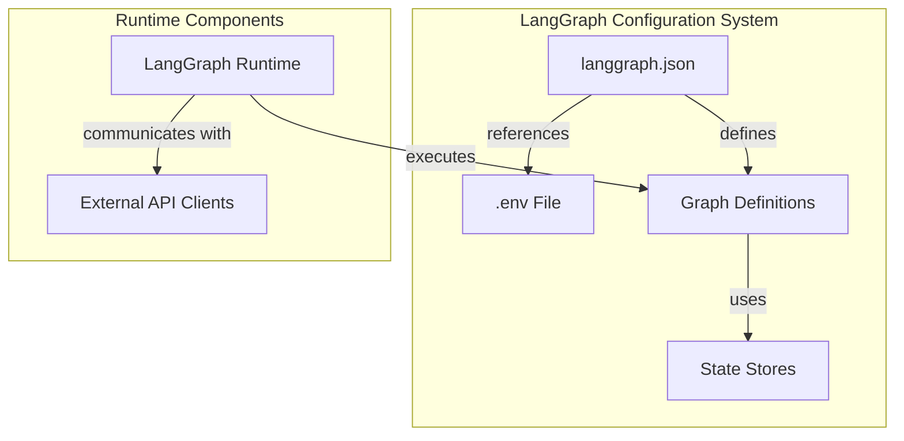
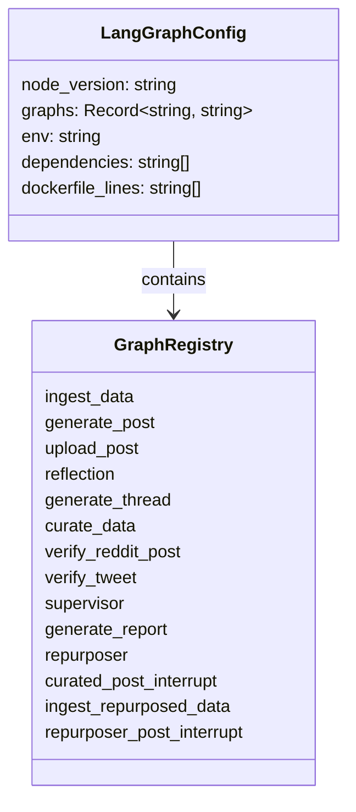
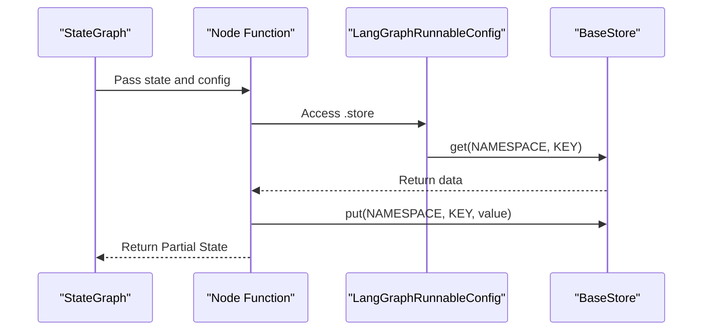
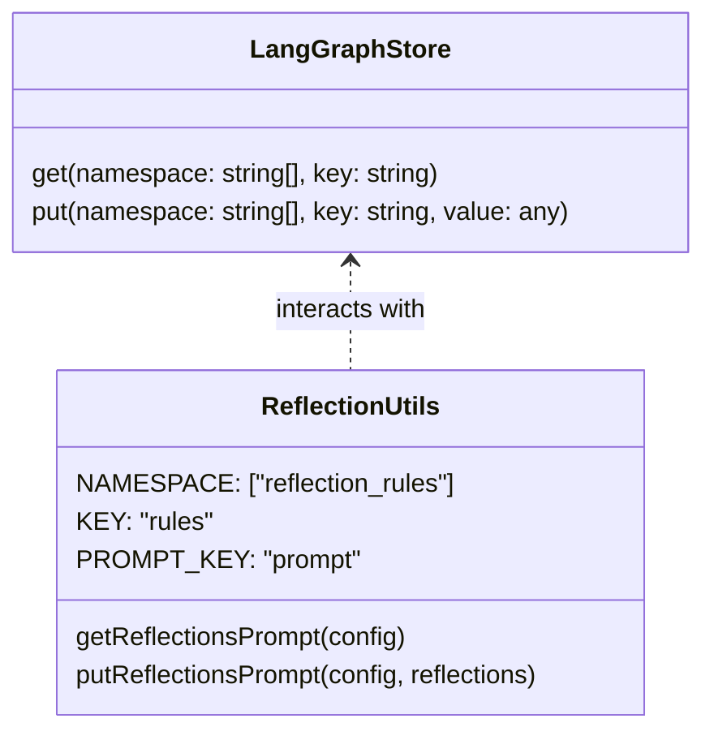

<!-- source: DeepWiki mcp.deepwiki.com · repo langchain-ai/social-media-agent · page 4.3 LangGraph Configuration · fetched 2026-10-26 -->

# LangGraph Configuration

<details>
<summary>Relevant source files</summary>

The following files were used as context for generating this wiki page:

- [langgraph.json](langgraph.json)
- [src/agents/reflection/index.ts](src/agents/reflection/index.ts)
- [src/tests/langgraph-config.test.ts](src/tests/langgraph-config.test.ts)
- [src/utils/reflections.ts](src/utils/reflections.ts)

</details>


This page details the configuration options and structures for LangGraph within the Social Media Agent system. LangGraph provides the workflow orchestration backbone that powers the agent's various processes.

## System Overview

LangGraph is used to create directed workflow graphs that connect the various functional components of the Social Media Agent. Each graph represents a specific workflow such as data ingestion, post generation, or content verification.



Sources: [langgraph.json:1-22]()

## Graph Registry Structure

The Social Media Agent defines its LangGraph workflows in the `langgraph.json` file, which serves as a registry of all available graphs in the system. Each graph is mapped to its implementation file and export.



The graph registry in `langgraph.json` maps logical graph names to their implementations, allowing for centralized management of workflow definitions.

Sources: [langgraph.json:1-19]()

## Core Graph Definitions

The Social Media Agent's LangGraph configuration defines 14 primary graphs in the registry. Below are the workflows defined in the system:

| Graph Name | Implementation Path | Purpose |
|------------|---------------------|---------|
| `ingest_data` | `./src/agents/ingest-data/ingest-data-graph.ts` | Entry point for raw data collection |
| `generate_post` | `./src/agents/generate-post/generate-post-graph.ts` | Core logic for creating social media content |
| `upload_post` | `./src/agents/upload-post/index.ts` | Handles final publishing to LinkedIn/Twitter |
| `reflection` | `./src/agents/reflection/index.ts` | Optimizes prompts based on user feedback |
| `generate_thread` | `./src/agents/generate-thread/index.ts` | Creates multi-post threads |
| `curate_data` | `./src/agents/curate-data/index.ts` | Filters and prioritizes ingested content |
| `verify_reddit_post`| `./src/agents/verify-reddit-post/verify-reddit-post-graph.ts` | Content validation for Reddit sources |
| `verify_tweet` | `./src/agents/verify-tweet/verify-tweet-graph.ts` | Content validation for Twitter sources |
| `supervisor` | `./src/agents/supervisor/supervisor-graph.ts` | Orchestrates high-level agent tasks |
| `repurposer` | `./src/agents/repurposer/index.ts` | Transforms existing content into new formats |
| `curated_post_interrupt` | `./src/agents/curated-post-interrupt/index.ts` | Human-in-the-loop for curated content |

Sources: [langgraph.json:4-18]()

## Graph Definition Structure

Each LangGraph is defined using TypeScript and follows a standard structure. Below is a diagram illustrating the typical definition pattern using the `reflectionGraph` as an example:

```mermaid
flowchart TB
    subgraph "Graph Definition Components"
        annotations["Annotation.Root"]
        state["State Definition"]
        nodes["Node Functions"]
        edges["Edge Connections"]
        compilation["Graph Compilation"]
        
        annotations --> state
        state --> nodes
        nodes --> edges
        edges --> compilation
    end
    
    subgraph "Reflection Graph Entity Space"
        ref_anno["ReflectionAnnotation"]
        ref_state["originalPost, newPost, userResponse"]
        ref_node["reflection() function"]
        ref_edges["START --> reflection --> END"]
        ref_compile["reflectionGraph = reflectionWorkflow.compile()"]
        
        ref_anno --> ref_state
        ref_state --> ref_node
        ref_node --> ref_edges
        ref_edges --> ref_compile
    end
```



Sources: [src/agents/reflection/index.ts:14-103]()

## State Management Configuration

LangGraph uses a state management system to maintain data between graph nodes. The configuration for state management includes:

1.  **State Definition**: Using `Annotation.Root` to define the structure of state.
2.  **State Access**: Within node functions using `LangGraphRunnableConfig`.
3.  **State Persistence**: Using the `store` provided in the configuration.



The reflection system provides a good example of state management configuration:

```typescript
// State definition [src/agents/reflection/index.ts:14-28]
const ReflectionAnnotation = Annotation.Root({
  originalPost: Annotation<string>,
  newPost: Annotation<string>,
  userResponse: Annotation<string>,
});

// Node function with state access [src/agents/reflection/index.ts:52-96]
async function reflection(
  state: typeof ReflectionAnnotation.State,
  config: LangGraphRunnableConfig,
): Promise<Partial<typeof ReflectionAnnotation.State>> {
  if (!config.store) {
    throw new Error("No store provided");
  }
  
  // Access store data via utility [src/utils/reflections.ts:14-23]
  const existingRules = await getReflectionsPrompt(config);
  
  // ... processing logic ...
  
  // Update store data via utility [src/utils/reflections.ts:32-43]
  await putReflectionsPrompt(config, updated);
  
  return {};
}
```

Sources: [src/agents/reflection/index.ts:14-96](), [src/utils/reflections.ts:1-43]()

## Store Configuration

The LangGraph `store` is a key part of configuration that allows for persistence of data between graph executions. The Social Media Agent uses the store to save and retrieve various types of data, including reflection rules.



Sources: [src/utils/reflections.ts:3-43]()

## External Service Integration

LangGraph configurations can incorporate external services. The `reflectionGraph` integrates with `LangMem` to perform metaprompt optimization:

```typescript
// Initializing client [src/agents/reflection/index.ts:60-64]
const langMemClient = new Client({
  apiUrl: "https://langmem-v0-544fccf4898a5e3c87bdca29b5f9ab21.us.langgraph.app",
  apiKey: process.env.LANGCHAIN_API_KEY,
});

// Executing a run with configuration [src/agents/reflection/index.ts:74-89]
const result = await langMemClient.runs.wait(null, "optimize_prompts", {
  input: {
    prompts: [
      {
        name: "Update Prompt",
        prompt: existingRules,
        when_to_update: WHEN_TO_UPDATE_INSTRUCTIONS,
        update_instructions: UPDATE_INSTRUCTIONS,
      },
    ],
    threads,
  },
  config: {
    configurable: { model: "claude-sonnet-4-5", kind: "metaprompt" },
  },
});
```

Sources: [src/agents/reflection/index.ts:60-91]()

## Configuration File Structure

The `langgraph.json` file controls the environment and deployment settings for the LangGraph Cloud or local development environment.

```json
{
  "node_version": "20",
  "graphs": {
    "ingest_data": "./src/agents/ingest-data/ingest-data-graph.ts:graph",
    "generate_post": "./src/agents/generate-post/generate-post-graph.ts:generatePostGraph"
  },
  "env": ".env",
  "dependencies": ["."],
  "dockerfile_lines": ["RUN npx -y playwright@1.59.1 install --with-deps"],
  "image_distro": "bookworm"
}
```

Key configuration elements include:
1.  **node_version**: The Node.js runtime version (v20).
2.  **graphs**: A map of graph IDs to their file paths and named exports.
3.  **dockerfile_lines**: Custom build steps. The system requires Playwright for web scraping (e.g., Reddit/Twitter verification), so it installs Playwright browsers with system dependencies.
4.  **image_distro**: The Linux distribution for the container (Debian Bookworm).

Sources: [langgraph.json:1-24](), [src/tests/langgraph-config.test.ts:74-80]()

## Advanced Configuration Options

### Reflection Logic
The reflection system uses specific instructions to determine when and how to update system prompts based on user feedback.

*   **UPDATE_INSTRUCTIONS**: Guidelines for analyzing current rules, sessions, and feedback to address explicit user requests while maintaining rule clarity. [src/agents/reflection/index.ts:30-47]()
*   **WHEN_TO_UPDATE_INSTRUCTIONS**: Logic to ensure updates only occur when feedback is explicit and generalizable. [src/agents/reflection/index.ts:49-50]()

### Thread Reflections
For multi-post threads, the system utilizes a separate prompt context to ensure consistency across the thread based on historical edits.

Sources: [src/utils/reflections.ts:129-136]()

---

