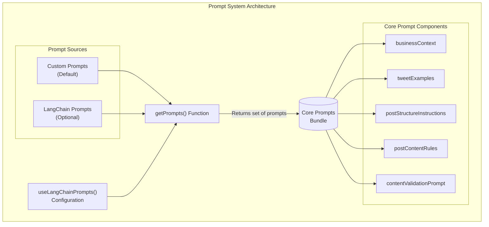
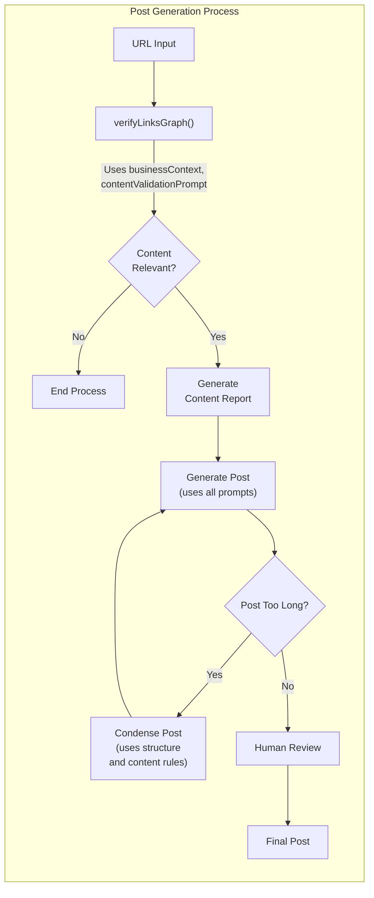
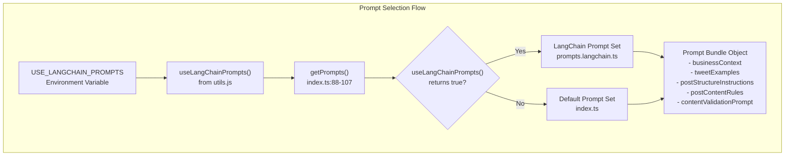
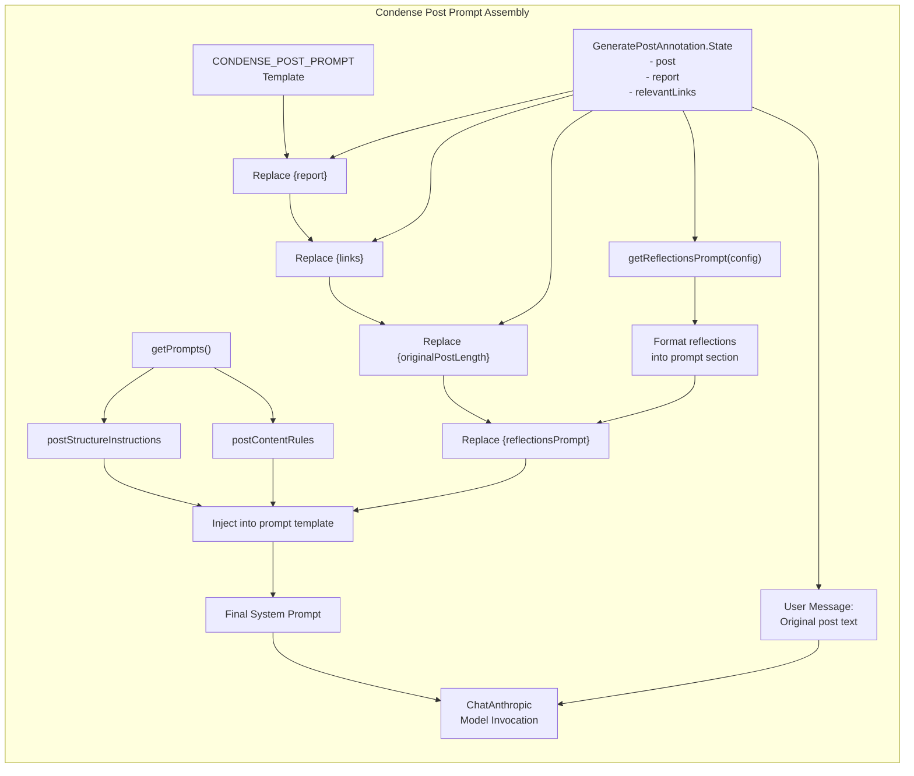
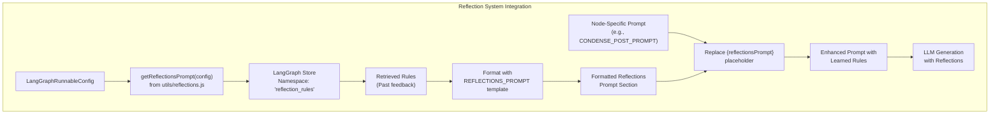

<!-- source: DeepWiki mcp.deepwiki.com · repo langchain-ai/social-media-agent · page 4.4 Prompt Customization · fetched 2026-10-26 -->

# Prompt Customization

<details>
<summary>Relevant source files</summary>

The following files were used as context for generating this wiki page:

- [src/agents/curate-data/nodes/validate-bulk-tweets.ts](src/agents/curate-data/nodes/validate-bulk-tweets.ts)
- [src/agents/generate-post/nodes/condense-post.ts](src/agents/generate-post/nodes/condense-post.ts)
- [src/agents/generate-post/nodes/generate-post/index.ts](src/agents/generate-post/nodes/generate-post/index.ts)
- [src/agents/generate-post/nodes/generate-post/prompts.ts](src/agents/generate-post/nodes/generate-post/prompts.ts)
- [src/agents/generate-post/prompts/examples.ts](src/agents/generate-post/prompts/examples.ts)
- [src/agents/generate-post/prompts/index.ts](src/agents/generate-post/prompts/index.ts)
- [src/agents/generate-post/prompts/prompts.langchain.ts](src/agents/generate-post/prompts/prompts.langchain.ts)
- [src/agents/generate-report/index.ts](src/agents/generate-report/index.ts)
- [src/agents/generate-report/prompts.ts](src/agents/generate-report/prompts.ts)
- [src/agents/should-exclude.ts](src/agents/should-exclude.ts)

</details>


This page details how to customize prompts in the Social Media Agent to tailor the content generation for your specific use case. The agent uses various prompts to guide content verification, marketing report generation, and social media post creation. By customizing these prompts, you can significantly alter the style, focus, and structure of generated posts.

## Prompt System Overview

The Social Media Agent's prompt system is organized into several customizable components that work together to generate appropriate social media content. Understanding this architecture is essential for effective customization.



Sources: [src/agents/generate-post/prompts/index.ts:88-107]()

The prompt system uses a configuration function `getPrompts()` to determine whether to use default prompts or LangChain-specific prompts based on the `useLangChainPrompts()` helper [src/agents/generate-post/prompts/index.ts:90-107](). This allows users to switch between prompt sets without modifying the underlying code.

## Core Prompt Components

The Social Media Agent's prompt system consists of five main customizable components defined in `getPrompts()` [src/agents/generate-post/prompts/index.ts:88-107]():

| Component | Description | Primary Usage |
|-----------|-------------|---------------|
| Business Context | Defines the business focus or content domain | Content validation, post generation, report generation |
| Tweet Examples | Sample posts for style and format reference | Post generation |
| Post Structure Instructions | Rules for post section organization | Post generation, condensation |
| Post Content Rules | Guidelines for content style and focus | Post generation, condensation |
| Content Validation Prompt | Rules for approving/rejecting content | Content verification |

### Business Context

The Business Context prompt defines what types of content your social media agent should focus on. This component is used throughout the agent to determine content relevance and guide post generation.

Default location: [src/agents/generate-post/prompts/index.ts:60-71]()

Example:
```
Here is some context about the types of content you should be interested in prompting:
<business-context>
- AI applications. You care greatly about all new and novel ways people are using AI to solve problems.
- UI/UX for AI. You are interested in how people are designing UI/UXs for AI applications.
...
</business-context>
```

Sources: [src/agents/generate-post/prompts/index.ts:60-71](), [src/agents/generate-post/prompts/prompts.langchain.ts:3-10]()

### Tweet Examples

The Tweet Examples component provides sample posts that guide the style, tone, and format of generated content. This is one of the most impactful components to customize, as it strongly influences the output style.

Default location: [src/agents/generate-post/prompts/examples.ts]() (imported and formatted in [src/agents/generate-post/prompts/index.ts:11-13]())

Example format:
```
<example index="1">
Podcastfy.ai 🎙️🤖

An Open Source API alternative to NotebookLM's podcast product

Transforming Multimodal Content into Captivating Multilingual Audio Conversations with GenAI

https://podcastfy.ai
</example>
```

Sources: [src/agents/generate-post/prompts/prompts.langchain.ts:33-90](), [src/agents/generate-post/prompts/index.ts:11-13]()

### Post Structure Instructions

This component defines the structure that each generated post should follow, typically divided into sections like header, body, and call-to-action.

Default location: [src/agents/generate-post/prompts/index.ts:21-37]()

Example:
```
<section key="1">
The first part should be the introduction or hook. This should be short and to the point...
</section>

<section key="2">
This section will contain the main content of the post...
</section>

<section key="3">
The final section of the post should contain a call to action...
</section>
```

Sources: [src/agents/generate-post/prompts/index.ts:21-37](), [src/agents/generate-post/prompts/prompts.langchain.ts:92-110]()

### Post Content Rules

The Post Content Rules component provides guidelines for the writing style, tone, and content focus of generated posts.

Default location: [src/agents/generate-post/prompts/index.ts:44-51]()

Example:
```
- Focus your post on what the content covers, aims to achieve, or the findings of the marketing report...
- Do not make the post over technical as some of our audience may not be advanced developers...
- Keep posts short, concise and engaging
...
```

Sources: [src/agents/generate-post/prompts/index.ts:44-51](), [src/agents/generate-post/prompts/prompts.langchain.ts:112-119]()

### Content Validation Prompt

This component defines the rules for determining whether content is relevant and appropriate for generating a social media post.

Default location: [src/agents/generate-post/prompts/index.ts:78-86]()

Example:
```
This content will be used to generate engaging, informative and educational social media posts.
The following are rules to follow when determining whether or not to approve content as valid, or not:
<validation-rules>
- The content may be about a new product, tool, service, or similar.
...
</validation-rules>
```

Sources: [src/agents/generate-post/prompts/index.ts:78-86](), [src/agents/generate-post/prompts/prompts.langchain.ts:12-31]()

## Prompt Usage Flow

The following diagram illustrates how prompts are used throughout the post generation process:



Sources: [src/agents/generate-post/nodes/condense-post.ts:12-52](), [src/agents/generate-post/nodes/generate-post/prompts.ts:3-32]()

## How to Customize Prompts

### Basic Customization

To customize the prompts for your own use case:

1. Locate the prompt definitions in [src/agents/generate-post/prompts/index.ts]()
2. Update the following components according to your needs:
   - `BUSINESS_CONTEXT`: Define your business focus or content domain
   - `POST_STRUCTURE_INSTRUCTIONS`: Set the structure sections for your posts
   - `POST_CONTENT_RULES`: Define your content style and tone
   - `CONTENT_VALIDATION_PROMPT`: Set rules for content validation

For customizing examples, edit the `EXAMPLES` array in [src/agents/generate-post/prompts/examples.ts]().

### Prompt Switching Mechanism

The system allows switching between default prompts and LangChain-specific prompts using the `useLangChainPrompts()` function. This is controlled by the `USE_LANGCHAIN_PROMPTS` environment variable and enables easy testing of different prompt sets without code changes.

**Prompt Selection System**



The prompt switching mechanism also affects content filtering behavior. When `USE_LANGCHAIN_PROMPTS` is enabled, the system automatically excludes certain domains and content types through the `shouldExclude*` functions in [src/agents/should-exclude.ts:9-51]():

| Function | Purpose | Excluded When USE_LANGCHAIN_PROMPTS=true |
|----------|---------|------------------------------------------|
| `shouldExcludeGeneralContent()` | Filters out URLs from specific domains | LangChain domains (langchain.com, langchain.dev, etc.) |
| `shouldExcludeGitHubContent()` | Filters GitHub repositories | langchain-ai GitHub organization repos |
| `shouldExcludeYouTubeContent()` | Filters YouTube channels | "langchain" channel videos |
| `shouldExcludeTweetContent()` | Filters tweets without external links | Tweets with no external URLs |

Sources: [src/agents/generate-post/prompts/index.ts:88-107](), [src/agents/should-exclude.ts:1-51]()

## Advanced Prompt Customization

### Node-Specific Prompts

Beyond the core prompt components, certain nodes in the processing graph have their own specialized prompts. These prompts dynamically incorporate the core prompt components along with node-specific instructions.

#### Condense Post Prompt

The `condensePost` node ([src/agents/generate-post/nodes/condense-post.ts:59-111]()) uses the `CONDENSE_POST_PROMPT` ([src/agents/generate-post/nodes/condense-post.ts:12-52]()), which is a specialized prompt for condensing posts that exceed Twitter's character limit. This prompt:

1. Includes the marketing report that was used to create the original post [src/agents/generate-post/nodes/condense-post.ts:16-18]()
2. References the relevant links that should be maintained [src/agents/generate-post/nodes/condense-post.ts:22-24]()
3. Dynamically injects `POST_STRUCTURE_INSTRUCTIONS` using `getPrompts().postStructureInstructions` [src/agents/generate-post/nodes/condense-post.ts:31]()
4. Dynamically injects `POST_CONTENT_RULES` using `getPrompts().postContentRules` [src/agents/generate-post/nodes/condense-post.ts:34]()
5. Includes reflection-based improvements [src/agents/generate-post/nodes/condense-post.ts:37]()
6. Provides specific guidance on condensing while maintaining structure [src/agents/generate-post/nodes/condense-post.ts:41-43]()

**Dynamic Prompt Assembly in condensePost()**



Sources: [src/agents/generate-post/nodes/condense-post.ts:12-111](), [src/agents/generate-post/prompts/index.ts:88-107]()

#### Generate Report Prompt

The marketing report generation uses `GENERATE_REPORT_PROMPT_O1` in [src/agents/generate-report/prompts.ts:59-93](). This prompt analyzes content and creates structured reports that guide post generation. The report prompt dynamically incorporates the `BUSINESS_CONTEXT` from `getPrompts()` to ensure content analysis aligns with your business focus [src/agents/generate-report/prompts.ts:63]().

#### Bulk Tweet Validation

The `validateBulkTweets` node ([src/agents/curate-data/nodes/validate-bulk-tweets.ts:143-161]()) uses a specialized `VALIDATE_BULK_TWEETS_PROMPT` ([src/agents/curate-data/nodes/validate-bulk-tweets.ts:73-108]()) that includes its own set of examples for relevance detection in raw social feeds.

### Working with Reflections

The system includes a reflection system that captures user feedback to improve generations over time. Reflections are dynamically injected into prompts during post generation [src/agents/generate-post/nodes/generate-post/index.ts:31-39]() and condensation [src/agents/generate-post/nodes/condense-post.ts:75-79]().

**Reflection Integration Flow**



Implementation example from [src/agents/generate-post/nodes/condense-post.ts:75-87]():

```typescript
const reflections = await getReflectionsPrompt(config);
const reflectionsPrompt = REFLECTIONS_PROMPT.replace(
  "{reflections}",
  reflections,
);

const formattedSystemPrompt = CONDENSE_POST_PROMPT.replace(
  "{report}",
  state.report,
)
  .replace("{links}", filterLinksForPostContent(state.relevantLinks))
  .replace("{originalPostLength}", originalPostLength)
  .replace("{reflectionsPrompt}", reflectionsPrompt);
```

Sources: [src/agents/generate-post/nodes/condense-post.ts:75-87](), [src/agents/generate-post/nodes/generate-post/index.ts:31-39](), [src/utils/reflections.ts:6-10]()

## Customization Best Practices

1. **Start with Examples**: The most impactful way to influence output style is by changing the tweet examples in `src/agents/generate-post/prompts/examples.ts` [src/agents/generate-post/prompts/examples.ts:1-118]().
2. **Update Business Context**: Ensure your business context clearly defines what content is relevant for your use case [src/agents/generate-post/prompts/index.ts:60-71]().
3. **Maintain Structure**: When modifying post structure instructions, maintain the section key markers (`<section key="1">`) for proper parsing [src/agents/generate-post/prompts/index.ts:21-37]().
4. **Test Incrementally**: Make small changes and test the results before making extensive modifications.
5. **Consider Advanced Customization**: For deeper changes, you may need to modify node-specific prompts like `GENERATE_POST_PROMPT` in [src/agents/generate-post/nodes/generate-post/prompts.ts:3-32]().

Sources: [src/agents/generate-post/prompts/index.ts:1-107](), [src/agents/generate-post/nodes/generate-post/prompts.ts:3-32]()

---

