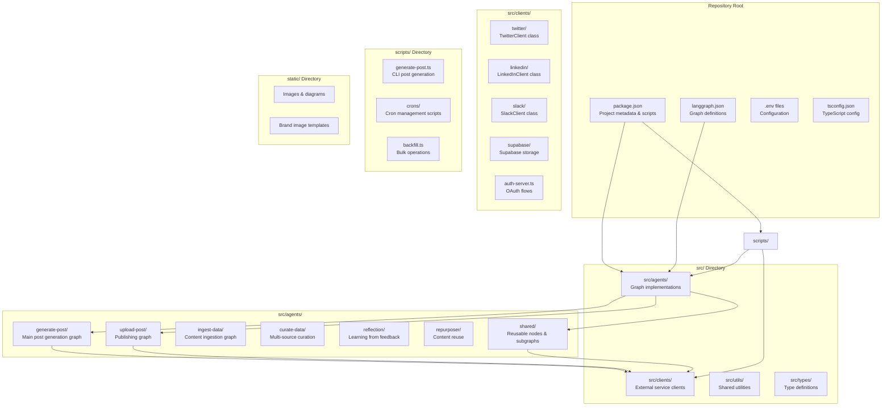
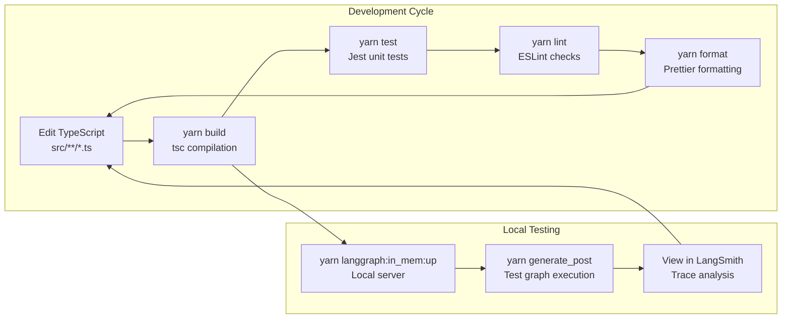

<!-- source: DeepWiki mcp.deepwiki.com · repo langchain-ai/social-media-agent · page 5 Development Guide · fetched 2026-10-26 -->

# Development Guide

<details>
<summary>Relevant source files</summary>

The following files were used as context for generating this wiki page:

- [.github/workflows/ci.yml](.github/workflows/ci.yml)
- [.github/workflows/integration-tests.yml](.github/workflows/integration-tests.yml)
- [.github/workflows/unit-tests.yml](.github/workflows/unit-tests.yml)
- [.vscode/settings.json](.vscode/settings.json)
- [README.md](README.md)
- [scripts/generate-post.ts](scripts/generate-post.ts)
- [static/agent_flow.png](static/agent_flow.png)
- [static/graph_screenshot.png](static/graph_screenshot.png)

</details>


This document provides an overview of development practices, workflows, and architectural patterns for working with the social media agent codebase. It covers the essential information developers need to understand the project structure, build and test the system, and contribute effectively.

For detailed setup instructions, see [Setup and Installation](#5.1). For information about testing approaches, see [Testing](#5.2). For utility scripts and automation tools, see [Scripts and Automation](#5.3). For understanding state flow through LangGraph, see [State Management](#5.4).

---

## Technology Stack

The social media agent is built using TypeScript and relies on several key technologies:

| Technology | Purpose | Version/Package |
|------------|---------|-----------------|
| TypeScript | Primary language | `^5.3.3` |
| LangGraph | Orchestration framework | `@langchain/langgraph@^1.0.2` |
| LangGraph SDK | Client for graph interactions | `@langchain/langgraph-sdk@1.0.0` |
| LangChain | LLM abstractions | Multiple `@langchain/*` packages |
| Node.js | Runtime environment | ES modules (`"type": "module"`) |
| Yarn | Package manager | `1.22.22` |
| Jest | Testing framework | `^29.7.0` with `ts-jest` |
| ESLint/Prettier | Code quality | `^8.41.0` / `^3.3.3` |

The project uses ES modules exclusively, as indicated by `"type": "module"` in [package.json:10]().

**Key External Services:**
- **Anthropic Claude**: Primary LLM for text generation (`@langchain/anthropic@^1.0.0`)
- **Google Vertex AI**: Multimodal capabilities for YouTube content (`@langchain/google-vertexai-web@^1.0.0`)
- **OpenAI**: Alternative LLM provider (`@langchain/openai@^1.1.0`)
- **Supabase**: Image storage (`@supabase/supabase-js@^2.47.10`)
- **Slack**: Message ingestion and notifications (`@slack/web-api@^7.7.0`)
- **Arcade**: OAuth abstraction for social media (`@arcadeai/arcadejs@^1.0.0`)

Sources: [package.json:10](), [package.json:42-100](), [README.md:156-165]()

---

## Project Structure



**Key Directories:**

- **`src/agents/`**: Contains all LangGraph graph definitions, organized by workflow.
- **`src/clients/`**: External service integrations (Twitter, LinkedIn, Slack, etc.).
- **`src/utils/`**: Shared utility functions and helpers.
- **`scripts/`**: Operational scripts for development and production use, such as [scripts/generate-post.ts:1-42]().
- **`static/`**: Static assets including brand templates and system diagrams like [static/agent_flow.png:1-30]().

Sources: [package.json:6](), [README.md:1-423](), [scripts/generate-post.ts:1-42]()

---

## Development Workflow

### Core Development Loop



### Available NPM Scripts

| Script | Command | Purpose |
|--------|---------|---------|
| `yarn langgraph:in_mem:up` | `npx @langchain/langgraph-cli dev` | Start LangGraph server in-memory mode [package.json:34]() |
| `yarn build` | `tsc` | Compile TypeScript to JavaScript [package.json:13]() |
| `yarn test` | `jest` | Execute unit tests (excludes `.int.test.ts`) [package.json:15]() |
| `yarn test:int` | `jest` | Execute integration tests only [package.json:16]() |
| `yarn lint:all` | `eslint src` | Check code quality across all source files [package.json:20]() |
| `yarn format` | `prettier --write .` | Format all files [package.json:21]() |
| `yarn generate_post` | `ts-node scripts/generate-post.ts` | Generate a post from URL [package.json:31]() |
| `yarn start:auth` | `ts-node src/clients/auth-server.ts` | Start OAuth server for token generation [package.json:29]() |

**LangGraph Server Modes:**

The project supports two server modes:

1. **In-memory mode** (`yarn langgraph:in_mem:up`): Executes `npx @langchain/langgraph-cli dev --port 54367`. Uses in-memory storage, fastest for development. Data lost on restart [README.md:123-130]().

2. **Persistent mode** (`yarn langgraph:up`): Executes `langgraph up --watch --port 54367`. Requires Docker, persists state to database [package.json:35]().

Sources: [package.json:11-36](), [README.md:118-130]()

---

## Code Organization Principles

### Graph Structure Pattern

Each graph follows a consistent directory structure:

```
src/agents/{graph-name}/
├── graph.ts              # Main graph definition (StateGraph instance)
├── state.ts              # State annotation and types
├── nodes/                # Node implementations
├── prompts/              # LLM prompts
└── constants.ts          # Graph-specific constants
```

**Example from `generate-post` graph:**
- Graph definition: `src/agents/generate-post/graph.ts`
- Constants: [src/agents/generate-post/constants.ts:1-7]()

### Shared Code Pattern

Reusable components live in `src/agents/shared/`. Functions like `schedulePost` are implemented in shared locations to be utilized by multiple graphs [src/agents/shared/nodes/generate-post/schedule-post.ts:81-147]().

### Client Pattern

External service clients follow a class-based pattern:
- `TwitterClient`: `src/clients/twitter/client.ts`
- `LinkedInClient`: `src/clients/linkedin/client.ts`
- `SlackClient`: `src/clients/slack/client.ts` (referenced in [src/agents/shared/nodes/generate-post/schedule-post.ts:46]())

Sources: [src/agents/shared/nodes/generate-post/schedule-post.ts:1-148](), [README.md:407-423]()

---

## Common Development Tasks

### Working with Configuration

Configuration flows through `LangGraphRunnableConfig.configurable`. Nodes access these settings to determine behavior, such as whether to skip specific checks or run in text-only mode [scripts/generate-post.ts:25-37]().

Key configurable constants include:
- `TEXT_ONLY_MODE`: [src/agents/generate-post/constants.ts:6]()
- `SKIP_CONTENT_RELEVANCY_CHECK`: [src/agents/generate-post/constants.ts:4]()
- `SKIP_USED_URLS_CHECK`: [src/agents/generate-post/constants.ts:5]()

### Creating Scheduled Runs

The system uses `@langchain/langgraph-sdk` `Client` to create scheduled executions. This is used for scheduling posts to be published at a later time [src/agents/shared/nodes/generate-post/schedule-post.ts:107-127]().

Implementation pattern:
1. Initialize `Client` with `apiUrl` [scripts/generate-post.ts:16-18]().
2. Create a thread using `client.threads.create()` [scripts/generate-post.ts:20]().
3. Call `client.runs.create()` with the target graph name and input data [scripts/generate-post.ts:21-38]().

### CI/CD and Quality Control

The repository uses GitHub Actions for continuous integration:
- **Formatting and Linting**: [`.github/workflows/ci.yml`]() runs `yarn format:check` and `yarn run lint:all` on every PR [ci.yml:38-53]().
- **Unit Tests**: [`.github/workflows/unit-tests.yml`]() runs `yarn test` on every push to main and pull requests [unit-tests.yml:44]().
- **Integration Tests**: [`.github/workflows/integration-tests.yml`]() runs `yarn test:int` daily via a cron schedule [integration-tests.yml:7-43]().

Sources: [scripts/generate-post.ts:1-42](), [src/agents/shared/nodes/generate-post/schedule-post.ts:81-147](), [package.json:11-36]()

---

## Module System and Imports

The project uses ES modules with TypeScript. 

**Import Syntax:**
- Always use `.js` extension in imports, even for `.ts` files: `import { x } from "./file.js"` [scripts/generate-post.ts:7]().
- This is required for Node.js resolution of ES modules.

**Top-Level Await:**
- Supported due to `"type": "module"` in [package.json:10]().

---

## Next Steps

For detailed information on specific development topics:

- **Setting up your development environment**: See [Setup and Installation](#5.1)
- **Running and writing tests**: See [Testing](#5.2)
- **Using operational scripts**: See [Scripts and Automation](#5.3)
- **Understanding state flow**: See [State Management](#5.4)

Sources: [README.md:1-423](), [package.json:1-100]()

---

