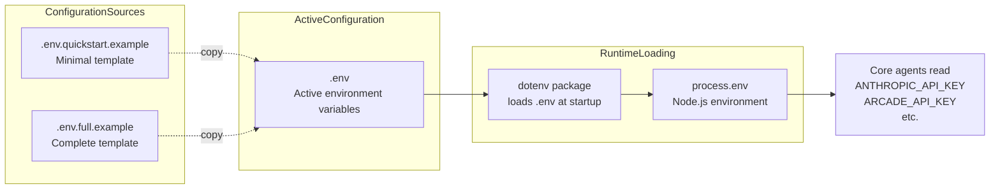
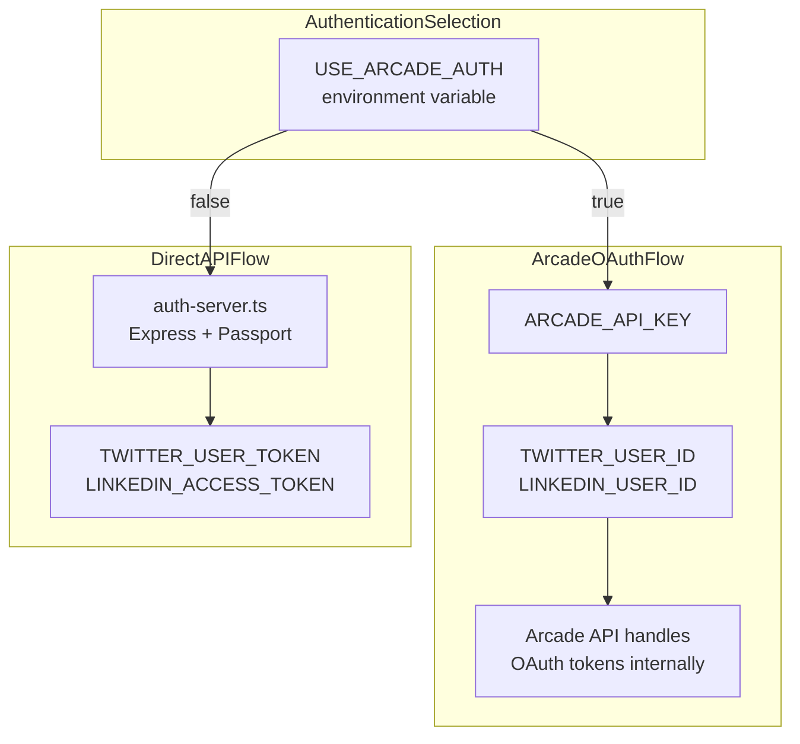
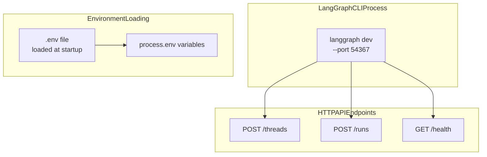

<!-- source: DeepWiki mcp.deepwiki.com · repo langchain-ai/social-media-agent · page 5.1 Setup and Installation · fetched 2026-10-26 -->

# Setup and Installation

<details>
<summary>Relevant source files</summary>

The following files were used as context for generating this wiki page:

- [.vscode/settings.json](.vscode/settings.json)
- [README.md](README.md)
- [memory-v2/poetry.lock](memory-v2/poetry.lock)
- [memory-v2/pyproject.toml](memory-v2/pyproject.toml)
- [package.json](package.json)
- [pyproject.toml](pyproject.toml)
- [scripts/generate-post.ts](scripts/generate-post.ts)
- [static/agent_flow.png](static/agent_flow.png)
- [static/graph_screenshot.png](static/graph_screenshot.png)
- [uv.lock](uv.lock)
- [yarn.lock](yarn.lock)

</details>


This page provides step-by-step instructions for installing and configuring the social media agent system on a local development environment. It covers prerequisite software, dependency installation, environment variable configuration, and initial system startup procedures. For information about testing the system after installation, see [Testing](#5.2). For information about running operational scripts, see [Scripts and Automation](#5.3).

The system supports two setup modes: **Quickstart Mode** (minimal configuration for basic functionality) and **Advanced Mode** (full feature set with all integrations). This document covers both modes.

## System Requirements

The system requires Node.js with Yarn package manager and Python 3 for the LangGraph CLI. All dependencies are managed through the package manager configuration files.

**Required Software:**
- Node.js (version compatible with ES modules) [package.json:10]()
- Yarn 1.22.22 (specified in [package.json:5]())
- Python 3.x (for LangGraph CLI and optional Python-based modules) [pyproject.toml:6](), [memory-v2/pyproject.toml:11]()
- Git (for repository cloning)

**Required Development Tools:**
- TypeScript compiler (`tsc`) - included in dev dependencies [package.json:106]()
- LangGraph CLI - installed separately via pip or npx [README.md:104-108](), [package.json:35]()

Sources: [package.json:1-108](), [README.md:45-51](), [pyproject.toml:1-18](), [memory-v2/pyproject.toml:1-29]()

## Prerequisites Overview

The following diagram maps the two setup modes to their respective service dependencies:

```mermaid
graph TB
    subgraph "SetupModes"
        Quickstart["Quickstart Mode"]
        Advanced["Advanced Mode"]
    end
    
    subgraph "CoreServices(Both Modes)"
        Anthropic["ANTHROPIC_API_KEY<br/>LLM generation"]
        LangSmith["LANGSMITH_API_KEY<br/>Tracing & monitoring"]
        FireCrawl["FIRECRAWL_API_KEY<br/>Web scraping"]
        Arcade["ARCADE_API_KEY<br/>Social media auth"]
    end
    
    subgraph "AdditionalServices(Advanced Only)"
        Vertex["Google Vertex AI<br/>Video/image processing"]
        Twitter["Twitter Developer<br/>Media uploads"]
        LinkedIn["LinkedIn Developer<br/>Direct API access"]
        GitHub["GITHUB_TOKEN<br/>Repository parsing"]
        Supabase["SUPABASE_URL + KEY<br/>Image storage"]
        Slack["SLACK_BOT_TOKEN<br/>Channel ingestion"]
    end
    
    Quickstart --> Anthropic
    Quickstart --> LangSmith
    Quickstart --> FireCrawl
    Quickstart --> Arcade
    
    Advanced --> Anthropic
    Advanced --> LangSmith
    Advanced --> FireCrawl
    Advanced --> Arcade
    Advanced --> Vertex
    Advanced --> Twitter
    Advanced --> LinkedIn
    Advanced --> GitHub
    Advanced --> Supabase
    Advanced --> Slack
```



**Feature Limitations in Quickstart Mode:**
- GitHub, Twitter, and YouTube URL parsing disabled [README.md:39]()
- Ingesting data from Slack or sending updates to Slack disabled [README.md:40]()
- Image selection and upload functionality disabled [README.md:41]()
- Uses `TEXT_ONLY_MODE=true` configuration flag [scripts/generate-post.ts:6]()

Sources: [README.md:36-43](), [README.md:154-165](), [scripts/generate-post.ts:1-39]()

## Installation Steps

### Repository Setup

Clone the repository and navigate to the project directory:

```bash
git clone https://github.com/langchain-ai/social-media-agent.git
cd social-media-agent
```

### Dependency Installation

Install all Node.js dependencies using Yarn:

```bash
yarn install
```

This command processes [package.json:1-108]() and installs the following categories of dependencies:

| Category | Key Packages | Purpose |
|----------|--------------|---------|
| **LangGraph Core** | `@langchain/langgraph`, `@langchain/langgraph-sdk` | Graph orchestration and SDK [package.json:45-46]() |
| **LLM Providers** | `@langchain/anthropic`, `@langchain/openai`, `@langchain/google-vertexai-web` | AI model integrations [package.json:41-47]() |
| **Social Media** | `twitter-api-v2`, `@arcadeai/arcadejs` | Twitter API and unified auth [package.json:38,68]() |
| **Content Sources** | `@octokit/rest`, `snoowrap`, `@googleapis/youtube` | GitHub, Reddit, YouTube APIs [package.json:40,49,67]() |
| **Web Scraping** | `@mendable/firecrawl-js`, `cheerio`, `playwright` | Content extraction [package.json:48,53,65]() |
| **Storage** | `@supabase/supabase-js` | Image bucket access [package.json:51]() |
| **Utilities** | `date-fns`, `zod`, `sharp`, `uuid` | Date handling, validation, image processing [package.json:54,66,69,71]() |

The system also includes Python dependencies managed by `uv` and `poetry` for specialized components like the Slack integration and Memory V2 module [pyproject.toml:1-18](), [memory-v2/pyproject.toml:1-29]().

Sources: [package.json:37-71](), [package.json:73-99](), [pyproject.toml:7-18](), [memory-v2/pyproject.toml:10-29]()

### LangGraph CLI Installation

The LangGraph CLI is required to run the graph server locally. Install it via pip:

```bash
pip install langgraph-cli
```

Verify installation:

```bash
langgraph --version
```

The CLI provides the `langgraph dev` command used by the `langgraph:in_mem:up` script [package.json:35]().

Sources: [README.md:104-116](), [package.json:35]()

## Environment Configuration

The system uses environment variables for API keys, feature flags, and service URLs. Configuration differs between Quickstart and Advanced modes.

### Configuration File Structure



### Quickstart Mode Configuration

Copy the quickstart template and populate required values:

```bash
cp .env.quickstart.example .env
```

**Required Environment Variables:**

```bash
# LangSmith tracing (optional but recommended)
LANGSMITH_API_KEY=lsv2_pt_...
LANGSMITH_TRACING_V2=true

# LLM provider
ANTHROPIC_API_KEY=sk-ant-...

# Web scraping
FIRECRAWL_API_KEY=fc-...

# Social media authentication
ARCADE_API_KEY=...
```

**Optional LinkedIn Organization Posting:**

If posting as a LinkedIn organization rather than personal profile:

```bash
POST_TO_LINKEDIN_ORGANIZATION=true
LINKEDIN_ORGANIZATION_ID=12345678
```

Sources: [README.md:72-102](), [scripts/generate-post.ts:1-7]()

### Advanced Mode Configuration

Copy the full template for complete feature access:

```bash
cp .env.full.example .env
```

**Additional Required Variables:**

```bash
# Twitter API (for media uploads)
TWITTER_API_KEY=...
TWITTER_API_KEY_SECRET=...
TWITTER_BEARER_TOKEN=...
TWITTER_CLIENT_ID=...
TWITTER_CLIENT_SECRET=...

# LinkedIn API (direct access)
LINKEDIN_CLIENT_ID=...
LINKEDIN_CLIENT_SECRET=...

# GitHub API
GITHUB_TOKEN=ghp_...

# Supabase storage
SUPABASE_URL=https://....supabase.co
SUPABASE_SERVICE_ROLE_KEY=...
```

Sources: [README.md:185-318](), [package.json:37-71]()

## Authentication Setup

The system supports two authentication patterns for social media platforms, selected via the `USE_ARCADE_AUTH` flag.

### Authentication Flow Diagram



### Arcade Authentication (Recommended)

Arcade provides simplified OAuth flow management. Required configuration:

1. Set `USE_ARCADE_AUTH=true` in `.env` [README.md:211]()
2. Obtain `ARCADE_API_KEY` from [arcade.dev](https://arcade.dev) [README.md:204]()
3. Set user identifiers:
   - `TWITTER_USER_ID` - Twitter account email/ID [README.md:208]()
   - `LINKEDIN_USER_ID` - LinkedIn account email/ID [README.md:209]()

Sources: [README.md:202-226](), [package.json:38]()

### Direct API Authentication

For direct API access without Arcade, follow the OAuth setup procedures:

**Auth Server:**
Run the local authentication server to generate tokens:
```bash
yarn start:auth
```
This script uses `tsx` to run `src/clients/auth-server.ts` [package.json:25]().

Sources: [README.md:227-286](), [package.json:25]()

## Starting the System

### LangGraph Server Startup

The LangGraph server hosts the agent workflows. Start the development server:

```bash
yarn langgraph:in_mem:up
```

This executes the underlying command:
```bash
npx @langchain/langgraph-cli@latest dev --port 54367
```

**First Run Behavior:**
On first execution, the CLI may prompt to install `@langchain/langgraph-cli`. Enter `y` to accept [README.md:132-134]().

Sources: [package.json:35](), [README.md:118-133]()

### Server Architecture



Sources: [package.json:35](), [scripts/generate-post.ts:16-21]()

## Verification

### Testing Basic Functionality

Execute the test script to verify installation:

```bash
yarn generate_post
```

This invokes the `generate_post` graph with a sample GitHub repository URL [scripts/generate-post.ts:14,21]().

**Successful Execution Indicators:**
- Thread created with ID [scripts/generate-post.ts:20]()
- Run initiated with `generate_post` graph name [scripts/generate-post.ts:21]()
- No error stack traces in terminal

Sources: [README.md:135-143](), [scripts/generate-post.ts:1-42]()

### Verification Checklist

| Component | Verification Method | Expected Result |
|-----------|-------------------|-----------------|
| **Dependencies** | `yarn install` | Successful completion |
| **LangGraph CLI** | `langgraph --version` | Version number displayed |
| **Server** | `yarn langgraph:in_mem:up` | Server ready on port 54367 |
| **Graph Invocation** | `yarn generate_post` | Run initiated successfully |

Sources: [README.md:67,113,123,138](), [package.json:35]()

---

