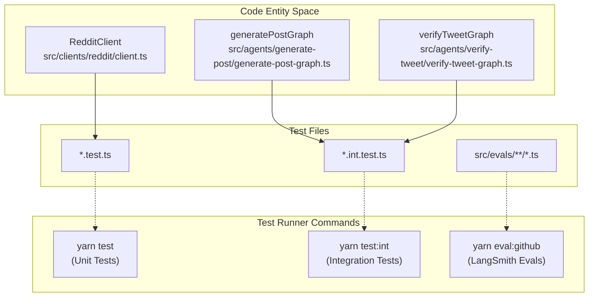
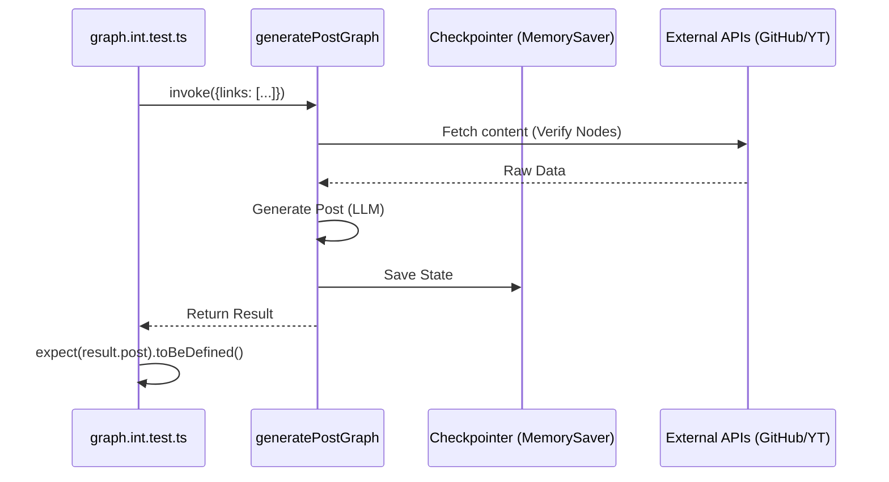

<!-- source: DeepWiki mcp.deepwiki.com · repo langchain-ai/social-media-agent · page 5.2 Testing · fetched 2026-10-26 -->

# Testing

Relevant source files

The following files were used as context for generating this wiki page:

- [.github/workflows/ci.yml](.github/workflows/ci.yml)
- [.github/workflows/integration-tests.yml](.github/workflows/integration-tests.yml)
- [.github/workflows/unit-tests.yml](.github/workflows/unit-tests.yml)
- [jest.config.js](jest.config.js)
- [jest.setup.cjs](jest.setup.cjs)
- [src/agents/curate-data/nodes/verify-reddit-wrapper.ts](src/agents/curate-data/nodes/verify-reddit-wrapper.ts)
- [src/agents/verify-reddit-post/nodes/get-external-urls.ts](src/agents/verify-reddit-post/nodes/get-external-urls.ts)
- [src/agents/verify-reddit-post/nodes/get-post.ts](src/agents/verify-reddit-post/nodes/get-post.ts)
- [src/agents/verify-reddit-post/tests/data/inputs-outputs.ts](src/agents/verify-reddit-post/tests/data/inputs-outputs.ts)
- [src/agents/verify-reddit-post/tests/e2e.int.test.ts](src/agents/verify-reddit-post/tests/e2e.int.test.ts)
- [src/agents/verify-reddit-post/types.ts](src/agents/verify-reddit-post/types.ts)
- [src/agents/verify-tweet/verify-tweet-graph.ts](src/agents/verify-tweet/verify-tweet-graph.ts)
- [src/agents/verify-tweet/verify-tweet-state.ts](src/agents/verify-tweet/verify-tweet-state.ts)
- [src/evals/e2e/e2e.int.test.ts](src/evals/e2e/e2e.int.test.ts)
- [src/evals/e2e/inputs.ts](src/evals/e2e/inputs.ts)
- [src/evals/general/index.ts](src/evals/general/index.ts)
- [src/evals/github/index.ts](src/evals/github/index.ts)
- [src/evals/twitter/index.ts](src/evals/twitter/index.ts)
- [src/evals/youtube/index.ts](src/evals/youtube/index.ts)
- [src/tests/graph.int.test.ts](src/tests/graph.int.test.ts)
- [src/tests/youtube.int.test.ts](src/tests/youtube.int.test.ts)
- [tsconfig.json](tsconfig.json)

## Purpose and Scope

This document covers the testing infrastructure and practices for the social media agent system, including test framework configuration, test types, evaluation suites, and CI/CD integration. The system emphasizes automated verification of complex AI workflows through a combination of traditional testing and LLM-based evaluations.

---

## Test Framework Architecture

The system uses **Jest** as its primary testing framework with TypeScript support. The infrastructure is designed to separate fast unit tests from long-running integration tests and evaluation suites.

### Testing Stack and Configuration

The codebase utilizes ES modules (`type: "module"`) [package.json:10](), requiring Node.js to be executed with specific flags for compatibility.

| Component | Role | File/Reference |
|-----------|------|----------------|
| **Jest** | Test runner and assertion library | [jest.config.js:1-5]() |
| **ts-jest** | TypeScript preprocessor for Jest | [jest.config.js:3-3]() |
| **Node.js** | Runtime (v22.x recommended) | [.github/workflows/ci.yml:33-33]() |
| **ESM Support** | Enabled via experimental flags | [package.json:15-17]() |
| **Timezone** | Standardized to `America/Los_Angeles` | [package.json:15-17]() |

### Code Entity Space to Test Runner Mapping

The following diagram bridges the source code entities to the test execution commands.

**Sources:** [package.json:15-24](), [src/tests/graph.int.test.ts:10-15]()

---

## Test Types and Organization

### Unit Tests
Unit tests focus on isolated logic such as utility functions and client methods.
- **File Pattern:** `*.test.ts` (excluding `*.int.test.ts`)
- **Command:** `yarn test` [package.json:15-15]()

### Integration Tests
Integration tests verify the interaction between LangGraph nodes and external APIs (Twitter, YouTube, GitHub).
- **File Pattern:** `*.int.test.ts`
- **Command:** `yarn test:int` [package.json:16-16]()
- **Key Features Tested:**
    - GitHub content extraction via `getGitHubContentsAndTypeFromUrl` [src/tests/graph.int.test.ts:69-74]().
    - YouTube video duration and summary verification [src/tests/graph.int.test.ts:138-143](), [src/tests/graph.int.test.ts:163-172]().
    - Full graph streaming and state updates for `generatePostGraph` [src/tests/graph.int.test.ts:22-41]().
    - Interrupt and resume capabilities using `MemorySaver` checkpointers [src/tests/graph.int.test.ts:174-201]().

### Evaluation Suites (Evals)
Evaluations use **LangSmith** to measure the quality of LLM-generated content against datasets.
- **Location:** `src/evals/`
- **Purpose:** To score post generation accuracy and formatting [src/evals/github/index.ts:13-30]().
- **Datasets:** Specialized datasets for GitHub (`sma:generate-post:github`), YouTube, and General web content [src/evals/github/index.ts:33-33](), [src/evals/youtube/index.ts:29-29](), [src/evals/general/index.ts:29-29]().

---

## Integration Test Workflow

The following diagram illustrates how an integration test interacts with the `generatePostGraph` to verify end-to-end flow.

**Sources:** [src/tests/graph.int.test.ts:151-161](), [src/tests/graph.int.test.ts:174-187]()

---

## Evaluation Implementation Detail

The system implements custom evaluators to validate graph outputs. For example, the `checkGeneratePostResult` evaluator (currently in development/commented) assesses multiple criteria:

1. **Post Length:** Validates the post is ≤ 280 characters after URL removal [src/evals/e2e/e2e.int.test.ts:55-60]().
2. **Content Extraction:** Ensures `pageContents` were successfully populated [src/evals/e2e/e2e.int.test.ts:62-64]().
3. **Report Generation:** Checks for the presence of a markdown report [src/evals/e2e/e2e.int.test.ts:66-69]().
4. **Image Discovery:** Compares generated `imageOptions` against expected counts [src/evals/e2e/e2e.int.test.ts:71-75]().

**Sources:** [src/evals/e2e/e2e.int.test.ts:14-99]()

---

## Automated CI/CD Testing

The repository uses GitHub Actions to enforce code quality on every push and pull request.

### CI Workflow (`ci.yml`)
- **Formatting:** Runs `yarn format:check` [ .github/workflows/ci.yml:38-38]().
- **Linting:** Runs `yarn run lint:all` [ .github/workflows/ci.yml:53-53]().
- **Spelling:** Uses `codespell` to check README and source code [ .github/workflows/ci.yml:60-74]().

### Unit Test Workflow (`unit-tests.yml`)
- Executes on push to `main` and all PRs [ .github/workflows/unit-tests.yml:5-8]().
- Runs `yarn test` after building the project [ .github/workflows/unit-tests.yml:41-44]().

### Integration Test Workflow (`integration-tests.yml`)
- Runs on a daily schedule (7:37 AM PT) to prevent API quota exhaustion during PRs [ .github/workflows/integration-tests.yml:6-8]().
- Executes `yarn test:int` [ .github/workflows/integration-tests.yml:43-43]().

---

## Test Data Management

Integration tests and evaluations rely on predefined states and inputs to ensure reproducibility.

- **Mock States:** Located in `src/tests/states.js`, including `GITHUB_MESSAGE` and `TWITTER_NESTED_GITHUB_MESSAGE` [src/tests/graph.int.test.ts:2-6]().
- **Expected Outputs:** `src/tests/expected.js` contains expected markdown for specific URLs [src/tests/graph.int.test.ts:8-8]().
- **Eval Inputs:** `src/evals/e2e/inputs.ts` contains a large array of real-world URLs (GitHub, YouTube, Substack) and their expected image metadata for E2E testing [src/evals/e2e/inputs.ts:1-179]().

**Sources:** [src/tests/graph.int.test.ts:2-8](), [src/evals/e2e/inputs.ts:1-179]()

---

