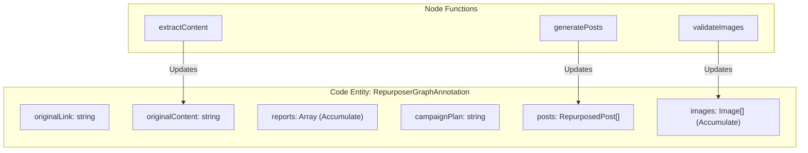

<!-- source: DeepWiki mcp.deepwiki.com · repo langchain-ai/social-media-agent · page 5.4 State Management · fetched 2026-10-26 -->

# State Management

<details>
<summary>Relevant source files</summary>

The following files were used as context for generating this wiki page:

- [src/agents/generate-post/generate-post-graph.ts](src/agents/generate-post/generate-post-graph.ts)
- [src/agents/generate-post/generate-post-state.ts](src/agents/generate-post/generate-post-state.ts)
- [src/agents/generate-post/nodes/condense-post.ts](src/agents/generate-post/nodes/condense-post.ts)
- [src/agents/generate-post/prompts/index.ts](src/agents/generate-post/prompts/index.ts)
- [src/agents/generate-post/prompts/prompts.langchain.ts](src/agents/generate-post/prompts/prompts.langchain.ts)
- [src/agents/repurposer/index.ts](src/agents/repurposer/index.ts)
- [src/agents/repurposer/nodes/extract-content/get-url-contents.ts](src/agents/repurposer/nodes/extract-content/get-url-contents.ts)
- [src/agents/repurposer/nodes/extract-content/index.ts](src/agents/repurposer/nodes/extract-content/index.ts)
- [src/agents/repurposer/types.ts](src/agents/repurposer/types.ts)
- [src/agents/should-exclude.ts](src/agents/should-exclude.ts)
- [src/agents/types.ts](src/agents/types.ts)
- [src/agents/utils.ts](src/agents/utils.ts)
- [src/utils/date.ts](src/utils/date.ts)

</details>


This document explains the state management system used throughout the codebase. State management in this system is built on LangGraph's Annotation-based state system, which provides type-safe state schemas with customizable reducers for controlling how state updates are applied.

For information about configuration management and environment variables, see [Configuration](#4). For graph orchestration and workflow structure, see [Core Workflows](#2).

## Overview

The system uses LangGraph's `Annotation` API to define state schemas for each graph. Each state schema specifies:
- **State fields**: Properties that persist across node executions.
- **Reducers**: Functions that control how updates to each field are merged with existing state.
- **Default values**: Initial values for state fields.
- **Type information**: TypeScript types for both full state and partial updates.

State flows through graph nodes sequentially, with each node receiving the current state and returning partial updates. The state annotation's reducers determine how these partial updates merge with the existing state.

Sources: [src/agents/generate-post/generate-post-state.ts:1-153](), [src/agents/repurposer/types.ts:1-120]()

## Annotation System

### Core Concepts

The `Annotation.Root()` function creates state schemas. Each field in the annotation accepts an object with optional `reducer`, `default`, and type information.

| Property | Purpose | Example |
|----------|---------|---------|
| `reducer` | Function that merges updates with existing state | `(state, update) => update` |
| `default` | Factory function returning initial value | `() => []` |
| Type parameter | TypeScript type for the field | `Annotation<string[]>` |

**Basic Annotation Pattern**

```typescript
export const GeneratePostAnnotation = Annotation.Root({
  links: Annotation<string[]>({
    reducer: (_state, update) => update,
    default: () => [],
  }),
  post: Annotation<string>({
    reducer: (_state, update) => update,
    default: () => "",
  }),
});
```

Sources: [src/agents/generate-post/generate-post-state.ts:26-108]()

### Reducer Functions

Reducers control how partial state updates merge with existing state. Three common patterns are utilized in the codebase:

| Pattern | Reducer | Use Case |
|---------|---------|----------|
| **Replace** | `(_state, update) => update` | Overwrite field completely (default behavior for many fields) |
| **Accumulate** | `(state, update) => state.concat(update)` | Append to arrays over multiple node executions |
| **Conditional** | Custom logic | Complex merge strategies or state validation |

**Accumulation Reducer Example**

The `reports` and `images` fields in `RepurposerGraphAnnotation` accumulate objects to build a campaign collection:

```typescript
reports: Annotation<Array<{ report: string; keyDetails: string }>>({
  reducer: (state, update) => state.concat(update),
  default: () => [],
}),
images: Annotation<Image[]>({
  reducer: (state, update) => state.concat(update),
  default: () => [],
})
```

Sources: [src/agents/repurposer/types.ts:42-50](), [src/agents/repurposer/types.ts:76-79]()

### State and Update Types

Each annotation generates two TypeScript types used to define node signatures:

```typescript
export type GeneratePostState = typeof GeneratePostAnnotation.State;
export type GeneratePostUpdate = typeof GeneratePostAnnotation.Update;
```

- **State**: Complete state object with all fields (used in conditionals and routing).
- **Update**: Partial state object where all fields are optional (used in node return values).

Sources: [src/agents/generate-post/generate-post-state.ts:110-111]()

## State Schemas by Graph

### Generate Post State

The `GeneratePostAnnotation` is the primary state for the content generation workflow. It inherits fields from other annotations to support modular subgraphs.

**State Composition Diagram**

```mermaid
graph TB
    subgraph "Code Entity: GeneratePostAnnotation"
        links["links: string[]"]
        report["report: string"]
        post["post: string"]
        complexPost["complexPost: ComplexPost?"]
        scheduleDate["scheduleDate: DateType"]
        userResponse["userResponse: string?"]
        next["next: NodeName | END"]
        image["image: {imageUrl, mimeType}?"]
        condenseCount["condenseCount: number"]
    end
    
    subgraph "Code Entity: VerifyLinksResultAnnotation"
        pageContents["pageContents: string[]"]
        relevantLinks["relevantLinks: string[]"]
        youtubeVideoSummaries["youtubeVideoSummaries"]
    end
    
    "GeneratePostAnnotation" -- "Spreads Spec" --> "VerifyLinksResultAnnotation"
```

**Key Fields**

| Field | Type | Reducer | Purpose |
|-------|------|---------|---------|
| `links` | `string[]` | Replace | Initial URLs extracted from source (e.g., Slack) |
| `post` | `string` | Replace | The final generated text for the social media post |
| `condenseCount` | `number` | Replace | Counter to prevent infinite loops during post shortening [src/agents/generate-post/generate-post-graph.ts:97-99]() |
| `next` | `string \| typeof END` | Replace | Explicit routing target used by human-in-the-loop nodes |

Sources: [src/agents/generate-post/generate-post-state.ts:26-108](), [src/agents/generate-post/generate-post-graph.ts:71-88]()

### Repurposer State

The `RepurposerGraphAnnotation` manages state for the batch generation of multiple posts from a single source.



Sources: [src/agents/repurposer/types.ts:8-93](), [src/agents/repurposer/index.ts:14-34]()

## Configurable State

Configurable annotations define runtime parameters that do not change during the graph execution but influence node behavior. These are accessed via `config.configurable`.

### Configuration Access Pattern

Nodes and conditional edges use helper utilities to read these values, often providing fallbacks to environment variables.

```typescript
// Example usage in conditional edge
const isTextOnlyMode = isTextOnly(config); 
```

**Common Configurable Fields:**
- `POST_TO_LINKEDIN_ORGANIZATION`: Determines if posts go to a company page or personal profile [src/agents/generate-post/generate-post-state.ts:118]().
- `TEXT_ONLY_MODE`: Disables image extraction and processing [src/agents/generate-post/generate-post-state.ts:125]().
- `SKIP_USED_URLS_CHECK`: Allows re-processing URLs already stored in the system [src/agents/generate-post/generate-post-state.ts:142]().

Sources: [src/agents/generate-post/generate-post-state.ts:113-143](), [src/agents/generate-post/generate-post-graph.ts:101-105]()

## State Flow and Partial Updates

### Node Execution Pattern

Each node in the graph follows a functional pattern: it receives the current state and returns a `Partial<State>`. LangGraph then applies the defined reducers to merge this update.

**Partial Update Example: `condensePost`**
The `condensePost` node only returns the updated post text and increments the counter, leaving the rest of the state (like `links` or `report`) untouched.

```typescript
// src/agents/generate-post/nodes/condense-post.ts
export async function condensePost(state, config) {
  // ... logic to shorten post
  return {
    post: parseGeneration(condensePostResponse.content),
    condenseCount: state.condenseCount + 1,
  };
}
```

Sources: [src/agents/generate-post/nodes/condense-post.ts:59-111]()

### Conditional Routing

Routing logic often depends on specific state values. For example, the `condenseOrHumanConditionalEdge` determines if a post needs shortening based on character count and the `condenseCount` state variable.

```typescript
function condenseOrHumanConditionalEdge(state, config) {
  const cleanedPost = removeUrls(state.post || "");
  if (cleanedPost.length > 280 && state.condenseCount <= 3) {
    return "condensePost";
  }
  // ... fallback routing
}
```

Sources: [src/agents/generate-post/generate-post-graph.ts:90-106]()

## Human-in-the-Loop State

The system handles interrupts by storing the user's intent in the state. When a user interacts with the Agent Inbox, the state is updated with `userResponse` and a `next` instruction.

1.  **Interrupt**: The graph stops at a `humanNode`.
2.  **Update**: External client updates the thread state with `userResponse` (e.g., "Make it shorter") and sets `next` to `"rewritePost"`.
3.  **Resume**: The graph resumes, and the `rewriteOrEndConditionalEdge` reads `state.next` to route the flow.

Sources: [src/agents/generate-post/generate-post-graph.ts:71-88](), [src/agents/generate-post/generate-post-state.ts:68-86]()

---

