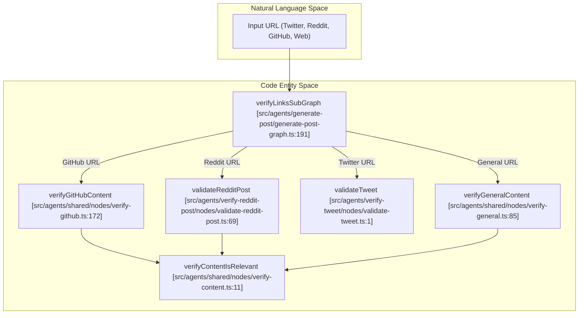
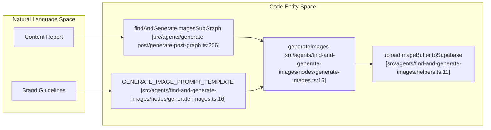

<!-- source: DeepWiki mcp.deepwiki.com · repo langchain-ai/social-media-agent · page 6 Glossary · fetched 2026-10-26 -->

# Glossary

Relevant source files

The following files were used as context for generating this wiki page:

- [.vscode/settings.json](.vscode/settings.json)
- [README.md](README.md)
- [langgraph.json](langgraph.json)
- [scripts/generate-post.ts](scripts/generate-post.ts)
- [src/agents/find-and-generate-images/community-template.ts](src/agents/find-and-generate-images/community-template.ts)
- [src/agents/find-and-generate-images/helpers.ts](src/agents/find-and-generate-images/helpers.ts)
- [src/agents/find-and-generate-images/nodes/generate-images.ts](src/agents/find-and-generate-images/nodes/generate-images.ts)
- [src/agents/generate-post/generate-post-graph.ts](src/agents/generate-post/generate-post-graph.ts)
- [src/agents/generate-post/generate-post-state.ts](src/agents/generate-post/generate-post-state.ts)
- [src/agents/generate-post/nodes/auth-socials.ts](src/agents/generate-post/nodes/auth-socials.ts)
- [src/agents/reflection/index.ts](src/agents/reflection/index.ts)
- [src/agents/shared/auth/linkedin.ts](src/agents/shared/auth/linkedin.ts)
- [src/agents/shared/auth/twitter.ts](src/agents/shared/auth/twitter.ts)
- [src/agents/shared/nodes/verify-general.ts](src/agents/shared/nodes/verify-general.ts)
- [src/agents/shared/nodes/verify-github.ts](src/agents/shared/nodes/verify-github.ts)
- [src/agents/shared/nodes/verify-luma.ts](src/agents/shared/nodes/verify-luma.ts)
- [src/agents/shared/nodes/verify-youtube.ts](src/agents/shared/nodes/verify-youtube.ts)
- [src/agents/utils.ts](src/agents/utils.ts)
- [src/agents/verify-reddit-post/nodes/validate-reddit-post.ts](src/agents/verify-reddit-post/nodes/validate-reddit-post.ts)
- [src/agents/verify-tweet/nodes/validate-tweet.ts](src/agents/verify-tweet/nodes/validate-tweet.ts)
- [src/clients/linkedin.ts](src/clients/linkedin.ts)
- [src/clients/types.ts](src/clients/types.ts)
- [src/tests/linkedin.int.test.ts](src/tests/linkedin.int.test.ts)
- [src/utils/reflections.ts](src/utils/reflections.ts)
- [static/agent_flow.png](static/agent_flow.png)
- [static/graph_screenshot.png](static/graph_screenshot.png)

This page provides definitions for codebase-specific terminology, domain concepts, and technical jargon used throughout the Social Media Agent system.

## System Core Concepts

### LangGraph Orchestration
The system is built as a multi-graph application using **LangGraph**. It consists of 14 distinct graphs defined in `langgraph.json` [langgraph.json:4-19](). These graphs are orchestrated to handle different stages of the content lifecycle, from ingestion to publishing.

### Human-in-the-loop (HITL)
A design pattern where the agent pauses execution to wait for human intervention. This is implemented using the `humanNode` [src/agents/generate-post/generate-post-graph.ts:198-198]() and `interrupt` [src/agents/shared/auth/linkedin.ts:76-78]() functions. It allows users to approve, rewrite, or reject posts before they are published.

### Reflection and Learning
The process by which the agent improves its output based on user feedback. The `reflectionGraph` [src/agents/reflection/index.ts:103-104]() uses a "metaprompt" approach to analyze user edits and update persistent rules stored in the LangGraph Store [src/agents/reflection/index.ts:93-93]().

---

## Technical Terms & Abbreviations

| Term | Definition | Code Pointer |
| :--- | :--- | :--- |
| **Arcade** | An authentication and integration platform used to handle OAuth flows for Twitter and LinkedIn without requiring direct developer app management. | [src/agents/shared/auth/linkedin.ts:163-176]() |
| **Annotation** | A LangGraph-specific way to define the schema and "reducers" (state update logic) for a graph's state. | [src/agents/generate-post/generate-post-state.ts:26-108]() |
| **FireCrawl** | A service used for web scraping and converting HTML content into clean Markdown for LLM consumption. | [src/agents/shared/nodes/verify-general.ts:3-7]() |
| **Supabase** | Used as the storage backend for image assets generated or found during the post-creation process. | [src/agents/find-and-generate-images/nodes/generate-images.ts:11-11]() |
| **URN** | Uniform Resource Name. Specifically used in LinkedIn integration to identify members (`urn:li:person:...`) or organizations (`urn:li:organization:...`). | [src/clients/linkedin.ts:97-105]() |
| **Condensation** | The iterative process of shortening a post (typically for Twitter's 280-character limit) if the initial generation is too long. | [src/agents/generate-post/generate-post-graph.ts:96-100]() |

---

## Code Entity Space Mapping

The following diagrams bridge the gap between high-level concepts and specific code entities.

### Content Verification Mapping
This diagram shows how different URL types are routed to specific verification logic within the system.

**Sources:** [src/agents/generate-post/generate-post-graph.ts:191-191](), [src/agents/shared/nodes/verify-github.ts:172-172](), [src/agents/verify-reddit-post/nodes/validate-reddit-post.ts:69-69](), [src/agents/shared/nodes/verify-general.ts:85-85]()

### Image Generation Data Flow
This diagram illustrates the transition from a text-based report to a visual asset.

**Sources:** [src/agents/generate-post/generate-post-graph.ts:206-206](), [src/agents/find-and-generate-images/nodes/generate-images.ts:16-118](), [src/agents/find-and-generate-images/helpers.ts:11-11]()

---

## Domain Concepts

### Business Context
A set of instructions and product definitions that tell the agent what the company does (e.g., LangChain, LangGraph). This context is injected into prompts to ensure the agent only generates relevant content [src/agents/shared/nodes/verify-github.ts:58-58]().

### Content Relevancy Check
A specialized node that uses an LLM and a structured schema (`RELEVANCY_SCHEMA`) to determine if a piece of scraped content is worth posting about [src/agents/shared/nodes/verify-general.ts:13-26](). This can be bypassed using the `SKIP_CONTENT_RELEVANCY_CHECK` configuration [src/agents/generate-post/generate-post-state.ts:137-137]().

### Social Auth Passthrough
A mechanism used at the start of the `generate_post` graph to ensure that the necessary social media credentials (or Arcade tokens) are available before proceeding with content generation [src/agents/generate-post/generate-post-graph.ts:189-189]().

### Complex Post
A state object used when a post is not just a single string but contains structured data, such as when a URL is split from the main body of a tweet to optimize for platform algorithms [src/agents/generate-post/generate-post-state.ts:54-57]().

**Sources:** [src/agents/generate-post/generate-post-state.ts:1-153](), [src/agents/shared/nodes/verify-general.ts:13-37](), [src/agents/reflection/index.ts:30-50]()