# Page: Overview

# Overview

<details>
<summary>Relevant source files</summary>

The following files were used as context for generating this wiki page:

- [.vscode/settings.json](.vscode/settings.json)
- [README.md](README.md)
- [langgraph.json](langgraph.json)
- [package.json](package.json)
- [scripts/generate-post.ts](scripts/generate-post.ts)
- [src/agents/reflection/index.ts](src/agents/reflection/index.ts)
- [src/utils/reflections.ts](src/utils/reflections.ts)
- [static/agent_flow.png](static/agent_flow.png)
- [static/graph_screenshot.png](static/graph_screenshot.png)
- [yarn.lock](yarn.lock)

</details>


The Social Media Agent is an AI-powered automation platform that generates and publishes content to Twitter and LinkedIn from various content sources including Slack channels, GitHub repositories, YouTube videos, Reddit posts, and general web pages. The system features a human-in-the-loop (HITL) workflow that allows users to review, modify, and approve generated posts before publication, with continuous learning from feedback to improve future generations. [README.md:1-5]()

The platform is built on **LangGraph**, which orchestrates 14 specialized graphs that handle different aspects of the content pipeline, from ingestion and verification to generation, human review, scheduling, and publishing. [langgraph.json:4-19]()

**Key capabilities:**
- Multi-source content ingestion (Slack, GitHub, Twitter, Reddit, YouTube, web pages)
- AI-powered content analysis and post generation using Anthropic Claude and Google Vertex AI
- Automated image discovery, validation, and AI generation with brand templates
- Human-in-the-loop review with multiple action options via Agent Inbox
- Scheduled post publishing to Twitter and LinkedIn
- Continuous learning from user feedback via a reflection system
- Content repurposing for multiple posts from single sources

For detailed information about specific components, refer to these child pages:
- [System Architecture](#1.1)
- [Features and Capabilities](#1.2)
- [Key Dependencies](#1.3)

## System Architecture

The Social Media Agent is built on **LangGraph Server**, which orchestrates 14 distinct graphs defined in `langgraph.json`. Each graph handles a specialized aspect of the content pipeline, from data acquisition through publishing and continuous learning. [langgraph.json:1-24]()

### Complete System Architecture

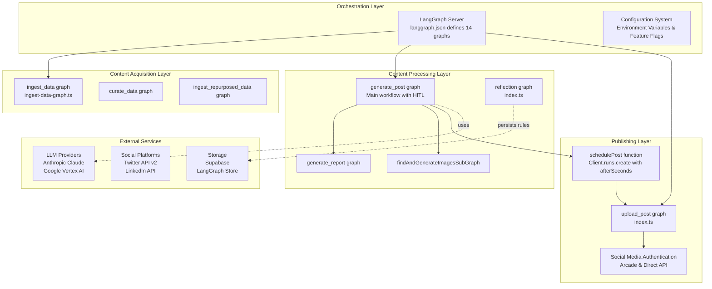

### Graph Definitions

The system defines 14 named graphs in [langgraph.json:4-19](). For more details, see [System Architecture](#1.1).

| Graph Name | Purpose | Entry Point |
|------------|---------|-------------|
| `ingest_data` | Fetches content from Slack, Twitter, Reddit, GitHub | [src/agents/ingest-data/ingest-data-graph.ts:5]() |
| `generate_post` | Main workflow: verification → generation → HITL → scheduling | [src/agents/generate-post/generate-post-graph.ts:6]() |
| `upload_post` | Publishes posts to Twitter and LinkedIn | [src/agents/upload-post/index.ts:7]() |
| `reflection` | Learns from user feedback to optimize prompts | [src/agents/reflection/index.ts:8]() |
| `repurposer` | Creates multiple posts from single content | [src/agents/repurposer/index.ts:15]() |
| `supervisor` | Consolidates reports from multiple sources | [src/agents/supervisor/supervisor-graph.ts:13]() |
| `generate_thread` | Generates Twitter threads | [src/agents/generate-thread/index.ts:9]() |

Sources: [langgraph.json:4-19](), [package.json:37-72]()

## Features and Capabilities

The agent provides a robust suite of tools for content creators and marketing teams. Key features include:

### Multi-Source Ingestion
The system can ingest data from diverse platforms including Slack, GitHub, YouTube, and Reddit. It uses specialized verification nodes to extract structured content like READMEs, transcripts, and comment threads. [README.md:39-43]()

### Human-in-the-Loop (HITL)
A central feature is the ability for users to review generated content before it goes live. Users can:
- **Accept**: Schedule the post for publishing.
- **Rewrite**: Modify the text of the generated post.
- **Modify Date**: Change the scheduled publishing time.
- **Reject**: Discard the post entirely.
[README.md:3]()

### Reflection and Continuous Learning
The `reflectionGraph` analyzes user feedback and modifications to generate new "rules" stored in the LangGraph Store. These rules guide future generations to better align with user preferences. [src/agents/reflection/index.ts:14-105]()

For a full breakdown of features, see [Features and Capabilities](#1.2).

Sources: [README.md:1-5](), [src/agents/reflection/index.ts:30-50]()

## Key Dependencies

The system relies on several core technologies and external APIs:

### Orchestration and AI
- **LangGraph**: Used for state management and workflow orchestration. [package.json:45]()
- **Anthropic Claude**: Primary LLM for text generation and reasoning. [package.json:41]()
- **Google Vertex AI**: Used for image validation, generation, and YouTube transcript processing. [package.json:44]()

### Social and Integration
- **Arcade AI**: Provides a unified OAuth interface for social media platforms. [package.json:38]()
- **Twitter & LinkedIn APIs**: Used for direct publishing and media uploads. [package.json:68]()
- **Supabase**: Used for storing generated images. [package.json:51]()
- **FireCrawl**: Used for high-quality web scraping and content extraction. [package.json:48]()

For a complete list of dependencies and their roles, see [Key Dependencies](#1.3).

Sources: [package.json:37-72](), [README.md:155-166]()

---

# Page: System Architecture

# System Architecture

<details>
<summary>Relevant source files</summary>

The following files were used as context for generating this wiki page:

- [langgraph.json](langgraph.json)
- [src/agents/generate-post/generate-post-graph.ts](src/agents/generate-post/generate-post-graph.ts)
- [src/agents/generate-post/generate-post-state.ts](src/agents/generate-post/generate-post-state.ts)
- [src/agents/reflection/index.ts](src/agents/reflection/index.ts)
- [src/agents/upload-post/index.ts](src/agents/upload-post/index.ts)
- [src/agents/utils.ts](src/agents/utils.ts)
- [src/agents/verify-tweet/nodes/get-tweet-content.ts](src/agents/verify-tweet/nodes/get-tweet-content.ts)
- [src/clients/twitter/client.ts](src/clients/twitter/client.ts)
- [src/clients/twitter/types.ts](src/clients/twitter/types.ts)
- [src/utils/reflections.ts](src/utils/reflections.ts)

</details>


This document provides an overview of the Social Media Agent's system architecture, detailing the core components, data flows, and interactions that enable the automated creation and publishing of social media content. It explains how the system's different parts work together to ingest content, verify its relevance, generate posts, facilitate human review, and publish to social media platforms.

## Overall Architecture

The Social Media Agent is built on LangGraph Server, which orchestrates 14 distinct graph workflows. The system follows a layered architecture with five main components: orchestration (LangGraph Server), content acquisition (ingestion and curation), content processing (generation with human oversight), publishing (scheduling and uploading), and continuous learning (reflection and repurposing).

### Core Architecture Layers

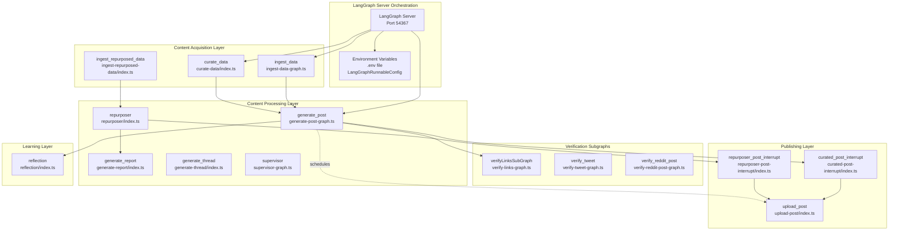

Sources: [langgraph.json:1-24](), [src/agents/generate-post/generate-post-graph.ts:185-243](), [src/agents/upload-post/index.ts:287-293](), [src/agents/reflection/index.ts:98-105]()

### LangGraph Server Configuration

The system is deployed as a LangGraph Server instance configured via `langgraph.json`. The server exposes 14 graph entry points, defining the mapping between graph names and their implementation files.

Sources: [langgraph.json:1-24]()

### Architectural Patterns

The architecture implements several key patterns:

1.  **Graph Orchestration**: Uses LangGraph's `StateGraph` and conditional edges for workflow control. Graphs can spawn other graphs using the LangGraph SDK `Client`. [src/agents/generate-post/generate-post-graph.ts:158-183]()
2.  **State Management**: Each graph defines its state using `Annotation.Root()`. State flows through nodes via shared state interfaces like `GeneratePostState`. [src/agents/generate-post/generate-post-state.ts:26-108]()
3.  **Human-in-the-Loop**: Implements interrupts via `humanNode` which pauses execution for user review and feedback. [src/agents/generate-post/generate-post-graph.ts:198-198]()
4.  **Modular Verification**: Content verification is delegated to specialized subgraphs or nodes based on URL type. [src/agents/generate-post/generate-post-graph.ts:191-191]()
5.  **Dual Authentication**: Supports both direct API credentials and Arcade OAuth flows via the `TwitterClient` and `LinkedInClient`. [src/clients/twitter/client.ts:45-60]()
6.  **Learning System**: The `reflectionGraph` uses LangMem to optimize prompt rules based on user feedback stored in the LangGraph Store. [src/agents/reflection/index.ts:52-96]()

Sources: [src/agents/generate-post/generate-post-graph.ts:158-243](), [src/agents/generate-post/generate-post-state.ts:26-108](), [src/clients/twitter/client.ts:45-60](), [src/agents/reflection/index.ts:52-96]()

## LangGraph Workflow Architecture

The system defines 14 graph workflows in `langgraph.json`.

### Complete Graph Registry

| Graph Name | Type | File Path | Primary Purpose |
| :--- | :--- | :--- | :--- |
| `ingest_data` | Entry Point | `ingest-data/ingest-data-graph.ts` | Ingests Slack messages and triggers post generation. |
| `generate_post` | Entry Point | `generate-post/generate-post-graph.ts` | Main workflow for post creation and human review. |
| `upload_post` | Entry Point | `upload-post/index.ts` | Publishes content to Twitter and LinkedIn. |
| `reflection` | Entry Point | `reflection/index.ts` | Optimizes prompts based on user feedback. |
| `curate_data` | Entry Point | `curate-data/index.ts` | Aggregates content from various social sources. |
| `verify_tweet` | Entry Point | `verify-tweet/verify-tweet-graph.ts` | Specialized verification for Twitter content. |
| `verify_reddit_post` | Entry Point | `verify-reddit-post-graph.ts` | Specialized verification for Reddit content. |
| `repurposer` | Entry Point | `repurposer/index.ts` | Generates multiple posts from a single source. |

Sources: [langgraph.json:1-19]()

### Graph Spawning Pattern

Graphs often trigger other workflows asynchronously. For instance, the `generate_post` graph can spawn a `curated_post_interrupt` if the origin is `curate-data`, allowing for specialized human-in-the-loop handling.

```typescript
// From src/agents/generate-post/generate-post-graph.ts:162-177
if (config.configurable?.origin === "curate-data") {
    const client = new Client({
      apiUrl: process.env.LANGGRAPH_API_URL,
      apiKey: process.env.LANGCHAIN_API_KEY,
    });

    const { thread_id } = await client.threads.create();
    await client.runs.create(thread_id, "curated_post_interrupt", {
      input: state,
      // ... configuration
    });

    return END;
}
```

Sources: [src/agents/generate-post/generate-post-graph.ts:162-180]()

## Post Generation Process

The `generate_post` graph is the central workflow for transforming content into social media updates.

### Generate Post Graph Structure

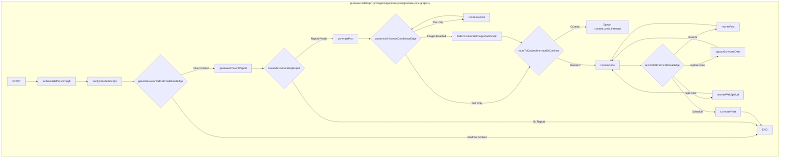

Sources: [src/agents/generate-post/generate-post-graph.ts:185-243](), [src/agents/generate-post/generate-post-graph.ts:62-155]()

### Conditional Routing Logic

The graph utilizes several key decision functions:
*   `generateReportOrEndConditionalEdge`: Checks if URLs were previously used via `checkIfUrlsArePreviouslyUsed` and ends the graph if so to avoid duplicates. [src/agents/generate-post/generate-post-graph.ts:128-151]()
*   `condenseOrHumanConditionalEdge`: Checks if the post length exceeds 280 characters. If so, it routes to `condensePost` (up to 3 times). [src/agents/generate-post/generate-post-graph.ts:90-106]()
*   `rewriteOrEndConditionalEdge`: Routes based on the `state.next` value set during the human interrupt phase. [src/agents/generate-post/generate-post-graph.ts:71-88]()

Sources: [src/agents/generate-post/generate-post-graph.ts:71-151]()

## Authentication and Social Media Integration

The system supports dual authentication modes for Twitter and LinkedIn, managed via specialized client classes.

### Twitter Authentication Logic

The `TwitterClient` handles both direct API keys and Arcade OAuth.

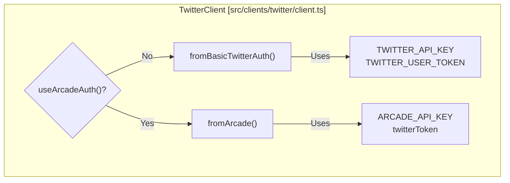

Sources: [src/clients/twitter/client.ts:61-105](), [src/clients/twitter/client.ts:153-187]()

### LinkedIn Integration

The `LinkedInClient` manages posting to either a personal profile or an organization page, depending on the `POST_TO_LINKEDIN_ORGANIZATION` configuration.

Sources: [src/agents/upload-post/index.ts:244-246](), [src/agents/utils.ts:521-530]()

## Publishing Layer: Upload Post Graph

The `upload_post` graph is responsible for the final delivery of content to social platforms.

### Upload Post Flow

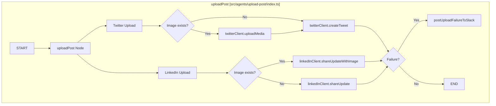

Sources: [src/agents/upload-post/index.ts:236-280](), [src/agents/upload-post/index.ts:187-234]()

The `uploadPost` node handles media conversion via `imageUrlToBuffer` before calling platform-specific clients. If an upload fails, `postUploadFailureToSlack` sends a detailed error report to a configured Slack channel. [src/agents/upload-post/index.ts:187-234]()

## Reflection and Learning System

The `reflectionGraph` allows the system to persist rules across runs by analyzing user feedback.

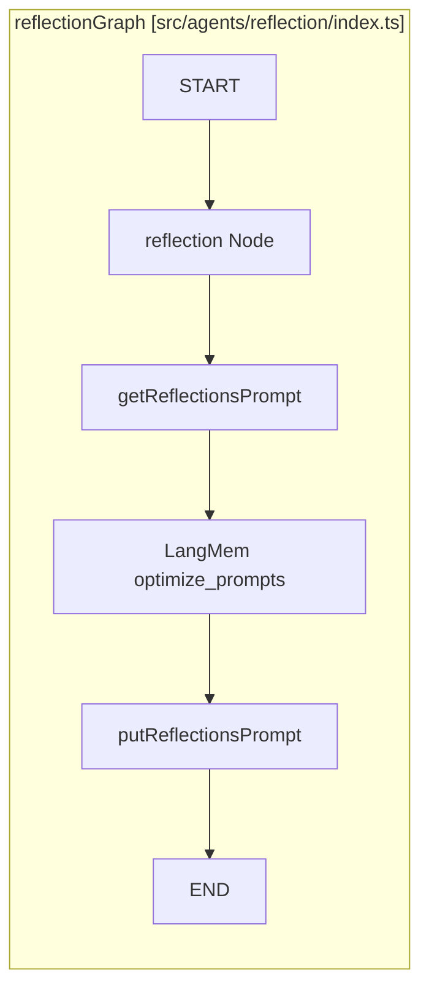

Sources: [src/agents/reflection/index.ts:52-96](), [src/utils/reflections.ts:14-43]()

The system uses the LangGraph `store` to persist these rules under the `["reflection_rules"]` namespace. The `reflection` node invokes a specialized LangMem agent (`optimize_prompts`) to distill natural language feedback into structured rules. [src/agents/reflection/index.ts:60-93]()

## Content Verification and Extraction

Before generation, the system extracts content from various sources. For Twitter content, the `getTweetContent` node fetches the full thread and media.

| Source | Extraction Logic | File Reference |
| :--- | :--- | :--- |
| Twitter | Fetches thread text and media URLs via `TwitterClient`. | `src/agents/verify-tweet/nodes/get-tweet-content.ts` |
| Web Pages | Uses `cheerio` to extract body text and image alts. | `src/agents/utils.ts:getPageText` |
| Slack | Extracts URLs using regex for `<link\|text>` formats. | `src/agents/utils.ts:extractUrlsFromSlackText` |

Sources: [src/agents/verify-tweet/nodes/get-tweet-content.ts:12-71](), [src/agents/utils.ts:105-168](), [src/agents/utils.ts:26-30]()

---

# Page: Features and Capabilities

# Features and Capabilities

<details>
<summary>Relevant source files</summary>

The following files were used as context for generating this wiki page:

- [.env.full.example](.env.full.example)
- [.env.quickstart.example](.env.quickstart.example)
- [.vscode/settings.json](.vscode/settings.json)
- [FEATURES.md](FEATURES.md)
- [README.md](README.md)
- [scripts/generate-post.ts](scripts/generate-post.ts)
- [src/agents/shared/stores/post-subject-urls.ts](src/agents/shared/stores/post-subject-urls.ts)
- [static/agent_flow.png](static/agent_flow.png)
- [static/graph_screenshot.png](static/graph_screenshot.png)

</details>


This document provides a comprehensive overview of the features and capabilities available in the social media agent system. It focuses on what the system can do and how these capabilities are implemented at the code level.

## Overview

The social media agent is an AI-powered automation platform that generates and publishes social media content with human oversight. The system supports end-to-end content workflows from ingestion through publication, with extensive customization and quality control mechanisms.

**Core Capabilities:**
- Ingests content from 7+ different sources (Slack, GitHub, YouTube, Reddit, Twitter, Luma, and general web).
- Generates marketing-optimized posts using multiple LLM providers (Anthropic, OpenAI, Google Vertex AI).
- Processes and generates images with AI, including brand-aware templates.
- Provides human-in-the-loop review and modification via the Agent Inbox.
- Publishes to Twitter and LinkedIn with sophisticated scheduling and rate-limiting.
- Learns from user feedback using a reflection graph to optimize future generations.
- Repurposes single content sources into multi-post campaigns.

Sources: [README.md:1-42](), [README.md:150-166](), [src/agents/generate-post/generate-post-graph.ts:1-246]()

---

## Content Ingestion Capabilities

The system can ingest and process content from multiple sources, each with specialized verification and extraction logic.

### Supported Content Sources

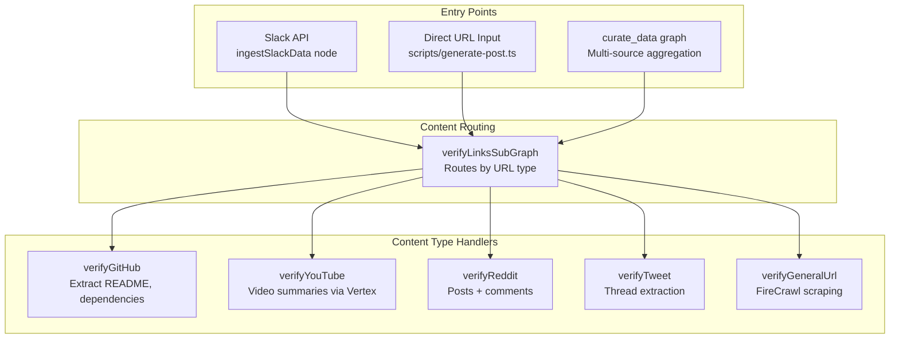

**Content Type Detection and Routing**

| Source Type | Detection Logic | Handler Node | Capabilities |
|-------------|----------------|--------------|--------------|
| GitHub | `hostname.includes("github")` | `verifyGitHub` | README extraction, dependency analysis, trending repos |
| YouTube | `hostname.includes("youtube")` or `youtu.be` | `verifyYouTube` | Video metadata, transcripts via Vertex AI |
| Reddit | `hostname.includes("reddit")` | `verifyReddit` | Post content, comment threads via Snoowrap |
| Twitter | `hostname.includes("twitter")` or `x.com` | `verifyTweet` | Tweet text, thread retrieval, media |
| General Web | All others | `verifyGeneralUrl` | Page scraping via FireCrawl API |

The `getUrlType` function in [src/agents/utils.ts:392-437]() performs URL classification, returning one of: `"github"`, `"youtube"`, `"twitter"`, `"reddit"`, `"luma"`, or `"general"`.

### Slack Message Ingestion

The `ingest_data` graph [src/agents/ingest-data/ingest-data-graph.ts:1-85]() provides automated Slack channel monitoring:

- Fetches messages from a configured Slack channel via `ingestSlackData` node.
- Extracts URLs using `extractUrlsFromSlackText` [src/agents/utils.ts:26-30]().
- Creates parallel `generate_post` runs for each URL with staggered delays to respect rate limits.
- Supports rate limiting with 30-second base delays [src/agents/utils.ts:553-573]().

Sources: [src/agents/utils.ts:392-437](), [src/agents/ingest-data/ingest-data-graph.ts:1-85](), [src/agents/utils.ts:26-30](), [README.md:298-310]()

---

## Post Generation Capabilities

The system generates marketing-optimized social media posts through a multi-stage pipeline with iterative refinement.

### Generation Pipeline Architecture

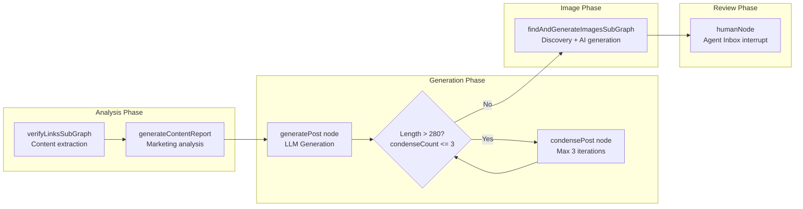

### Content Report Generation

The `generateContentReport` node produces structured marketing analysis, validating content matches the configured `BUSINESS_CONTEXT` [FEATURES.md:54-56]().

### Post Generation Features

| Feature | Implementation | Configuration |
|---------|---------------|---------------|
| **Length Optimization** | Iterative condensation (max 3 attempts) | `condenseCount` in state [src/agents/generate-post/generate-post-state.ts:104-107]() |
| **URL Handling** | Removes URLs from length calculation | `removeUrls` [src/agents/utils.ts:81-84]() |
| **Duplicate Prevention** | Checks stored URLs before generation | `getSavedUrls` [src/agents/shared/stores/post-subject-urls.ts:48-64]() |
| **Style Control** | Few-shot examples + structure instructions | `TWEET_EXAMPLES`, `POST_STRUCTURE_INSTRUCTIONS` [README.md:407-422]() |
| **Exclusion Logic** | Skips specific URLs based on business rules | `shouldExclude<type>Content` [FEATURES.md:87-95]() |

The length check in [src/agents/generate-post/generate-post-graph.ts:62-78]() uses `removeUrls(state.post).length > 280` to exclude URLs from character count, as Twitter displays URLs with fixed length.

Sources: [src/agents/generate-post/generate-post-graph.ts:1-246](), [src/agents/generate-post/generate-post-state.ts:1-153](), [src/agents/utils.ts:81-84](), [FEATURES.md:18-31](), [src/agents/shared/stores/post-subject-urls.ts:48-64]()

---

## Image Processing Capabilities

The `findAndGenerateImagesSubGraph` provides comprehensive image handling.

### Image Pipeline Stages

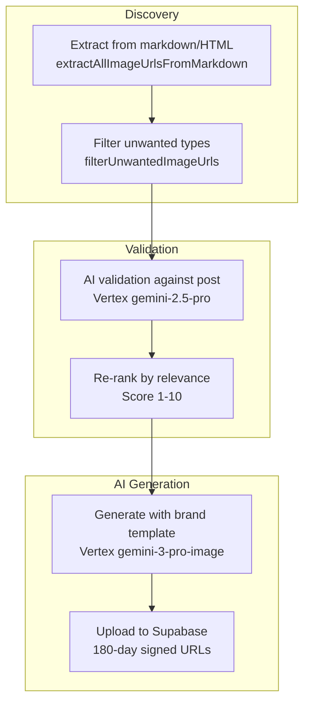

### Image Discovery and Filtering

The `filterUnwantedImageUrls` function [src/agents/utils.ts:367-377]() removes SVGs, icons, and badge images (like `img.shields.io`). If `TEXT_ONLY_MODE` is enabled, the entire image pipeline is skipped [src/agents/utils.ts:512-519]().

### AI-Powered Image Validation and Generation

- **Validation**: Uses Google Vertex AI to score images (1-10) based on relevance to the post content.
- **Generation**: If no suitable image is found, the system uses `gemini-3-pro-image` to generate one.
- **Storage**: Images are stored in Supabase with signed URLs [README.md:288-297]().

Sources: [src/agents/utils.ts:334-377](), [src/agents/utils.ts:512-519](), [README.md:288-297]()

---

## Human-in-the-Loop Capabilities

The system provides comprehensive human review through the Agent Inbox interface.

### Available User Actions

The `humanNode` [src/agents/generate-post/generate-post-graph.ts:43-60]() allows users to:
- **Accept**: Proceed to scheduling/upload.
- **Rewrite**: Provide feedback for regeneration.
- **Modify Date**: Change the scheduled post time using natural language.
- **Reject**: Terminate the workflow.
- **Split URL**: Move the link to a separate tweet in a thread (Complex Post).

### Duplicate Prevention

Once a run reaches the `humanNode`, all URLs are stored in the LangGraph store [FEATURES.md:20-22](). Future runs check this store via `getSavedUrls` to prevent duplicate content generation unless `SKIP_USED_URLS_CHECK` is true [src/agents/shared/stores/post-subject-urls.ts:17-40]().

Sources: [src/agents/generate-post/generate-post-graph.ts:43-60](), [FEATURES.md:18-31](), [src/agents/shared/stores/post-subject-urls.ts:17-40]()

---

## Scheduling and Publishing Capabilities

The system handles publication to Twitter and LinkedIn with platform-specific logic.

### Scheduling Mechanism

The `schedulePost` node creates delayed LangGraph runs using the `afterSeconds` parameter [src/agents/ingest-data/ingest-data-graph.ts:44-59](). Delay times are calculated based on URL type and count to prevent rate limiting [src/agents/utils.ts:553-573]().

### Multi-Platform Authentication

The system supports two authentication modes:
1. **Arcade Mode**: Uses `ARCADE_API_KEY` for simplified OAuth handling [README.md:204-210]().
2. **Direct Mode**: Uses developer account secrets (e.g., `TWITTER_API_KEY`, `LINKEDIN_CLIENT_ID`) [README.md:214-255]().

**Platform Specifics:**
- **Twitter**: Requires OAuth 1.0a for media uploads even if using Arcade for text [README.md:222-226]().
- **LinkedIn**: Supports posting as a Person or an Organization (`POST_TO_LINKEDIN_ORGANIZATION`) [README.md:257-275]().

Sources: [src/agents/utils.ts:553-573](), [README.md:204-275](), [src/agents/ingest-data/ingest-data-graph.ts:44-59]()

---

## Learning and Optimization

The system includes a **Reflection Graph** that learns from human edits. When a user rewrites or edits a post in the Agent Inbox, the reflection graph:
1. Compares the original AI generation with the human-edited version.
2. Extracts "rules" or preferences (e.g., "don't use emojis", "keep it technical").
3. Stores these rules in the LangGraph Store (namespace `reflection_rules`).
4. Automatically injects these rules into future generation prompts to improve alignment with user style.

Sources: [README.md:3](), [FEATURES.md:3]() (General system behavior)

---

## Configuration and Flags

| Flag | Description | Implementation |
|------|-------------|----------------|
| `SKIP_CONTENT_RELEVANCY_CHECK` | Bypasses the AI check for business relevance. | [FEATURES.md:54-56]() |
| `SKIP_USED_URLS_CHECK` | Disables duplicate URL prevention. | [src/agents/shared/stores/post-subject-urls.ts:22-24]() |
| `TEXT_ONLY_MODE` | Disables image extraction and generation. | [src/agents/utils.ts:512-519]() |
| `USE_ARCADE_AUTH` | Toggles between Arcade and Direct API authentication. | [src/agents/utils.ts:611-613]() |
| `USE_LANGCHAIN_PROMPTS` | Enables specific exclusion logic and prompts for LangChain. | [FEATURES.md:91-93]() |

Sources: [FEATURES.md:54-95](), [src/agents/utils.ts:512-613](), [src/agents/shared/stores/post-subject-urls.ts:22-24]()

---

# Page: Key Dependencies

# Key Dependencies

<details>
<summary>Relevant source files</summary>

The following files were used as context for generating this wiki page:

- [memory-v2/poetry.lock](memory-v2/poetry.lock)
- [memory-v2/pyproject.toml](memory-v2/pyproject.toml)
- [package.json](package.json)
- [pyproject.toml](pyproject.toml)
- [uv.lock](uv.lock)
- [yarn.lock](yarn.lock)

</details>


This document catalogs the external dependencies and services that power the social media automation system. It covers npm packages, API integrations, and required infrastructure components, along with their specific roles and configuration requirements.

For information about configuring these dependencies through environment variables, see [Environment Variables](#4.1). For details on authentication setup, see [Arcade Authentication](#3.6).

---

## Core Orchestration Dependencies

The system's foundation is built on LangGraph, which provides the graph-based workflow orchestration and execution runtime.

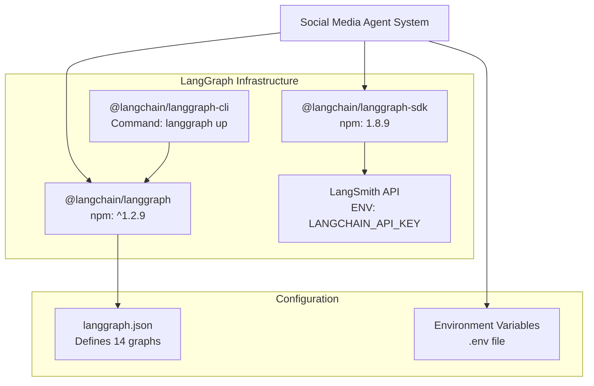

**LangGraph Core Components:**

| Package/Service | Version | Purpose |
|----------------|---------|---------|
| `@langchain/langgraph` | ^1.2.9 | Core graph orchestration, state management, and workflow definition |
| `@langchain/langgraph-sdk` | 1.8.9 | Client SDK for interacting with LangGraph server (threads, runs, crons) |
| LangGraph CLI | Latest | Development server and deployment tooling (`langgraph up` command) |
| LangSmith | ^0.5.25 | Tracing, monitoring, and API authentication for LangGraph runtime |

The LangGraph SDK is used throughout the codebase to manage workflow execution and scheduled tasks. For example, scripts utilize the `Client` from `@langchain/langgraph-sdk` to interact with the runtime.

**Sources:** [package.json:45-46](), [package.json:61](), [package.json:34-35]()

---

## LLM Provider Dependencies

The system integrates with three primary LLM providers, each serving distinct roles in content generation and analysis.

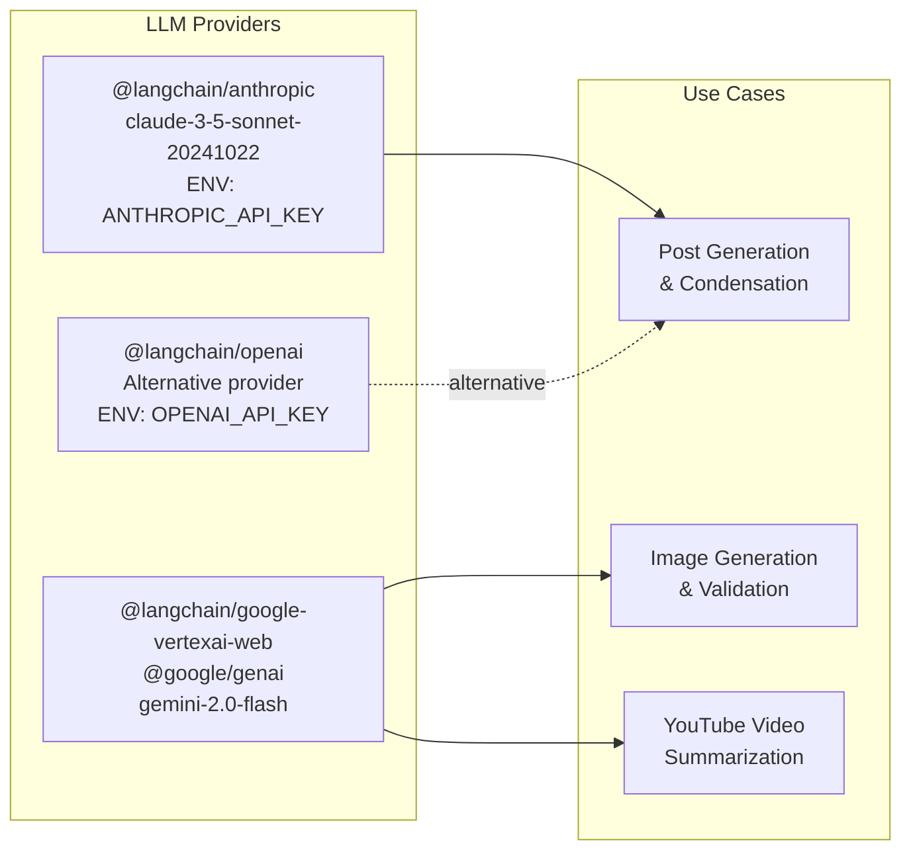

**LLM Provider Packages:**

| Package | Version | Primary Use Cases |
|---------|---------|------------------|
| `@langchain/anthropic` | ^1.3.28 | Post generation, text condensation, content analysis |
| `@langchain/openai` | ^1.4.5 | Alternative LLM provider for text operations |
| `@langchain/google-vertexai-web` | ^1.0.0 | Image generation validation, multimodal tasks |
| `@google/genai` | ^1.50.1 | Google Generative AI models (Gemini series) |

**Model Selection by Task:**
- **Text Generation:** Anthropic's `claude-3-5-sonnet-20241022` is a primary model for post generation and content report creation.
- **Image Tasks:** Google Vertex AI models are utilized for image validation and multimodal analysis.
- **Video Analysis:** YouTube transcript analysis and summarization leverage multimodal capabilities.

**Sources:** [package.json:39](), [package.json:41](), [package.json:44](), [package.json:47]()

---

## Social Media API Dependencies

Integration with Twitter and LinkedIn for content publishing is handled through a combination of direct API clients and OAuth abstraction layers.

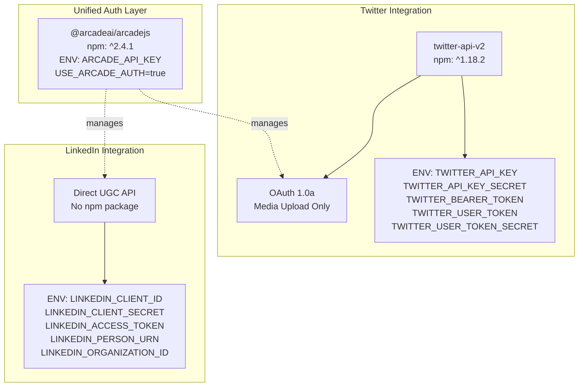

**Twitter API:**

| Package/Component | Version | Purpose |
|------------------|---------|---------|
| `twitter-api-v2` | ^1.18.2 | Twitter API v2 client for posting tweets, searching, and thread management |
| OAuth 1.0a | Required | Authentication for media uploads (images/videos) |
| Arcade (optional) | ^2.4.1 | Unified OAuth for simplified posting |

**LinkedIn API:**

| Component | Configuration | Purpose |
|-----------|--------------|---------|
| Direct UGC API | No npm package | LinkedIn's User Generated Content API for posting |
| Personal Posting | `LINKEDIN_ACCESS_TOKEN` | Posting as individual user |
| Organization Posting | `LINKEDIN_ORGANIZATION_ID` | Posting as company page |
| Arcade (optional) | `USE_ARCADE_AUTH=true` | Simplified OAuth abstraction |

**Sources:** [package.json:38](), [package.json:68]()

---

## Content Source API Dependencies

The system ingests content from multiple platforms, requiring specialized API clients.

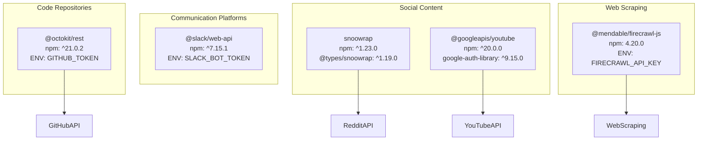

**Content Source Packages:**

| Package | Version | Platform | Purpose |
|---------|---------|----------|---------|
| `@slack/web-api` | ^7.15.1 | Slack | Message ingestion and notification delivery |
| `@octokit/rest` | ^21.0.2 | GitHub | Repository metadata and content extraction |
| `snoowrap` | ^1.23.0 | Reddit | Subreddit post and comment extraction |
| `@googleapis/youtube` | ^20.0.0 | YouTube | Video metadata and transcript retrieval |
| `@mendable/firecrawl-js` | 4.20.0 | Web | General web page scraping and content extraction |
| `google-auth-library` | ^9.15.0 | Google | Authentication for Google/YouTube APIs |

**Sources:** [package.json:40](), [package.json:48-50](), [package.json:60](), [package.json:67]()

---

## Storage and Persistence Dependencies

The system uses Supabase for image hosting and LangGraph's store for operational data.

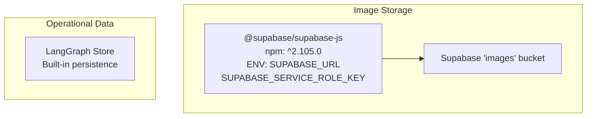

**Storage Packages:**

| Package/Service | Version | Purpose |
|----------------|---------|---------|
| `@supabase/supabase-js` | ^2.105.0 | Supabase client for image storage operations |
| LangGraph Store | Built-in | Key-value store for reflection rules and processed URLs |

**Sources:** [package.json:51]()

---

## Supporting Utility Dependencies

The system relies on utility libraries for data transformation, validation, and operational tasks.

**Utility Package Table:**

| Category | Package | Version | Purpose |
|----------|---------|---------|---------|
| **Validation** | `zod` | ^4.1.12 | Schema validation for state and API responses |
| **HTML/XML** | `cheerio` | ^1.0.0 | HTML parsing and DOM manipulation |
| **HTML/XML** | `xml2js` | ^0.6.2 | XML to JavaScript object conversion |
| **Date/Time** | `date-fns` | ^4.1.0 | Date arithmetic and formatting |
| **Date/Time** | `date-fns-tz` | ^3.2.0 | Timezone-aware date operations |
| **Date/Time** | `moment` | ^2.30.1 | Date formatting utilities |
| **Images** | `sharp` | ^0.34.5 | Image processing and optimization |
| **Browser** | `playwright` | ^1.59.1 | Browser automation for content extraction |
| **IDs** | `uuid` | ^14.0.0 | UUID generation for unique identifiers |
| **Environment** | `dotenv` | ^16.4.7 | Environment variable loading |

**Sources:** [package.json:53-71]()

---

## Dependency Version Management

The project uses Yarn for Node.js dependencies and includes specialized Python-based components (like `memory-v2`) managed via Poetry or UV.

**Version Management Strategy:**

| Aspect | Implementation |
|--------|---------------|
| **Package Manager** | Yarn 1.22.22 (Main) / Poetry (Memory V2) / UV (Slack module) |
| **Lock Files** | `yarn.lock`, `poetry.lock`, `uv.lock` |
| **TypeScript** | Version ^6.0.3 |

**Sources:** [package.json:5](), [package.json:106](), [memory-v2/poetry.lock:1](), [uv.lock:1]()

---

# Page: Core Workflows

# Core Workflows

<details>
<summary>Relevant source files</summary>

The following files were used as context for generating this wiki page:

- [langgraph.json](langgraph.json)
- [src/agents/generate-post/generate-post-graph.ts](src/agents/generate-post/generate-post-graph.ts)
- [src/agents/generate-post/generate-post-state.ts](src/agents/generate-post/generate-post-state.ts)
- [src/agents/reflection/index.ts](src/agents/reflection/index.ts)
- [src/agents/utils.ts](src/agents/utils.ts)
- [src/utils/reflections.ts](src/utils/reflections.ts)

</details>


This document provides an introduction to the primary operational workflows in the Social Media Agent system. These workflows are implemented as LangGraph state graphs that orchestrate AI-powered content curation, generation, and publishing. Each workflow represents a complete end-to-end process with defined state, nodes, and conditional edges that route execution based on runtime conditions.

For detailed information about individual workflow components, see:
- Data ingestion mechanisms: [Data Ingestion](#2.1)
- Content verification logic: [Content Verification](#2.2) 
- Post generation process: [Post Generation](#2.3)
- Image discovery and generation: [Image Processing](#2.4)
- Human review interface: [Human Review Process](#2.5)
- Post scheduling and publishing: [Post Scheduling and Upload](#2.6)
- Feedback loops and prompt optimization: [Reflection and Learning](#2.7)
- Content batching and campaigns: [Content Repurposing](#2.8)

## Workflow Architecture

The system defines 14 named graphs in [langgraph.json:1-24](), each representing a distinct workflow or reusable subgraph. These workflows coordinate to form the complete social media automation pipeline.

### Primary Workflow Types

| Workflow Type | Graphs | Purpose |
|--------------|--------|---------|
| **Main Pipeline** | `ingest_data`, `generate_post`, `upload_post` | Core end-to-end automation from content discovery to publishing |
| **Content Curation** | `curate_data`, `verify_reddit_post`, `verify_tweet` | Multi-source content aggregation and verification |
| **Interrupt Handlers** | `curated_post_interrupt`, `repurposer_post_interrupt` | Human-in-the-loop review interfaces |
| **Learning & Optimization** | `reflection`, `repurposer` | Feedback processing and content repurposing |
| **Utilities** | `supervisor`, `generate_report`, `generate_thread`, `ingest_repurposed_data` | Supporting workflows for specific tasks |

**Workflow Execution Flow**

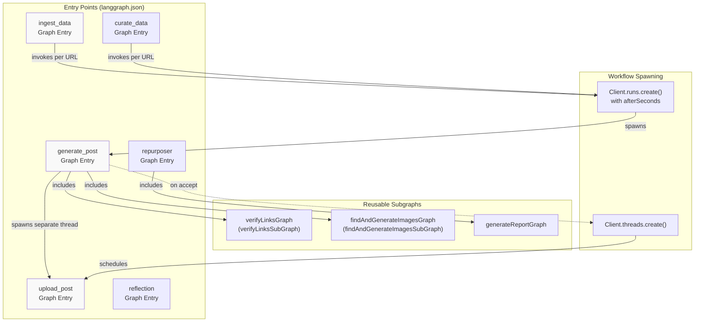

Sources: [langgraph.json:1-24](), [src/agents/generate-post/generate-post-graph.ts:157-243]()

### State Graph Implementation

Each workflow is implemented using LangGraph's `StateGraph` class with typed state annotations. The pattern follows:

```typescript
// State definition with Annotation.Root
const StateAnnotation = Annotation.Root({
  field: Annotation<Type>({
    reducer: (_state, update) => update,
    default: () => defaultValue
  })
});

// Graph construction
const builder = new StateGraph(StateAnnotation, ConfigurableAnnotation)
  .addNode("nodeName", nodeFunction)
  .addEdge(START, "nodeName")
  .addConditionalEdges("nodeName", routingFunction, ["target1", "target2", END]);

export const graphName = builder.compile();
```

Sources: [src/agents/generate-post/generate-post-graph.ts:184-241](), [src/agents/generate-post/generate-post-state.ts:26-108](), [src/agents/reflection/index.ts:98-103]()

## Main Pipeline Workflow

The primary automation pipeline consists of three sequential graphs that process content from discovery through publishing.

**Pipeline State Flow**

```mermaid
stateDiagram-v2
    direction LR
    
    [*] --> ingestSlackData
    
    state ingest_data {
        ingestSlackData --> generatePostFromMessages
        generatePostFromMessages --> links_array
        links_array --> spawns_threads
    }
    
    spawns_threads --> generate_post_threads: creates thread per URL
    
    state generate_post_threads {
        state generate_post {
            authSocialsPassthrough --> verifyLinksSubGraph
            verifyLinksSubGraph --> generateReportOrEndConditionalEdge
            generateReportOrEndConditionalEdge --> generateContentReport
            generateContentReport --> generatePost
            generatePost --> condenseOrHumanConditionalEdge
            condenseOrHumanConditionalEdge --> condensePost
            condensePost --> findAndGenerateImagesSubGraph
            findAndGenerateImagesSubGraph --> humanNode
            humanNode --> rewriteOrEndConditionalEdge
            rewriteOrEndConditionalEdge --> schedulePost
        }
    }
    
    schedulePost --> upload_scheduled: afterSeconds delay
    
    state upload_post {
        upload_scheduled --> uploadToTwitter
        upload_scheduled --> uploadToLinkedIn
        uploadToTwitter --> notifySlack
        uploadToLinkedIn --> notifySlack
    }
    
    notifySlack --> [*]
```

Sources: [src/agents/generate-post/generate-post-graph.ts:184-241]()

### Workflow Orchestration Pattern

The system uses a spawning pattern where upstream graphs create new threads and scheduled runs for downstream graphs:

1. **Ingestion Phase**: `ingestSlackData` node extracts URLs from Slack messages into `state.links` array.
2. **Thread Spawning**: Upstream nodes create separate threads via `Client.threads.create()` [src/agents/generate-post/generate-post-graph.ts:169]().
3. **Scheduled Execution**: Each thread invokes the next graph (e.g., `generate_post`) with `afterSeconds` for rate limiting.
4. **Human Review**: `humanNode` creates an interrupt requiring user action via the Agent Inbox [src/agents/generate-post/generate-post-graph.ts:198]().
5. **Scheduling**: `schedulePost` node spawns an `upload_post` run [src/agents/generate-post/generate-post-graph.ts:200]().
6. **Publishing**: `upload_post` graph handles final platform delivery.

Sources: [src/agents/generate-post/generate-post-graph.ts:157-243]()

## Conditional Routing

State graphs use conditional edges to implement dynamic routing based on state and configuration.

**Generate Post Graph Conditional Routing**

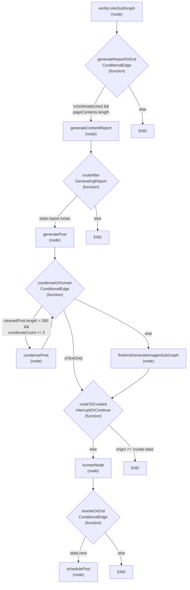

Sources: [src/agents/generate-post/generate-post-graph.ts:34-155](), [src/agents/generate-post/generate-post-graph.ts:184-241]()

### Key Routing Functions

**`generateReportOrEndConditionalEdge`** [src/agents/generate-post/generate-post-graph.ts:128-151]()
- Checks if URLs were previously used via `checkIfUrlsArePreviouslyUsed()`.
- Returns `END` if `urlsAlreadyUsed || !state.pageContents?.length`.
- Otherwise routes to `"generateContentReport"`.

**`routeAfterGeneratingReport`** [src/agents/generate-post/generate-post-graph.ts:62-69]()
- Returns `"generatePost"` if `state.report` exists.
- Returns `END` if report generation failed.

**`condenseOrHumanConditionalEdge`** [src/agents/generate-post/generate-post-graph.ts:90-106]()
- Uses `removeUrls()` to strip URLs from post text for character counting [src/agents/utils.ts:81-84]().
- Routes to `"condensePost"` if length > 280 and `condenseCount <= 3`.
- Routes to `routeToCuratedInterruptOrContinue()` if `isTextOnly(config)` is true.
- Otherwise routes to `"findAndGenerateImagesSubGraph"`.

**`rewriteOrEndConditionalEdge`** [src/agents/generate-post/generate-post-graph.ts:71-88]()
- Routes to `state.next` value set by human review node.
- Possible values: `"rewritePost"`, `"schedulePost"`, `"updateScheduleDate"`, `"rewriteWithSplitUrl"`, `"humanNode"`, `END`.

## Reflection and Learning Workflow

The system includes a dedicated `reflectionGraph` [src/agents/reflection/index.ts:103]() that learns from human feedback. When a user provides feedback on a generated post, this graph analyzes the delta between the original and new post to update persistent "reflection rules" stored in the LangGraph Store [src/utils/reflections.ts:32-43]().

**Reflection Logic Space**

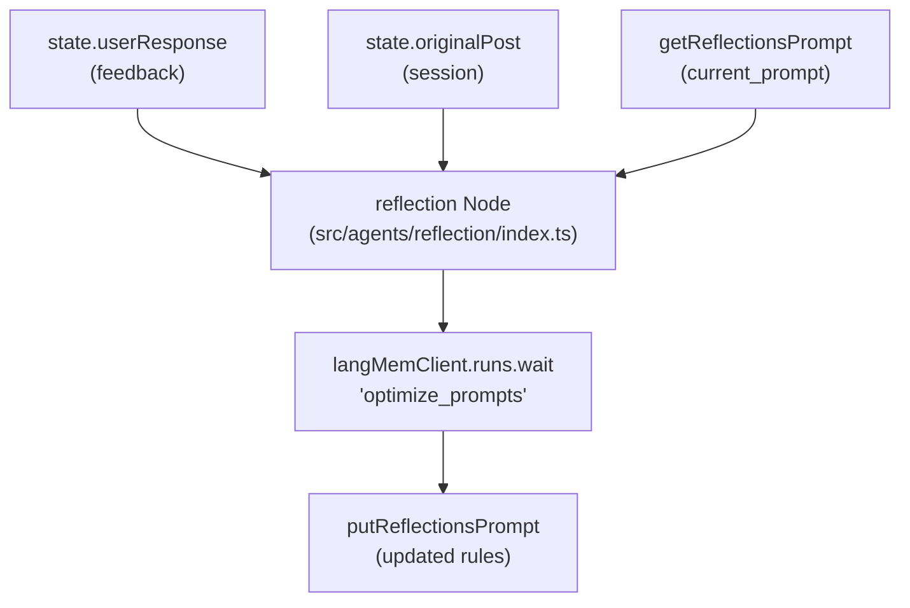

Sources: [src/agents/reflection/index.ts:52-96](), [src/utils/reflections.ts:14-43]()

## Configuration Propagation

Configuration flows through the graph execution hierarchy via `LangGraphRunnableConfig.configurable` objects.

| Configuration Key | Type | Effect |
|-------------------|------|--------|
| `POST_TO_LINKEDIN_ORGANIZATION` | `boolean` | Routes LinkedIn posts to organization page vs personal profile [src/agents/generate-post/generate-post-state.ts:118]() |
| `TEXT_ONLY_MODE` | `boolean` | Disables image processing pipeline [src/agents/generate-post/generate-post-state.ts:125]() |
| `SKIP_CONTENT_RELEVANCY_CHECK` | `boolean` | Bypasses content validation [src/agents/generate-post/generate-post-state.ts:137]() |
| `SKIP_USED_URLS_CHECK` | `boolean` | Allows duplicate URL processing [src/agents/generate-post/generate-post-state.ts:142]() |

Configuration values are read via utility functions that check both `config.configurable` and environment variables (e.g., `isTextOnly` in [src/agents/utils.ts:512-519]()).

## Error Handling and Early Termination

Workflows terminate early under specific conditions to prevent unnecessary processing:

1. **Duplicate URLs**: `generateReportOrEndConditionalEdge` returns `END` if URLs were already processed [src/agents/generate-post/generate-post-graph.ts:139]().
2. **Empty Content**: Terminates if `pageContents` length is 0 [src/agents/generate-post/generate-post-graph.ts:139]().
3. **Curated Origin**: `routeToCuratedInterruptOrContinue` spawns a separate `curated_post_interrupt` thread and returns `END` to the current thread [src/agents/generate-post/generate-post-graph.ts:179]().
4. **Condense Limit**: Condensation stops after 3 attempts to prevent infinite loops [src/agents/generate-post/generate-post-graph.ts:97]().

Sources: [src/agents/generate-post/generate-post-graph.ts:34-183]()

---

# Page: Data Ingestion

# Data Ingestion

<details>
<summary>Relevant source files</summary>

The following files were used as context for generating this wiki page:

- [scripts/get-scheduled-runs.ts](scripts/get-scheduled-runs.ts)
- [src/agents/curate-data/loaders/ai-news-blog.ts](src/agents/curate-data/loaders/ai-news-blog.ts)
- [src/agents/curate-data/loaders/github/langchain.ts](src/agents/curate-data/loaders/github/langchain.ts)
- [src/agents/curate-data/loaders/github/trending.ts](src/agents/curate-data/loaders/github/trending.ts)
- [src/agents/curate-data/loaders/latent-space.ts](src/agents/curate-data/loaders/latent-space.ts)
- [src/agents/curate-data/loaders/reddit.ts](src/agents/curate-data/loaders/reddit.ts)
- [src/agents/curate-data/loaders/twitter.ts](src/agents/curate-data/loaders/twitter.ts)
- [src/agents/curate-data/nodes/ingest-data.ts](src/agents/curate-data/nodes/ingest-data.ts)
- [src/agents/ingest-data/ingest-data-graph.ts](src/agents/ingest-data/ingest-data-graph.ts)
- [src/agents/ingest-data/ingest-data-state.ts](src/agents/ingest-data/ingest-data-state.ts)
- [src/agents/ingest-data/nodes/ingest-slack.ts](src/agents/ingest-data/nodes/ingest-slack.ts)
- [src/agents/ingest-data/nodes/ingest-twitter.ts](src/agents/ingest-data/nodes/ingest-twitter.ts)
- [src/agents/ingest-repurposed-data/nodes/ingest-slack.ts](src/agents/ingest-repurposed-data/nodes/ingest-slack.ts)
- [src/tests/slack.int.test.ts](src/tests/slack.int.test.ts)

</details>


The Data Ingestion component is responsible for collecting content from various sources to generate social media posts. It serves as the entry point for the Social Media Agent system, providing a structured way to gather information from platforms like Slack, Twitter, GitHub, Reddit, and web pages.

For information about content verification after ingestion, see [Content Verification](#2.2). For post generation using the ingested data, see [Post Generation](#2.3).

## Overview

The Social Media Agent's data ingestion system collects content from multiple sources, extracts and validates URLs, and prepares the data for the post generation process. The system is designed to avoid duplicate content and to ensure relevance to the desired topics.

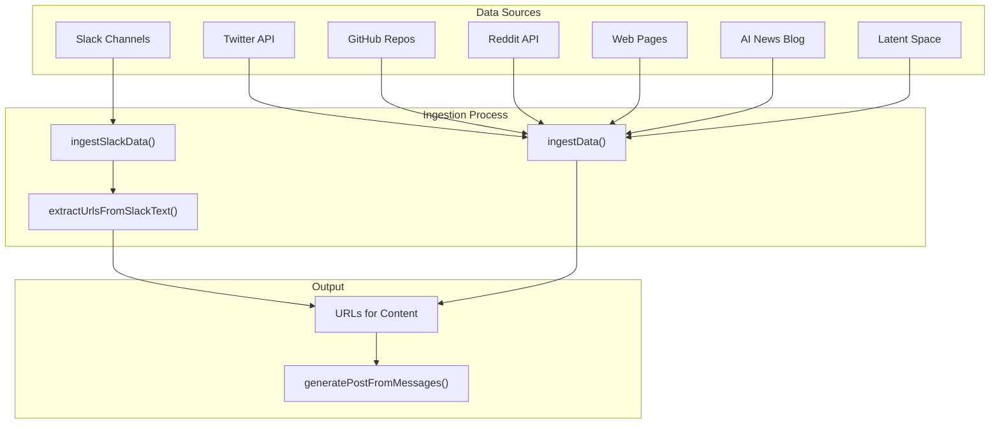

Sources: [src/agents/ingest-data/ingest-data-graph.ts:64-80](), [src/agents/ingest-data/nodes/ingest-slack.ts:12-47](), [src/agents/curate-data/nodes/ingest-data.ts:17-108]()

## Ingestion Workflows

The system supports two primary ingestion workflows defined in different graphs:

1.  **Slack Data Ingestion (`ingest_data` graph)**: Extracts links from messages in a specified Slack channel [src/agents/ingest-data/ingest-data-graph.ts:64-82]().
2.  **Curated Data Ingestion (`curate_data` graph)**: Collects content from various sources including Twitter, GitHub, and Reddit [src/agents/curate-data/nodes/ingest-data.ts:17-108]().

### Slack Ingestion Process

The `ingestSlackData` node fetches messages from a specified channel using the `SlackClient`, extracts URLs, and returns them in the `links` state [src/agents/ingest-data/nodes/ingest-slack.ts:12-47](). These links are then passed to `generatePostFromMessages`, which triggers a new `generate_post` run for each link [src/agents/ingest-data/ingest-data-graph.ts:27-60]().

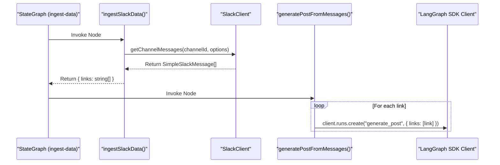

Sources: [src/agents/ingest-data/ingest-data-graph.ts:27-61](), [src/agents/ingest-data/nodes/ingest-slack.ts:12-47]()

### Curated Data Ingestion

The `ingestData` node in the curation workflow selects loaders based on the `sources` configuration and the `useLangChainPrompts()` feature flag [src/agents/curate-data/nodes/ingest-data.ts:36-100]().

| Source | LangChain-Specific Loader | General Loader |
| :--- | :--- | :--- |
| **Twitter** | `twitterLoaderWithLangChain` | `twitterLoader` |
| **GitHub** | `langchainDependencyReposLoader` | `githubTrendingLoader` |
| **Reddit** | `getLangChainRedditPosts` | `getRedditPosts` |
| **RSS/Web** | N/A | `aiNewsBlogLoader`, `latentSpaceLoader` |

Sources: [src/agents/curate-data/nodes/ingest-data.ts:36-100]()

## Data Sources and Loaders

### Twitter Data Loader

The system uses `TwitterClient` to interact with the X API. `twitterLoaderWithLangChain` searches for mentions of `@LangChainAI` while excluding employees to find high-signal community content [src/agents/curate-data/loaders/twitter.ts:85-118](). It persists the `lastIngestedTweetId` in the `BaseStore` to avoid duplicates [src/agents/curate-data/loaders/twitter.ts:114-116]().

Sources: [src/agents/curate-data/loaders/twitter.ts:85-124]()

### GitHub Loaders

The `langchainDependencyReposLoader` uses `Octokit` to search for repositories created or pushed within the last 30 days that mention "langchain" or "langgraph" [src/agents/curate-data/loaders/github/langchain.ts:15-32](). It specifically targets repositories with a minimum star count (e.g., >10 stars for new repos) [src/agents/curate-data/loaders/github/langchain.ts:78-80]().

Sources: [src/agents/curate-data/loaders/github/langchain.ts:15-103]()

### Reddit Loader

The Reddit loader fetches posts from subreddits like `r/LocalLLaMA` (general) or `r/LangChain` and `r/LangGraph` (LangChain-specific) [src/agents/curate-data/loaders/reddit.ts:16-69](). It also fetches the top 10 comments for each post to provide context for generation [src/agents/curate-data/loaders/reddit.ts:19-22]().

Sources: [src/agents/curate-data/loaders/reddit.ts:12-93]()

## Configuration and State

### Ingest Data State
The `IngestDataAnnotation` defines the state schema for the ingestion graph:
*   `links`: `string[]` - Collected URLs [src/agents/ingest-data/ingest-data-state.ts:19-22]().
*   `report`: `string` - Analysis of the content [src/agents/ingest-data/ingest-data-state.ts:27-30]().

### Configurable Parameters
The `IngestDataConfigurableAnnotation` allows runtime control [src/agents/ingest-data/ingest-data-state.ts:47-90]():
*   `maxMessages`: Limit for Slack ingestion (default 100) [src/agents/ingest-data/ingest-data-state.ts:48-51]().
*   `slackChannelId`: Source channel for Slack messages [src/agents/ingest-data/ingest-data-state.ts:57]().
*   `skipIngest`: If true, requires links to be provided in the initial state [src/agents/ingest-data/ingest-data-state.ts:59-63]().
*   `TEXT_ONLY_MODE`: Disables image extraction and processing [src/agents/ingest-data/ingest-data-state.ts:75-78]().

## Integration with Post Generation

The ingestion graph bridges to the generation graph by acting as a scheduler. `generatePostFromMessages` calculates staggered delays using `getAfterSecondsFromLinks` to ensure posts are not published all at once [src/agents/ingest-data/ingest-data-graph.ts:36-58]().

```mermaid
flowchart LR
    subgraph "Ingest Data Graph"
        IS[ingestSlackData] --> GP[generatePostFromMessages]
    end
    
    subgraph "External Trigger"
        GP -- "client.runs.create" --> GP_Graph["generate_post Graph"]
    end
    
    subgraph "Configuration Mapping"
        GP -- "Passes" --> TO[TEXT_ONLY_MODE]
        GP -- "Passes" --> SCR[SKIP_CONTENT_RELEVANCY_CHECK]
    end
```

Sources: [src/agents/ingest-data/ingest-data-graph.ts:44-60]()

## Monitoring Scheduled Runs

The `get-scheduled-runs.ts` script allows developers to monitor ingestion results by searching for "busy" threads in the `upload_post` graph [scripts/get-scheduled-runs.ts:24-29](). It formats and sends a summary of pending posts to Slack [scripts/get-scheduled-runs.ts:73-85]().

Sources: [scripts/get-scheduled-runs.ts:18-91]()

---

# Page: Content Verification

# Content Verification

<details>
<summary>Relevant source files</summary>

The following files were used as context for generating this wiki page:

- [src/agents/generate-post/nodes/rewrite-with-split-url.ts](src/agents/generate-post/nodes/rewrite-with-split-url.ts)
- [src/agents/ingest-repurposed-data/nodes/extract.ts](src/agents/ingest-repurposed-data/nodes/extract.ts)
- [src/agents/shared/nodes/verify-content.ts](src/agents/shared/nodes/verify-content.ts)
- [src/agents/shared/nodes/verify-general.ts](src/agents/shared/nodes/verify-general.ts)
- [src/agents/shared/nodes/verify-github.ts](src/agents/shared/nodes/verify-github.ts)
- [src/agents/shared/nodes/verify-luma.ts](src/agents/shared/nodes/verify-luma.ts)
- [src/agents/shared/nodes/verify-youtube.ts](src/agents/shared/nodes/verify-youtube.ts)
- [src/agents/verify-links/verify-links-state.test.ts](src/agents/verify-links/verify-links-state.test.ts)
- [src/agents/verify-links/verify-links-state.ts](src/agents/verify-links/verify-links-state.ts)
- [src/agents/verify-reddit-post/nodes/validate-reddit-post.ts](src/agents/verify-reddit-post/nodes/validate-reddit-post.ts)
- [src/agents/verify-reddit-post/utils.ts](src/agents/verify-reddit-post/utils.ts)
- [src/agents/verify-reddit-post/verify-reddit-post-graph.ts](src/agents/verify-reddit-post/verify-reddit-post-graph.ts)
- [src/agents/verify-reddit-post/verify-reddit-post-state.ts](src/agents/verify-reddit-post/verify-reddit-post-state.ts)
- [src/agents/verify-tweet/nodes/validate-tweet.ts](src/agents/verify-tweet/nodes/validate-tweet.ts)

</details>


Content Verification is a critical component of the Social Media Agent that sits between data ingestion and post generation. Its purpose is to validate content from various sources (Slack, Twitter, GitHub, Reddit, web pages) to ensure it's relevant to the desired context before investing resources in generating posts about it. 

For information about how data is collected for verification, see [Data Ingestion](#2.1). For details on how verified content is used to create posts, see [Post Generation](#2.3).

## System Architecture

The Content Verification system is built around a LangGraph workflow (`verifyLinksGraph`) that routes links to specialized verification nodes based on URL type. The architecture is designed for modularity, with separate verification processes for different content sources.

**Content Verification Workflow Architecture**

```mermaid
graph TD
    subgraph "Content Verification Main Graph"
        VerifyLinks["verifyLinksGraph"]
        RouteLink{"routeLinkTypes()"}
        
        VerifyLinks --> RouteLink
        
        RouteLink -->|"github"| VerifyGitHub["verifyGitHubContent"]
        RouteLink -->|"youtube"| VerifyYouTube["verifyYouTubeContent"]
        RouteLink -->|"twitter"| VerifyTweet["verifyTweetGraph"]
        RouteLink -->|"reddit"| VerifyReddit["verifyRedditPostGraph"]
        RouteLink -->|"luma"| VerifyLuma["verifyLumaEvent"]
        RouteLink -->|"general"| VerifyGeneral["verifyGeneralContent"]
    end
    
    Input["Input Links"] --> VerifyLinks
    VerifyLinks --> Output["Verified Content"]
```

Sources: [src/agents/verify-links/verify-links-graph.ts:1-30]()

### State Management

Content Verification uses LangGraph annotations to track and transform state as it flows through the verification process. The `sharedLinksReducer` ensures that updates are prioritized while maintaining a unique set of URLs.

```mermaid
graph LR
    subgraph "Main Graph State"
        VLState["VerifyLinksGraphAnnotation"]
        VLState --> Links["links: string[]"]
        VLState --> RelevantLinks["relevantLinks: string[]"]
        VLState --> PageContents["pageContents: string[]"]
        VLState --> ImageOptions["imageOptions: string[]"]
    end
    
    subgraph "Configuration State"
        Config["VerifyLinksGraphConfigurableAnnotation"]
        Config --> SkipRelevancy["SKIP_CONTENT_RELEVANCY_CHECK"]
    end
    
    subgraph "Specialized Graph States"
        TwitterState["VerifyTweetAnnotation"]
        RedditState["VerifyRedditPostAnnotation"]
    end
    
    VLState --> TwitterState
    VLState --> RedditState
```

Sources: [src/agents/verify-links/verify-links-state.ts:5-60](), [src/agents/verify-reddit-post/verify-reddit-post-state.ts:9-31]()

## Verification Process

The verification system follows a standard pattern across content types:

1. Determine the URL type using `getUrlType()`.
2. Route to a specialized verification node.
3. Check if content is relevant to the business context using `verifyContentIsRelevant`.
4. Return relevant links, page contents, and optional image URLs if relevant.

**Standard Verification Flow**

```mermaid
flowchart TD
    Start[Start] --> UrlType["getUrlType() determines content source"]
    UrlType --> CheckExclude["Check for excluded content"]
    CheckExclude --> ShouldExclude{"Should exclude?"}
    
    ShouldExclude -->|"Yes"| ReturnEmpty1["Return empty result"]
    ShouldExclude -->|"No"| FetchContent["Fetch content"]
    
    FetchContent --> SkipCheck{"skipContentRelevancyCheck()?"}
    SkipCheck -->|"Yes"| ReturnContent1["Return content without verification"]
    SkipCheck -->|"No"| VerifyRelevance["verifyContentIsRelevant()"]
    
    VerifyRelevance --> IsRelevant{"Is relevant?"}
    IsRelevant -->|"Yes"| ReturnContent2["Return relevantLinks, pageContents, imageOptions"]
    IsRelevant -->|"No"| ReturnEmpty2["Return empty arrays"]
    
    ReturnEmpty1 --> End["End"]
    ReturnContent1 --> End
    ReturnContent2 --> End
    ReturnEmpty2 --> End
```

Sources: [src/agents/shared/nodes/verify-content.ts:20-60](), [src/agents/utils.ts:614-632]()

### URL Type Detection

URL type detection is handled by the `getUrlType` function, which analyzes the URL structure to determine its type:

| URL Pattern | Detected Type |
|-------------|---------------|
| github.com (not github.io) | github |
| youtube.com, youtu.be | youtube |
| twitter.com, x.com | twitter |
| reddit.com, redd.it | reddit |
| lu.ma | luma |
| All others | general |

Sources: [src/agents/utils.ts:382-427]()

## Specialized Verification Processes

### Website Content Verification

General web content verification uses `FireCrawlLoader` to scrape content and `verifyContentIsRelevant` to check against the business context.

Sources: [src/agents/shared/nodes/verify-general.ts:85-122]()

### GitHub Content Verification

GitHub verification focuses on repository READMEs and dependency files (e.g., `package.json`, `requirements.txt`). It uses `getOctokit` [src/agents/shared/nodes/verify-github.ts:16-27]() to interact with the GitHub API.

```mermaid
flowchart TD
    Start[Start] --> CheckExclude["shouldExcludeGitHubContent()"]
    CheckExclude --> ShouldExclude{"Should exclude?"}
    
    ShouldExclude -->|"Yes"| ReturnEmpty1["Return empty arrays"]
    ShouldExclude -->|"No"| FetchContents["getGitHubContentsAndTypeFromUrl()"]
    
    FetchContents --> ContentsFound{"Contents found?"}
    ContentsFound -->|"No"| ReturnEmpty2["Return empty arrays"]
    ContentsFound -->|"Yes"| SkipCheck{"skipContentRelevancyCheck()?"}
    
    SkipCheck -->|"Yes"| ReturnContent1["Return content in state"]
    SkipCheck -->|"No"| GetDependencies["getDependencies()"]
    
    GetDependencies --> VerifyRelevance["verifyGitHubContentIsRelevant()"]
    VerifyRelevance --> IsRelevant{"Is relevant?"}
    
    IsRelevant -->|"Yes"| ReturnContent2["Return relevantLinks & pageContents"]
    IsRelevant -->|"No"| ReturnEmpty3["Return empty arrays"]
```

Sources: [src/agents/shared/nodes/verify-github.ts:172-226]()

### YouTube Content Verification

YouTube verification analyzes video summaries extracted via `getVideoSummary`.

Sources: [src/agents/shared/nodes/verify-youtube.ts:45-75]()

### Twitter Content Verification

Twitter verification processes both tweet content and any links within tweets. It constructs a context combining the tweet text and scraped webpage content [src/agents/verify-tweet/nodes/validate-tweet.ts:35-53]().

Sources: [src/agents/verify-tweet/nodes/validate-tweet.ts:58-95]()

### Reddit Post Verification

Reddit verification uses a subgraph to process the post, comments, and any external URLs found in the post body.

```mermaid
flowchart TD
    Start[Start] --> GetPost["getPost()"]
    GetPost --> ExtractUrls["getExternalUrls()"]
    
    ExtractUrls --> HasUrls{"Has URLs?"}
    HasUrls -->|"Yes"| RoutePostUrls["routePostUrls()"]
    HasUrls -->|"No"| ValidatePost["validateRedditPost()"]
    
    RoutePostUrls --> VerifyUrls["Verify URLs: YouTube/GitHub/General"]
    VerifyUrls --> ValidatePost
    
    ValidatePost --> SkipCheck{"skipContentRelevancyCheck()?"}
    SkipCheck -->|"Yes"| ReturnContent1["Return all content"]
    SkipCheck -->|"No"| IsRelevant{"Is relevant?"}
    
    IsRelevant -->|"Yes"| ReturnContent2["Return relevantLinks & pageContents"]
    IsRelevant -->|"No"| ReturnEmpty["Return empty state"]
```

Sources: [src/agents/verify-reddit-post/verify-reddit-post-graph.ts:25-89](), [src/agents/verify-reddit-post/nodes/validate-reddit-post.ts:69-101]()

## Configuration Options

### Skip Content Relevancy Check

You can bypass the content relevancy verification with the `SKIP_CONTENT_RELEVANCY_CHECK` option. This is useful for testing or when content has been pre-validated.

Sources: [src/agents/utils.ts:614-632](), [src/agents/verify-links/verify-links-state.ts:62-67]()

## Content Relevancy Verification

The heart of the verification system is the content relevancy check. Each verification node uses a specialized prompt and a structured output schema (`RELEVANCY_SCHEMA`) to determine if content is relevant to the business context.

**Verification Prompts by Content Type**

| Content Type | Prompt Variable | File Reference |
|-------------|-----------------|----------------|
| General Web | `VERIFY_COMPANY_RELEVANT_CONTENT_PROMPT` | [src/agents/shared/nodes/verify-general.ts:28-37]() |
| GitHub | `VERIFY_LANGCHAIN_RELEVANT_CONTENT_PROMPT` | [src/agents/shared/nodes/verify-github.ts:54-65]() |
| YouTube | `VERIFY_RELEVANT_CONTENT_PROMPT` | [src/agents/shared/nodes/verify-youtube.ts:15-25]() |
| Reddit | `VALIDATE_REDDIT_POST_PROMPT` | [src/agents/verify-reddit-post/nodes/validate-reddit-post.ts:9-19]() |
| Luma | `VERIFY_LUMA_RELEVANT_CONTENT_PROMPT` | [src/agents/shared/nodes/verify-luma.ts:26-36]() |

Sources: [src/agents/shared/nodes/verify-content.ts:5-18]()

## Integration with Other Components

Content Verification integrates with other system components:

```mermaid
graph TD
    subgraph "Data Ingestion"
        Ingest["ingestData"]
        ExtractUrls["extractUrlsFromSlackText()"]
    end
    
    subgraph "Content Verification"
        VerifyLinks["verifyLinksGraph"]
        GetUrlType["getUrlType()"]
        SpecializedVerifiers["Specialized Verification Nodes"]
    end
    
    subgraph "Post Generation"
        GeneratePost["generatePostGraph"]
        VerifyLinksNode["verifyLinks node"]
    end
    
    Ingest --> ExtractUrls
    ExtractUrls --> VerifyLinks
    
    VerifyLinks --> GetUrlType
    GetUrlType --> SpecializedVerifiers
    
    VerifyLinks --> VerifyLinksNode
    VerifyLinksNode --> GeneratePost
```

Sources: [src/agents/verify-links/verify-links-state.ts:26-52](), [src/agents/shared/nodes/verify-github.ts:29-32]()

---

# Page: Post Generation

# Post Generation

<details>
<summary>Relevant source files</summary>

The following files were used as context for generating this wiki page:

- [src/agents/curate-data/nodes/validate-bulk-tweets.ts](src/agents/curate-data/nodes/validate-bulk-tweets.ts)
- [src/agents/generate-post/constants.ts](src/agents/generate-post/constants.ts)
- [src/agents/generate-post/generate-post-graph.ts](src/agents/generate-post/generate-post-graph.ts)
- [src/agents/generate-post/generate-post-state.ts](src/agents/generate-post/generate-post-state.ts)
- [src/agents/generate-post/nodes/condense-post.ts](src/agents/generate-post/nodes/condense-post.ts)
- [src/agents/generate-post/nodes/generate-post/index.ts](src/agents/generate-post/nodes/generate-post/index.ts)
- [src/agents/generate-post/nodes/generate-post/prompts.ts](src/agents/generate-post/nodes/generate-post/prompts.ts)
- [src/agents/generate-post/nodes/generate-report/index.ts](src/agents/generate-post/nodes/generate-report/index.ts)
- [src/agents/generate-post/nodes/generate-report/prompts.ts](src/agents/generate-post/nodes/generate-report/prompts.ts)
- [src/agents/generate-post/prompts/index.ts](src/agents/generate-post/prompts/index.ts)
- [src/agents/generate-post/prompts/prompts.langchain.ts](src/agents/generate-post/prompts/prompts.langchain.ts)
- [src/agents/generate-report/nodes/extract-key-details.ts](src/agents/generate-report/nodes/extract-key-details.ts)
- [src/agents/generate-report/nodes/generate-report.ts](src/agents/generate-report/nodes/generate-report.ts)
- [src/agents/generate-report/state.ts](src/agents/generate-report/state.ts)
- [src/agents/generate-thread/nodes/generate-thread-plan.ts](src/agents/generate-thread/nodes/generate-thread-plan.ts)
- [src/agents/should-exclude.ts](src/agents/should-exclude.ts)
- [src/agents/utils.ts](src/agents/utils.ts)
- [src/tests/utils.int.test.ts](src/tests/utils.int.test.ts)
- [src/utils/screenshot.ts](src/utils/screenshot.ts)

</details>


The Post Generation component is a critical part of the Social Media Agent system, responsible for transforming verified content from various sources into engaging social media posts. This component uses advanced language models to analyze relevant content, generate appropriate messaging, and ensure posts meet platform-specific requirements. This page details the architecture, workflow, and key components of the post generation system.

For information about how posts are uploaded to social media platforms, see **2.6 Post Scheduling and Upload**. For details on how humans review generated content, see **2.5 Human Review Process**.

## Workflow Overview

The `generate_post` graph transforms verified content into platform-ready social media posts. The graph is defined using `StateGraph` and includes specialized nodes for report generation, post creation, and iterative refinement.

### Graph Architecture (Natural Language to Code Entity Space)

```mermaid
flowchart TB
    START[START]
    authSocialsPassthrough["authSocialsPassthrough\n(src/agents/generate-post/nodes/auth-socials.js)"]
    verifyLinksSubGraph["verifyLinksSubGraph\n(src/agents/verify-links/verify-links-graph.js)"]
    generateReportOrEnd{"generateReportOrEndConditionalEdge\n(src/agents/generate-post/generate-post-graph.ts)"}
    generateContentReport["generateContentReport\n(src/agents/generate-post/nodes/generate-report/index.js)"]
    routeAfterReport{"routeAfterGeneratingReport\n(src/agents/generate-post/generate-post-graph.ts)"}
    generatePost["generatePost\n(src/agents/generate-post/nodes/generate-post/index.js)"]
    condenseOrHuman{"condenseOrHumanConditionalEdge\n(src/agents/generate-post/generate-post-graph.ts)"}
    condensePost["condensePost\n(src/agents/generate-post/nodes/condense-post.ts)"]
    findAndGenerateImagesSubGraph["findAndGenerateImagesSubGraph\n(src/agents/find-and-generate-images/find-and-generate-images-graph.js)"]
    routeToCurated{"routeToCuratedInterruptOrContinue\n(src/agents/generate-post/generate-post-graph.ts)"}
    humanNode["humanNode\n(src/agents/shared/nodes/generate-post/human-node.js)"]
    rewriteOrEnd{"rewriteOrEndConditionalEdge\n(src/agents/generate-post/generate-post-graph.ts)"}
    rewritePost["rewritePost\n(src/agents/shared/nodes/generate-post/rewrite-post.js)"]
    updateScheduleDate["updateScheduleDate\n(src/agents/shared/nodes/update-scheduled-date.js)"]
    rewriteWithSplitUrl["rewriteWithSplitUrl\n(src/agents/generate-post/nodes/rewrite-with-split-url.js)"]
    schedulePost["schedulePost\n(src/agents/shared/nodes/generate-post/schedule-post.js)"]
    END[END]

    START --> authSocialsPassthrough
    authSocialsPassthrough --> verifyLinksSubGraph
    verifyLinksSubGraph --> generateReportOrEnd
    generateReportOrEnd -->|"URLs already used or no content"| END
    generateReportOrEnd -->|"Generate report"| generateContentReport
    generateContentReport --> routeAfterReport
    routeAfterReport -->|"No report"| END
    routeAfterReport -->|"Has report"| generatePost
    generatePost --> condenseOrHuman
    condenseOrHuman -->|"Too long (condenseCount <= 3)"| condensePost
    condensePost --> condenseOrHuman
    condenseOrHuman -->|"Length OK & text-only"| routeToCurated
    condenseOrHuman -->|"Length OK & not text-only"| findAndGenerateImagesSubGraph
    findAndGenerateImagesSubGraph --> routeToCurated
    routeToCurated -->|"origin='curate-data'"| END
    routeToCurated -->|"Otherwise"| humanNode
    humanNode --> rewriteOrEnd
    rewriteOrEnd -->|"rewritePost"| rewritePost
    rewriteOrEnd -->|"updateScheduleDate"| updateScheduleDate
    rewriteOrEnd -->|"rewriteWithSplitUrl"| rewriteWithSplitUrl
    rewriteOrEnd -->|"schedulePost"| schedulePost
    rewriteOrEnd -->|"unknownResponse"| humanNode
    rewriteOrEnd -->|"END"| END
    rewritePost --> humanNode
    updateScheduleDate --> humanNode
    rewriteWithSplitUrl --> humanNode
    schedulePost --> END
```

Sources: [src/agents/generate-post/generate-post-graph.ts:185-246]()

## State Schema and Configuration

The `GeneratePostAnnotation` defines the state schema, while `GeneratePostConfigurableAnnotation` provides runtime configuration via `config.configurable`.

### State Entity Space

```mermaid
classDiagram
    class GeneratePostAnnotation {
        links: string[]
        report: string
        post: string
        complexPost: ComplexPost
        scheduleDate: DateType
        userResponse: string
        next: string
        image: object
        condenseCount: number
    }

    class VerifyLinksResultAnnotation {
        relevantLinks: string[]
        pageContents: string[]
    }

    GeneratePostAnnotation --|> VerifyLinksResultAnnotation : includes spec
```

**State Fields** (from `GeneratePostAnnotation`):

| Field | Type | Purpose |
|-------|------|---------|
| `links` | `string[]` | Initial URLs to process [src/agents/generate-post/generate-post-state.ts:30-33]() |
| `report` | `string` | Marketing report used as context for the post [src/agents/generate-post/generate-post-state.ts:38]() |
| `post` | `string` | The generated social media post text [src/agents/generate-post/generate-post-state.ts:43-46]() |
| `complexPost` | `ComplexPost` | Split format with main body and reply URL [src/agents/generate-post/generate-post-state.ts:54-57]() |
| `scheduleDate` | `DateType` | Target publication time [src/agents/generate-post/generate-post-state.ts:61-63]() |
| `condenseCount` | `number` | Tracks condensation attempts to prevent loops [src/agents/generate-post/generate-post-state.ts:104-107]() |

**Configuration Options** (from `GeneratePostConfigurableAnnotation`):

| Option | Type | Default | Purpose |
|--------|------|---------|---------|
| `TEXT_ONLY_MODE` | `boolean` | `false` | Bypasses image extraction and generation [src/agents/generate-post/generate-post-state.ts:125-128]() |
| `SKIP_USED_URLS_CHECK` | `boolean` | `undefined` | Bypasses the LangGraph Store check for duplicate URLs [src/agents/generate-post/generate-post-state.ts:142]() |

Sources: [src/agents/generate-post/generate-post-state.ts:26-153]()

## Content Report Generation

Before a post is written, the system generates a content report using the `generateContentReport` node. This node extracts summaries or entire pages from the input `pageContents`.

- **Implementation**: Uses `ChatAnthropic` with `claude-sonnet-4-5` [src/agents/generate-post/nodes/generate-report/index.ts:39-42]().
- **Logic**: Formats page contents into a structured prompt wrapped in `<Content>` tags [src/agents/generate-post/nodes/generate-report/index.ts:24-27]().
- **Parsing**: Extracts the report from the model's response using the `<report>` XML tag [src/agents/generate-post/nodes/generate-report/index.ts:12-22]().

Sources: [src/agents/generate-post/nodes/generate-report/index.ts:1-58]()

## Post Creation Node

The `generatePost` node creates the actual social media content based on the report.

- **Style Inspiration**: Uses `TWEET_EXAMPLES` to maintain brand voice [src/agents/generate-post/nodes/generate-post/prompts.ts:8-10]().
- **Structure**: Follows `POST_STRUCTURE_INSTRUCTIONS`, typically consisting of a header/hook, main body (max 3 sentences), and a call to action [src/agents/generate-post/prompts/index.ts:21-37]().
- **Iterative Thinking**: The model is instructed to write thoughts in `<thinking>` tags before outputting the final post in `<post>` tags [src/agents/generate-post/nodes/generate-post/prompts.ts:25-30]().

Sources: [src/agents/generate-post/nodes/generate-post/index.ts](), [src/agents/generate-post/nodes/generate-post/prompts.ts:3-32]()

## Post Condensation Process

If a post exceeds 280 characters (excluding URLs), the `condensePost` node is triggered.

- **Length Calculation**: The system uses `removeUrls()` to strip links before measuring character count, as social platforms handle links differently [src/agents/generate-post/nodes/condense-post.ts:73]().
- **Prompting**: The `CONDENSE_POST_PROMPT` directs the model to reduce length while preserving the core structure and at least one relevant link [src/agents/generate-post/nodes/condense-post.ts:12-52]().
- **Termination**: The `condenseOrHumanConditionalEdge` limits this process to 3 attempts [src/agents/generate-post/generate-post-graph.ts:97-99]().

Sources: [src/agents/generate-post/nodes/condense-post.ts:59-111](), [src/agents/generate-post/generate-post-graph.ts:90-106]()

## Human-in-the-Loop and Refinement

The workflow incorporates a `humanNode` that creates an interrupt, allowing users to review and modify the post via the Agent Inbox.

- **Routing**: After human input, `rewriteOrEndConditionalEdge` determines the next step based on `state.next` [src/agents/generate-post/generate-post-graph.ts:71-88]().
- **Refinement Nodes**:
    - `rewritePost`: Updates the post based on natural language feedback [src/agents/shared/nodes/generate-post/rewrite-post.js]().
    - `updateScheduleDate`: Parses requested changes to the publication time [src/agents/shared/nodes/update-scheduled-date.js]().
    - `rewriteWithSplitUrl`: Formats the post into a `ComplexPost` where the URL is moved to a separate reply [src/agents/generate-post/nodes/rewrite-with-split-url.js]().

Sources: [src/agents/generate-post/generate-post-graph.ts:71-88](), [src/agents/shared/nodes/generate-post/human-node.js]()

## Prompt Management

Prompts are managed centrally to support both generic AI content and LangChain-specific branding.

- **LangChain Prompts**: When `useLangChainPrompts()` is true, the system uses `LANGCHAIN_POST_CONTENT_RULES` and `LANGCHAIN_BUSINESS_CONTEXT` [src/agents/generate-post/prompts/index.ts:90-97]().
- **Business Context**: Defines the types of content the agent should prioritize (e.g., AI Research, Agents, Multi-modal AI) [src/agents/generate-post/prompts/index.ts:60-71]().
- **Structure Instructions**: Enforces a consistent 3-section format for all generated posts [src/agents/generate-post/prompts/index.ts:21-37]().

Sources: [src/agents/generate-post/prompts/index.ts:1-107](), [src/agents/generate-post/prompts/prompts.langchain.ts:1-120]()

---

# Page: Image Processing

# Image Processing

<details>
<summary>Relevant source files</summary>

The following files were used as context for generating this wiki page:

- [src/agents/find-and-generate-images/community-template.ts](src/agents/find-and-generate-images/community-template.ts)
- [src/agents/find-and-generate-images/find-and-generate-images-graph.ts](src/agents/find-and-generate-images/find-and-generate-images-graph.ts)
- [src/agents/find-and-generate-images/helpers.ts](src/agents/find-and-generate-images/helpers.ts)
- [src/agents/find-and-generate-images/nodes/find-images.ts](src/agents/find-and-generate-images/nodes/find-images.ts)
- [src/agents/find-and-generate-images/nodes/generate-images.ts](src/agents/find-and-generate-images/nodes/generate-images.ts)
- [src/agents/find-and-generate-images/nodes/re-rank-images.ts](src/agents/find-and-generate-images/nodes/re-rank-images.ts)
- [src/agents/find-and-generate-images/nodes/validate-images.ts](src/agents/find-and-generate-images/nodes/validate-images.ts)
- [src/agents/find-and-generate-images/screenshot.ts](src/agents/find-and-generate-images/screenshot.ts)

</details>


## Purpose and Scope

This document describes the image processing pipeline implemented in the `findAndGenerateImagesSubGraph`, which discovers, validates, ranks, and generates images for social media posts. The pipeline operates as a reusable subgraph invoked during post generation to attach optimal visual content.

For information about the overall post generation workflow that invokes this subgraph, see [Post Generation](#2.3). For details on how images are uploaded to platforms, see [Post Scheduling and Upload](#2.6).

---

## Pipeline Overview

The image processing pipeline executes four sequential operations:

1. **Discovery**: Extract images from source content (README files, screenshots, reference images).
2. **Validation**: Filter images for relevance using multimodal AI analysis.
3. **Re-ranking**: Sort validated images by relevance to post content.
4. **Generation**: Create branded AI-generated images as alternatives.

### Image Processing Graph Flow
```mermaid
graph LR
    Start["START<br/>(with report + post)"]
    FindImages["findImages<br/>Discover images from content"]
    ValidateCheck{"Has<br/>images?"}
    ValidateImages["validateImages<br/>Filter for relevance"]
    ReRankImages["reRankImages<br/>Sort by relevance"]
    GenerateImages["generateImageCandidatesForPost<br/>AI generation with branding"]
    End["END<br/>(imageOptions + image_candidates)"]
    
    Start --> FindImages
    FindImages --> ValidateCheck
    ValidateCheck -->|"Yes"| ValidateImages
    ValidateCheck -->|"No"| GenerateImages
    ValidateImages --> ReRankImages
    ReRankImages --> GenerateImages
    GenerateImages --> End
```

**Sources:** [src/agents/find-and-generate-images/find-and-generate-images-graph.ts:39-62]()

---

## Graph Structure and State

### State Annotation

The `FindAndGenerateImagesAnnotation` extends `VerifyLinksResultAnnotation` with image-specific fields:

| Field | Type | Purpose |
|-------|------|---------|
| `report` | `string` | Marketing report used as context for generation |
| `post` | `string` | Generated social media post text |
| `image_candidates` | `Image[]` | Array of validated images with metadata |
| `image` | `Image \| undefined` | Selected image to attach (defaults to first generated image) |
| `imageOptions` | `string[]` | URLs of available images (inherited) |
| `pageContents` | `string[]` | Markdown content for extraction (inherited) |
| `relevantLinks` | `string[]` | Source URLs for discovery (inherited) |

**Sources:** [src/agents/find-and-generate-images/find-and-generate-images-graph.ts:9-28]()

### Graph Node Routing

The graph uses a conditional edge `validateImagesOrGenerateDirectly` to skip validation when no images are found:

```mermaid
graph TD
    FindImages["findImages"]
    Conditional{"validateImagesOrGenerateDirectly"}
    ValidateImages["validateImages"]
    GenerateImages["generateImageCandidatesForPost"]
    
    FindImages --> Conditional
    Conditional -->|"imageOptions.length > 0"| ValidateImages
    Conditional -->|"imageOptions.length === 0"| GenerateImages
```

**Sources:** [src/agents/find-and-generate-images/find-and-generate-images-graph.ts:30-37](), [src/agents/find-and-generate-images/find-and-generate-images-graph.ts:49-52]()

---

## Image Discovery Process

### Discovery Sources

The `findImages` node aggregates images from multiple sources:

| Source | Method | Priority |
|--------|--------|----------|
| Page screenshots | Playwright automation via `takeScreenshotAndUpload()` | High |
| GitHub sub-links | Screenshots of referenced repositories | Medium |
| Existing `imageOptions` | Pre-provided URLs from upstream nodes | High |
| Markdown images | Extracted via `extractAllImageUrlsFromMarkdown()` | Low |

**Sources:** [src/agents/find-and-generate-images/nodes/find-images.ts:35-124]()

### Screenshot Capture

For non-YouTube and non-Twitter URLs, the system captures screenshots using Playwright.

### Screenshot Orchestration
```mermaid
sequenceDiagram
    participant FI as findImages
    participant TSU as takeScreenshotAndUpload
    participant GU as getUrlForScreenshot
    participant PW as takeScreenshot
    participant SUP as uploadImageBufferToSupabase
    
    FI->>TSU: URL
    TSU->>GU: Resolve screenshot target
    GU->>GU: Check if GitHub (find README)
    GU-->>TSU: Target URL
    TSU->>PW: Launch browser + capture
    Note over PW: GITHUB_SCREENSHOT_OPTIONS<br/>clips to README area
    PW-->>TSU: Image buffer
    TSU->>SUP: Upload buffer
    SUP-->>TSU: Signed URL (180 days)
    TSU-->>FI: Screenshot URL
```

**Sources:** [src/agents/find-and-generate-images/screenshot.ts:19-82](), [src/agents/find-and-generate-images/nodes/find-images.ts:49-65]()

### GitHub Image Handling

When encountering GitHub URLs, the system resolves `download_url` for raw image access using `getFileContents`. Special handling in `checkIsGitHubImageUrl` identifies GitHub-hosted assets by checking for `user-attachments/assets` or specific path patterns.

**Sources:** [src/agents/find-and-generate-images/nodes/find-images.ts:13-33](), [src/agents/find-and-generate-images/nodes/find-images.ts:83-102]()

---

## Image Validation

### Validation Strategy

The `validateImages` node uses `gemini-2.5-pro` to analyze images against post content in chunks of 10.

### Protected URLs

Certain image URLs bypass validation:
- **Supabase-hosted images**: URLs matching `process.env.SUPABASE_URL`.
- **YouTube thumbnails**: URLs starting with `https://i.ytimg.com/`.

**Sources:** [src/agents/find-and-generate-images/nodes/validate-images.ts:59-77]()

### Validation Logic

The AI receives the post, the report, and image chunks. It returns a list of relevant indices. If validation fails for a chunk, the system defaults to including all images from that chunk to prevent loss of potential content.

**Sources:** [src/agents/find-and-generate-images/nodes/validate-images.ts:6-43](), [src/agents/find-and-generate-images/nodes/validate-images.ts:154-200]()

---

## Image Re-ranking

### Re-ranking Logic

The `reRankImages` node sorts validated images by relevance. If fewer than 2 images exist, it returns early.

### Re-ranking Data Flow
```mermaid
graph TD
    Input["Validated imageOptions"]
    Chunk["chunkArray()<br/>Split into chunks of 5"]
    Model["ChatVertexAI<br/>gemini-2.5-pro"]
    Parse["parseResult()<br/>Extract reranked-indices"]
    Merge["Merge chunk indices<br/>to global indices"]
    Output["imageOptions in relevance order"]
    
    Input --> Chunk
    Chunk --> Model
    Model --> Parse
    Parse --> Merge
    Merge --> Output
```

**Sources:** [src/agents/find-and-generate-images/nodes/re-rank-images.ts:60-164]()

---

## AI Image Generation

### Generation Model

The `generateImageCandidatesForPost` node uses `gemini-3-pro-image-preview` to create branded images.

### Style Variations

The system cycles through 7 predefined color schemes (e.g., `Violet 100` background with `Orange` accents or `Blue 500` with `Green` accents) to ensure visual diversity.

**Sources:** [src/agents/find-and-generate-images/nodes/generate-images.ts:290-298]()

### Brand Guidelines

The `GENERATE_IMAGE_PROMPT_TEMPLATE` enforces strict constraints:
- **Flat 2D Only**: Strictly forbids 3D shapes, drop shadows, and gradients on shapes.
- **No Parenthetical Labels**: Forbids labels like `(AI)` or `(Code)`.
- **No Logo Imagery**: Explicitly forbids the LangChain pinwheel or parrot logos.
- **No All Caps**: Requires sentence case or title case for all text.

**Sources:** [src/agents/find-and-generate-images/nodes/generate-images.ts:16-118]()

### Generation Process Flow
```mermaid
sequenceDiagram
    participant Node as generateImageCandidatesForPost
    participant Model as gemini-3-pro-image-preview
    participant Embed as embedImageInTemplate
    participant Upload as uploadImageBufferToSupabase
    
    loop Style Variations
        Node->>Model: Generate Image (Text + Image Reference)
        alt Reference Error
            Node->>Model: Retry without reference images
        end
        Model-->>Node: Base64 Image
        Node->>Embed: Embed in COMMUNITY_TEMPLATE_SVG
        Embed-->>Node: PNG Buffer
        Node->>Upload: Upload to Supabase
        Upload-->>Node: Signed URL
    end
```

**Sources:** [src/agents/find-and-generate-images/nodes/generate-images.ts:426-496]()

---

## Brand Template System

### Template Structure

The `COMMUNITY_TEMPLATE_SVG` provides a consistent frame for generated content. It is a 3000x3000px SVG with a violet background and "LangChain Community" branding.

**Sources:** [src/agents/find-and-generate-images/community-template.ts:1-33]()

### Template Embedding

The `embedImageInTemplate` function uses `sharp` to composite the generated image into the SVG. It replaces a placeholder image URL, updates dimensions to 16:9 (1376x768), and applies a transformation matrix to scale the image.

**Sources:** [src/agents/find-and-generate-images/helpers.ts:15-51]()

### Supabase Storage

The `uploadImageBufferToSupabase` function:
1. Detects MIME type using `fileTypeFromBuffer`.
2. Generates a unique filename with a random suffix.
3. Uploads to the `images` bucket.
4. Returns a signed URL valid for 180 days.

**Sources:** [src/agents/find-and-generate-images/helpers.ts:59-101]()

---

## Error Handling and Retries

- **Generation Retries**: Uses `retryWithTimeout` with a 120s timeout and 3 attempts for image generation.
- **Fallback Logic**: If generation with reference images fails (common with strict safety filters), it retries with a text-only prompt.
- **Validation Failures**: If the validation model fails to return valid indices, the system defaults to keeping all images to ensure the user has options.

**Sources:** [src/agents/find-and-generate-images/nodes/generate-images.ts:390-415](), [src/agents/find-and-generate-images/nodes/validate-images.ts:183-197]()

---

# Page: Human Review Process

# Human Review Process

<details>
<summary>Relevant source files</summary>

The following files were used as context for generating this wiki page:

- [src/agents/curated-post-interrupt/index.ts](src/agents/curated-post-interrupt/index.ts)
- [src/agents/curated-post-interrupt/types.ts](src/agents/curated-post-interrupt/types.ts)
- [src/agents/generate-thread/nodes/generate-thread-posts.ts](src/agents/generate-thread/nodes/generate-thread-posts.ts)
- [src/agents/generate-thread/nodes/rewrite-thread.ts](src/agents/generate-thread/nodes/rewrite-thread.ts)
- [src/agents/shared/nodes/generate-post/human-node.ts](src/agents/shared/nodes/generate-post/human-node.ts)
- [src/agents/shared/nodes/generate-post/rewrite-post.ts](src/agents/shared/nodes/generate-post/rewrite-post.ts)
- [src/agents/shared/nodes/generate-post/schedule-post.ts](src/agents/shared/nodes/generate-post/schedule-post.ts)
- [src/agents/shared/nodes/generate-post/types.ts](src/agents/shared/nodes/generate-post/types.ts)
- [src/agents/shared/nodes/route-response.ts](src/agents/shared/nodes/route-response.ts)
- [src/agents/shared/nodes/update-scheduled-date.ts](src/agents/shared/nodes/update-scheduled-date.ts)

</details>


This document describes the human-in-the-loop review process that allows users to review, modify, and schedule social media posts generated by the system. The human review process is a critical component that ensures quality control while still providing significant efficiency gains in social media content creation.

For information about post generation before the human review stage, see [Post Generation](2.3). For details on what happens after approval, see [Post Scheduling and Upload](2.6).

## Overview

The human review process occurs after the system has generated a social media post based on analyzed content. It presents the generated post, related content information, and available options to a human reviewer who can then approve, reject, edit, or request changes to the post before scheduling it for publication.

### Human-in-the-Loop Workflow

The primary orchestration for this process is found in the `curatedPostInterruptGraph`, which manages the transitions between human interaction and automated refinement.

```mermaid
flowchart TD
    subgraph "Curated Post Interrupt Graph"
        [START] --> HN["humanNode"]
        HN --> COND{"rewriteOrEndConditionalEdge"}
        
        COND -->|"schedulePost"| SP["schedulePost"]
        COND -->|"rewritePost"| RP["rewritePost"]
        COND -->|"updateScheduleDate"| USD["updateScheduledDate"]
        COND -->|"humanNode"| HN
        COND -->|"END"| E["END"]
        
        RP --> HN
        USD --> HN
        SP --> E
    end
```

Sources: [src/agents/curated-post-interrupt/index.ts:32-68](), [src/agents/shared/nodes/generate-post/human-node.ts:111-177]()

## Interrupt Mechanism

The human review process utilizes LangGraph's `interrupt` function to pause execution and await human input. When the workflow reaches the `humanNode`, it creates an interrupt that displays the post content and awaits a response through the Agent Inbox interface.

```mermaid
sequenceDiagram
    participant HN as "humanNode (src/agents/shared/nodes/generate-post/human-node.ts)"
    participant LG as "LangGraph Runtime"
    participant AI as "Agent Inbox UI"
    participant HR as "Human Reviewer"
    
    HN->>LG: interrupt([HumanInterrupt])
    LG->>AI: State Suspension
    AI->>HR: Display review interface
    HR->>AI: Submit (Accept/Edit/Ignore/Respond)
    AI->>LG: Resume with HumanResponse
    LG->>HN: Return HumanResponse[]
```

Sources: [src/agents/shared/nodes/generate-post/human-node.ts:145-177]()

## Interrupt Content Structure

The `HumanInterrupt` object constructed in `humanNode` contains comprehensive information to help make an informed decision:

| Content Element | Description | Code Reference |
|-----------------|-------------|----------------|
| **Post** | The generated social media post text (or `complexPost` with main/reply) | [src/agents/shared/nodes/generate-post/human-node.ts:136-143]() |
| **Report** | A marketing report about the content used as context | [src/agents/shared/nodes/generate-post/human-node.ts:162]() |
| **Relevant URLs** | Original and extracted links used for generation | [src/agents/shared/nodes/generate-post/human-node.ts:163-164]() |
| **Image Options** | Available images and instructions for modification | [src/agents/shared/nodes/generate-post/human-node.ts:34-54]() |
| **Schedule Date** | The proposed date/time or priority level (P1, P2, P3) | [src/agents/shared/nodes/generate-post/human-node.ts:121-134]() |

Sources: [src/agents/shared/nodes/generate-post/human-node.ts:24-96](), [src/agents/shared/nodes/generate-post/human-node.ts:145-170]()

## Response Types and Handling

The `humanNode` processes the `HumanResponse` array returned by the interrupt. It supports four primary response types:

### 1. Accept
The `accept` action triggers immediate scheduling of the post as currently configured.
*   **Action**: Sets `next` to `"schedulePost"`.
*   **Source**: [src/agents/shared/nodes/generate-post/human-node.ts:224-227]()

### 2. Ignore
The `ignore` action terminates the workflow without scheduling.
*   **Action**: Returns `{ next: END }`.
*   **Source**: [src/agents/shared/nodes/generate-post/human-node.ts:184-188]()

### 3. Edit
Allows direct manual modification of the state via the UI.
*   **Action**: Parses `response.args` to update `post`, `complexPost`, `scheduleDate`, and `image`.
*   **Logic**: Validates the date using `parseDateResponse` and image using `processImageInput`.
*   **Source**: [src/agents/shared/nodes/generate-post/human-node.ts:229-290]()

### 4. Response (Natural Language)
The reviewer provides feedback (e.g., "Make it shorter" or "Schedule for Monday").
*   **Action**: Calls `routeResponse` to classify intent.
*   **Source**: [src/agents/shared/nodes/generate-post/human-node.ts:195-222]()

## Natural Language Space to Code Entity Space

The system bridges human natural language feedback to specific graph nodes using an LLM-based router.

```mermaid
flowchart TD
    subgraph "Natural Language Space (User Input)"
        UI1["'Can you rewrite the second paragraph?'"]
        UI2["'Move this to P1 priority'"]
        UI3["'Split the link into a reply'"]
    end

    subgraph "Code Entity Space (System Logic)"
        RR["routeResponse (src/agents/shared/nodes/route-response.ts)"]
        RNP["rewritePost (src/agents/shared/nodes/generate-post/rewrite-post.ts)"]
        USD["updateScheduledDate (src/agents/shared/nodes/update-scheduled-date.ts)"]
        RWSR["rewriteWithSplitUrl"]
    end

    UI1 & UI2 & UI3 --> RR
    RR -->|"rewrite_post"| RNP
    RR -->|"update_date"| USD
    RR -->|"rewrite_with_split_url"| RWSR
```

Sources: [src/agents/shared/nodes/route-response.ts:4-30](), [src/agents/shared/nodes/route-response.ts:98-105]()

## Refinement Nodes

### rewritePost
This node uses `claude-sonnet-4-5` to modify the post based on `state.userResponse`.
*   **Reflections**: It incorporates previous learning via `getReflectionsPrompt`.
*   **Learning**: It triggers a background `reflection` run by calling `runReflections` with the `originalPost`, `newPost`, and `userResponse`.
*   **Source**: [src/agents/shared/nodes/generate-post/rewrite-post.ts:52-101]()

### updateScheduledDate
Extracts structured timing data from natural language.
*   **Priority Levels**: Maps "P1", "P2", "P3" to specific time windows (e.g., P1 is weekend 8-10 AM PST).
*   **Extraction**: Converts relative dates (e.g., "next Tuesday") to `'MM/dd/yyyy hh:mm a z'` format.
*   **Source**: [src/agents/shared/nodes/update-scheduled-date.ts:7-30](), [src/agents/shared/nodes/update-scheduled-date.ts:40-85]()

## Post Scheduling Integration

Once a post is accepted or edited, the `schedulePost` node creates a new LangGraph run for the `upload_post` graph.

```mermaid
flowchart LR
    subgraph "schedulePost (src/agents/shared/nodes/generate-post/schedule-post.ts)"
        C["LangGraph SDK Client"] -->|client.threads.create| T["New Thread"]
        T -->|client.runs.create| R["upload_post Run"]
        R --> SC["Slack Notification"]
    end
```

*   **Delayed Execution**: If a `scheduleDate` is present, it calculates `afterSeconds` using `getScheduledDateSeconds` to delay the `upload_post` run.
*   **Slack Feedback**: Sends a confirmation message to Slack containing the Run ID, Thread ID, and the scheduled time.
*   **Source**: [src/agents/shared/nodes/generate-post/schedule-post.ts:81-147]()

## State Management

The process relies on the `BaseGeneratePostState` (and its specialized version `CuratedPostInterruptState`) to maintain context across interrupts.

| State Property | Type | Role |
|----------------|------|------|
| `post` | `string` | The current text of the post. |
| `complexPost` | `ComplexPost` | Holds `main_post` and `reply_post` if split. |
| `scheduleDate` | `DateType` | Either a specific ISO string or a priority (p1/p2/p3). |
| `userResponse` | `string` | The raw text from the user's last "Respond" action. |
| `next` | `string` | Controls the conditional routing after an interrupt. |

Sources: [src/agents/shared/nodes/generate-post/types.ts:17-63](), [src/agents/curated-post-interrupt/types.ts:11-72]()

## URL Tracking and Duplication Prevention

To ensure the agent doesn't process the same content twice, the `humanNode` calls `saveUsedUrls` before the interrupt occurs. This persists all links associated with the current generation (from `state.links` and `state.relevantLinks`) into the `Post Subject URLs Store`.

Sources: [src/agents/shared/nodes/generate-post/human-node.ts:173](), [src/agents/shared/stores/post-subject-urls.ts:10]()

---

# Page: Post Scheduling and Upload

# Post Scheduling and Upload

<details>
<summary>Relevant source files</summary>

The following files were used as context for generating this wiki page:

- [src/agents/shared/nodes/generate-post/human-node.ts](src/agents/shared/nodes/generate-post/human-node.ts)
- [src/agents/shared/nodes/generate-post/rewrite-post.ts](src/agents/shared/nodes/generate-post/rewrite-post.ts)
- [src/agents/shared/nodes/generate-post/schedule-post.ts](src/agents/shared/nodes/generate-post/schedule-post.ts)
- [src/agents/upload-post/index.ts](src/agents/upload-post/index.ts)
- [src/agents/verify-tweet/nodes/get-tweet-content.ts](src/agents/verify-tweet/nodes/get-tweet-content.ts)
- [src/clients/twitter/client.ts](src/clients/twitter/client.ts)
- [src/clients/twitter/types.ts](src/clients/twitter/types.ts)
- [src/utils/schedule-date/constants.ts](src/utils/schedule-date/constants.ts)
- [src/utils/schedule-date/helpers.ts](src/utils/schedule-date/helpers.ts)
- [src/utils/schedule-date/index.ts](src/utils/schedule-date/index.ts)
- [src/utils/schedule-date/tests/schedule-date.test.ts](src/utils/schedule-date/tests/schedule-date.test.ts)
- [src/utils/schedule-date/types.ts](src/utils/schedule-date/types.ts)

</details>


This document describes the Post Scheduling and Upload system, which handles the final stages of the social media agent's workflow: scheduling approved content for future publication and executing the actual upload to social media platforms. The system consists of two main components: the scheduling mechanism that creates delayed execution runs, and the upload process that authenticates with and publishes to Twitter and LinkedIn.

For information about how posts are generated and processed before reaching this stage, see [Post Generation](2.3) and [Human Review Process](2.5).

## Overview

The Post Scheduling and Upload system operates in two distinct phases:

1.  **Scheduling Phase** (`schedulePost`): After human approval, creates a new LangGraph thread and run for the `upload_post` graph with optional delayed execution using the `afterSeconds` parameter. Sends Slack notifications about scheduled posts.
2.  **Upload Phase** (`uploadPost`): Executes at the scheduled time, authenticating with social media platforms and publishing content to Twitter and LinkedIn. Supports text-only posts, posts with images, and complex posts split into multiple parts.

The system integrates with the LangGraph SDK to manage scheduled execution and provides comprehensive error handling with Slack notifications for failures.

**Complete Scheduling and Upload Flow**

```mermaid
flowchart TD
    subgraph "Scheduling Phase"
        HR["Human Review\nApproves Post"] --> SP["schedulePost()"]
        SP --> CLC["Create LangGraph Client"]
        CLC --> CT["client.threads.create()"]
        CT --> SD{"scheduleDate\nprovided?"}
        SD -->|"Yes"| GSD["getScheduledDateSeconds()"]
        SD -->|"No"| CR["client.runs.create()"]
        GSD --> AS["afterSeconds parameter"]
        AS --> CR
        CR --> RUN["Creates 'upload_post' run"]
        RUN --> SSM["sendSlackMessage()\nSchedule notification"]
    end
    
    subgraph "Upload Phase - Executes at Scheduled Time"
        RUN --> |"Delayed execution"| UP["uploadPost()"]
        UP --> |"Text+Image"| MT["Upload to Twitter"]
        UP --> |"Text+Image"| ML["Upload to LinkedIn"]
        
        MT --> |"Success"| TS["✓ Twitter Success"]
        MT --> |"Failure"| TF["× Twitter Failure"]
        
        ML --> |"Success"| LS["✓ LinkedIn Success"]
        ML --> |"Failure"| LF["× LinkedIn Failure"]
        
        TF --> PUFS["postUploadFailureToSlack()"]
        LF --> PUFS
        
        PUFS --> SC["Slack Channel"]
        SSM --> SC
    end
    
    subgraph "State Flow"
        PS["Post State"] --> SP
        PS --> |"post: string"| SimplePost["Simple Post"]
        PS --> |"complexPost"| ComplexPost["Complex Post"]
        PS --> |"image"| ImageData["Image Data"]
        PS --> |"scheduleDate"| ScheduleDate["Schedule Date"]
    end
```

Sources: [src/agents/shared/nodes/generate-post/schedule-post.ts:81-147](), [src/agents/upload-post/index.ts:236-281]()

## Post Scheduling System

The scheduling system enables delayed execution of post uploads, allowing posts to be published at optimal times. This is implemented through the `schedulePost` function, which creates scheduled LangGraph runs.

### Scheduling Process

**Scheduling Workflow**

```mermaid
flowchart TD
    Start["schedulePost()"] --> CheckPost{"Has post\ncontent?"}
    CheckPost -->|"No"| Error["Throw Error"]
    CheckPost -->|"Yes"| GetConfig["Get Configuration\nisTextOnly, postToOrg"]
    
    GetConfig --> CreateClient["new Client()\nLangGraph SDK"]
    CreateClient --> CheckDate{"scheduleDate\nexists?"}
    
    CheckDate -->|"Yes"| CalcSeconds["getScheduledDateSeconds()"]
    CheckDate -->|"No"| CreateThread["client.threads.create()"]
    
    CalcSeconds --> SetAfter["Set afterSeconds"]
    SetAfter --> CreateThread
    
    CreateThread --> CreateRun["client.runs.create()"]
    CreateRun --> |"Graph: 'upload_post'"| SetInput["Input:\npost, complexPost, image"]
    SetInput --> SetConfig["Config:\nPOST_TO_LINKEDIN_ORGANIZATION\nTEXT_ONLY_MODE"]
    SetConfig --> CheckAfter{"afterSeconds\nset?"}
    
    CheckAfter -->|"Yes"| AddDelay["Add { afterSeconds }"]
    CheckAfter -->|"No"| NotifySlack["sendSlackMessage()"]
    AddDelay --> NotifySlack
    
    NotifySlack --> Done["Return {}"]
```

Sources: [src/agents/shared/nodes/generate-post/schedule-post.ts:81-147]()

### Schedule Date Calculation

The system calculates the delay in seconds from the current time to the scheduled date. Priority levels (P1, P2, P3) are converted to specific time slots in the future using the LangGraph Store to track "taken" dates.

| Helper Function | Purpose |
| :--- | :--- |
| `getScheduledDateSeconds()` | Converts a priority (P1-P3) or date string to seconds delay from now. |
| `getTakenScheduleDates()` | Retrieves already scheduled dates from the `taken_schedule_dates` store namespace. |
| `putTakenScheduleDates()` | Updates the store with a newly reserved date. |
| `getNextAvailableDate()` | Logic to find the next valid UTC hour for a specific priority level. |

Sources: [src/utils/schedule-date/index.ts:67-116](), [src/utils/schedule-date/index.ts:133-221](), [src/agents/shared/nodes/generate-post/schedule-post.ts:96-102]()

### LangGraph Run Creation

The scheduling system uses the LangGraph SDK to create delayed execution runs:

```typescript
const run = await client.runs.create(thread.thread_id, "upload_post", {
  input: {
    post: state.post,
    complexPost: state.complexPost,
    image: state.image,
  },
  config: {
    configurable: {
      [POST_TO_LINKEDIN_ORGANIZATION]: postToLinkedInOrg,
      [TEXT_ONLY_MODE]: isTextOnlyMode,
    },
  },
  ...(afterSeconds ? { afterSeconds } : {}),
});
```

Key parameters:
*   `thread.thread_id`: New thread created for the upload execution [src/agents/shared/nodes/generate-post/schedule-post.ts:107-108]().
*   `"upload_post"`: The graph to execute [src/agents/shared/nodes/generate-post/schedule-post.ts:109]().
*   `input`: Post content, complex post structure, and image data [src/agents/shared/nodes/generate-post/schedule-post.ts:110-114]().
*   `config.configurable`: Configuration flags for the upload process [src/agents/shared/nodes/generate-post/schedule-post.ts:115-120]().
*   `afterSeconds`: Delay in seconds before execution (optional) [src/agents/shared/nodes/generate-post/schedule-post.ts:121]().

Sources: [src/agents/shared/nodes/generate-post/schedule-post.ts:106-123]()

### Slack Notifications

The scheduling system sends Slack notifications when a post is scheduled via `sendSlackMessage`.

**Notification Contents:**
*   Scheduled execution time (calculated from `afterSeconds`).
*   Run ID and Thread ID for tracking.
*   Post content (simple or complex format).
*   Image information (if not in text-only mode).

Sources: [src/agents/shared/nodes/generate-post/schedule-post.ts:31-79]()

## Post Upload System

The upload system executes at the scheduled time, handling authentication and publishing to social media platforms.

### Upload Post Graph

The upload process is orchestrated by a LangGraph workflow called `uploadPostGraph`.

```mermaid
flowchart LR
    START(["START"]) --> UP["uploadPost()"]
    UP --> END(["END"])
```

Sources: [src/agents/upload-post/index.ts:333-342]()

### Upload Post Function

The `uploadPost` function is the core logic that executes the publishing. It supports cross-platform retweeting and resharing from main accounts after the initial post is successful.

**Retweet and Reshare Logic**
*   `retweetFromMainAccount`: Uses `TWITTER_MAIN_USER_TOKEN` to retweet the new post from a primary brand account [src/agents/upload-post/index.ts:60-90]().
*   `reshareFromMainLinkedInAccount`: Uses `LINKEDIN_MAIN_ACCESS_TOKEN` to reshare the post to a main organization page [src/agents/upload-post/index.ts:92-141]().

Sources: [src/agents/upload-post/index.ts:60-141]()

## Authentication Methods

The system supports two authentication modes for both Twitter and LinkedIn.

### Basic Authentication

Basic authentication uses direct API credentials from environment variables.
*   **Twitter**: Requires `TWITTER_USER_TOKEN`, `TWITTER_USER_TOKEN_SECRET`, `TWITTER_API_KEY`, and `TWITTER_API_KEY_SECRET` [src/clients/twitter/client.ts:153-187]().
*   **LinkedIn**: Requires `LINKEDIN_ACCESS_TOKEN` and `LINKEDIN_PERSON_URN` or `LINKEDIN_ORGANIZATION_ID` [src/agents/upload-post/index.ts:17-28]().

### Arcade Authentication

Arcade authentication uses OAuth flow through Arcade's service.
*   **Twitter**: Requires `ARCADE_API_KEY` and `TWITTER_USER_ID` [src/clients/twitter/client.ts:198-228]().
*   **LinkedIn**: Managed through the `LinkedInClient` using Arcade's auth status [src/agents/upload-post/index.ts:270-276]().

Sources: [src/clients/twitter/client.ts:45-60](), [src/agents/upload-post/index.ts:247-253]()

## Post Types and Media Handling

The system supports different types of post content:

### Simple Text Posts
Basic posts containing only text, uploaded as single tweets on Twitter and text posts on LinkedIn.

### Complex Posts (Split Posts)
Posts where the content is split into a `main_post` and a `reply_post`. These are uploaded as tweet threads on Twitter using `twitterClient.uploadThread` [src/agents/upload-post/index.ts:258-262]().

### Posts with Images
The system handles media processing via `getMediaFromImage`, which uses `imageUrlToBuffer` to fetch and convert images for upload [src/agents/upload-post/index.ts:33-43]().

```mermaid
flowchart LR
    subgraph "Media Processing"
        IMG["getMediaFromImage()"] --> BUF["imageUrlToBuffer()"]
        BUF --> Media["CreateMediaRequest"]
    end
    
    subgraph "Twitter Upload"
        Media --> |"Simple Post"| UT["twitterClient.uploadTweet()"]
        Media --> |"Complex Post"| UTH["twitterClient.uploadThread()"]
    end
    
    subgraph "LinkedIn Upload"
        IMG --> |"With Image"| LI["linkedInClient.createImagePost()"]
        IMG --> |"Text Only"| LT["linkedInClient.createTextPost()"]
    end
```

Sources: [src/agents/upload-post/index.ts:33-43](), [src/agents/upload-post/index.ts:245-281]()

## Error Handling

When post uploads fail, the system captures errors and sends detailed notifications to a configured Slack channel via `postUploadFailureToSlack`.

```mermaid
flowchart TD
    Error["Upload Error"] --> PUFS["postUploadFailureToSlack()"]
    
    PUFS --> CheckChannel{"Slack Channel\nConfigured?"}
    CheckChannel -->|"No"| Console["Log Warning to Console"]
    CheckChannel -->|"Yes"| Format["Format Error Message"]
    
    Format --> SC["SlackClient"]
    SC --> Send["Send Message to Slack"]
```

The error notification includes the Thread ID and the full post content to facilitate manual recovery [src/agents/upload-post/index.ts:202-233]().

Sources: [src/agents/upload-post/index.ts:187-234]()

## Technical Implementation Details

### State Schema

The Upload Post system defines its state using Annotations:

| Property | Type | Description |
| :--- | :--- | :--- |
| `post` | `string` | The primary text of the post. |
| `complexPost` | `ComplexPost` | Optional structure for multi-part posts (main and reply). |
| `image` | `object` | Optional `imageUrl` and `mimeType`. |

Sources: [src/agents/upload-post/index.ts:143-160]()

### Signature Enforcement
The system includes an `ensureSignature` utility to enforce the "LangChain Community Spotlight:" prefix on posts, ensuring brand consistency [src/agents/upload-post/index.ts:45-58]().

### Configuration Constants
The system relies on several constants for platform-specific IDs and feature flags:
*   `POST_TO_LINKEDIN_ORGANIZATION` [src/agents/upload-post/index.ts:163]()
*   `TEXT_ONLY_MODE` [src/agents/upload-post/index.ts:170]()
*   `TWITTER_MAIN_USER_TOKEN` [src/agents/upload-post/index.ts:24]()

Sources: [src/agents/upload-post/index.ts:18-31]()

---

# Page: Reflection and Learning

# Reflection and Learning

<details>
<summary>Relevant source files</summary>

The following files were used as context for generating this wiki page:

- [langgraph.json](langgraph.json)
- [src/agents/reflection/index.ts](src/agents/reflection/index.ts)
- [src/agents/reflection/prompts.ts](src/agents/reflection/prompts.ts)
- [src/utils/reflections.ts](src/utils/reflections.ts)

</details>


This document describes the reflection system that enables the social media agent to learn from user feedback and improve future post generation. When users edit posts during human-in-the-loop review, the system analyzes these changes to extract generalizable rules that can be automatically applied to subsequent posts.

For information about the human review process that triggers reflection, see [Human Review Process](#2.5). For details on how reflection rules are applied during post generation, see [Post Generation](#2.3).

---

## Overview

The reflection system implements a continuous learning mechanism that captures user preferences and editorial patterns from post modifications. Rather than treating each human edit as a one-time correction, the system identifies patterns in feedback and codifies them into persistent rules.

The reflection workflow is defined in [src/agents/reflection/index.ts:98-104]() as a standalone LangGraph that can be invoked after user edits. It leverages LangMem, a specialized service for prompt optimization, to analyze the difference between original and edited posts alongside user feedback, then updates a stored prompt that guides future generations.

**Core Capabilities:**
- Extract generalizable rules from specific feedback
- Update rule prompts without overwriting unrelated rules
- Persist learned rules across sessions using LangGraph Store
- Prevent rule bloat by merging similar or conflicting rules

**Key Files:**
- Graph definition: [src/agents/reflection/index.ts]()
- Storage utilities: [src/utils/reflections.ts]()
- Legacy prompts: [src/agents/reflection/prompts.ts]() (deprecated in favor of LangMem)

Sources: [src/agents/reflection/index.ts:1-105](), [src/utils/reflections.ts:1-137](), [src/agents/reflection/prompts.ts:1-82]()

---

## Reflection State and Data Flow

The reflection graph operates on a simple state structure defined by `ReflectionAnnotation` that captures the before/after comparison needed for learning.

```mermaid
graph TB
    Input["ReflectionAnnotation State"]
    Node["reflection Node"]
    Store[("LangGraph Store<br/>namespace: reflection_rules<br/>key: rules")]
    LangMem["LangMem Service<br/>optimize_prompts graph"]
    Output["Updated Rules"]
    
    Input -->|"originalPost<br/>newPost<br/>userResponse"| Node
    Node -->|"getReflectionsPrompt()"| Store
    Store -->|"Current prompt"| Node
    Node -->|"Conversation + feedback"| LangMem
    LangMem -->|"Updated prompt"| Node
    Node -->|"putReflectionsPrompt()"| Store
    Node -->|"Empty state update"| Output
    
    subgraph "ReflectionAnnotation Properties"
        Original["originalPost: string"]
        New["newPost: string"]
        Response["userResponse: string"]
    end
```
**Diagram: Reflection State Flow and External Dependencies**

The state annotation consists of three string fields defined in [src/agents/reflection/index.ts:14-28]():

| Field | Type | Description |
|-------|------|-------------|
| `originalPost` | `string` | The AI-generated post before user modifications |
| `newPost` | `string` | The post after user edits have been applied |
| `userResponse` | `string` | The natural language feedback that triggered the edit |

The reflection node itself returns an empty state update (`{}`) because its primary effect is the side effect of updating the stored rules [src/agents/reflection/index.ts:95]().

Sources: [src/agents/reflection/index.ts:14-28](), [src/agents/reflection/index.ts:52-96](), [src/utils/reflections.ts:14-23]()

---

## The Reflection Process

The reflection process is implemented in a single node that coordinates between stored rules, the LangMem optimization service, and persistent storage.

```mermaid
graph TB
    Start([Start])
    Validate{config.store<br/>available?}
    GetRules["getReflectionsPrompt(config)<br/>Retrieve existing rules<br/>from store"]
    PrepareConv["Format conversation:<br/>[role: assistant, content: originalPost]"]
    PrepareFeedback["Format feedback:<br/>{user_feedback: userResponse}"]
    CallLangMem["LangMem Client: runs.wait()<br/>optimize_prompts graph"]
    Extract["Extract updated_prompts[0].prompt<br/>from result"]
    SaveRules["putReflectionsPrompt(config, updated)<br/>Save to store"]
    End([End])
    Error([Throw Error])
    
    Start --> Validate
    Validate -->|No| Error
    Validate -->|Yes| GetRules
    GetRules --> PrepareConv
    PrepareConv --> PrepareFeedback
    PrepareFeedback --> CallLangMem
    CallLangMem --> Extract
    Extract --> SaveRules
    SaveRules --> End
```
**Diagram: Reflection Node Execution Flow**

The implementation in [src/agents/reflection/index.ts:52-96]() follows these steps:

1. **Validation**: Ensures a `store` is provided in the LangGraph config, throwing an error otherwise [src/agents/reflection/index.ts:56-58]().
2. **Rule Retrieval**: Calls `getReflectionsPrompt(config)` to fetch the current rules prompt from namespace `["reflection_rules"]` and key `"rules"` [src/agents/reflection/index.ts:66]().
3. **Data Preparation**: Formats the original post as an assistant message and the user response as feedback [src/agents/reflection/index.ts:68-72]().
4. **LangMem Invocation**: Sends the conversation and feedback to the LangMem service using the `optimize_prompts` graph [src/agents/reflection/index.ts:74-89]().
5. **Prompt Update**: Receives the optimized prompt and saves it back to the store via `putReflectionsPrompt(config, updated)` [src/agents/reflection/index.ts:91-93]().

**LangMem Configuration:**
The LangMem service is configured with specific instructions defined in [src/agents/reflection/index.ts:30-50]():

| Parameter | Value | Purpose |
|-----------|-------|---------|
| `name` | `"Update Prompt"` | Identifier for the optimization task |
| `prompt` | Current rules from store | The baseline prompt to update |
| `when_to_update` | `WHEN_TO_UPDATE_INSTRUCTIONS` | Criteria for whether to update (explicit, generalizable feedback) |
| `update_instructions` | `UPDATE_INSTRUCTIONS` | How to perform the update (merge, conflict resolution, specificity requirements) |
| `model` | `"claude-sonnet-4-5"` | LLM to use for optimization |
| `kind` | `"metaprompt"` | Optimization strategy |

The `UPDATE_INSTRUCTIONS` constant [src/agents/reflection/index.ts:30-47]() enforces strict constraints, such as only adding rules explicitly mentioned in feedback and avoiding overgeneralization.

Sources: [src/agents/reflection/index.ts:30-96](), [src/utils/reflections.ts:14-23]()

---

## Prompt Optimization with LangMem

The reflection system delegates the task of prompt analysis and merging to LangMem. This approach separates the concern of learning from the core social media agent logic.

```mermaid
graph LR
    subgraph "Social Media Agent"
        RG["reflectionGraph"]
        Store1[("LangGraph Store")]
    end
    
    subgraph "LangMem Service"
        OptGraph["optimize_prompts Graph"]
        Analyzer["Prompt Analyzer"]
        Merger["Rule Merger"]
    end
    
    RG -->|"Current prompt + threads"| OptGraph
    OptGraph --> Analyzer
    Analyzer --> Merger
    Merger -->|"updated_prompts"| RG
    RG --> Store1
    
    Note1["Configured with claude-sonnet-4-5"]
    Note2["Enforces explicit feedback rules"]
    
    OptGraph -.-> Note1
    Analyzer -.-> Note2
```
**Diagram: LangMem Integration Architecture**

The LangMem client is initialized in [src/agents/reflection/index.ts:60-64]() with the specific API URL and key. The service receives an input structure containing the prompt and the "threads" representing the feedback loop [src/agents/reflection/index.ts:74-85]().

**When Updates Occur:**
Per `WHEN_TO_UPDATE_INSTRUCTIONS` [src/agents/reflection/index.ts:49-50](), updates only happen when:
- User feedback is explicit (not implied).
- Changes can be generalized to all future posts.
- Requested changes are clear and specific enough for consistent application.

Sources: [src/agents/reflection/index.ts:49-50](), [src/agents/reflection/index.ts:60-91]()

---

## Storage and Persistence

Reflection rules are persisted using LangGraph's built-in store, ensuring they remain available across all graph runs and system restarts.

```mermaid
graph TB
    subgraph "LangGraph Store"
        Namespace["Namespace: ['reflection_rules']"]
        Key["Key: 'rules'"]
        Value["Value: { prompt: string }"]
    end
    
    subgraph "src/utils/reflections.ts"
        Get["getReflectionsPrompt(config)"]
        Put["putReflectionsPrompt(config, reflections)"]
    end
    
    Get -->|"store.get(NAMESPACE, KEY)"| Key
    Put -->|"store.put(NAMESPACE, KEY, {prompt})"| Key
    Key --> Value
```
**Diagram: Reflection Storage Schema**

The storage interface is defined in [src/utils/reflections.ts:1-137]() with two main functions:

| Function | Parameters | Returns | Purpose |
|----------|-----------|---------|---------|
| `getReflectionsPrompt` | `config: LangGraphRunnableConfig` | `Promise<string>` | Retrieves the prompt string from `store.get(NAMESPACE, KEY)` [src/utils/reflections.ts:14-23]() |
| `putReflectionsPrompt` | `config: LangGraphRunnableConfig`<br/>`reflections: string` | `Promise<void>` | Stores the prompt string at `store.put(NAMESPACE, KEY, ...)` [src/utils/reflections.ts:32-43]() |

**Storage Constants** [src/utils/reflections.ts:3-6]():
- `NAMESPACE`: `["reflection_rules"]`
- `KEY`: `"rules"`
- `PROMPT_KEY`: `"prompt"`

**Deprecated Storage API:**
Earlier versions used a different schema with an array of rules stored under `RULESET_KEY` [src/utils/reflections.ts:52-82](), but this has been replaced by the string-based prompt approach.

**Thread-Specific Rules:**
The storage module also supports thread-specific reflection rules [src/utils/reflections.ts:89-127]() using key `"thread_rules"` and field `THREAD_RULESET_KEY`.

Sources: [src/utils/reflections.ts:3-43](), [src/utils/reflections.ts:52-82](), [src/utils/reflections.ts:89-127]()

---

## Integration with Post Generation

The reflection graph is intended to be invoked following user edits during the human-in-the-loop workflow.

**Using Reflected Rules in Generation:**
The updated rules are retrieved during post generation via `getReflectionsPrompt(config)` and injected into the generation prompt using the template defined in [src/utils/reflections.ts:84-87]():

```
You have also been provided with a handful of reflections based on previous 
requests the user has made. Be sure to follow these rules when writing this 
new post so the user does not need to repeat their requests:
<reflections>
{reflections}
</reflections>
```

This ensures that learned preferences automatically apply to all subsequent posts without requiring repeated user corrections.

Sources: [src/utils/reflections.ts:84-87](), [src/agents/reflection/index.ts:98-104]()

---

## Graph Definition and Compilation

The reflection workflow is compiled into a standalone LangGraph as defined in [langgraph.json:8]().

```mermaid
graph LR
    START([START])
    ReflectionNode["reflection Node<br/>(src/agents/reflection/index.ts)"]
    END([END])
    
    START --> ReflectionNode
    ReflectionNode --> END
```
**Diagram: Reflection Graph Structure**

The graph is defined in [src/agents/reflection/index.ts:98-104]():

```typescript
const reflectionWorkflow = new StateGraph(ReflectionAnnotation)
  .addNode("reflection", reflection)
  .addEdge(START, "reflection")
  .addEdge("reflection", END);

export const reflectionGraph = reflectionWorkflow.compile();
reflectionGraph.name = "Reflection Graph";
```

This simple linear structure reflects the fact that reflection is a single-purpose operation with no branching logic. The complexity lies within the `reflection` node's interaction with the LangMem service.

Sources: [src/agents/reflection/index.ts:98-105](), [langgraph.json:8]()

---

# Page: Content Repurposing

# Content Repurposing

<details>
<summary>Relevant source files</summary>

The following files were used as context for generating this wiki page:

- [src/agents/ingest-repurposed-data/index.ts](src/agents/ingest-repurposed-data/index.ts)
- [src/agents/ingest-repurposed-data/types.ts](src/agents/ingest-repurposed-data/types.ts)
- [src/agents/repurposer-post-interrupt/index.ts](src/agents/repurposer-post-interrupt/index.ts)
- [src/agents/repurposer-post-interrupt/nodes/human-node/index.ts](src/agents/repurposer-post-interrupt/nodes/human-node/index.ts)
- [src/agents/repurposer-post-interrupt/nodes/human-node/utils.ts](src/agents/repurposer-post-interrupt/nodes/human-node/utils.ts)
- [src/agents/repurposer-post-interrupt/types.ts](src/agents/repurposer-post-interrupt/types.ts)
- [src/agents/repurposer/index.ts](src/agents/repurposer/index.ts)
- [src/agents/repurposer/nodes/extract-content/get-url-contents.ts](src/agents/repurposer/nodes/extract-content/get-url-contents.ts)
- [src/agents/repurposer/nodes/extract-content/index.ts](src/agents/repurposer/nodes/extract-content/index.ts)
- [src/agents/repurposer/nodes/generate-campaign-plan.ts](src/agents/repurposer/nodes/generate-campaign-plan.ts)
- [src/agents/repurposer/nodes/generate-posts.ts](src/agents/repurposer/nodes/generate-posts.ts)
- [src/agents/repurposer/nodes/start-interrupt-graph.ts](src/agents/repurposer/nodes/start-interrupt-graph.ts)
- [src/agents/repurposer/tests/graph.int.test.ts](src/agents/repurposer/tests/graph.int.test.ts)
- [src/agents/repurposer/types.ts](src/agents/repurposer/types.ts)
- [src/agents/repurposer/utils.ts](src/agents/repurposer/utils.ts)
- [src/agents/types.ts](src/agents/types.ts)
- [src/utils/date.ts](src/utils/date.ts)

</details>


## Purpose and Scope

The content repurposing system creates multiple social media posts from a single source URL, enabling campaign-style content distribution over an extended period. This workflow is managed by the `repurposerGraph`, which extracts content from multiple sources, generates a campaign plan, creates multiple posts, and schedules them with appropriate intervals.

The system supports extracting content from standard web pages, Twitter threads (including replies and media), and YouTube videos (summarized). It is designed to take existing content and build a "marketing campaign" that provides new context rather than just repeating the original post.

**Sources:** [src/agents/repurposer/index.ts:14-39](), [src/agents/repurposer/types.ts:1-120](), [src/agents/repurposer/nodes/extract-content/get-url-contents.ts:136-151]()

---

## Repurposer Graph Architecture

The `repurposerGraph` orchestrates a multi-stage workflow that transforms a single content source into a series of scheduled social media posts. The graph processes the original content, optionally combines it with additional context, generates a strategic campaign plan, and produces multiple posts that are individually reviewed and scheduled.

### Graph Flow

```mermaid
graph TB
    START["START"]
    extractContent["extractContent<br/>(src/agents/repurposer/nodes/extract-content/index.ts)"]
    validateImages["validateImages<br/>(src/agents/repurposer/nodes/validate-images.ts)"]
    generateReport["generateReport<br/>(src/agents/generate-report/index.ts)"]
    generateCampaignPlan["generateCampaignPlan<br/>(src/agents/repurposer/nodes/generate-campaign-plan.ts)"]
    generatePosts["generatePosts<br/>(src/agents/repurposer/nodes/generate-posts.ts)"]
    startInterruptGraphRuns["startInterruptGraphRuns<br/>(src/agents/repurposer/nodes/start-interrupt-graph.ts)"]
    END["END"]
    
    START --> extractContent
    extractContent --> validateImages
    validateImages --> generateReport
    generateReport --> generateCampaignPlan
    generateCampaignPlan --> generatePosts
    generatePosts --> startInterruptGraphRuns
    startInterruptGraphRuns --> END
    
    class extractContent nodeClass
    class validateImages nodeClass
    class generateReport nodeClass
    class generateCampaignPlan nodeClass
    class generatePosts nodeClass
    class startInterruptGraphRuns nodeClass
```

**Sources:** [src/agents/repurposer/index.ts:14-36](), [src/agents/repurposer/nodes/extract-content/index.ts:4-59]()

### Node Responsibilities

| Node | Function | Output State Fields |
|------|----------|-------------------|
| `extractContent` | Scrapes original link and optional context links using `getUrlContents`. | `originalContent`, `additionalContexts`, `pageContents`, `imageOptions` |
| `validateImages` | Extracts and validates image URLs from content sources. | `imageOptions` |
| `generateReport` | Invokes `generateReportGraph` to analyze content and extract key details. | `reports` |
| `generateCampaignPlan` | Uses `ChatOpenAI` (o1) to create a strategic plan for the post series. | `campaignPlan` |
| `generatePosts` | Generates specified quantity of posts using `ChatAnthropic` (Claude 3.5 Sonnet). | `posts` |
| `startInterruptGraphRuns` | Spawns `repurposer_post_interrupt` threads for individual human review. | (External runs) |

**Sources:** [src/agents/repurposer/index.ts:21-34](), [src/agents/repurposer/nodes/generate-campaign-plan.ts:72-93](), [src/agents/repurposer/nodes/generate-posts.ts:78-139]()

---

## State Schema and Configuration

### RepurposerGraphAnnotation

The `RepurposerGraphAnnotation` defines the complete state structure for the repurposer workflow:

```mermaid
graph LR
    subgraph "Input State (RepurposerInputAnnotation)"
        originalLink["originalLink: string"]
        contextLinks["contextLinks: string[]?"]
        quantity["quantity: number"]
    end
    
    subgraph "Content Extraction"
        originalContent["originalContent: string"]
        additionalContexts["additionalContexts: AdditionalContext[]"]
        pageContents["pageContents: string[]"]
    end
    
    subgraph "Processing State"
        imageOptions["imageOptions: string[]"]
        reports["reports: Array<{report, keyDetails}>"]
        campaignPlan["campaignPlan: string"]
    end
    
    subgraph "Output State"
        posts["posts: RepurposedPost[]"]
        images["images: Image[]"]
    end
    
    originalLink --> originalContent
    contextLinks --> additionalContexts
    originalContent --> pageContents
    additionalContexts --> pageContents
    pageContents --> reports
    reports --> campaignPlan
    campaignPlan --> posts
```

**Sources:** [src/agents/repurposer/types.ts:8-93](), [src/agents/repurposer/types.ts:98-111]()

### Key State Fields

| Field | Type | Purpose | Reducer Behavior |
|-------|------|---------|-----------------|
| `originalLink` | `string` | Primary content source URL. | Default |
| `contextLinks` | `string[] \| undefined` | Additional URLs for context. | Default |
| `quantity` | `number` | Number of posts to generate. | Replace (default: `DEFAULT_POST_QUANTITY`) |
| `reports` | `Array<{report, keyDetails}>` | Content analysis results. | `state.concat(update)` |
| `campaignPlan` | `string` | Strategic plan for post series. | Default |
| `posts` | `RepurposedPost[]` | Generated posts with index. | Default |
| `images` | `Image[]` | Images paired with posts by index. | `state.concat(update)` |
| `numWeeksBetween` | `number` | Weeks between scheduled posts. | Replace (default: 1) |

**Sources:** [src/agents/repurposer/types.ts:8-93](), [src/agents/ingest-repurposed-data/constants.ts:3]()

---

## Content Extraction and Preparation

### URL Content Processing

The `getUrlContents` function in `src/agents/repurposer/nodes/extract-content/get-url-contents.ts` acts as the primary ingestion engine, supporting multiple media types:

*   **Twitter**: Uses `getTwitterClient` to fetch the tweet, resolves thread replies via `getThreadReplies`, and extracts media URLs. It also recursively scrapes links found within the tweet text. [src/agents/repurposer/nodes/extract-content/get-url-contents.ts:65-131]()
*   **YouTube**: Uses `getVideoSummary` to retrieve a transcript-based summary and the video thumbnail. [src/agents/repurposer/nodes/extract-content/get-url-contents.ts:50-63]()
*   **General Web**: Uses `FireCrawlLoader` in `scrape` mode to convert web pages to Markdown and extract images from metadata. [src/agents/repurposer/nodes/extract-content/get-url-contents.ts:17-48]()

### Content Preparation Logic

The `extractContent` node combines the `originalLink` and `contextLinks` into a master prompt. The `originalContent` is wrapped in `<original-post-content>` tags, while additional context is provided in an `<additional-contexts>` block to distinguish between what has already been shared and what is new information. [src/agents/repurposer/nodes/extract-content/index.ts:10-45]()

---

## Campaign Planning and Generation

### Strategic Planning

The `generateCampaignPlan` node uses a reasoning model (OpenAI `o1`) to determine how to distribute information across the requested number of posts. It ensures that the campaign flows seamlessly without repeating content. The output is structured with `<post>`, `<header>`, `<details>`, and `<index>` tags. [src/agents/repurposer/nodes/generate-campaign-plan.ts:14-70]()

### Post Creation

The `generatePosts` node takes the campaign plan and the marketing report to generate the final copy. It uses `ChatAnthropic` (Claude 3.5 Sonnet) with a specific tool call `write_posts` to ensure the output is a valid array of strings. [src/agents/repurposer/nodes/generate-posts.ts:78-139]()

The prompt enforces a strict three-section structure:
1.  **Header**: Short (max 5 words) with emojis.
2.  **Body**: Concise overview (max 3 sentences) focusing on the "what" and "why" of the product.
3.  **Call to Action**: Encourages clicking the original link. [src/agents/repurposer/nodes/generate-posts.ts:7-24]()

---

## Scheduling and Distribution

### The Ingest Pipeline

The `ingest_repurposed_data` graph is the entry point for batch processing, often triggered by Slack messages. It uses the `extract` node to parse links and quantities from the input and then iterates through the `contents` array to spawn individual `repurposer` graph runs using the LangGraph SDK `Client`. [src/agents/ingest-repurposed-data/index.ts:18-45]()

### Post-Generation Interrupts

Once posts are generated, they are not immediately published. The `startInterruptGraphRuns` node creates a new thread for **every individual post** in the series. [src/agents/repurposer/nodes/start-interrupt-graph.ts:4-36]()

These threads run the `repurposer_post_interrupt` graph, which:
1.  Provides a human-in-the-loop interface via the Agent Inbox. [src/agents/repurposer-post-interrupt/nodes/human-node/utils.ts:80-165]()
2.  Allows editing the post content, selecting from `imageOptions`, or modifying the `scheduleDate`. [src/agents/repurposer-post-interrupt/nodes/human-node/utils.ts:127-150]()
3.  Supports priority levels (`r1`, `r2`, `r3`) for repurposed content scheduling. [src/agents/repurposer-post-interrupt/nodes/human-node/utils.ts:140-146]()

**Sources:** [src/agents/repurposer/nodes/start-interrupt-graph.ts:12-30](), [src/agents/repurposer-post-interrupt/nodes/human-node/utils.ts:1-167]()

---

# Page: External Integrations

# External Integrations

<details>
<summary>Relevant source files</summary>

The following files were used as context for generating this wiki page:

- [src/agents/generate-post/nodes/auth-socials.ts](src/agents/generate-post/nodes/auth-socials.ts)
- [src/agents/shared/auth/linkedin.ts](src/agents/shared/auth/linkedin.ts)
- [src/agents/shared/auth/twitter.ts](src/agents/shared/auth/twitter.ts)
- [src/agents/upload-post/index.ts](src/agents/upload-post/index.ts)
- [src/agents/verify-tweet/nodes/get-tweet-content.ts](src/agents/verify-tweet/nodes/get-tweet-content.ts)
- [src/clients/linkedin.ts](src/clients/linkedin.ts)
- [src/clients/twitter/client.ts](src/clients/twitter/client.ts)
- [src/clients/twitter/types.ts](src/clients/twitter/types.ts)
- [src/clients/types.ts](src/clients/types.ts)
- [src/tests/linkedin.int.test.ts](src/tests/linkedin.int.test.ts)

</details>


This page provides an overview of how the Social Media Agent integrates with external services and APIs. The system depends on 15+ external services across content sources, AI providers, publishing platforms, storage, and authentication.

For detailed configuration of these integrations, see [Configuration](#4). For detailed implementation of specific integrations, refer to the child pages of this section.

## Integration Categories

The system integrates with external services in five main categories:

| Category | Services | Primary Purpose | Configuration Page |
|----------|----------|----------------|-------------------|
| **AI/LLM Providers** | Anthropic Claude, OpenAI, Google Vertex AI | Text generation, image generation, content analysis | [LLM Providers](#3.4) |
| **Content Sources** | Slack, GitHub, Twitter, YouTube, Reddit, FireCrawl | Content ingestion and verification | [Slack Integration](#3.3), [Twitter Integration](#3.1) |
| **Publishing Platforms** | Twitter, LinkedIn | Post publishing and scheduling | [Twitter Integration](#3.1), [LinkedIn Integration](#3.2) |
| **Storage & Persistence** | Supabase, LangGraph Store | Image storage, state tracking, reflection rules | [Storage and Persistence](#3.5) |
| **Authentication** | Arcade | OAuth abstraction for social media platforms | [Arcade Authentication](#3.6) |
| **Monitoring** | LangSmith | Tracing, debugging, observability | N/A (required infrastructure) |

Sources: [package.json:37-72](), [src/agents/upload-post/index.ts:1-31]()

## System Integration Architecture

The following diagram shows how external services integrate into the system's workflow:

```mermaid
graph TB
    subgraph "Content Ingestion"
        Slack["SlackClient"]
        GitHub["Octokit REST"]
        TwitterIn["TwitterClient"]
        Reddit["Snoowrap"]
        YouTube["YouTube API"]
        FireCrawl["FireCrawl API"]
    end
    
    subgraph "AI Processing"
        Anthropic["ChatAnthropic"]
        OpenAI["ChatOpenAI"]
        Vertex["ChatVertexAI"]
    end
    
    subgraph "Publishing"
        TwitterPub["TwitterClient"]
        LinkedIn["LinkedInClient"]
        Arcade["Arcade"]
    end
    
    subgraph "Storage"
        Supabase["SupabaseClient"]
        LGStore["LangGraph Store"]
    end
    
    subgraph "Core Workflows"
        IngestData["ingest_data graph"]
        VerifyContent["verifyLinksSubGraph"]
        GeneratePost["generate_post graph"]
        UploadPost["upload_post graph"]
    end
    
    Slack --> IngestData
    GitHub --> VerifyContent
    TwitterIn --> VerifyContent
    Reddit --> VerifyContent
    YouTube --> VerifyContent
    FireCrawl --> VerifyContent
    
    IngestData --> GeneratePost
    VerifyContent --> GeneratePost
    
    Anthropic --> GeneratePost
    OpenAI --> GeneratePost
    Vertex --> GeneratePost
    
    GeneratePost --> UploadPost
    
    Arcade --> TwitterPub
    Arcade --> LinkedIn
    TwitterPub --> UploadPost
    LinkedIn --> UploadPost
    
    GeneratePost --> Supabase
    GeneratePost --> LGStore
    UploadPost --> Supabase
```

Sources: [src/clients/twitter/client.ts:61-105](), [src/clients/linkedin.ts:51-82](), [src/agents/upload-post/index.ts:1-31](), [src/agents/verify-tweet/nodes/get-tweet-content.ts:12-71]()

## AI and LLM Providers

The system uses three AI providers for different tasks:

| Provider | Models | Use Cases | Client Implementation |
|----------|--------|-----------|----------------------|
| **Anthropic Claude** | `claude-3-5-sonnet` | Post generation, condensation, content analysis | `ChatAnthropic` |
| **OpenAI** | Configurable | Alternative LLM provider | `ChatOpenAI` |
| **Google Vertex AI** | `gemini-1.5-pro` | Image validation, YouTube video summaries | `ChatVertexAI` |

For detailed configuration and usage, see [LLM Providers](#3.4).

Sources: [package.json:41-47](), [src/agents/upload-post/index.ts:1-20]()

## Content Source Integrations

The system ingests and verifies content from multiple sources:

### Platform-Specific Clients

```mermaid
graph LR
    subgraph "Content Sources"
        TwitterAPI["Twitter API v2"]
        LinkedInAPI["LinkedIn API v2"]
        SlackAPI["Slack Web API"]
    end
    
    subgraph "Client Implementations"
        TwitterClient["TwitterClient"]
        LinkedInClient["LinkedInClient"]
        SlackClient["SlackClient"]
    end
    
    subgraph "Verification & Upload"
        VerifyTwitter["getTweetContent"]
        UploadNode["uploadPost"]
        IngestSlack["postUploadFailureToSlack"]
    end
    
    TwitterAPI --> TwitterClient --> VerifyTwitter
    TwitterClient --> UploadNode
    LinkedInAPI --> LinkedInClient --> UploadNode
    SlackAPI --> SlackClient --> IngestSlack
```

**Content Source Details**:

| Source | Client | Primary Operations | Implementation |
|--------|--------|-------------------|----------------|
| **Slack** | `SlackClient` | Notification delivery, error reporting | [src/agents/upload-post/index.ts:200-233]() |
| **Twitter** | `TwitterClient` | Tweet retrieval, media upload, thread posting | [src/clients/twitter/client.ts:61-572]() |
| **LinkedIn** | `LinkedInClient` | Text/Image post creation, media registration | [src/clients/linkedin.ts:51-337]() |

For detailed Slack integration, see [Slack Integration](#3.3). For Twitter content reading, see [Twitter Integration](#3.1).

Sources: [src/clients/twitter/client.ts:61-105](), [src/clients/linkedin.ts:51-82](), [src/agents/verify-tweet/nodes/get-tweet-content.ts:12-71]()

## Publishing Platform Integrations

The system publishes content to Twitter and LinkedIn through dedicated client implementations:

**Publishing Capabilities**:

| Platform | Features | Authentication Options | Details |
|----------|----------|----------------------|---------|
| **Twitter** | Single tweets, threads, media uploads, retweets | Arcade OAuth or Basic Auth (API Keys) | [Twitter Integration](#3.1) |
| **LinkedIn** | Text posts, image posts, personal/org posting | Arcade OAuth or Basic Auth (Access Tokens) | [LinkedIn Integration](#3.2) |

Both platforms support text-only and image-attached posts. The system handles authentication through either Arcade's unified OAuth flow or direct API credentials. For media uploads to Twitter, OAuth 1.0a credentials are required even when using Arcade for text posting.

For authentication details, see [Arcade Authentication](#3.6).

Sources: [src/agents/upload-post/index.ts:236-278](), [src/clients/twitter/client.ts:61-105](), [src/clients/linkedin.ts:51-82]()

## Storage and Persistence

The system uses two storage solutions for different purposes:

| System | Purpose | Data Types | Access Pattern |
|--------|---------|------------|----------------|
| **Supabase** | Public image hosting | Generated images for social posts | `imageUrlToBuffer` in [src/agents/utils.js]() |
| **LangGraph Store** | State tracking | Processed content, reflection rules | Accessed via graph state and `Annotation` |

For detailed storage implementation and configuration, see [Storage and Persistence](#3.5).

Sources: [src/agents/upload-post/index.ts:10-15](), [src/agents/upload-post/index.ts:143-160]()

## Authentication and Authorization

Authentication is handled through two mechanisms:

1. **Arcade Authentication**: Uses Arcade's OAuth flow to get user tokens. See [Arcade Authentication](#3.6).
2. **Basic Authentication**: Uses direct API keys and tokens from environment variables.

The system uses environment variables like `USE_ARCADE_AUTH` and `USE_TWITTER_API_ONLY` to route authentication logic.

Sources: [src/agents/shared/auth/twitter.ts:135-156](), [src/agents/shared/auth/linkedin.ts:157-182](), [src/clients/twitter/client.ts:47-60]()

## Monitoring and Observability

The system uses **LangSmith** for tracing and debugging. This provides real-time visibility into the multi-step graph executions and LLM interactions.

Sources: [package.json:61]()

## Integration Error Handling

The system uses Slack for error reporting across integrations. The `postUploadFailureToSlack` function in [src/agents/upload-post/index.ts:187-234]() formats error details, including thread IDs and post content, and sends them to a configured Slack channel.

Sources: [src/agents/upload-post/index.ts:187-234]()

## Authentication Decision Tree

```mermaid
flowchart TD
    start["Authentication Needed"]
    checkPlatform{"Platform?"}
    
    checkPlatform -->|"Twitter"| checkTwitterAuth["useArcadeAuth()?"]
    checkPlatform -->|"LinkedIn"| checkLinkedInAuth["useArcadeAuth()?"]
    
    checkTwitterAuth -->|"Yes"| twitterArcade["getArcadeTwitterAuthOrInterrupt"]
    checkTwitterAuth -->|"No"| twitterBasic["getBasicTwitterAuthOrInterrupt"]
    
    checkLinkedInAuth -->|"Yes"| linkedinArcade["getArcadeLinkedInAuthOrInterrupt"]
    checkLinkedInAuth -->|"No"| linkedinBasic["getBasicLinkedInAuthOrInterrupt"]
```

Sources: [src/agents/shared/auth/twitter.ts:135-156](), [src/agents/shared/auth/linkedin.ts:157-182](), [src/agents/generate-post/nodes/auth-socials.ts:8-35]()

---

# Page: Twitter Integration

# Twitter Integration

<details>
<summary>Relevant source files</summary>

The following files were used as context for generating this wiki page:

- [src/agents/upload-post/index.ts](src/agents/upload-post/index.ts)
- [src/agents/verify-tweet/nodes/get-tweet-content.ts](src/agents/verify-tweet/nodes/get-tweet-content.ts)
- [src/clients/twitter/client.ts](src/clients/twitter/client.ts)
- [src/clients/twitter/tests/arcade.int.test.ts](src/clients/twitter/tests/arcade.int.test.ts)
- [src/clients/twitter/tests/twitter.int.test.ts](src/clients/twitter/tests/twitter.int.test.ts)
- [src/clients/twitter/types.ts](src/clients/twitter/types.ts)
- [src/clients/twitter/utils.ts](src/clients/twitter/utils.ts)

</details>


This document describes the Twitter API integration, including the `TwitterClient` class implementation, authentication strategies, media upload handling, and API usage patterns. For LinkedIn integration, see [LinkedIn Integration](#3.2). For general authentication configuration, see [Environment Variables](#4.1).

## Purpose and Scope

The system integrates with Twitter (X) API v2 to:
- Read tweet content, including threads and media [src/clients/twitter/client.ts:379-571]()
- Publish tweets and threads with optional media attachments [src/clients/twitter/client.ts:230-311]()
- Search tweets and fetch lists [src/clients/twitter/client.ts:480-537]()
- Verify tweet URLs during content ingestion [src/agents/verify-tweet/nodes/get-tweet-content.ts:12-71]()

The integration supports two authentication modes: Arcade OAuth (simplified) and direct Twitter API credentials (required for media uploads).

## Authentication Architecture

The system provides two authentication strategies with different capabilities and setup requirements.

```mermaid
graph TB
    subgraph "Authentication Mode Selection"
        Config["Configuration Flags<br/>USE_ARCADE_AUTH<br/>USE_TWITTER_API_ONLY"]
        Decision{Authentication<br/>Mode?}
    end
    
    subgraph "Arcade Authentication"
        ArcadeMode["Arcade Mode<br/>useArcadeAuth() = true"]
        ArcadeReq["Required:<br/>ARCADE_API_KEY<br/>TWITTER_USER_ID"]
        ArcadeAuth["TwitterClient.fromArcade()<br/>OAuth via Arcade"]
        ArcadeLimit["Limitation:<br/>Text posts only"]
        MediaFallback["Media Upload:<br/>Requires TWITTER_USER_TOKEN<br/>TWITTER_USER_TOKEN_SECRET"]
    end
    
    subgraph "Direct API Authentication"
        DirectMode["Direct API Mode<br/>useTwitterApiOnly() = true<br/>OR useArcadeAuth() = false"]
        DirectReq["Required:<br/>TWITTER_API_KEY<br/>TWITTER_API_KEY_SECRET<br/>TWITTER_USER_TOKEN<br/>TWITTER_USER_TOKEN_SECRET"]
        DirectAuth["TwitterClient.fromBasicTwitterAuth()<br/>OAuth 1.0a"]
        DirectFull["Full Capability:<br/>Text & Media"]
    end
    
    Config --> Decision
    Decision -->|Arcade| ArcadeMode
    Decision -->|Direct| DirectMode
    
    ArcadeMode --> ArcadeReq
    ArcadeReq --> ArcadeAuth
    ArcadeAuth --> ArcadeLimit
    ArcadeLimit -.->|For Media| MediaFallback
    
    DirectMode --> DirectReq
    DirectReq --> DirectAuth
    DirectAuth --> DirectFull
```

**Sources:** [src/clients/twitter/client.ts:45-105](), [src/clients/twitter/client.ts:143-207]()

### Arcade Authentication Mode

Arcade mode simplifies OAuth by delegating authentication to the Arcade service. It is enabled when `USE_ARCADE_AUTH="true"` and `USE_TWITTER_API_ONLY="false"`.

| Feature | Requirement | Purpose |
|---------|-------------|---------|
| Environment Variable | `ARCADE_API_KEY` | Authenticate with Arcade service [src/clients/twitter/client.ts:58]() |
| User Identifier | `TWITTER_USER_ID` | User email/ID for OAuth flow [src/clients/twitter/client.ts:199]() |
| Scope | `tweet.write`, `users.read`, `tweet.read`, `offline.access` | API permissions [src/clients/twitter/client.ts:121]() |
| Limitation | Text-only posts without media | Arcade tokens insufficient for media upload [src/clients/twitter/client.ts:88-104]() |
| Media Workaround | `TWITTER_USER_TOKEN`, `TWITTER_USER_TOKEN_SECRET` | OAuth 1.0a credentials for media [src/clients/twitter/client.ts:89-93]() |

The `TwitterClient.authorizeUser()` method handles the Arcade authorization flow, returning either a completed token or an authorization URL for the user to visit [src/clients/twitter/client.ts:116-140]().

**Sources:** [src/clients/twitter/client.ts:106-139](), [src/clients/twitter/client.ts:188-207]()

### Direct API Authentication Mode

Direct mode uses standard Twitter API credentials with OAuth 1.0a, providing full functionality including media uploads.

| Environment Variable | Purpose |
|---------------------|---------|
| `TWITTER_API_KEY` | Application API key (Consumer Key) [src/clients/twitter/client.ts:54]() |
| `TWITTER_API_KEY_SECRET` | Application API secret (Consumer Secret) [src/clients/twitter/client.ts:55]() |
| `TWITTER_USER_TOKEN` | User access token [src/clients/twitter/client.ts:52]() |
| `TWITTER_USER_TOKEN_SECRET` | User access token secret [src/clients/twitter/client.ts:53]() |
| `TWITTER_BEARER_TOKEN` | Optional, for OAuth 2.0 read operations [src/clients/twitter/client.ts:179]() |

The `TwitterClient.fromBasicTwitterAuth()` factory method initializes the client with these credentials [src/clients/twitter/client.ts:153-187]().

**Sources:** [src/clients/twitter/client.ts:142-186]()

### Configuration Flow

```mermaid
sequenceDiagram
    participant Code as "Application Code"
    participant Utils as "utils.useArcadeAuth()<br/>utils.useTwitterApiOnly()"
    participant Env as "Environment Variables"
    participant Factory as "TwitterClient Factory"
    participant Client as "TwitterClient Instance"
    
    Code->>Utils: Check authentication mode
    Utils->>Env: Read USE_ARCADE_AUTH
    Utils->>Env: Read USE_TWITTER_API_ONLY
    Utils-->>Code: Return mode flags
    
    alt Arcade Mode
        Code->>Factory: TwitterClient.fromArcade(userId, tokens)
        Factory->>Env: Read ARCADE_API_KEY
        Factory->>Factory: Arcade.auth.start()
        Factory-->>Client: Create with Arcade token
    else Direct API Mode
        Code->>Factory: TwitterClient.fromBasicTwitterAuth()
        Factory->>Env: Read TWITTER_API_KEY
        Factory->>Env: Read TWITTER_API_KEY_SECRET
        Factory->>Env: Read TWITTER_USER_TOKEN
        Factory->>Env: Read TWITTER_USER_TOKEN_SECRET
        Factory-->>Client: Create with OAuth 1.0a
    end
    
    Client-->>Code: Ready for API calls
```

**Sources:** [src/clients/twitter/client.ts:153-187](), [src/clients/twitter/client.ts:188-207]()

## TwitterClient Implementation

The `TwitterClient` class encapsulates all Twitter API interactions, using the `twitter-api-v2` library for API calls [src/clients/twitter/client.ts:10-12]().

### Class Structure

```mermaid
classDiagram
    class TwitterClient {
        -TwitterApi twitterClient
        -TwitterApi twitterClientOauth2
        -string twitterToken
        -string twitterTokenSecret
        
        +constructor(TwitterClientArgs)
        +uploadTweet(CreateTweetRequest) Promise~any~
        +uploadThread(CreateTweetRequest[]) Promise~any[]~
        +uploadMedia(Buffer, string) Promise~string~
        +getTweet(id, fields?) Promise~TweetV2SingleResult~
        +getListTweets(listId, fields?) Promise~TweetV2ListTweetsPaginator~
        +searchTweets(query, options?) Promise~TweetSearchRecentV2Paginator~
        +getThreadReplies(id, username) Promise~TweetV2[]~
        +testAuthentication() Promise~boolean~
    }
    
    class TwitterClientArgs {
        +TwitterApi twitterClient
        +TwitterApi? twitterClientOauth2
        +string? twitterToken
        +string? twitterTokenSecret
        +boolean? useArcade
        +boolean? textOnlyMode
    }
    
    class CreateTweetRequest {
        +string text
        +CreateMediaRequest? media
        +string? quoteTweetId
    }
    
    class CreateMediaRequest {
        +Buffer media
        +string mimeType
        +string[]? additionalOwners
    }
    
    TwitterClient --> TwitterClientArgs : initialized with
    TwitterClient --> CreateTweetRequest : accepts for posting
    CreateTweetRequest --> CreateMediaRequest : optional media
```

**Sources:** [src/clients/twitter/client.ts:61-105](), [src/clients/twitter/types.ts:6-49]()

### Factory Methods

The client provides static factory methods for each authentication mode:

| Method | Authentication | Usage |
|--------|----------------|-------|
| `fromBasicTwitterAuth()` | Direct API credentials | Reads env vars, creates OAuth 1.0a client [src/clients/twitter/client.ts:153-187]() |
| `fromArcade(userId, tokens, options)` | Arcade OAuth | Starts Arcade auth flow, creates client [src/clients/twitter/client.ts:188-207]() |
| `authorizeUser(id, client)` | Arcade OAuth helper | Returns auth URL or completed token [src/clients/twitter/client.ts:116-140]() |

**Sources:** [src/clients/twitter/client.ts:116-207]()

## Reading Tweet Content

The client supports multiple methods for retrieving tweet data, with automatic fallback between authentication modes.

### getTweet Method

Retrieves a single tweet by ID with rich metadata including media, author, and thread context [src/clients/twitter/client.ts:379-478]().

The method includes these fields via `BASE_FETCH_TWEET_OPTIONS`:
- `tweet.fields`: `note_tweet`, `created_at`, `id`, `author_id`, `in_reply_to_user_id`, `referenced_tweets`, `public_metrics` [src/clients/twitter/client.ts:21-29]()
- `user.fields`: `username` [src/clients/twitter/client.ts:30]()
- `expansions`: `referenced_tweets.id`, `referenced_tweets.id.author_id`, `attachments.media_keys` [src/clients/twitter/client.ts:31-35]()
- `media.fields`: `type`, `url` [src/clients/twitter/client.ts:36]()

**Sources:** [src/clients/twitter/client.ts:20-37](), [src/agents/verify-tweet/nodes/get-tweet-content.ts:12-71]()

### getThreadReplies Method

Retrieves all replies in a thread where the author replies to themselves [src/clients/twitter/client.ts:539-571]().

The method constructs a search query: `conversation_id:${tweetId} from:${authorUsername} to:${authorUsername}` and uses `searchAll` with recency sorting [src/clients/twitter/client.ts:554-558]().

**Important:** This requires `twitterClientOauth2` (bearer token) which is only available in direct API mode [src/clients/twitter/client.ts:543-548]().

**Sources:** [src/clients/twitter/client.ts:539-571]()

## Publishing Tweets

The client supports posting single tweets and multi-tweet threads, with optional media attachments.

### Media Upload Requirements

Media upload requires OAuth 1.0a credentials due to Twitter API limitations. The upload flow differs based on authentication mode:

```mermaid
sequenceDiagram
    participant App as "Application"
    participant Client as "TwitterClient"
    participant OAuth1 as "OAuth 1.0a Client"
    participant API as "Twitter API"
    
    App->>Client: uploadTweet({text, media})
    Client->>Client: uploadMedia(buffer, mimeType)
    
    alt Arcade Mode
        Client->>OAuth1: New TwitterApi with TWITTER_USER_TOKEN
    else Direct API Mode
        Client->>OAuth1: Use existing twitterClient
    end
    
    OAuth1->>API: v1.uploadMedia(buffer)
    API-->>OAuth1: Return mediaId
    OAuth1-->>Client: Return mediaId
    Client->>API: v2.tweet({text, media_ids: [mediaId]})
    API-->>Client: Tweet response
    Client-->>App: Success
```

**Key Point:** The v1 API endpoint (`uploadMedia`) requires OAuth 1.0a, while v2 endpoints (`tweet`) can use OAuth 2.0 tokens from Arcade [src/clients/twitter/client.ts:329-376]().

**Sources:** [src/clients/twitter/client.ts:329-376]()

### uploadTweet Method

Posts a single tweet with optional media [src/clients/twitter/client.ts:230-265]().

```typescript
// Usage in upload-post graph
const result = await twitterClient.uploadTweet({
  text: ensureSignature(state.post),
  media: mediaData,
});
```

The method:
1. Uploads media (if provided) to get `mediaId` [src/clients/twitter/client.ts:237-241]()
2. Calls `twitterClient.v2.tweet()` with text and media IDs [src/clients/twitter/client.ts:251-255]()

**Sources:** [src/clients/twitter/client.ts:230-265](), [src/agents/upload-post/index.ts:236-289]()

### uploadThread Method

Posts a sequence of tweets as a thread, with optional media for each tweet [src/clients/twitter/client.ts:267-311]().

```typescript
// Usage from upload-post graph with complex posts
if (state.complexPost) {
  await twitterClient.uploadThread([
    {
      text: ensureSignature(state.complexPost.main_post),
      media: mediaData,
    },
    {
      text: state.complexPost.reply_post,
    },
  ]);
}
```

**Sources:** [src/clients/twitter/client.ts:267-311](), [src/agents/upload-post/index.ts:269-278]()

## Integration Points

The `TwitterClient` is used throughout the system in multiple workflows.

```mermaid
graph LR
    subgraph "Content Ingestion"
        VerifyTweet["verify_tweet graph"]
        GetContent["getTweetContent node"]
    end
    
    subgraph "TwitterClient Usage"
        GetTweet["getTweet()"]
        GetReplies["getThreadReplies()"]
        SearchTweets["searchTweets()"]
    end
    
    subgraph "Publishing"
        UploadPost["upload_post graph"]
        UploadNode["uploadPost node"]
        PostTweet["uploadTweet()"]
        PostThread["uploadThread()"]
    end
    
    VerifyTweet --> GetContent
    GetContent --> GetTweet
    GetContent --> GetReplies
    
    UploadPost --> UploadNode
    UploadNode --> PostTweet
    UploadNode --> PostThread
```

**Sources:** [src/agents/verify-tweet/nodes/get-tweet-content.ts:12-71](), [src/agents/upload-post/index.ts:236-289]()

## API Limitations and Considerations

### Media Upload Constraints
- Supported formats: Images (JPEG, PNG, GIF, WebP) [src/clients/twitter/utils.ts:204]()
- Media upload uses v1 API endpoint, requiring OAuth 1.0a [src/clients/twitter/client.ts:360]()
- Maximum media attachments per tweet: 4 [src/clients/twitter/client.ts:39-43]()

### Thread Retrieval Limitations
- Requires OAuth 2.0 bearer token (not available in Arcade-only mode) [src/clients/twitter/client.ts:543-548]()
- Only retrieves self-replies (author replying to themselves) [src/clients/twitter/client.ts:556-557]()

### Text-Only Mode Behavior
When `TEXT_ONLY_MODE="true"`:
- Media upload methods are skipped [src/clients/twitter/client.ts:88-104]()
- `uploadTweet()` and `uploadThread()` ignore media parameters [src/agents/upload-post/index.ts:243-245]()

**Sources:** [src/clients/twitter/client.ts:88-104](), [src/agents/upload-post/index.ts:243-245]()

---

# Page: LinkedIn Integration

# LinkedIn Integration

<details>
<summary>Relevant source files</summary>

The following files were used as context for generating this wiki page:

- [src/agents/generate-post/nodes/auth-socials.ts](src/agents/generate-post/nodes/auth-socials.ts)
- [src/agents/shared/auth/linkedin.ts](src/agents/shared/auth/linkedin.ts)
- [src/agents/shared/auth/twitter.ts](src/agents/shared/auth/twitter.ts)
- [src/clients/linkedin.ts](src/clients/linkedin.ts)
- [src/clients/types.ts](src/clients/types.ts)
- [src/tests/linkedin.int.test.ts](src/tests/linkedin.int.test.ts)

</details>


## Purpose and Scope

This document describes the LinkedIn API integration in the social media agent system. It covers the `LinkedInClient` implementation, authentication methods (direct API and Arcade), posting modes (personal profile vs organization page), and the integration with the post upload workflow. For Twitter integration details, see [Twitter Integration (3.1)](#). For general authentication configuration, see [Environment Variables (4.1)](#).

---

## System Architecture

The LinkedIn integration consists of three main components: the `LinkedInClient` class that handles API communication, authentication modules that manage OAuth flows, and the upload workflow that orchestrates post publishing.

```mermaid
graph TB
    subgraph "Upload Workflow"
        UploadPostGraph["uploadPostGraph<br/>[src/agents/upload-post/index.ts]"]
        UploadPostNode["uploadPost()<br/>Node function"]
    end
    
    subgraph "Authentication Layer"
        AuthSocials["authSocialsPassthrough()<br/>[src/agents/generate-post/nodes/auth-socials.ts]"]
        LinkedInAuth["getLinkedInAuthOrInterrupt()<br/>[src/agents/shared/auth/linkedin.ts]"]
        BasicAuth["getBasicLinkedInAuthOrInterrupt()"]
        ArcadeAuth["getArcadeLinkedInAuthOrInterrupt()"]
    end
    
    subgraph "LinkedIn Client"
        LinkedInClient["LinkedInClient<br/>[src/clients/linkedin.ts]"]
        CreateTextPost["createTextPost()"]
        CreateImagePost["createImagePost()"]
        RegisterUpload["registerAndUploadMedia()"]
    end
    
    subgraph "LinkedIn API"
        UGCAPI["UGC API<br/>/v2/ugcPosts"]
        AssetsAPI["Assets API<br/>/v2/assets"]
    end
    
    subgraph "Configuration"
        EnvVars["Environment Variables<br/>LINKEDIN_ACCESS_TOKEN<br/>LINKEDIN_PERSON_URN<br/>LINKEDIN_ORGANIZATION_ID"]
        RuntimeConfig["Runtime Config<br/>POST_TO_LINKEDIN_ORGANIZATION"]
    end
    
    UploadPostGraph --> UploadPostNode
    UploadPostNode --> LinkedInClient
    UploadPostNode --> AuthSocials
    
    AuthSocials --> LinkedInAuth
    LinkedInAuth --> BasicAuth
    LinkedInAuth --> ArcadeAuth
    
    LinkedInClient --> CreateTextPost
    LinkedInClient --> CreateImagePost
    CreateImagePost --> RegisterUpload
    
    CreateTextPost --> UGCAPI
    CreateImagePost --> UGCAPI
    RegisterUpload --> AssetsAPI
    
    EnvVars --> LinkedInClient
    RuntimeConfig --> UploadPostNode
```

**Sources:** [src/clients/linkedin.ts:1-337](), [src/agents/shared/auth/linkedin.ts:1-183](), [src/agents/generate-post/nodes/auth-socials.ts:8-76]()

---

## LinkedInClient Class

The `LinkedInClient` class provides methods for posting to LinkedIn through the UGC (User Generated Content) API. It is located at [src/clients/linkedin.ts:51-82]() and supports both personal profile and organization page posting.

### Class Structure

| Property | Type | Description |
|----------|------|-------------|
| `baseURL` | string | LinkedIn API base URL (`https://api.linkedin.com/v2`) [src/clients/linkedin.ts:52-52]() |
| `accessToken` | string | OAuth 2.0 access token [src/clients/linkedin.ts:53-53]() |
| `personUrn` | string \| undefined | LinkedIn person URN for personal posting [src/clients/linkedin.ts:54-54]() |
| `organizationId` | string \| undefined | Organization ID for company page posting [src/clients/linkedin.ts:55-55]() |

**Sources:** [src/clients/linkedin.ts:51-56]()

### Constructor

The constructor accepts optional parameters or falls back to environment variables:

```typescript
constructor(input?: {
  accessToken: string | undefined;
  personUrn: string | undefined;
  organizationId: string | undefined;
})
```

It requires `accessToken` and at least one of `personUrn` or `organizationId` [src/clients/linkedin.ts:68-77](). If `accessToken` is missing, it throws an error [src/clients/linkedin.ts:69-72](). The constructor validates that at least one author identifier (person or organization) is provided [src/clients/linkedin.ts:73-77]().

**Sources:** [src/clients/linkedin.ts:57-82]()

---

## Authentication Methods

The system supports two authentication approaches: direct API authentication using LinkedIn developer credentials, and Arcade authentication for simplified OAuth management.

```mermaid
graph TB
    Start["getLinkedInAuthOrInterrupt()"]
    CheckMode{"useArcadeAuth()"}
    
    subgraph "Direct API Flow"
        CheckCreds{"LINKEDIN_ACCESS_TOKEN<br/>LINKEDIN_PERSON_URN or<br/>LINKEDIN_ORGANIZATION_ID<br/>set?"}
        CredsValid["Return undefined<br/>(auth valid)"]
        CredsInterrupt["Create HumanInterrupt<br/>with docs link"]
    end
    
    subgraph "Arcade Flow"
        CheckUser{"linkedInUserId<br/>provided?"}
        ArcadeStart["arcade.auth.start(<br/>linkedInUserId,<br/>'linkedin',<br/>scopes<br/>)"]
        CheckAuth{"authUrl<br/>exists?"}
        ArcadeInterrupt["Create HumanInterrupt<br/>with auth URL"]
    end
    
    Start --> CheckMode
    CheckMode -->|true| CheckUser
    CheckMode -->|false| CheckCreds
    
    CheckCreds -->|Yes| CredsValid
    CheckCreds -->|No| CredsInterrupt
    
    CheckUser -->|Yes| ArcadeStart
    CheckUser -->|No| Error["throw Error"]
    
    ArcadeStart --> CheckAuth
    CheckAuth -->|Yes| ArcadeInterrupt
    CheckAuth -->|No| ArcadeClient["Return undefined"]
```

**Sources:** [src/agents/shared/auth/linkedin.ts:157-182](), [src/agents/shared/auth/linkedin.ts:93-155]()

### Direct API Authentication

Direct API authentication requires environment variables:
- `LINKEDIN_ACCESS_TOKEN`: OAuth 2.0 access token [src/agents/shared/auth/linkedin.ts:38-38]()
- `LINKEDIN_PERSON_URN`: Person URN for personal posting [src/agents/shared/auth/linkedin.ts:40-40]()
- `LINKEDIN_ORGANIZATION_ID`: Organization ID for company page posting [src/agents/shared/auth/linkedin.ts:39-39]()

The `getBasicLinkedInAuthOrInterrupt()` function checks if required credentials are set [src/agents/shared/auth/linkedin.ts:43-43](). If missing, it creates a `HumanInterrupt` [src/agents/shared/auth/linkedin.ts:56-70]() with documentation instructions [src/agents/shared/auth/linkedin.ts:44-54]().

**Sources:** [src/agents/shared/auth/linkedin.ts:33-91]()

### Arcade Authentication

Arcade authentication handles the authorization flow through the Arcade service. If `useArcadeAuth()` is true [src/agents/shared/auth/linkedin.ts:163-163](), the system uses `getArcadeLinkedInAuthOrInterrupt()`.

The method calls `arcade.auth.start()` [src/agents/shared/auth/linkedin.ts:104-106]() with scopes based on whether the post is for an organization [src/agents/shared/auth/linkedin.ts:101-103](). If an authorization URL is returned, it triggers a `HumanInterrupt` [src/agents/shared/auth/linkedin.ts:120-134]().

**Sources:** [src/agents/shared/auth/linkedin.ts:93-155]()

---

## Posting Modes

LinkedIn posting supports two target modes: personal profile posting and organization page posting. The mode is determined by the `postToOrganization` option and available credentials.

### Author String Resolution

The `getAuthorString()` private method determines which author to use:

```mermaid
graph TB
    Start["getAuthorString(options)"]
    CheckOrg{"options.postToOrganization<br/>OR<br/>!this.personUrn"}
    
    UseOrg["Check organizationId"]
    OrgValid{"organizationId<br/>exists?"}
    ReturnOrg["Return<br/>'urn:li:organization:{organizationId}'"]
    OrgError["throw Error<br/>'Missing organization ID'"]
    
    UsePerson["Check personUrn"]
    PersonValid{"personUrn<br/>exists?"}
    ReturnPerson["Return<br/>'urn:li:person:{personUrn}'"]
    PersonError["throw Error<br/>'Missing person URN'"]
    
    Start --> CheckOrg
    CheckOrg -->|true| UseOrg
    CheckOrg -->|false| UsePerson
    
    UseOrg --> OrgValid
    OrgValid -->|Yes| ReturnOrg
    OrgValid -->|No| OrgError
    
    UsePerson --> PersonValid
    PersonValid -->|Yes| ReturnPerson
    PersonValid -->|No| PersonError
```

**Sources:** [src/clients/linkedin.ts:89-106]()

### Personal Profile Posting

Personal posting uses the `personUrn` to create posts on the authenticated user's profile. The post appears as authored by the individual user (`urn:li:person:{id}`) [src/clients/linkedin.ts:105-105]().

**Sources:** [src/clients/linkedin.ts:100-106]()

### Organization Page Posting

Organization posting requires the `organizationId`. If `postToOrganization` is requested [src/clients/linkedin.ts:91-91](), the client returns the organization URN (`urn:li:organization:{id}`) [src/clients/linkedin.ts:97-97]().

**Sources:** [src/clients/linkedin.ts:91-98]()

---

## Post Types

The `LinkedInClient` supports two post types: text-only posts and posts with images. Both use the LinkedIn UGC API endpoint at `/v2/ugcPosts` [src/clients/linkedin.ts:133-133]().

### Text Posts

The `createTextPost()` method creates text-only posts:

```typescript
async createTextPost(
  text: string,
  options?: {
    postToOrganization?: boolean;
  }
): Promise<Response>
```

It constructs a `LinkedInPost` object with `shareMediaCategory: "NONE"` [src/clients/linkedin.ts:144-144]() and `lifecycleState: "PUBLISHED"` [src/clients/linkedin.ts:138-138]().

**Sources:** [src/clients/linkedin.ts:127-156]()

### Image Posts

The `createImagePost()` method creates posts with image attachments:

```mermaid
sequenceDiagram
    participant Client as createImagePost()
    participant Register as registerAndUploadMedia()
    participant AssetsAPI as LinkedIn Assets API
    participant ImageSource as Image URL
    participant UGCAPI as LinkedIn UGC API
    
    Client->>Register: imageUrl, author
    Register->>AssetsAPI: POST /v2/assets?action=registerUpload
    Note over Register,AssetsAPI: RegisterUploadRequest with<br/>recipe: feedshare-image
    AssetsAPI-->>Register: MediaUploadResponse<br/>(uploadUrl, asset)
    Register->>ImageSource: fetch(imageUrl)
    ImageSource-->>Register: image buffer
    Register->>AssetsAPI: POST uploadUrl<br/>Content-Type: application/octet-stream
    AssetsAPI-->>Register: Upload confirmation
    Register-->>Client: asset URN
    Client->>UGCAPI: POST /v2/ugcPosts
    Note over Client,UGCAPI: Post data with<br/>shareMediaCategory: IMAGE
    UGCAPI-->>Client: Post created
```

**Sources:** [src/clients/linkedin.ts:215-264](), [src/clients/linkedin.ts:158-212]()

#### Media Registration and Upload

The `registerAndUploadMedia()` private method handles the process:
1. **Register Upload**: POST to `/v2/assets?action=registerUpload` [src/clients/linkedin.ts:165-165]() with recipe `feedshare-image` [src/clients/linkedin.ts:169-169]().
2. **Fetch Image**: Downloads image from the provided URL [src/clients/linkedin.ts:189-190]().
3. **Upload Media**: POST image buffer to the provided `uploadUrl` [src/clients/linkedin.ts:198-205]() with `Content-Type: application/octet-stream` [src/clients/linkedin.ts:202-202]().

**Sources:** [src/clients/linkedin.ts:158-212]()

---

## Configuration

### Environment Variables

| Variable | Required | Description |
|----------|----------|-------------|
| `LINKEDIN_ACCESS_TOKEN` | Yes (Direct) | OAuth 2.0 access token [src/clients/linkedin.ts:63-63]() |
| `LINKEDIN_PERSON_URN` | Yes* (Direct) | Person identifier [src/clients/linkedin.ts:66-66]() |
| `LINKEDIN_ORGANIZATION_ID` | Yes* (Direct) | Organization identifier [src/clients/linkedin.ts:64-65]() |
| `LINKEDIN_USER_ID` | Yes (Arcade) | User ID for Arcade auth [src/agents/shared/auth/linkedin.ts:162-162]() |

**Sources:** [src/clients/linkedin.ts:62-67](), [src/agents/shared/auth/linkedin.ts:162-162]()

### Scopes

Scopes are selected based on the target:
- **Personal**: `["w_member_social"]` [src/agents/shared/auth/linkedin.ts:103-103]()
- **Organization**: `["w_member_social", "w_organization_social"]` [src/agents/shared/auth/linkedin.ts:102-102]()

**Sources:** [src/agents/shared/auth/linkedin.ts:101-103]()

---

# Page: Slack Integration

# Slack Integration

<details>
<summary>Relevant source files</summary>

The following files were used as context for generating this wiki page:

- [scripts/get-scheduled-runs.ts](scripts/get-scheduled-runs.ts)
- [slack-messaging/.gitignore](slack-messaging/.gitignore)
- [slack-messaging/README.md](slack-messaging/README.md)
- [slack-messaging/src/langgraph_slack/__init__.py](slack-messaging/src/langgraph_slack/__init__.py)
- [slack-messaging/src/langgraph_slack/__main__.py](slack-messaging/src/langgraph_slack/__main__.py)
- [slack-messaging/src/langgraph_slack/auth.py](slack-messaging/src/langgraph_slack/auth.py)
- [slack-messaging/src/langgraph_slack/config.py](slack-messaging/src/langgraph_slack/config.py)
- [slack-messaging/src/langgraph_slack/server.py](slack-messaging/src/langgraph_slack/server.py)
- [src/agents/ingest-data/nodes/ingest-slack.ts](src/agents/ingest-data/nodes/ingest-slack.ts)
- [src/agents/ingest-repurposed-data/nodes/ingest-slack.ts](src/agents/ingest-repurposed-data/nodes/ingest-slack.ts)
- [src/clients/slack/client.ts](src/clients/slack/client.ts)
- [src/clients/slack/types.ts](src/clients/slack/types.ts)
- [src/clients/slack/utils.ts](src/clients/slack/utils.ts)
- [src/tests/slack.int.test.ts](src/tests/slack.int.test.ts)

</details>


## Purpose and Scope

This page documents the Slack integration in the social media agent system. Slack serves three primary functions: (1) ingesting URLs and messages from Slack channels for post generation, (2) sending notifications about scheduled posts and system status, and (3) providing a standalone bridge (`slack-messaging`) to connect LangGraph applications directly to Slack workspaces for interactive chat.

## Overview

The Slack integration provides a bidirectional communication channel. The system can read messages from configured Slack channels to extract URLs for content generation and send notifications back to Slack when posts are scheduled. Additionally, a specialized Python-based module allows the system to act as a Slack bot, responding to mentions and DMs by proxying messages to LangGraph assistants.

**Sources:** [src/clients/slack/client.ts:62-96](), [slack-messaging/src/langgraph_slack/server.py:1-40]()

## Architecture

The integration consists of a TypeScript `SlackClient` used within LangGraph nodes and a standalone Python `slack-messaging` service.

```mermaid
graph TB
    subgraph "Slack Workspace"
        InputChannel["Input Channel<br/>(configurable.slackChannelId)"]
        NotifChannel["Notification Channel<br/>(SLACK_CHANNEL_ID)"]
        BotUser["Bot User<br/>(Mentions/DMs)"]
    end
    
    subgraph "Social Media Agent (TS)"
        SlackClient["SlackClient<br/>(src/clients/slack/client.ts)"]
        IngestNode["ingestSlackData<br/>(ingest-slack.ts)"]
        RepurposerNode["ingestSlackMessages<br/>(ingest-slack.ts)"]
    end

    subgraph "Slack Messaging Bridge (Py)"
        FastAPI["FastAPI Server<br/>(server.py)"]
        Worker["Background Worker<br/>(_process_task)"]
    end

    InputChannel -->|"getChannelMessages"| SlackClient
    SlackClient --> IngestNode
    SlackClient --> RepurposerNode
    BotUser -->|"Events API"| FastAPI
    FastAPI --> Worker
    Worker -->|"runs.create"| LangGraphAPI["LangGraph API"]
    
    style SlackClient fill:#f9f9f9
    style IngestNode fill:#f9f9f9
    style Worker fill:#f9f9f9
```

**Sources:** [src/agents/ingest-data/nodes/ingest-slack.ts:12-47](), [slack-messaging/src/langgraph_slack/server.py:59-109]()

## Slack Client Implementation

The `SlackClient` class [src/clients/slack/client.ts:62-245]() wraps the official `@slack/web-api`. It is instantiated using `SLACK_BOT_OAUTH_TOKEN` [src/clients/slack/client.ts:66-71]().

### Key Methods

| Method | Description |
|--------|-------------|
| `getChannelMessages` | Fetches history from a channel, filtered by `maxMessages` and `maxHoursHistory` [src/clients/slack/client.ts:144-196](). |
| `sendMessage` | Posts a plain text message to a specific channel [src/clients/slack/client.ts:209-218](). |
| `makeFilePublic` | Enables public sharing for a file and retrieves its public URL [src/clients/slack/client.ts:238-244](). |
| `getReplies` | Retrieves a message thread for a given parent timestamp [src/clients/slack/client.ts:198-207](). |

### Data Normalization
The client converts raw Slack messages into a `SimpleSlackMessage` interface [src/clients/slack/client.ts:23-32]() to simplify downstream processing in the graphs. This includes extracting text, user IDs, and file/attachment IDs [src/clients/slack/client.ts:122-142]().

**Sources:** [src/clients/slack/client.ts:23-32](), [src/clients/slack/client.ts:144-245]()

## Message Ingestion Workflows

The system utilizes Slack ingestion in two distinct graphs:

### 1. Data Curation Ingestion
The `ingestSlackData` function [src/agents/ingest-data/nodes/ingest-slack.ts:12-47]() fetches messages from a channel specified by `configurable.slackChannelId`. It uses `extractUrlsFromSlackText` to identify links within the message text [src/agents/ingest-data/nodes/ingest-slack.ts:36-42]().

### 2. Content Repurposing Ingestion
The `ingestSlackMessages` function [src/agents/ingest-repurposed-data/nodes/ingest-slack.ts:15-37]() fetches full message objects for the repurposer graph. It retrieves the channel ID from `config.configurable.repurposerSlackChannelId` [src/agents/ingest-repurposed-data/nodes/ingest-slack.ts:8-13]().

**Sources:** [src/agents/ingest-data/nodes/ingest-slack.ts:12-47](), [src/agents/ingest-repurposed-data/nodes/ingest-slack.ts:15-37]()

## Standalone Messaging Bridge (`slack-messaging`)

The `slack-messaging` module is a Python FastAPI application that acts as a bridge between Slack's Events API and the LangGraph SDK.

### Event Processing Flow
1. **Endpoint**: Slack sends events to `/events/slack` [slack-messaging/src/langgraph_slack/server.py:181-183]().
2. **Filtering**: `handle_message` ignores messages from bots or those not mentioning the agent [slack-messaging/src/langgraph_slack/server.py:139-150]().
3. **Queueing**: Valid events are put into an `asyncio.Queue` [slack-messaging/src/langgraph_slack/server.py:149]().
4. **Worker**: The `_process_task` function creates a new run in LangGraph using `LANGGRAPH_CLIENT.runs.create` [slack-messaging/src/langgraph_slack/server.py:81-107]().
5. **Callback**: When the LangGraph run completes, it hits the `/callbacks/{thread_id}` endpoint [slack-messaging/src/langgraph_slack/server.py:203-210](), which triggers the worker to post the response back to Slack via `chat_postMessage` [slack-messaging/src/langgraph_slack/server.py:123-131]().

### Authentication
The bridge includes a custom authenticator [slack-messaging/src/langgraph_slack/auth.py:7-12]() that allows requests with a `Slackbot` User-Agent to access the LangGraph API with `read` and `write` permissions.

**Sources:** [slack-messaging/src/langgraph_slack/server.py:59-136](), [slack-messaging/src/langgraph_slack/auth.py:7-12]()

## Notification and Reporting

The script `scripts/get-scheduled-runs.ts` provides a mechanism for reporting the status of scheduled posts back to Slack.

### Scheduled Run Reporting
The `getScheduledRuns` function:
1. Searches for active threads in the `upload_post` graph [scripts/get-scheduled-runs.ts:24-29]().
2. Extracts post content and scheduled dates from run metadata [scripts/get-scheduled-runs.ts:32-48]().
3. Formats a summary message including the total count and details for each post [scripts/get-scheduled-runs.ts:57-77]().
4. Sends the report to the channel defined in `process.env.SLACK_CHANNEL_ID` [scripts/get-scheduled-runs.ts:79-85]().

**Sources:** [scripts/get-scheduled-runs.ts:18-89]()

## Configuration Summary

### Environment Variables
| Variable | Context | Purpose |
|----------|---------|---------|
| `SLACK_BOT_OAUTH_TOKEN` | TypeScript | Primary token for `SlackClient` [src/clients/slack/client.ts:66](). |
| `SLACK_BOT_USER_OAUTH_TOKEN` | TypeScript | Token used specifically for `makeFilePublic` [src/clients/slack/client.ts:241](). |
| `SLACK_CHANNEL_ID` | Scripts | Destination for status reports and notifications [scripts/get-scheduled-runs.ts:79](). |
| `SLACK_BOT_TOKEN` | Python | Token for the Slack Messaging bridge [slack-messaging/src/langgraph_slack/config.py:9](). |
| `SLACK_BOT_USER_ID` | Python | ID used to filter mentions [slack-messaging/src/langgraph_slack/config.py:8](). |

### Runtime Configuration
Nodes expect channel IDs in the `configurable` object of the `LangGraphRunnableConfig`:
- `slackChannelId`: Used by `ingestSlackData` [src/agents/ingest-data/nodes/ingest-slack.ts:9]().
- `repurposerSlackChannelId`: Used by `ingestSlackMessages` [src/agents/ingest-repurposed-data/nodes/ingest-slack.ts:8]().

**Sources:** [src/agents/ingest-data/nodes/ingest-slack.ts:6-10](), [src/agents/ingest-repurposed-data/nodes/ingest-slack.ts:5-13](), [slack-messaging/src/langgraph_slack/config.py:1-24]()

---

# Page: LLM Providers

# LLM Providers

<details>
<summary>Relevant source files</summary>

The following files were used as context for generating this wiki page:

- [package.json](package.json)
- [src/agents/find-and-generate-images/community-template.ts](src/agents/find-and-generate-images/community-template.ts)
- [src/agents/find-and-generate-images/helpers.ts](src/agents/find-and-generate-images/helpers.ts)
- [src/agents/find-and-generate-images/nodes/generate-images.ts](src/agents/find-and-generate-images/nodes/generate-images.ts)
- [src/agents/repurposer/nodes/validate-images.ts](src/agents/repurposer/nodes/validate-images.ts)
- [src/agents/shared/youtube/video-summary.ts](src/agents/shared/youtube/video-summary.ts)
- [yarn.lock](yarn.lock)

</details>


## Purpose and Scope

This document describes how the social media agent integrates with AI model providers to power content generation, image processing, and content analysis workflows. The system uses multiple LLM providers, each optimized for specific tasks: Anthropic Claude for text generation, Google Vertex AI for multimodal operations and image generation, and OpenAI as an alternative provider.

For information about specific workflows that use these providers, see [Post Generation](./2.3) and [Image Processing](./2.4).

---

## Architecture Overview

The system integrates three primary LLM providers through LangChain's abstraction layer, allowing it to leverage specialized capabilities from each:

```mermaid
graph TB
    subgraph "System Components"
        GeneratePost["generate_post Graph"]
        CondensePost["condensePost Node"]
        GenerateImages["generateImageCandidates Node"]
        ValidateImages["validateImages Node"]
        ReRankImages["reRankImages Node"]
        GenerateReport["generateReport Node"]
        VideoSummary["generateVideoSummary Function"]
    end
    
    subgraph "LangChain Abstractions"
        ChatAnthropic["ChatAnthropic<br/>@langchain/anthropic"]
        ChatVertexAI["ChatVertexAI<br/>@langchain/google-vertexai-web"]
        ChatOpenAI["ChatOpenAI<br/>@langchain/openai"]
        GoogleGenAI["GoogleGenAI<br/>@google/genai"]
    end
    
    subgraph "LLM Providers"
        Anthropic["Anthropic API<br/>Claude Models"]
        VertexAI["Google Vertex AI<br/>Gemini Models"]
        OpenAI["OpenAI API<br/>GPT Models"]
    end
    
    GeneratePost --> ChatAnthropic
    CondensePost --> ChatAnthropic
    GenerateReport --> ChatAnthropic
    
    ValidateImages --> ChatVertexAI
    ReRankImages --> ChatVertexAI
    VideoSummary --> ChatVertexAI
    GenerateImages --> GoogleGenAI
    
    ChatAnthropic --> Anthropic
    ChatVertexAI --> VertexAI
    GoogleGenAI --> VertexAI
    ChatOpenAI --> OpenAI
```

**Sources:** [package.json:37-47](), [src/agents/generate-post/nodes/condense-post.ts:89-92](), [src/agents/find-and-generate-images/nodes/generate-images.ts:316-338](), [src/agents/find-and-generate-images/nodes/validate-images.ts:172-175](), [src/agents/shared/youtube/video-summary.ts:23-26]()

---

## Provider Dependencies

The system declares its LLM provider dependencies in `package.json`:

| Package | Version | Purpose |
|---------|---------|---------|
| `@langchain/anthropic` | ^1.3.28 | Anthropic Claude integration |
| `@langchain/openai` | ^1.4.5 | OpenAI GPT integration |
| `@langchain/google-vertexai-web` | ^1.0.0 | Google Vertex AI integration (LangChain wrapper) |
| `@google/genai` | ^1.50.1 | Google Generative AI SDK (direct API) |

The system uses two different approaches for Google's services:
- **LangChain wrapper** (`ChatVertexAI`) for chat/text and multimodal analysis.
- **Native SDK** (`GoogleGenAI`) for advanced image generation with multimodal inputs.

**Sources:** [package.json:39-47]()

---

## Anthropic Claude Integration

### Usage Pattern

Anthropic Claude serves as the primary text generation engine, specifically the `claude-sonnet-4-5` model. The system instantiates it through LangChain's `ChatAnthropic` class:

```typescript
// Example from condensePost node
const condensePostModel = new ChatAnthropic({
  model: "claude-sonnet-4-5",
  temperature: 0.5,
});
```

### Tasks Powered by Claude

```mermaid
graph LR
    Claude["Claude<br/>claude-sonnet-4-5"]
    
    GeneratePost["Post Generation"]
    CondensePost["Post Condensation"]
    GenerateReport["Report Generation"]
    
    Claude --> GeneratePost
    Claude --> CondensePost
    Claude --> GenerateReport
    
    GeneratePost --> Output1["Initial post draft"]
    CondensePost --> Output2["Condensed post<br/>under 280 chars"]
    GenerateReport --> Output3["Marketing report"]
```

**Sources:** [src/agents/generate-post/nodes/condense-post.ts:89-92]()

---

## Google Vertex AI Integration

### Dual Integration Strategy

The system uses Google's AI services through two distinct clients:

#### 1. ChatVertexAI (LangChain Wrapper)

Used for multimodal tasks like image validation and video summarization:

```typescript
// Example from video-summary.ts
const model = new ChatVertexAI({
  model: "gemini-2.5-pro",
  temperature: 0,
});
```

**Use Cases:**
- **Image Validation:** Identifying relevant images from web content [src/agents/repurposer/nodes/validate-images.ts:172-175]().
- **Image Re-ranking:** Sorting discovered images by relevance.
- **Video Summarization:** Processing YouTube video content directly via URI [src/agents/shared/youtube/video-summary.ts:23-40]().

#### 2. GoogleGenAI (Native SDK)

Used for brand-aligned image generation:

```typescript
// Example from generate-images.ts
const GEMINI_MODEL = "gemini-3-pro-image-preview";
```

**Use Cases:**
- **Image Generation:** Creating professional developer-focused images following strict `GENERATE_IMAGE_PROMPT_TEMPLATE` rules [src/agents/find-and-generate-images/nodes/generate-images.ts:14-118]().

### Model Selection

| Model | Task | Client |
|-------|------|--------|
| `gemini-2.5-pro` | Video Summary, Image Validation | `ChatVertexAI` |
| `gemini-3-pro-image-preview` | Image Generation | `GoogleGenAI` |

**Sources:** [src/agents/find-and-generate-images/nodes/generate-images.ts:14](), [src/agents/shared/youtube/video-summary.ts:24](), [src/agents/repurposer/nodes/validate-images.ts:173]()

---

## Authentication and Credentials

### Anthropic Authentication
Uses standard LangChain environment variable handling for `ANTHROPIC_API_KEY`.

### Google Vertex AI Authentication
Google services require structured credentials, typically passed as a JSON object via environment variables. The `GoogleGenAI` client is initialized with `vertexai: true` and the project ID [src/agents/find-and-generate-images/nodes/generate-images.ts:323-338]().

---

## Model Selection by Task

| Task | Provider | Model | Temperature | Rationale |
|------|----------|-------|-------------|-----------|
| Post Generation | Anthropic | claude-sonnet-4-5 | ~0.5 | Creative but structured |
| Video Summary | Google | gemini-2.5-pro | 0 | High accuracy for media analysis |
| Image Validation | Google | gemini-2.5-pro | 0 | Deterministic filtering |
| Image Generation | Google | gemini-3-pro-image-preview | 1.2-1.8 | High visual variety |

**Sources:** [src/agents/shared/youtube/video-summary.ts:25](), [src/agents/repurposer/nodes/validate-images.ts:174](), [src/agents/find-and-generate-images/nodes/generate-images.ts:384]()

---

## Image Generation Pipeline

### Brand Template Integration
The system doesn't just generate a raw image. It uses a post-processing pipeline to embed the AI output into a brand-compliant SVG template:

1. **Generation:** `gemini-3-pro-image-preview` generates an image based on `GENERATE_IMAGE_PROMPT_TEMPLATE` [src/agents/find-and-generate-images/nodes/generate-images.ts:16-118]().
2. **Embedding:** `embedImageInTemplate` replaces placeholders in `COMMUNITY_TEMPLATE_SVG` with the generated base64 data [src/agents/find-and-generate-images/helpers.ts:15-25]().
3. **Rendering:** `sharp` converts the modified SVG into a high-resolution PNG buffer [src/agents/find-and-generate-images/helpers.ts:45-50]().
4. **Persistence:** `uploadImageBufferToSupabase` stores the final branded image and returns a signed URL [src/agents/find-and-generate-images/helpers.ts:59-100]().

**Sources:** [src/agents/find-and-generate-images/helpers.ts:15-50](), [src/agents/find-and-generate-images/community-template.ts:1-5]()

---

## Optimization Strategies

### Multimodal Batching
When validating images extracted from a page, the system chunks images into groups of 10 to manage prompt size and provider limits [src/agents/repurposer/nodes/validate-images.ts:187-198]().

### Video Length Constraints
To optimize performance and cost, the system limits video summarization to videos under 30 minutes (1800 seconds) [src/agents/shared/youtube/video-summary.ts:85-90]().

### Error Handling
The image generation logic includes `retryWithTimeout` with 3 retries and a 120-second timeout to handle transient API failures [src/agents/find-and-generate-images/nodes/generate-images.ts:387-390]().

**Sources:** [src/agents/repurposer/nodes/validate-images.ts:187](), [src/agents/shared/youtube/video-summary.ts:85](), [src/agents/find-and-generate-images/nodes/generate-images.ts:387-390]()

---

# Page: Storage and Persistence

# Storage and Persistence

<details>
<summary>Relevant source files</summary>

The following files were used as context for generating this wiki page:

- [.env.full.example](.env.full.example)
- [.env.quickstart.example](.env.quickstart.example)
- [FEATURES.md](FEATURES.md)
- [memory-v2/Makefile](memory-v2/Makefile)
- [memory-v2/README.md](memory-v2/README.md)
- [memory-v2/langgraph.json](memory-v2/langgraph.json)
- [memory-v2/memory_v2/graph.py](memory-v2/memory_v2/graph.py)
- [memory-v2/memory_v2/state.py](memory-v2/memory_v2/state.py)
- [src/agents/find-and-generate-images/community-template.ts](src/agents/find-and-generate-images/community-template.ts)
- [src/agents/find-and-generate-images/helpers.ts](src/agents/find-and-generate-images/helpers.ts)
- [src/agents/find-and-generate-images/nodes/generate-images.ts](src/agents/find-and-generate-images/nodes/generate-images.ts)
- [src/agents/shared/stores/post-subject-urls.ts](src/agents/shared/stores/post-subject-urls.ts)

</details>


This page documents the storage and persistence mechanisms used by the social media agent system. The system uses two primary storage backends: **Supabase** for image storage and **LangGraph Store** for metadata, processed content tracking, and reflection rules.

---

## Overview

The system persists data across several categories to ensure idempotency, brand consistency, and continuous learning.

| Data Type | Storage Backend | Purpose | Expiration |
|-----------|----------------|---------|------------|
| Generated Images | Supabase Storage | Public hosting of AI-generated social media images | 180 days (signed URLs) |
| Screenshots | Supabase Storage | Captured screenshots of content URLs | 180 days (signed URLs) |
| Processed URLs | LangGraph Store | Tracking of previously used content to prevent duplicates | Persistent |
| Reflection Rules | LangGraph Store | User feedback-based prompt optimizations | Persistent |
| Scheduled Posts | LangGraph Runs | Delayed execution of post uploads | Until execution |

**Sources:** [src/agents/find-and-generate-images/helpers.ts:6-6](), [src/agents/shared/stores/post-subject-urls.ts:4-6](), [memory-v2/memory_v2/graph.py:16-18]()

---

## Storage Architecture Diagram

```mermaid
graph TB
    subgraph "Application Layer"
        GenerateImages["generate-images.ts<br/>generate_images node"]
        UploadHelper["helpers.ts<br/>uploadImageBufferToSupabase"]
        ReflectionNode["memory_v2/graph.py<br/>reflection node"]
        URLStore["post-subject-urls.ts<br/>saveUsedUrls / getSavedUrls"]
    end
    
    subgraph "Storage Backends"
        SupabaseClient["Supabase Client<br/>createSupabaseClient()"]
        LangGraphStore["LangGraph Store<br/>config.store / BaseStore"]
    end
    
    subgraph "Supabase Storage"
        ImagesBucket["'images' bucket"]
        SignedURLs["Signed URLs<br/>(180 day expiry)"]
    end
    
    subgraph "LangGraph Store Namespaces"
        URLNamespace["Namespace: ['saved_data', 'used_urls']<br/>Key: 'urls'"]
        ReflectionNamespace["Namespace: ('reflection_rules',)<br/>Key: 'rules'"]
    end
    
    GenerateImages -->|"uploads buffer"| UploadHelper
    UploadHelper -->|"storage.upload()"| SupabaseClient
    SupabaseClient -->|"stores in"| ImagesBucket
    SupabaseClient -->|"creates"| SignedURLs
    
    ReflectionNode -->|"aput / aget"| LangGraphStore
    URLStore -->|"put / get"| LangGraphStore
    
    LangGraphStore -->|"persists to"| URLNamespace
    LangGraphStore -->|"persists to"| ReflectionNamespace
```

**Sources:** [src/agents/find-and-generate-images/helpers.ts:59-101](), [src/agents/shared/stores/post-subject-urls.ts:17-64](), [memory-v2/memory_v2/graph.py:21-40]()

---

## Supabase Image Storage

### Implementation

The system uses Supabase to host images generated during the workflow. The primary utility for this is `uploadImageBufferToSupabase`, which handles the lifecycle from buffer validation to signed URL generation.

**Key functions:**
- `uploadImageBufferToSupabase`: Uploads a buffer and returns a signed URL. [src/agents/find-and-generate-images/helpers.ts:59-101]()
- `embedImageInTemplate`: Combines generated image data with the LangChain brand SVG template using `sharp`. [src/agents/find-and-generate-images/helpers.ts:15-51]()

| Aspect | Detail |
|--------|--------|
| **Bucket** | `images` [src/agents/find-and-generate-images/helpers.ts:75-75]() |
| **Signed URL Expiry** | 180 days (15,552,000 seconds) [src/agents/find-and-generate-images/helpers.ts:6-6]() |
| **File Naming** | `{prefix}-{Date.now()}-{randomSuffix}.{extension}` [src/agents/find-and-generate-images/helpers.ts:72-72]() |

### Image Processing Flow

When the `generate-images` node executes, it performs the following:
1. Generates an image via `gemini-3-pro-image-preview`. [src/agents/find-and-generate-images/nodes/generate-images.ts:14-14]()
2. Calls `embedImageInTemplate` to wrap the image in the `COMMUNITY_TEMPLATE_SVG`. [src/agents/find-and-generate-images/helpers.ts:15-43]()
3. Uses `sharp` to render the SVG to a PNG buffer. [src/agents/find-and-generate-images/helpers.ts:45-48]()
4. Uploads the final PNG to Supabase. [src/agents/find-and-generate-images/helpers.ts:59-62]()

**Sources:** [src/agents/find-and-generate-images/helpers.ts:1-101](), [src/agents/find-and-generate-images/nodes/generate-images.ts:1-14]()

---

## LangGraph Store Usage

The system utilizes the LangGraph `BaseStore` for cross-thread persistence of non-state data.

### 1. Processed Content Tracking (Idempotency)

To prevent generating duplicate posts for the same source material, the system tracks URLs that have already reached the human review stage.

- **Namespace:** `["saved_data", "used_urls"]` [src/agents/shared/stores/post-subject-urls.ts:4-4]()
- **Key:** `"urls"` [src/agents/shared/stores/post-subject-urls.ts:5-5]()

**Logic Flow:**
1. Before post generation, `getSavedUrls` is called to retrieve the list of processed links. [src/agents/shared/stores/post-subject-urls.ts:48-64]()
2. If the current URL is in this list, the graph routes to `END`. [FEATURES.md:20-22]()
3. When a post reaches the `humanNode`, `saveUsedUrls` adds the new URLs to the store. [src/agents/shared/stores/post-subject-urls.ts:17-40]()

**Configurable Overrides:**
- `SKIP_USED_URLS_CHECK`: If set to `true`, the system bypasses this check and does not save URLs. [src/agents/shared/stores/post-subject-urls.ts:22-24](), [FEATURES.md:26-31]()

### 2. Reflection and Learning

The `reflection_v2` graph uses the store to persist optimized prompt rules derived from user feedback.

- **Namespace:** `("reflection_rules",)` [memory-v2/memory_v2/graph.py:16-16]()
- **Key:** `"rules"` [memory-v2/memory_v2/graph.py:17-17]()

**Implementation:**
- `aget_reflections`: Retrieves current rules from the store. [memory-v2/memory_v2/graph.py:21-32]()
- `aput_reflections`: Updates the store with new rules generated by the `optimizer`. [memory-v2/memory_v2/graph.py:35-37]()
- `reflection` node: Uses `ChatAnthropic` and `langmem`'s `create_prompt_optimizer` to analyze user feedback and update the stored rules. [memory-v2/memory_v2/graph.py:40-82]()

**Sources:** [src/agents/shared/stores/post-subject-urls.ts:1-65](), [memory-v2/memory_v2/graph.py:1-92](), [FEATURES.md:18-31]()

---

## Data Flow: Storage Integration

```mermaid
sequenceDiagram
    participant Graph as "LangGraph Node"
    participant Store as "LangGraph Store"
    participant Supabase as "Supabase Storage"
    
    Note over Graph, Store: URL Deduplication
    Graph->>Store: getSavedUrls(config)
    Store-->>Graph: string[] (processed URLs)
    Graph->>Graph: Check if current URL in list
    
    Note over Graph, Supabase: Image Persistence
    Graph->>Graph: generate image buffer
    Graph->>Supabase: uploadImageBufferToSupabase(buffer)
    Supabase-->>Graph: signedUrl (180 days)
    
    Note over Graph, Store: Reflection Update
    Graph->>Store: aget_reflections(store)
    Store-->>Graph: current_rules
    Graph->>Graph: optimize_prompts(feedback)
    Graph->>Store: aput_reflections(store, new_rules)
```

**Sources:** [src/agents/shared/stores/post-subject-urls.ts:48-64](), [src/agents/find-and-generate-images/helpers.ts:59-101](), [memory-v2/memory_v2/graph.py:40-82]()

---

## Configuration Requirements

To enable these persistence features, the following environment variables must be configured:

| Variable | Role | Source |
|----------|------|--------|
| `SUPABASE_URL` | API endpoint for Supabase project | [.env.full.example:72]() |
| `SUPABASE_SERVICE_ROLE_KEY` | Auth key for storage uploads | [.env.full.example:73]() |
| `SKIP_USED_URLS_CHECK` | Flag to disable URL tracking | [.env.full.example:100]() |

**Sources:** [.env.full.example:71-74](), [.env.full.example:99-101]()

---

# Page: Arcade Authentication

# Arcade Authentication

<details>
<summary>Relevant source files</summary>

The following files were used as context for generating this wiki page:

- [.eslintrc.cjs](.eslintrc.cjs)
- [src/agents/generate-post/nodes/auth-socials.ts](src/agents/generate-post/nodes/auth-socials.ts)
- [src/agents/shared/auth/linkedin.ts](src/agents/shared/auth/linkedin.ts)
- [src/agents/shared/auth/twitter.ts](src/agents/shared/auth/twitter.ts)
- [src/clients/auth-server.ts](src/clients/auth-server.ts)
- [src/clients/linkedin.ts](src/clients/linkedin.ts)
- [src/clients/reddit/snoowrap.ts](src/clients/reddit/snoowrap.ts)
- [src/clients/types.ts](src/clients/types.ts)
- [src/tests/linkedin.int.test.ts](src/tests/linkedin.int.test.ts)

</details>


## Purpose and Scope

This document covers the Arcade authentication system, which provides unified OAuth handling for Twitter and LinkedIn publishing in the social media agent. Arcade serves as an authentication abstraction layer that simplifies the OAuth flow for social media platforms by providing a managed authorization interface.

For information about the direct API authentication alternative, see the Twitter Integration (3.1) and LinkedIn Integration (3.2) pages. For details on how authentication is triggered during post generation, see Human Review Process (2.5).

---

## Overview

### What is Arcade

Arcade is a third-party service that provides unified OAuth management for social media platforms. The system uses Arcade to handle authorization flows for both Twitter and LinkedIn, eliminating the need to implement platform-specific OAuth flows directly within the agent's codebase.

**Key Benefits:**
- Simplified OAuth implementation across multiple platforms.
- Single API key manages multiple social media authentications.
- Automatic token management and refresh via the Arcade service.
- Human-in-the-loop authorization prompts integrated into LangGraph.

**Trade-offs:**
- Twitter media uploads still require direct Twitter API credentials for OAuth 1.0a compatibility.
- Cannot be used simultaneously with direct API authentication mode.
- Adds dependency on the Arcade service.

Sources: [src/agents/shared/auth/linkedin.ts:104-107](), [src/agents/shared/auth/twitter.ts:31-33](), [src/clients/linkedin.ts:281-309]()

---

## Configuration

### Environment Variables

Arcade authentication requires specific environment variables to be set. The system checks the `USE_ARCADE_AUTH` flag to determine which authentication path to execute.

| Variable | Required | Purpose |
|----------|----------|---------|
| `ARCADE_API_KEY` | Yes | API key for the Arcade service. |
| `TWITTER_USER_ID` | Yes* | User identifier for Twitter authentication within Arcade. |
| `LINKEDIN_USER_ID` | Yes* | User identifier for LinkedIn authentication within Arcade. |
| `USE_ARCADE_AUTH` | Yes | Feature flag to enable Arcade mode (must be `true`). |

*\*Required when posting to the respective platform.*

Sources: [src/agents/shared/auth/linkedin.ts:162-170](), [src/agents/shared/auth/twitter.ts:139-145](), [src/agents/shared/auth/linkedin.ts:9-9]()

---

## Authentication Flow

### OAuth Authorization Process

The Arcade authentication flow follows a sequence where the system requests an authorization status. If the user has not yet authorized the application, Arcade returns a URL which is then presented to the user via a LangGraph `interrupt`.

**Authorization Sequence:**

```mermaid
sequenceDiagram
    participant Node as "authSocialsPassthrough"
    participant AuthHelper as "getArcadeLinkedInAuthOrInterrupt"
    participant ArcadeJS as "Arcade SDK"
    participant Human as "Human User"
    participant ArcadeAPI as "Arcade API Service"

    Node->>AuthHelper: Request Auth (returnInterrupt: true)
    AuthHelper->>ArcadeJS: arcade.auth.start(userId, "linkedin", {scopes})
    ArcadeJS->>ArcadeAPI: POST /auth/start
    
    alt Authorization Complete
        ArcadeAPI-->>ArcadeJS: Return access_token
        ArcadeJS-->>AuthHelper: Return authResponse (no URL)
        AuthHelper-->>Node: Return undefined (No Interrupt)
    else Authorization Needed
        ArcadeAPI-->>ArcadeJS: Return authorization_url
        ArcadeJS-->>AuthHelper: Return authResponse.url
        AuthHelper-->>Node: Return HumanInterrupt object
        Node->>Human: Trigger LangGraph interrupt([HumanInterrupt])
        Note over Human: User visits URL & authorizes
        Human->>Node: Resume Graph (type: "accept")
    end
```

Sources: [src/agents/shared/auth/linkedin.ts:93-155](), [src/agents/shared/auth/twitter.ts:24-82](), [src/agents/generate-post/nodes/auth-socials.ts:8-76]()

### Human Interrupt Mechanism

When authorization is required, the system creates a `HumanInterrupt` object. This object contains the description and metadata necessary for the frontend or user to complete the OAuth handshake.

**Interrupt Logic:**
1. **Check Status:** The node calls `arcade.auth.start()`.
2. **Handle URL:** If a `url` is returned, the user must authorize.
3. **Interrupt:** The graph execution pauses. The `HumanInterrupt` includes the `authorizeLinkedInURL` or `authorizeTwitterURL` in the `action_request.args`.
4. **Resume:** Once the user clicks "Accept" in the interface, the graph continues.

Sources: [src/agents/shared/auth/linkedin.ts:109-134](), [src/agents/shared/auth/twitter.ts:35-60]()

---

## Code Architecture

### Key Authentication Functions

#### Platform-Specific Auth Helpers

The system provides platform-specific helpers that abstract the choice between "Basic" (direct API) and "Arcade" authentication based on the `USE_ARCADE_AUTH` flag.

**LinkedIn Auth Routing:**
`getLinkedInAuthOrInterrupt` [src/agents/shared/auth/linkedin.ts:157-182]()
- Checks `useArcadeAuth()`.
- If true, calls `getArcadeLinkedInAuthOrInterrupt`.
- If false, calls `getBasicLinkedInAuthOrInterrupt` (which uses `LINKEDIN_ACCESS_TOKEN`).

**Twitter Auth Routing:**
`getTwitterAuthOrInterrupt` [src/agents/shared/auth/twitter.ts:135-156]()
- Checks `useArcadeAuth()`.
- If true, calls `getArcadeTwitterAuthOrInterrupt`.
- If false, calls `getBasicTwitterAuthOrInterrupt`.

#### Arcade Implementation Details

The Arcade-specific functions initialize the `Arcade` client and manage the interaction with the SDK.

```mermaid
graph TD
    subgraph "Arcade Auth Logic"
        Start["getArcadeLinkedInAuthOrInterrupt"]
        Init["new Arcade({ apiKey: ARCADE_API_KEY })"]
        Call["arcade.auth.start(userId, platform, {scopes})"]
        CheckURL{"authResponse.url?"}
        CreateInt["Create HumanInterrupt"]
        ReturnNil["Return undefined"]
    end

    Start --> Init
    Init --> Call
    Call --> CheckURL
    CheckURL -->|Exists| CreateInt
    CheckURL -->|Missing| ReturnNil
```

Sources: [src/agents/shared/auth/linkedin.ts:93-107](), [src/agents/shared/auth/twitter.ts:24-33]()

### Combined Authorization Node

The `authSocialsPassthrough` node in the `generate-post` graph is responsible for checking both Twitter and LinkedIn authorization in a single step before content is published.

**Functionality:**
- It calls both platform helpers with `returnInterrupt: true` [src/agents/generate-post/nodes/auth-socials.ts:16-30]().
- It aggregates the results into a single `combinedArgs` object [src/agents/generate-post/nodes/auth-socials.ts:37-40]().
- It presents a single, combined `HumanInterrupt` to the user if either platform requires authorization [src/agents/generate-post/nodes/auth-socials.ts:52-64]().

Sources: [src/agents/generate-post/nodes/auth-socials.ts:8-76]()

---

## Client Integration

### LinkedInClient Arcade Methods

The `LinkedInClient` class includes static and instance logic for Arcade.

- **`LinkedInClient.authorizeUser`**: A static method that wraps `arcade.auth.start`. It dynamically sets scopes to `["w_member_social", "w_organization_social"]` if `postToOrganization` is requested [src/clients/linkedin.ts:281-309]().
- **`LinkedInClient.fromArcade`**: A factory method that authenticates via Arcade, extracts the `access_token` and `user_urn`, and returns a fully initialized `LinkedInClient` instance [src/clients/linkedin.ts:311-337]().

### TwitterClient Arcade Methods

The `TwitterClient` uses a similar pattern. It calls `TwitterClient.authorizeUser(twitterUserId, arcade)` to retrieve either the bearer token or the authorization URL [src/agents/shared/auth/twitter.ts:31]().

---

## Error Handling

The authentication logic includes specific error states to prevent the graph from continuing without valid credentials:

| Error Condition | Behavior |
|-----------------|----------|
| **Missing User ID** | Throws "Must provide [Platform] User ID when using Arcade auth" if IDs are not provided in Arcade mode [src/agents/shared/auth/linkedin.ts:165](). |
| **User Ignores Interrupt** | If the user selects "ignore" on the authorization interrupt, the graph throws "Authorization denied by user" and terminates [src/agents/shared/auth/linkedin.ts:151](), [src/agents/shared/auth/twitter.ts:77](). |
| **Incomplete Auth** | If a user "accepts" the interrupt but the Arcade check still returns a URL, the system throws "User accepted authorization, but authorization is still needed" [src/agents/shared/auth/linkedin.ts:146-148](). |

---

## Limitations and Considerations

### Twitter Media Uploads
While Arcade handles the OAuth flow for text posting, the `TwitterClient` still requires direct API credentials (API Key and Secret) for certain operations, particularly those involving media uploads or legacy OAuth 1.0a requirements not fully covered by the Arcade managed token.

### Scopes and Organization Posting
When using Arcade for LinkedIn, the requested scopes are conditional. If `postToOrg` is true, the system requests `w_organization_social` in addition to `w_member_social` [src/agents/shared/auth/linkedin.ts:101-103](). Users must ensure their LinkedIn App has these permissions enabled.

### Type Safety
The system uses a discriminated union `AuthorizeUserResponse` to handle the dual-nature of the Arcade response (either a token or a URL).

```typescript
export type AuthorizeUserResponse =
  | {
      token: string;
      authorizationUrl?: never;
    }
  | {
      token?: never;
      authorizationUrl: string;
    };
```

Sources: [src/clients/types.ts:4-24]()

---

# Page: Configuration

# Configuration

<details>
<summary>Relevant source files</summary>

The following files were used as context for generating this wiki page:

- [.env.full.example](.env.full.example)
- [.env.quickstart.example](.env.quickstart.example)
- [FEATURES.md](FEATURES.md)
- [langgraph.json](langgraph.json)
- [src/agents/reflection/index.ts](src/agents/reflection/index.ts)
- [src/agents/shared/stores/post-subject-urls.ts](src/agents/shared/stores/post-subject-urls.ts)
- [src/utils/reflections.ts](src/utils/reflections.ts)

</details>


## Purpose and Scope

This document describes the configuration system for the social media agent, including environment variables, feature flags, runtime configuration options, and prompt customization. Configuration controls system behavior across three layers: environment variables (system-wide defaults), runtime configuration (per-graph-run overrides), and script parameters (one-off executions).

For information about setting up external service integrations and authentication, see [External Integrations](#3). For details on LangGraph graph definitions, see [LangGraph Configuration](#4.3). For prompt engineering and customization, see [Prompt Customization](#4.4).

---

## Configuration Architecture

The system implements a three-layer configuration hierarchy that determines behavior at runtime. Each layer serves a distinct purpose and has different precedence rules.

### Configuration Layers Overview

```mermaid
graph TB
    subgraph "Layer 1: Environment Variables"
        EnvFile[".env file"]
        ProcessEnv["process.env"]
    end
    
    subgraph "Layer 2: Runtime Configuration"
        ConfigObject["LangGraphRunnableConfig"]
        Configurable["config.configurable"]
    end
    
    subgraph "Layer 3: Script Parameters"
        PackageJSON["package.json scripts"]
        CLIArgs["Command line arguments"]
    end
    
    subgraph "Code Access Points"
        Constants["constants.ts<br/>TEXT_ONLY_MODE<br/>SKIP_USED_URLS_CHECK"]
        UtilFunctions["utils.ts<br/>isTextOnly()<br/>skipUsedUrlsCheck()"]
        DirectAccess["Direct process.env access"]
    end
    
    EnvFile --> ProcessEnv
    ProcessEnv --> DirectAccess
    
    ConfigObject --> Configurable
    Configurable --> UtilFunctions
    
    PackageJSON --> CLIArgs
    CLIArgs --> ConfigObject
    
    Constants --> UtilFunctions
    
    UtilFunctions --> AppLogic["Application Logic<br/>Graph Nodes<br/>Client Classes"]
    DirectAccess --> AppLogic
```

**Sources:** [langgraph.json:20](), [.env.full.example:1-101](), [src/agents/shared/stores/post-subject-urls.ts:22]()

### Configuration Resolution Order

Configuration values are resolved with the following precedence (highest to lowest):

1. **Runtime Configuration** (`config.configurable`) - Per-run overrides passed when creating a graph run.
2. **Environment Variables** (`process.env`) - System-wide defaults from `.env` file.
3. **Code Defaults** - Hardcoded fallback values in the application.

```mermaid
graph LR
    Input["Graph Invocation"]
    
    subgraph "Resolution Steps"
        Step1["1. Check config.configurable"]
        Step2["2. Check process.env"]
        Step3["3. Use code default"]
    end
    
    Output["Final Value"]
    
    Input --> Step1
    Step1 -->|"Value exists"| Output
    Step1 -->|"Not found"| Step2
    Step2 -->|"Value exists"| Output
    Step2 -->|"Not found"| Step3
    Step3 --> Output
```

**Sources:** [src/agents/shared/stores/post-subject-urls.ts:22](), [FEATURES.md:27-31](), [FEATURES.md:55-57]()

---

## Environment Variables

Environment variables are defined in the `.env` file and provide system-wide default configuration. The system uses `dotenv` to load these values into `process.env` at startup.

### Environment Variable Categories

The system requires environment variables across functional categories:

| Category | Purpose | Required |
|----------|---------|----------|
| LangGraph Infrastructure | LangGraph server connection and LangSmith tracing | Yes |
| LLM Providers | API keys for Anthropic, Google Vertex AI | Yes |
| Social Media APIs | Authentication for Twitter and LinkedIn | Conditional |
| Content Sources | APIs for GitHub, FireCrawl, Slack | Conditional |
| Storage & Data | Supabase storage, LangGraph Store | Conditional |
| Authentication | Arcade API or direct OAuth credentials | Yes |

### LangGraph Infrastructure Variables

```bash
# LangGraph server endpoint
LANGGRAPH_API_URL="http://localhost:54367"

# LangSmith API key for tracing
LANGCHAIN_API_KEY=
LANGCHAIN_TRACING_V2=true

# Graph/Assistant ID for Slack messaging
LANGGRAPH_ASSISTANT_ID="ingest_repurposed_data"
```

**Sources:** [.env.full.example:2-7](), [.env.full.example:94]()

### LLM Provider Variables

```bash
# Anthropic Claude (primary LLM)
ANTHROPIC_API_KEY=

# Google Vertex AI (optional)
GOOGLE_VERTEX_AI_WEB_CREDENTIALS=
```

**Sources:** [.env.full.example:61-63](), [src/agents/reflection/index.ts:87]()

### Authentication Variables

The system supports two authentication modes: Arcade (unified OAuth) or direct API credentials.

#### Arcade Authentication Mode

```bash
# Arcade API key
ARCADE_API_KEY=

# Feature flag to enable Arcade
USE_ARCADE_AUTH="true"

# User identifiers for Arcade
TWITTER_USER_ID=
LINKEDIN_USER_ID=
```

**Sources:** [.env.full.example:13-20]()

#### Direct API Authentication Mode

The system can use direct developer credentials for Twitter and LinkedIn.

```bash
# LinkedIn secrets
LINKEDIN_CLIENT_ID=
LINKEDIN_CLIENT_SECRET=
LINKEDIN_ACCESS_TOKEN=

# Twitter secrets
TWITTER_API_KEY=
TWITTER_API_KEY_SECRET=
TWITTER_USER_TOKEN=
TWITTER_USER_TOKEN_SECRET=

# Feature flag to disable Arcade
USE_ARCADE_AUTH="false"
```

**Sources:** [.env.full.example:22-52]()

---

## Feature Flags

Feature flags control major system behaviors and can be toggled via environment variables or runtime configuration.

### System-Wide Feature Flags

| Flag | Default | Purpose | Impact |
|------|---------|---------|--------|
| `USE_ARCADE_AUTH` | `"true"` | Use Arcade for OAuth instead of direct API | Switches authentication flow for Twitter/LinkedIn |
| `USE_TWITTER_API_ONLY` | `false` | Force direct Twitter API usage | Overrides Arcade for Twitter operations |
| `SKIP_CONTENT_RELEVANCY_CHECK` | `"false"` | Bypass AI-based link verification | Assumes all links are valid/relevant |
| `SKIP_USED_URLS_CHECK` | `"false"` | Disable duplicate URL detection | Prevents saving/checking URLs in LangGraph Store |
| `POST_TO_LINKEDIN_ORGANIZATION` | `false` | Post to company page instead of personal | Changes target LinkedIn URN |
| `USE_LANGCHAIN_PROMPTS` | `false` | Enable LangChain-specific filtering | Checks `shouldExcludeContent` logic |

**Sources:** [.env.full.example:15](), [.env.full.example:36](), [.env.full.example:56](), [.env.full.example:97](), [.env.full.example:100](), [FEATURES.md:92-95]()

### Used URLs Check Logic

When `SKIP_USED_URLS_CHECK` is false, the system stores URLs in the LangGraph Store under the `["saved_data", "used_urls"]` namespace. If a URL is found in this store during a subsequent run, the graph routes to `END`.

**Sources:** [src/agents/shared/stores/post-subject-urls.ts:4-5](), [FEATURES.md:20-24]()

---

## Runtime Configuration

Runtime configuration provides per-graph-run overrides through the `configurable` object in the graph config.

### Passing Runtime Configuration

```typescript
// Example of passing configuration during a run creation
const res = await client.runs.create(thread_id, "generate_post", {
  input: { links: ["https://example.com"] },
  config: {
    configurable: {
      "skipUsedUrlsCheck": true,
      "skipContentRelevancyCheck": true
    },
  },
});
```

**Sources:** [FEATURES.md:41-51](), [FEATURES.md:67-77]()

---

## Prompt and Rule Configuration

The system uses the LangGraph Store to persist and evolve "reflection rules" that guide content generation based on user feedback.

### Reflection Store Configuration

The `reflection` graph analyzes user feedback and updates a ruleset stored in the LangGraph Store. These rules are then retrieved by the `generate_post` and `generate_thread` graphs to ensure consistent output style.

| Config Key | Store Namespace | Purpose |
|------------|-----------------|---------|
| `PROMPT_KEY` | `["reflection_rules"]` | Stores the actual text of the evolved rules prompt |
| `THREAD_RULESET_KEY` | `["reflection_rules"]` | Stores rules specific to thread generation |

**Sources:** [src/utils/reflections.ts:3-6](), [src/agents/reflection/index.ts:93]()

---

## LangGraph Configuration

The `langgraph.json` file defines the system's entry points, dependencies, and environment.

### Graph Definitions

The system defines 14 distinct graphs, each mapping a name to a specific entry point in the code:

```json
"graphs": {
  "ingest_data": "./src/agents/ingest-data/ingest-data-graph.ts:graph",
  "generate_post": "./src/agents/generate-post/generate-post-graph.ts:generatePostGraph",
  "upload_post": "./src/agents/upload-post/index.ts:uploadPostGraph",
  "reflection": "./src/agents/reflection/index.ts:reflectionGraph"
  // ... (see file for full list)
}
```

**Sources:** [langgraph.json:4-19]()

---

## Related Pages
- [Environment Variables](#4.1) — Detailed list of all supported variables.
- [Feature Flags](#4.2) — Detailed explanation of behavioral toggles.
- [LangGraph Configuration](#4.3) — Technical details of the `langgraph.json` structure.
- [Prompt Customization](#4.4) — How to modify the AI's persona and rules.

---

# Page: Environment Variables

# Environment Variables

<details>
<summary>Relevant source files</summary>

The following files were used as context for generating this wiki page:

- [.env.full.example](.env.full.example)
- [.env.quickstart.example](.env.quickstart.example)
- [FEATURES.md](FEATURES.md)
- [src/agents/shared/stores/post-subject-urls.ts](src/agents/shared/stores/post-subject-urls.ts)

</details>


This page documents all environment variables used by the social media agent system. Environment variables serve as system-wide configuration defaults that control API integrations, authentication methods, feature flags, and operational behavior.

For information about runtime configuration options that override these defaults on a per-run basis, see [Feature Flags](#4.2). For details on LangGraph-specific configuration, see [LangGraph Configuration](#4.3).

## Overview

The system uses environment variables from a `.env` file in the project root. Two example files are provided:

- `.env.quickstart.example` - Minimal configuration for basic functionality [.env.quickstart.example:1-30]()
- `.env.full.example` - Complete configuration for all features [.env.full.example:1-101]()

Environment variables fall into six primary categories:

1. **Core Infrastructure** - LangGraph server and LangSmith tracing
2. **AI Model Providers** - Anthropic, OpenAI, Google Vertex AI
3. **Social Media Authentication** - Twitter and LinkedIn credentials
4. **External Service APIs** - Slack, GitHub, Supabase, FireCrawl
5. **Feature Flags** - Behavioral switches that control system modes
6. **Authentication Strategy** - Arcade vs. Direct API credentials

### System Variable Flow

The following diagram maps environment variables to their primary code entities and roles.

```mermaid
graph TB
    subgraph "Environment Variable Categories"
        Core["Core Infrastructure<br/>LANGGRAPH_API_URL<br/>LANGCHAIN_API_KEY"]
        AI["AI Model Providers<br/>ANTHROPIC_API_KEY<br/>GOOGLE_VERTEX_AI_WEB_CREDENTIALS"]
        Social["Social Media Auth<br/>TWITTER_*<br/>LINKEDIN_*"]
        Services["External Services<br/>SLACK_*<br/>GITHUB_TOKEN<br/>SUPABASE_*<br/>FIRECRAWL_API_KEY"]
        Flags["Feature Flags<br/>USE_ARCADE_AUTH<br/>SKIP_USED_URLS_CHECK<br/>USE_TWITTER_API_ONLY"]
        Strategy["Authentication Strategy<br/>ARCADE_API_KEY<br/>TWITTER_USER_ID<br/>LINKEDIN_USER_ID"]
    end
    
    Core --> System["Social Media Agent System"]
    AI --> System
    Social --> System
    Services --> System
    Flags --> System
    Strategy --> System
    
    System --> Behavior["Runtime Behavior"]
    
    Flags --> AuthMode["Authentication Mode Selection"]
    Strategy --> AuthMode
    AuthMode --> Behavior
```

**Sources:** [.env.full.example:1-101](), [.env.quickstart.example:1-30]()

## Configuration Flow

Environment variables are loaded at multiple points in the system lifecycle and interact with runtime configuration:

```mermaid
graph LR
    EnvFile[".env File"]
    Process["process.env"]
    
    EnvFile --> Process
    
    Process --> CoreNodes["Core Nodes<br/>schedule-post.ts<br/>auth-socials.ts"]
    Process --> Clients["Client Classes<br/>LinkedInClient<br/>TwitterClient<br/>SlackClient"]
    Process --> Utils["Utility Functions<br/>skipUsedUrlsCheck()<br/>useArcadeAuth()"]
    
    RuntimeConfig["LangGraphRunnableConfig.configurable"]
    
    RuntimeConfig --> Utils
    Utils --> Decision["Runtime Decisions"]
    Process --> Decision
    
    Decision --> Execution["Graph Execution"]
```

**Sources:** [src/agents/shared/stores/post-subject-urls.ts:22-24](), [.env.full.example:1-101]()

## Core Infrastructure Variables

These variables are required for the LangGraph server and tracing:

| Variable | Required | Description | Default |
|----------|----------|-------------|---------|
| `LANGCHAIN_API_KEY` | Yes | LangSmith API key for tracing and server authentication [.env.full.example:2]() | None |
| `LANGGRAPH_API_URL` | Yes | URL of the LangGraph server API [.env.full.example:7]() | `http://localhost:54367` |
| `LANGCHAIN_TRACING_V2` | No | Enable LangSmith tracing [.env.full.example:3]() | `true` |
| `SESSION_SECRET` | No | Randomly generated string for Twitter OAuth flow [.env.full.example:81]() | None |

**Sources:** [.env.full.example:1-81]()

## AI Model Provider Variables

The system uses multiple LLM providers for different tasks:

| Variable | Required | Provider | Description |
|----------|----------|----------|-------------|
| `ANTHROPIC_API_KEY` | Yes | Anthropic | Primary key for Claude models used in generation [.env.full.example:61]() |
| `GOOGLE_VERTEX_AI_WEB_CREDENTIALS` | No | Google | Credentials for Vertex AI (optional setup) [.env.full.example:63]() |

**Sources:** [.env.full.example:60-64]()

## Social Media Authentication Variables

Authentication configuration depends on whether you're using Arcade or direct API credentials.

### Twitter Authentication Strategy

```mermaid
graph TB
    UseArcade{"USE_ARCADE_AUTH<br/>or<br/>USE_TWITTER_API_ONLY"}
    
    UseArcade -->|false| DirectTwitter["Direct Twitter API Mode"]
    UseArcade -->|true| ArcadeTwitter["Arcade Twitter Mode"]
    
    DirectTwitter --> DirectVars["Required Variables:<br/>TWITTER_API_KEY<br/>TWITTER_API_KEY_SECRET<br/>TWITTER_BEARER_TOKEN<br/>TWITTER_CLIENT_ID<br/>TWITTER_CLIENT_SECRET<br/>TWITTER_USER_TOKEN<br/>TWITTER_USER_TOKEN_SECRET"]
    
    ArcadeTwitter --> ArcadeVars["Required Variables:<br/>ARCADE_API_KEY<br/>TWITTER_USER_ID"]
    
    DirectVars --> MediaUpload["Supports media uploads"]
    ArcadeVars --> ArcadeNote["Uses Arcade for reading tweets"]
```

| Variable | Mode | Description |
|----------|------|-------------|
| `TWITTER_API_KEY` | Direct | App-level API key [.env.full.example:41]() |
| `TWITTER_API_KEY_SECRET` | Direct | App-level API key secret [.env.full.example:42]() |
| `TWITTER_BEARER_TOKEN` | Direct | App-level bearer token [.env.full.example:43]() |
| `TWITTER_CLIENT_ID` | Direct | OAuth 2.0 client ID [.env.full.example:45]() |
| `TWITTER_CLIENT_SECRET` | Direct | OAuth 2.0 client secret [.env.full.example:46]() |
| `TWITTER_USER_TOKEN` | Direct | User OAuth 1.0a token [.env.full.example:48]() |
| `TWITTER_USER_TOKEN_SECRET` | Direct | User OAuth 1.0a token secret [.env.full.example:49]() |
| `TWITTER_USER_ID` | Arcade | User ID for Arcade authorization [.env.full.example:19]() |

**Sources:** [.env.full.example:10-56]()

### LinkedIn Authentication Strategy

| Variable | Mode | Description |
|----------|------|-------------|
| `LINKEDIN_CLIENT_ID` | Direct | LinkedIn developer app client ID [.env.full.example:25]() |
| `LINKEDIN_CLIENT_SECRET` | Direct | LinkedIn developer app client secret [.env.full.example:26]() |
| `LINKEDIN_ACCESS_TOKEN` | Direct | User access token for personal posting [.env.full.example:28]() |
| `LINKEDIN_PERSON_URN` | Direct | User's LinkedIn Person URN [.env.full.example:29]() |
| `LINKEDIN_ORGANIZATION_ID` | Both | Numeric ID for company page posting [.env.full.example:31]() |
| `LINKEDIN_USER_ID` | Arcade | User ID for Arcade authorization [.env.full.example:20]() |

**Sources:** [.env.full.example:22-36]()

## External Service Variables

### Slack Integration

| Variable | Required | Description |
|----------|----------|-------------|
| `SLACK_BOT_OAUTH_TOKEN` | Yes* | Required if running `ingest-data` graph [.env.full.example:66]() |
| `SLACK_SIGNING_SECRET` | Yes | Found in Slack App OAuth section [.env.full.example:89]() |
| `SLACK_BOT_TOKEN` | Yes | Token for Slack messaging integration [.env.full.example:90]() |
| `SLACK_CHANNEL_ID` | Yes | Specific channel to ingest messages from [.env.full.example:84]() |

### Content & Storage

| Variable | Required | Description |
|----------|----------|-------------|
| `FIRECRAWL_API_KEY` | Yes | Used for scraping web pages [.env.full.example:69]() |
| `GITHUB_TOKEN` | No | Used for fetching GitHub repo contents [.env.full.example:76]() |
| `SUPABASE_URL` | No | URL for Supabase image storage [.env.full.example:72]() |
| `SUPABASE_SERVICE_ROLE_KEY` | No | Role key for Supabase operations [.env.full.example:73]() |

**Sources:** [.env.full.example:65-76]()

## Feature Flag Variables

These flags control the logic flow within graphs like `generate_post`.

| Variable | Default | Description |
|----------|---------|-------------|
| `USE_ARCADE_AUTH` | `"true"` | If `"false"`, direct API credentials are used [.env.full.example:15]() |
| `USE_TWITTER_API_ONLY` | `false` | Overrides `USE_ARCADE_AUTH` for Twitter [.env.full.example:56]() |
| `POST_TO_LINKEDIN_ORGANIZATION` | `false` | Post to company account instead of person [.env.full.example:36]() |
| `SKIP_CONTENT_RELEVANCY_CHECK` | `"false"` | If `"true"`, bypasses business relevance validation [FEATURES.md:56]() |
| `SKIP_USED_URLS_CHECK` | `"false"` | If `"true"`, prevents duplicate link detection [FEATURES.md:28]() |

### Duplicate Content Prevention

The `SKIP_USED_URLS_CHECK` variable directly affects the `saveUsedUrls` and `getSavedUrls` functions. When set to `"false"` (default), the system uses the LangGraph `store` to track URLs in the `["saved_data", "used_urls"]` namespace [src/agents/shared/stores/post-subject-urls.ts:4-17]().

```mermaid
graph TD
    Node["verifyLinksSubGraph"] --> CheckFlag{"SKIP_USED_URLS_CHECK?"}
    CheckFlag -->|false| QueryStore["getSavedUrls() from Store"]
    CheckFlag -->|true| Continue["Bypass check"]
    
    QueryStore --> Exists{"URL exists?"}
    Exists -->|Yes| EndNode["Route to END"]
    Exists -->|No| HumanNode["Proceed to humanNode"]
    
    HumanNode --> SaveURL["saveUsedUrls() to Store"]
```

**Sources:** [src/agents/shared/stores/post-subject-urls.ts:1-64](), [FEATURES.md:18-31](), [FEATURES.md:54-57]()

---

**Sources:** [.env.full.example:1-101](), [.env.quickstart.example:1-30](), [src/agents/shared/stores/post-subject-urls.ts:1-64](), [FEATURES.md:1-95]()

---

# Page: Feature Flags

# Feature Flags

<details>
<summary>Relevant source files</summary>

The following files were used as context for generating this wiki page:

- [.env.full.example](.env.full.example)
- [.env.quickstart.example](.env.quickstart.example)
- [FEATURES.md](FEATURES.md)
- [src/agents/generate-post/generate-post-graph.ts](src/agents/generate-post/generate-post-graph.ts)
- [src/agents/generate-post/generate-post-state.ts](src/agents/generate-post/generate-post-state.ts)
- [src/agents/shared/stores/post-subject-urls.ts](src/agents/shared/stores/post-subject-urls.ts)
- [src/agents/utils.ts](src/agents/utils.ts)

</details>


This document describes the feature flag system that controls behavioral variations in the social media agent. Feature flags operate at two levels: global environment variables that affect all graph executions, and per-run configuration options that can be set when invoking individual graph runs.

---

## Architecture Overview

The feature flag system uses a two-tier architecture:

1.  **Global flags**: Set via environment variables in `.env`, affect all graph executions system-wide.
2.  **Per-run flags**: Set via `LangGraphRunnableConfig.configurable` when invoking a graph, override or supplement global flags for specific runs.

### Configuration Resolution Logic

The following diagram illustrates how the system associates configuration names with code entities and resolves their values at runtime.

**Configuration Resolution Diagram**
```mermaid
graph TB
    subgraph "Natural Language Space"
        UserIntent["User wants to skip URL checks"]
        GlobalSetting["System-wide Text Only Mode"]
    end

    subgraph "Code Entity Space"
        ENV["Environment Variables (.env)"]
        CONFIG["LangGraphRunnableConfig.configurable"]
        
        subgraph "Logic Functions (src/agents/utils.ts)"
            isTextOnly["isTextOnly()"]
            skipUsedUrlsCheck["skipUsedUrlsCheck()"]
            shouldPostToLinkedInOrg["shouldPostToLinkedInOrg()"]
        end

        subgraph "Constants (src/agents/generate-post/constants.ts)"
            TEXT_ONLY_MODE["TEXT_ONLY_MODE constant"]
            SKIP_USED_URLS_CHECK["SKIP_USED_URLS_CHECK constant"]
            POST_TO_LINKEDIN_ORGANIZATION["POST_TO_LINKEDIN_ORGANIZATION constant"]
        end
    end

    UserIntent -.-> CONFIG
    GlobalSetting -.-> ENV

    ENV --> isTextOnly
    CONFIG --> isTextOnly
    TEXT_ONLY_MODE -.-> isTextOnly

    ENV --> skipUsedUrlsCheck
    CONFIG --> skipUsedUrlsCheck
    SKIP_USED_URLS_CHECK -.-> skipUsedUrlsCheck

    ENV --> shouldPostToLinkedInOrg
    CONFIG --> shouldPostToLinkedInOrg
    POST_TO_LINKEDIN_ORGANIZATION -.-> shouldPostToLinkedInOrg
```
**Sources:** [src/agents/utils.ts:512-530](), [src/agents/utils.ts:644-659](), [src/agents/generate-post/generate-post-state.ts:113-143]()

---

## Global Feature Flags

Global feature flags are set via environment variables and control system-wide behavior that typically doesn't change between runs.

### USE_ARCADE_AUTH
**Type:** Boolean (`"true"` or `"false"`)  
**Default:** `"true"` (in examples)  
**Implementation:** [src/agents/utils.ts:611-613]()

Determines whether to use Arcade's unified OAuth service for Twitter and LinkedIn authentication, or direct API credentials. When set to `"true"`, the system expects `ARCADE_API_KEY` to be present [.env.full.example:12-15]().

### USE_TWITTER_API_ONLY
**Type:** Boolean  
**Default:** `false`  
**Implementation:** [src/agents/utils.ts:620-622]()

An override flag that forces the system to use the Twitter direct API for reading and posting, even if `USE_ARCADE_AUTH` is enabled [.env.full.example:53-56]().

---

## Per-Run Configuration Flags

These flags are defined in the `GeneratePostConfigurableAnnotation` [src/agents/generate-post/generate-post-state.ts:113-143]() and can be passed during graph invocation.

### TEXT_ONLY_MODE
**Scope:** Dual-level (Global + Per-run)  
**Implementation:** [src/agents/utils.ts:512-519]()

Disables the image processing pipeline. When enabled, the graph skips the `findAndGenerateImagesSubGraph` node [src/agents/generate-post/generate-post-graph.ts:101-105]().

**Routing Impact in `generate-post` Graph:**
```mermaid
graph TD
    Start["condenseOrHumanConditionalEdge"]
    CheckTextOnly{"isTextOnly(config)?"}
    HumanNode["humanNode"]
    ImageSubGraph["findAndGenerateImagesSubGraph"]
    CuratedInterrupt["curated_post_interrupt (if origin='curate-data')"]

    Start --> CheckTextOnly
    CheckTextOnly -- "true" --> CuratedInterrupt
    CheckTextOnly -- "false" --> ImageSubGraph
    CuratedInterrupt -- "fallback" --> HumanNode
```
**Sources:** [src/agents/generate-post/generate-post-graph.ts:90-106](), [src/agents/generate-post/generate-post-graph.ts:158-183]()

### SKIP_USED_URLS_CHECK
**Scope:** Dual-level (Global + Per-run)  
**Implementation:** [src/agents/utils.ts:644-659]()

Prevents the system from checking the `LangGraph Store` for previously used URLs. By default, the system stores URLs in a namespace `["saved_data", "used_urls"]` [src/agents/shared/stores/post-subject-urls.ts:4-6]().

If this flag is `false`, the graph will terminate early at `generateReportOrEndConditionalEdge` if the URLs have been seen before [src/agents/generate-post/generate-post-graph.ts:132-148]().

### SKIP_CONTENT_RELEVANCY_CHECK
**Scope:** Dual-level (Global + Per-run)  
**Implementation:** [src/agents/utils.ts:624-642]()

Bypasses the AI validation step that checks if content is relevant to the business context before generating a report [FEATURES.md:54-56]().

### POST_TO_LINKEDIN_ORGANIZATION
**Scope:** Dual-level (Global + Per-run)  
**Implementation:** [src/agents/utils.ts:521-530]()

Determines if LinkedIn posts should target a company page (Organization) or a personal profile. If `true`, the `LINKEDIN_ORGANIZATION_ID` must be provided [.env.full.example:31-36]().

---

## Summary Table of Feature Flags

| Flag Constant | Env Var Key | Purpose | Code Reference |
| :--- | :--- | :--- | :--- |
| `TEXT_ONLY_MODE` | `TEXT_ONLY_MODE` | Skips image extraction and generation | [src/agents/utils.ts:512]() |
| `SKIP_USED_URLS_CHECK` | `SKIP_USED_URLS_CHECK` | Allows duplicate content generation | [src/agents/utils.ts:644]() |
| `SKIP_CONTENT_RELEVANCY_CHECK` | `SKIP_CONTENT_RELEVANCY_CHECK` | Bypasses business relevancy AI check | [src/agents/utils.ts:624]() |
| `POST_TO_LINKEDIN_ORGANIZATION` | `POST_TO_LINKEDIN_ORGANIZATION` | Routes posts to LinkedIn Company Pages | [src/agents/utils.ts:521]() |
| N/A | `USE_ARCADE_AUTH` | Switches between Arcade and Direct Auth | [src/agents/utils.ts:611]() |
| `origin` | N/A | Tracks source graph (e.g., 'curate-data') | [src/agents/generate-post/generate-post-state.ts:133]() |

**Sources:** [src/agents/generate-post/constants.ts:4-8](), [src/agents/generate-post/generate-post-state.ts:113-143](), [src/agents/utils.ts:512-659]()

---

# Page: LangGraph Configuration

# LangGraph Configuration

<details>
<summary>Relevant source files</summary>

The following files were used as context for generating this wiki page:

- [langgraph.json](langgraph.json)
- [src/agents/reflection/index.ts](src/agents/reflection/index.ts)
- [src/tests/langgraph-config.test.ts](src/tests/langgraph-config.test.ts)
- [src/utils/reflections.ts](src/utils/reflections.ts)

</details>


This page details the configuration options and structures for LangGraph within the Social Media Agent system. LangGraph provides the workflow orchestration backbone that powers the agent's various processes.

## System Overview

LangGraph is used to create directed workflow graphs that connect the various functional components of the Social Media Agent. Each graph represents a specific workflow such as data ingestion, post generation, or content verification.

```mermaid
flowchart TB
    subgraph "LangGraph Configuration System"
        config["langgraph.json"]
        env[".env File"]
        graphs["Graph Definitions"]
        stores["State Stores"]
        
        config --> |"defines"| graphs
        config --> |"references"| env
        graphs --> |"uses"| stores
    end
    
    subgraph "Runtime Components"
        runtime["LangGraph Runtime"]
        clients["External API Clients"]
        
        runtime --> |"executes"| graphs
        runtime --> |"communicates with"| clients
    end
```

Sources: [langgraph.json:1-22]()

## Graph Registry Structure

The Social Media Agent defines its LangGraph workflows in the `langgraph.json` file, which serves as a registry of all available graphs in the system. Each graph is mapped to its implementation file and export.

```mermaid
classDiagram
    class LangGraphConfig {
        node_version: string
        graphs: Record~string, string~
        env: string
        dependencies: string[]
        dockerfile_lines: string[]
    }
    
    class GraphRegistry {
        ingest_data
        generate_post
        upload_post
        reflection
        generate_thread
        curate_data
        verify_reddit_post
        verify_tweet
        supervisor
        generate_report
        repurposer
        curated_post_interrupt
        ingest_repurposed_data
        repurposer_post_interrupt
    }
    
    LangGraphConfig --> GraphRegistry : contains
```

The graph registry in `langgraph.json` maps logical graph names to their implementations, allowing for centralized management of workflow definitions.

Sources: [langgraph.json:1-19]()

## Core Graph Definitions

The Social Media Agent's LangGraph configuration defines 14 primary graphs in the registry. Below are the workflows defined in the system:

| Graph Name | Implementation Path | Purpose |
|------------|---------------------|---------|
| `ingest_data` | `./src/agents/ingest-data/ingest-data-graph.ts` | Entry point for raw data collection |
| `generate_post` | `./src/agents/generate-post/generate-post-graph.ts` | Core logic for creating social media content |
| `upload_post` | `./src/agents/upload-post/index.ts` | Handles final publishing to LinkedIn/Twitter |
| `reflection` | `./src/agents/reflection/index.ts` | Optimizes prompts based on user feedback |
| `generate_thread` | `./src/agents/generate-thread/index.ts` | Creates multi-post threads |
| `curate_data` | `./src/agents/curate-data/index.ts` | Filters and prioritizes ingested content |
| `verify_reddit_post`| `./src/agents/verify-reddit-post/verify-reddit-post-graph.ts` | Content validation for Reddit sources |
| `verify_tweet` | `./src/agents/verify-tweet/verify-tweet-graph.ts` | Content validation for Twitter sources |
| `supervisor` | `./src/agents/supervisor/supervisor-graph.ts` | Orchestrates high-level agent tasks |
| `repurposer` | `./src/agents/repurposer/index.ts` | Transforms existing content into new formats |
| `curated_post_interrupt` | `./src/agents/curated-post-interrupt/index.ts` | Human-in-the-loop for curated content |

Sources: [langgraph.json:4-18]()

## Graph Definition Structure

Each LangGraph is defined using TypeScript and follows a standard structure. Below is a diagram illustrating the typical definition pattern using the `reflectionGraph` as an example:

```mermaid
flowchart TB
    subgraph "Graph Definition Components"
        annotations["Annotation.Root"]
        state["State Definition"]
        nodes["Node Functions"]
        edges["Edge Connections"]
        compilation["Graph Compilation"]
        
        annotations --> state
        state --> nodes
        nodes --> edges
        edges --> compilation
    end
    
    subgraph "Reflection Graph Entity Space"
        ref_anno["ReflectionAnnotation"]
        ref_state["originalPost, newPost, userResponse"]
        ref_node["reflection() function"]
        ref_edges["START --> reflection --> END"]
        ref_compile["reflectionGraph = reflectionWorkflow.compile()"]
        
        ref_anno --> ref_state
        ref_state --> ref_node
        ref_node --> ref_edges
        ref_edges --> ref_compile
    end
```

Sources: [src/agents/reflection/index.ts:14-103]()

## State Management Configuration

LangGraph uses a state management system to maintain data between graph nodes. The configuration for state management includes:

1.  **State Definition**: Using `Annotation.Root` to define the structure of state.
2.  **State Access**: Within node functions using `LangGraphRunnableConfig`.
3.  **State Persistence**: Using the `store` provided in the configuration.

```mermaid
sequenceDiagram
    participant Graph as "StateGraph"
    participant Node as "Node Function"
    participant Config as "LangGraphRunnableConfig"
    participant Store as "BaseStore"
    
    Graph->>Node: Pass state and config
    Node->>Config: Access .store
    Config->>Store: get(NAMESPACE, KEY)
    Store-->>Node: Return data
    Node->>Store: put(NAMESPACE, KEY, value)
    Node-->>Graph: Return Partial State
```

The reflection system provides a good example of state management configuration:

```typescript
// State definition [src/agents/reflection/index.ts:14-28]
const ReflectionAnnotation = Annotation.Root({
  originalPost: Annotation<string>,
  newPost: Annotation<string>,
  userResponse: Annotation<string>,
});

// Node function with state access [src/agents/reflection/index.ts:52-96]
async function reflection(
  state: typeof ReflectionAnnotation.State,
  config: LangGraphRunnableConfig,
): Promise<Partial<typeof ReflectionAnnotation.State>> {
  if (!config.store) {
    throw new Error("No store provided");
  }
  
  // Access store data via utility [src/utils/reflections.ts:14-23]
  const existingRules = await getReflectionsPrompt(config);
  
  // ... processing logic ...
  
  // Update store data via utility [src/utils/reflections.ts:32-43]
  await putReflectionsPrompt(config, updated);
  
  return {};
}
```

Sources: [src/agents/reflection/index.ts:14-96](), [src/utils/reflections.ts:1-43]()

## Store Configuration

The LangGraph `store` is a key part of configuration that allows for persistence of data between graph executions. The Social Media Agent uses the store to save and retrieve various types of data, including reflection rules.

```mermaid
classDiagram
    class LangGraphStore {
        get(namespace: string[], key: string)
        put(namespace: string[], key: string, value: any)
    }
    
    class ReflectionUtils {
        NAMESPACE: ["reflection_rules"]
        KEY: "rules"
        PROMPT_KEY: "prompt"
        getReflectionsPrompt(config)
        putReflectionsPrompt(config, reflections)
    }
    
    LangGraphStore <.. ReflectionUtils : interacts with
```

Sources: [src/utils/reflections.ts:3-43]()

## External Service Integration

LangGraph configurations can incorporate external services. The `reflectionGraph` integrates with `LangMem` to perform metaprompt optimization:

```typescript
// Initializing client [src/agents/reflection/index.ts:60-64]
const langMemClient = new Client({
  apiUrl: "https://langmem-v0-544fccf4898a5e3c87bdca29b5f9ab21.us.langgraph.app",
  apiKey: process.env.LANGCHAIN_API_KEY,
});

// Executing a run with configuration [src/agents/reflection/index.ts:74-89]
const result = await langMemClient.runs.wait(null, "optimize_prompts", {
  input: {
    prompts: [
      {
        name: "Update Prompt",
        prompt: existingRules,
        when_to_update: WHEN_TO_UPDATE_INSTRUCTIONS,
        update_instructions: UPDATE_INSTRUCTIONS,
      },
    ],
    threads,
  },
  config: {
    configurable: { model: "claude-sonnet-4-5", kind: "metaprompt" },
  },
});
```

Sources: [src/agents/reflection/index.ts:60-91]()

## Configuration File Structure

The `langgraph.json` file controls the environment and deployment settings for the LangGraph Cloud or local development environment.

```json
{
  "node_version": "20",
  "graphs": {
    "ingest_data": "./src/agents/ingest-data/ingest-data-graph.ts:graph",
    "generate_post": "./src/agents/generate-post/generate-post-graph.ts:generatePostGraph"
  },
  "env": ".env",
  "dependencies": ["."],
  "dockerfile_lines": ["RUN npx -y playwright@1.59.1 install --with-deps"],
  "image_distro": "bookworm"
}
```

Key configuration elements include:
1.  **node_version**: The Node.js runtime version (v20).
2.  **graphs**: A map of graph IDs to their file paths and named exports.
3.  **dockerfile_lines**: Custom build steps. The system requires Playwright for web scraping (e.g., Reddit/Twitter verification), so it installs Playwright browsers with system dependencies.
4.  **image_distro**: The Linux distribution for the container (Debian Bookworm).

Sources: [langgraph.json:1-24](), [src/tests/langgraph-config.test.ts:74-80]()

## Advanced Configuration Options

### Reflection Logic
The reflection system uses specific instructions to determine when and how to update system prompts based on user feedback.

*   **UPDATE_INSTRUCTIONS**: Guidelines for analyzing current rules, sessions, and feedback to address explicit user requests while maintaining rule clarity. [src/agents/reflection/index.ts:30-47]()
*   **WHEN_TO_UPDATE_INSTRUCTIONS**: Logic to ensure updates only occur when feedback is explicit and generalizable. [src/agents/reflection/index.ts:49-50]()

### Thread Reflections
For multi-post threads, the system utilizes a separate prompt context to ensure consistency across the thread based on historical edits.

Sources: [src/utils/reflections.ts:129-136]()

---

# Page: Prompt Customization

# Prompt Customization

<details>
<summary>Relevant source files</summary>

The following files were used as context for generating this wiki page:

- [src/agents/curate-data/nodes/validate-bulk-tweets.ts](src/agents/curate-data/nodes/validate-bulk-tweets.ts)
- [src/agents/generate-post/nodes/condense-post.ts](src/agents/generate-post/nodes/condense-post.ts)
- [src/agents/generate-post/nodes/generate-post/index.ts](src/agents/generate-post/nodes/generate-post/index.ts)
- [src/agents/generate-post/nodes/generate-post/prompts.ts](src/agents/generate-post/nodes/generate-post/prompts.ts)
- [src/agents/generate-post/prompts/examples.ts](src/agents/generate-post/prompts/examples.ts)
- [src/agents/generate-post/prompts/index.ts](src/agents/generate-post/prompts/index.ts)
- [src/agents/generate-post/prompts/prompts.langchain.ts](src/agents/generate-post/prompts/prompts.langchain.ts)
- [src/agents/generate-report/index.ts](src/agents/generate-report/index.ts)
- [src/agents/generate-report/prompts.ts](src/agents/generate-report/prompts.ts)
- [src/agents/should-exclude.ts](src/agents/should-exclude.ts)

</details>


This page details how to customize prompts in the Social Media Agent to tailor the content generation for your specific use case. The agent uses various prompts to guide content verification, marketing report generation, and social media post creation. By customizing these prompts, you can significantly alter the style, focus, and structure of generated posts.

## Prompt System Overview

The Social Media Agent's prompt system is organized into several customizable components that work together to generate appropriate social media content. Understanding this architecture is essential for effective customization.

```mermaid
flowchart TD
    subgraph "Prompt System Architecture"
        getPrompts["getPrompts() Function"]
        
        subgraph "Core Prompt Components"
            BC["businessContext"]
            TE["tweetExamples"]
            PSI["postStructureInstructions"]
            PCR["postContentRules"]
            CVP["contentValidationPrompt"]
        end
        
        subgraph "Prompt Sources"
            CP["Custom Prompts\n(Default)"]
            LP["LangChain Prompts\n(Optional)"]
        end
        
        getPrompts --> |"Returns set of prompts"| CorePrompts
        CorePrompts[("Core Prompts\nBundle")] --> BC
        CorePrompts --> TE
        CorePrompts --> PSI
        CorePrompts --> PCR
        CorePrompts --> CVP
        
        CP --> getPrompts
        LP --> getPrompts
        
        Config["useLangChainPrompts()\nConfiguration"] --> getPrompts
    end
```

Sources: [src/agents/generate-post/prompts/index.ts:88-107]()

The prompt system uses a configuration function `getPrompts()` to determine whether to use default prompts or LangChain-specific prompts based on the `useLangChainPrompts()` helper [src/agents/generate-post/prompts/index.ts:90-107](). This allows users to switch between prompt sets without modifying the underlying code.

## Core Prompt Components

The Social Media Agent's prompt system consists of five main customizable components defined in `getPrompts()` [src/agents/generate-post/prompts/index.ts:88-107]():

| Component | Description | Primary Usage |
|-----------|-------------|---------------|
| Business Context | Defines the business focus or content domain | Content validation, post generation, report generation |
| Tweet Examples | Sample posts for style and format reference | Post generation |
| Post Structure Instructions | Rules for post section organization | Post generation, condensation |
| Post Content Rules | Guidelines for content style and focus | Post generation, condensation |
| Content Validation Prompt | Rules for approving/rejecting content | Content verification |

### Business Context

The Business Context prompt defines what types of content your social media agent should focus on. This component is used throughout the agent to determine content relevance and guide post generation.

Default location: [src/agents/generate-post/prompts/index.ts:60-71]()

Example:
```
Here is some context about the types of content you should be interested in prompting:
<business-context>
- AI applications. You care greatly about all new and novel ways people are using AI to solve problems.
- UI/UX for AI. You are interested in how people are designing UI/UXs for AI applications.
...
</business-context>
```

Sources: [src/agents/generate-post/prompts/index.ts:60-71](), [src/agents/generate-post/prompts/prompts.langchain.ts:3-10]()

### Tweet Examples

The Tweet Examples component provides sample posts that guide the style, tone, and format of generated content. This is one of the most impactful components to customize, as it strongly influences the output style.

Default location: [src/agents/generate-post/prompts/examples.ts]() (imported and formatted in [src/agents/generate-post/prompts/index.ts:11-13]())

Example format:
```
<example index="1">
Podcastfy.ai 🎙️🤖

An Open Source API alternative to NotebookLM's podcast product

Transforming Multimodal Content into Captivating Multilingual Audio Conversations with GenAI

https://podcastfy.ai
</example>
```

Sources: [src/agents/generate-post/prompts/prompts.langchain.ts:33-90](), [src/agents/generate-post/prompts/index.ts:11-13]()

### Post Structure Instructions

This component defines the structure that each generated post should follow, typically divided into sections like header, body, and call-to-action.

Default location: [src/agents/generate-post/prompts/index.ts:21-37]()

Example:
```
<section key="1">
The first part should be the introduction or hook. This should be short and to the point...
</section>

<section key="2">
This section will contain the main content of the post...
</section>

<section key="3">
The final section of the post should contain a call to action...
</section>
```

Sources: [src/agents/generate-post/prompts/index.ts:21-37](), [src/agents/generate-post/prompts/prompts.langchain.ts:92-110]()

### Post Content Rules

The Post Content Rules component provides guidelines for the writing style, tone, and content focus of generated posts.

Default location: [src/agents/generate-post/prompts/index.ts:44-51]()

Example:
```
- Focus your post on what the content covers, aims to achieve, or the findings of the marketing report...
- Do not make the post over technical as some of our audience may not be advanced developers...
- Keep posts short, concise and engaging
...
```

Sources: [src/agents/generate-post/prompts/index.ts:44-51](), [src/agents/generate-post/prompts/prompts.langchain.ts:112-119]()

### Content Validation Prompt

This component defines the rules for determining whether content is relevant and appropriate for generating a social media post.

Default location: [src/agents/generate-post/prompts/index.ts:78-86]()

Example:
```
This content will be used to generate engaging, informative and educational social media posts.
The following are rules to follow when determining whether or not to approve content as valid, or not:
<validation-rules>
- The content may be about a new product, tool, service, or similar.
...
</validation-rules>
```

Sources: [src/agents/generate-post/prompts/index.ts:78-86](), [src/agents/generate-post/prompts/prompts.langchain.ts:12-31]()

## Prompt Usage Flow

The following diagram illustrates how prompts are used throughout the post generation process:

```mermaid
flowchart LR
    subgraph "Post Generation Process"
        URL["URL Input"] --> VerifyLinks["verifyLinksGraph()"]
        VerifyLinks --> |"Uses businessContext,\ncontentValidationPrompt"| ContentValid{"Content\nRelevant?"}
        ContentValid -->|"No"| End["End Process"]
        ContentValid -->|"Yes"| GenReport["Generate\nContent Report"]
        GenReport --> GenPost["Generate Post\n(uses all prompts)"]
        GenPost --> LengthCheck{"Post Too Long?"}
        LengthCheck -->|"Yes"| Condense["Condense Post\n(uses structure\nand content rules)"]
        Condense --> GenPost
        LengthCheck -->|"No"| HumanReview["Human Review"]
        HumanReview --> FinalPost["Final Post"]
    end
```

Sources: [src/agents/generate-post/nodes/condense-post.ts:12-52](), [src/agents/generate-post/nodes/generate-post/prompts.ts:3-32]()

## How to Customize Prompts

### Basic Customization

To customize the prompts for your own use case:

1. Locate the prompt definitions in [src/agents/generate-post/prompts/index.ts]()
2. Update the following components according to your needs:
   - `BUSINESS_CONTEXT`: Define your business focus or content domain
   - `POST_STRUCTURE_INSTRUCTIONS`: Set the structure sections for your posts
   - `POST_CONTENT_RULES`: Define your content style and tone
   - `CONTENT_VALIDATION_PROMPT`: Set rules for content validation

For customizing examples, edit the `EXAMPLES` array in [src/agents/generate-post/prompts/examples.ts]().

### Prompt Switching Mechanism

The system allows switching between default prompts and LangChain-specific prompts using the `useLangChainPrompts()` function. This is controlled by the `USE_LANGCHAIN_PROMPTS` environment variable and enables easy testing of different prompt sets without code changes.

**Prompt Selection System**

```mermaid
flowchart TD
    subgraph "Prompt Selection Flow"
        EnvVar["USE_LANGCHAIN_PROMPTS\nEnvironment Variable"] --> useLangChainPrompts["useLangChainPrompts()\nfrom utils.js"]
        useLangChainPrompts --> getPrompts["getPrompts()\nindex.ts:88-107"]
        getPrompts --> Decision{"useLangChainPrompts()\nreturns true?"}
        Decision -->|"Yes"| LangChainSet["LangChain Prompt Set\nprompts.langchain.ts"]
        Decision -->|"No"| DefaultSet["Default Prompt Set\nindex.ts"]
        
        LangChainSet --> Bundle["Prompt Bundle Object\n- businessContext\n- tweetExamples\n- postStructureInstructions\n- postContentRules\n- contentValidationPrompt"]
        DefaultSet --> Bundle
    end
```

The prompt switching mechanism also affects content filtering behavior. When `USE_LANGCHAIN_PROMPTS` is enabled, the system automatically excludes certain domains and content types through the `shouldExclude*` functions in [src/agents/should-exclude.ts:9-51]():

| Function | Purpose | Excluded When USE_LANGCHAIN_PROMPTS=true |
|----------|---------|------------------------------------------|
| `shouldExcludeGeneralContent()` | Filters out URLs from specific domains | LangChain domains (langchain.com, langchain.dev, etc.) |
| `shouldExcludeGitHubContent()` | Filters GitHub repositories | langchain-ai GitHub organization repos |
| `shouldExcludeYouTubeContent()` | Filters YouTube channels | "langchain" channel videos |
| `shouldExcludeTweetContent()` | Filters tweets without external links | Tweets with no external URLs |

Sources: [src/agents/generate-post/prompts/index.ts:88-107](), [src/agents/should-exclude.ts:1-51]()

## Advanced Prompt Customization

### Node-Specific Prompts

Beyond the core prompt components, certain nodes in the processing graph have their own specialized prompts. These prompts dynamically incorporate the core prompt components along with node-specific instructions.

#### Condense Post Prompt

The `condensePost` node ([src/agents/generate-post/nodes/condense-post.ts:59-111]()) uses the `CONDENSE_POST_PROMPT` ([src/agents/generate-post/nodes/condense-post.ts:12-52]()), which is a specialized prompt for condensing posts that exceed Twitter's character limit. This prompt:

1. Includes the marketing report that was used to create the original post [src/agents/generate-post/nodes/condense-post.ts:16-18]()
2. References the relevant links that should be maintained [src/agents/generate-post/nodes/condense-post.ts:22-24]()
3. Dynamically injects `POST_STRUCTURE_INSTRUCTIONS` using `getPrompts().postStructureInstructions` [src/agents/generate-post/nodes/condense-post.ts:31]()
4. Dynamically injects `POST_CONTENT_RULES` using `getPrompts().postContentRules` [src/agents/generate-post/nodes/condense-post.ts:34]()
5. Includes reflection-based improvements [src/agents/generate-post/nodes/condense-post.ts:37]()
6. Provides specific guidance on condensing while maintaining structure [src/agents/generate-post/nodes/condense-post.ts:41-43]()

**Dynamic Prompt Assembly in condensePost()**

```mermaid
flowchart LR
    subgraph "Condense Post Prompt Assembly"
        State["GeneratePostAnnotation.State\n- post\n- report\n- relevantLinks"] --> GetReflections["getReflectionsPrompt(config)"]
        GetReflections --> ReflectionsFmt["Format reflections\ninto prompt section"]
        
        BasePrompt["CONDENSE_POST_PROMPT\nTemplate"] --> Replace1["Replace {report}"]
        Replace1 --> Replace2["Replace {links}"]
        Replace2 --> Replace3["Replace {originalPostLength}"]
        Replace3 --> Replace4["Replace {reflectionsPrompt}"]
        
        ReflectionsFmt --> Replace4
        State --> Replace1
        State --> Replace2
        State --> Replace3
        
        getPrompts["getPrompts()"] --> PSI["postStructureInstructions"]
        getPrompts --> PCR["postContentRules"]
        PSI --> Replace5["Inject into prompt template"]
        PCR --> Replace5
        
        Replace4 --> Replace5
        Replace5 --> FinalPrompt["Final System Prompt"]
        
        FinalPrompt --> Model["ChatAnthropic\nModel Invocation"]
        State --> UserMsg["User Message:\nOriginal post text"]
        UserMsg --> Model
    end
```

Sources: [src/agents/generate-post/nodes/condense-post.ts:12-111](), [src/agents/generate-post/prompts/index.ts:88-107]()

#### Generate Report Prompt

The marketing report generation uses `GENERATE_REPORT_PROMPT_O1` in [src/agents/generate-report/prompts.ts:59-93](). This prompt analyzes content and creates structured reports that guide post generation. The report prompt dynamically incorporates the `BUSINESS_CONTEXT` from `getPrompts()` to ensure content analysis aligns with your business focus [src/agents/generate-report/prompts.ts:63]().

#### Bulk Tweet Validation

The `validateBulkTweets` node ([src/agents/curate-data/nodes/validate-bulk-tweets.ts:143-161]()) uses a specialized `VALIDATE_BULK_TWEETS_PROMPT` ([src/agents/curate-data/nodes/validate-bulk-tweets.ts:73-108]()) that includes its own set of examples for relevance detection in raw social feeds.

### Working with Reflections

The system includes a reflection system that captures user feedback to improve generations over time. Reflections are dynamically injected into prompts during post generation [src/agents/generate-post/nodes/generate-post/index.ts:31-39]() and condensation [src/agents/generate-post/nodes/condense-post.ts:75-79]().

**Reflection Integration Flow**

```mermaid
flowchart TD
    subgraph "Reflection System Integration"
        Config["LangGraphRunnableConfig"] --> getReflections["getReflectionsPrompt(config)\nfrom utils/reflections.js"]
        
        getReflections --> Store["LangGraph Store\nNamespace: 'reflection_rules'"]
        Store --> Rules["Retrieved Rules\n(Past feedback)"]
        
        Rules --> Format["Format with\nREFLECTIONS_PROMPT template"]
        Format --> ReflectionSection["Formatted Reflections\nPrompt Section"]
        
        BasePrompt["Node-Specific Prompt\n(e.g., CONDENSE_POST_PROMPT)"] --> Replace["Replace {reflectionsPrompt}\nplaceholder"]
        ReflectionSection --> Replace
        
        Replace --> EnhancedPrompt["Enhanced Prompt with\nLearned Rules"]
        EnhancedPrompt --> ModelCall["LLM Generation\nwith Reflections"]
    end
```

Implementation example from [src/agents/generate-post/nodes/condense-post.ts:75-87]():

```typescript
const reflections = await getReflectionsPrompt(config);
const reflectionsPrompt = REFLECTIONS_PROMPT.replace(
  "{reflections}",
  reflections,
);

const formattedSystemPrompt = CONDENSE_POST_PROMPT.replace(
  "{report}",
  state.report,
)
  .replace("{links}", filterLinksForPostContent(state.relevantLinks))
  .replace("{originalPostLength}", originalPostLength)
  .replace("{reflectionsPrompt}", reflectionsPrompt);
```

Sources: [src/agents/generate-post/nodes/condense-post.ts:75-87](), [src/agents/generate-post/nodes/generate-post/index.ts:31-39](), [src/utils/reflections.ts:6-10]()

## Customization Best Practices

1. **Start with Examples**: The most impactful way to influence output style is by changing the tweet examples in `src/agents/generate-post/prompts/examples.ts` [src/agents/generate-post/prompts/examples.ts:1-118]().
2. **Update Business Context**: Ensure your business context clearly defines what content is relevant for your use case [src/agents/generate-post/prompts/index.ts:60-71]().
3. **Maintain Structure**: When modifying post structure instructions, maintain the section key markers (`<section key="1">`) for proper parsing [src/agents/generate-post/prompts/index.ts:21-37]().
4. **Test Incrementally**: Make small changes and test the results before making extensive modifications.
5. **Consider Advanced Customization**: For deeper changes, you may need to modify node-specific prompts like `GENERATE_POST_PROMPT` in [src/agents/generate-post/nodes/generate-post/prompts.ts:3-32]().

Sources: [src/agents/generate-post/prompts/index.ts:1-107](), [src/agents/generate-post/nodes/generate-post/prompts.ts:3-32]()

---

# Page: Development Guide

# Development Guide

<details>
<summary>Relevant source files</summary>

The following files were used as context for generating this wiki page:

- [.github/workflows/ci.yml](.github/workflows/ci.yml)
- [.github/workflows/integration-tests.yml](.github/workflows/integration-tests.yml)
- [.github/workflows/unit-tests.yml](.github/workflows/unit-tests.yml)
- [.vscode/settings.json](.vscode/settings.json)
- [README.md](README.md)
- [scripts/generate-post.ts](scripts/generate-post.ts)
- [static/agent_flow.png](static/agent_flow.png)
- [static/graph_screenshot.png](static/graph_screenshot.png)

</details>


This document provides an overview of development practices, workflows, and architectural patterns for working with the social media agent codebase. It covers the essential information developers need to understand the project structure, build and test the system, and contribute effectively.

For detailed setup instructions, see [Setup and Installation](#5.1). For information about testing approaches, see [Testing](#5.2). For utility scripts and automation tools, see [Scripts and Automation](#5.3). For understanding state flow through LangGraph, see [State Management](#5.4).

---

## Technology Stack

The social media agent is built using TypeScript and relies on several key technologies:

| Technology | Purpose | Version/Package |
|------------|---------|-----------------|
| TypeScript | Primary language | `^5.3.3` |
| LangGraph | Orchestration framework | `@langchain/langgraph@^1.0.2` |
| LangGraph SDK | Client for graph interactions | `@langchain/langgraph-sdk@1.0.0` |
| LangChain | LLM abstractions | Multiple `@langchain/*` packages |
| Node.js | Runtime environment | ES modules (`"type": "module"`) |
| Yarn | Package manager | `1.22.22` |
| Jest | Testing framework | `^29.7.0` with `ts-jest` |
| ESLint/Prettier | Code quality | `^8.41.0` / `^3.3.3` |

The project uses ES modules exclusively, as indicated by `"type": "module"` in [package.json:10]().

**Key External Services:**
- **Anthropic Claude**: Primary LLM for text generation (`@langchain/anthropic@^1.0.0`)
- **Google Vertex AI**: Multimodal capabilities for YouTube content (`@langchain/google-vertexai-web@^1.0.0`)
- **OpenAI**: Alternative LLM provider (`@langchain/openai@^1.1.0`)
- **Supabase**: Image storage (`@supabase/supabase-js@^2.47.10`)
- **Slack**: Message ingestion and notifications (`@slack/web-api@^7.7.0`)
- **Arcade**: OAuth abstraction for social media (`@arcadeai/arcadejs@^1.0.0`)

Sources: [package.json:10](), [package.json:42-100](), [README.md:156-165]()

---

## Project Structure

```mermaid
graph TB
    subgraph "Repository Root"
        PackageJSON["package.json<br/>Project metadata & scripts"]
        LangGraphJSON["langgraph.json<br/>Graph definitions"]
        EnvFiles[".env files<br/>Configuration"]
        TSConfig["tsconfig.json<br/>TypeScript config"]
    end
    
    subgraph "src/ Directory"
        Agents["src/agents/<br/>Graph implementations"]
        Clients["src/clients/<br/>External service clients"]
        Utils["src/utils/<br/>Shared utilities"]
        Types["src/types/<br/>Type definitions"]
    end
    
    subgraph "src/agents/"
        GeneratePost["generate-post/<br/>Main post generation graph"]
        UploadPost["upload-post/<br/>Publishing graph"]
        IngestData["ingest-data/<br/>Content ingestion graph"]
        CurateData["curate-data/<br/>Multi-source curation"]
        Reflection["reflection/<br/>Learning from feedback"]
        Repurposer["repurposer/<br/>Content reuse"]
        Shared["shared/<br/>Reusable nodes & subgraphs"]
    end
    
    subgraph "src/clients/"
        TwitterClient["twitter/<br/>TwitterClient class"]
        LinkedInClient["linkedin/<br/>LinkedInClient class"]
        SlackClient["slack/<br/>SlackClient class"]
        SupabaseClient["supabase/<br/>Supabase storage"]
        AuthServer["auth-server.ts<br/>OAuth flows"]
    end
    
    subgraph "scripts/ Directory"
        GeneratePostScript["generate-post.ts<br/>CLI post generation"]
        Crons["crons/<br/>Cron management scripts"]
        Backfill["backfill.ts<br/>Bulk operations"]
    end
    
    subgraph "static/ Directory"
        Images["Images & diagrams"]
        BrandTemplates["Brand image templates"]
    end
    
    PackageJSON --> Agents
    PackageJSON --> Scripts["scripts/"]
    LangGraphJSON --> Agents
    
    Agents --> GeneratePost
    Agents --> UploadPost
    Agents --> Shared
    
    GeneratePost --> Clients
    UploadPost --> Clients
    Shared --> Clients
    
    Scripts --> Agents
    Scripts --> Clients
```

**Key Directories:**

- **`src/agents/`**: Contains all LangGraph graph definitions, organized by workflow.
- **`src/clients/`**: External service integrations (Twitter, LinkedIn, Slack, etc.).
- **`src/utils/`**: Shared utility functions and helpers.
- **`scripts/`**: Operational scripts for development and production use, such as [scripts/generate-post.ts:1-42]().
- **`static/`**: Static assets including brand templates and system diagrams like [static/agent_flow.png:1-30]().

Sources: [package.json:6](), [README.md:1-423](), [scripts/generate-post.ts:1-42]()

---

## Development Workflow

### Core Development Loop

```mermaid
graph LR
    subgraph "Development Cycle"
        Edit["Edit TypeScript<br/>src/**/*.ts"]
        Compile["yarn build<br/>tsc compilation"]
        Test["yarn test<br/>Jest unit tests"]
        Lint["yarn lint<br/>ESLint checks"]
        Format["yarn format<br/>Prettier formatting"]
    end
    
    subgraph "Local Testing"
        StartServer["yarn langgraph:in_mem:up<br/>Local server"]
        InvokeGraph["yarn generate_post<br/>Test graph execution"]
        ViewLangSmith["View in LangSmith<br/>Trace analysis"]
    end
    
    Edit --> Compile
    Compile --> Test
    Test --> Lint
    Lint --> Format
    Format --> Edit
    
    Compile --> StartServer
    StartServer --> InvokeGraph
    InvokeGraph --> ViewLangSmith
    ViewLangSmith --> Edit
```

### Available NPM Scripts

| Script | Command | Purpose |
|--------|---------|---------|
| `yarn langgraph:in_mem:up` | `npx @langchain/langgraph-cli dev` | Start LangGraph server in-memory mode [package.json:34]() |
| `yarn build` | `tsc` | Compile TypeScript to JavaScript [package.json:13]() |
| `yarn test` | `jest` | Execute unit tests (excludes `.int.test.ts`) [package.json:15]() |
| `yarn test:int` | `jest` | Execute integration tests only [package.json:16]() |
| `yarn lint:all` | `eslint src` | Check code quality across all source files [package.json:20]() |
| `yarn format` | `prettier --write .` | Format all files [package.json:21]() |
| `yarn generate_post` | `ts-node scripts/generate-post.ts` | Generate a post from URL [package.json:31]() |
| `yarn start:auth` | `ts-node src/clients/auth-server.ts` | Start OAuth server for token generation [package.json:29]() |

**LangGraph Server Modes:**

The project supports two server modes:

1. **In-memory mode** (`yarn langgraph:in_mem:up`): Executes `npx @langchain/langgraph-cli dev --port 54367`. Uses in-memory storage, fastest for development. Data lost on restart [README.md:123-130]().

2. **Persistent mode** (`yarn langgraph:up`): Executes `langgraph up --watch --port 54367`. Requires Docker, persists state to database [package.json:35]().

Sources: [package.json:11-36](), [README.md:118-130]()

---

## Code Organization Principles

### Graph Structure Pattern

Each graph follows a consistent directory structure:

```
src/agents/{graph-name}/
├── graph.ts              # Main graph definition (StateGraph instance)
├── state.ts              # State annotation and types
├── nodes/                # Node implementations
├── prompts/              # LLM prompts
└── constants.ts          # Graph-specific constants
```

**Example from `generate-post` graph:**
- Graph definition: `src/agents/generate-post/graph.ts`
- Constants: [src/agents/generate-post/constants.ts:1-7]()

### Shared Code Pattern

Reusable components live in `src/agents/shared/`. Functions like `schedulePost` are implemented in shared locations to be utilized by multiple graphs [src/agents/shared/nodes/generate-post/schedule-post.ts:81-147]().

### Client Pattern

External service clients follow a class-based pattern:
- `TwitterClient`: `src/clients/twitter/client.ts`
- `LinkedInClient`: `src/clients/linkedin/client.ts`
- `SlackClient`: `src/clients/slack/client.ts` (referenced in [src/agents/shared/nodes/generate-post/schedule-post.ts:46]())

Sources: [src/agents/shared/nodes/generate-post/schedule-post.ts:1-148](), [README.md:407-423]()

---

## Common Development Tasks

### Working with Configuration

Configuration flows through `LangGraphRunnableConfig.configurable`. Nodes access these settings to determine behavior, such as whether to skip specific checks or run in text-only mode [scripts/generate-post.ts:25-37]().

Key configurable constants include:
- `TEXT_ONLY_MODE`: [src/agents/generate-post/constants.ts:6]()
- `SKIP_CONTENT_RELEVANCY_CHECK`: [src/agents/generate-post/constants.ts:4]()
- `SKIP_USED_URLS_CHECK`: [src/agents/generate-post/constants.ts:5]()

### Creating Scheduled Runs

The system uses `@langchain/langgraph-sdk` `Client` to create scheduled executions. This is used for scheduling posts to be published at a later time [src/agents/shared/nodes/generate-post/schedule-post.ts:107-127]().

Implementation pattern:
1. Initialize `Client` with `apiUrl` [scripts/generate-post.ts:16-18]().
2. Create a thread using `client.threads.create()` [scripts/generate-post.ts:20]().
3. Call `client.runs.create()` with the target graph name and input data [scripts/generate-post.ts:21-38]().

### CI/CD and Quality Control

The repository uses GitHub Actions for continuous integration:
- **Formatting and Linting**: [`.github/workflows/ci.yml`]() runs `yarn format:check` and `yarn run lint:all` on every PR [ci.yml:38-53]().
- **Unit Tests**: [`.github/workflows/unit-tests.yml`]() runs `yarn test` on every push to main and pull requests [unit-tests.yml:44]().
- **Integration Tests**: [`.github/workflows/integration-tests.yml`]() runs `yarn test:int` daily via a cron schedule [integration-tests.yml:7-43]().

Sources: [scripts/generate-post.ts:1-42](), [src/agents/shared/nodes/generate-post/schedule-post.ts:81-147](), [package.json:11-36]()

---

## Module System and Imports

The project uses ES modules with TypeScript. 

**Import Syntax:**
- Always use `.js` extension in imports, even for `.ts` files: `import { x } from "./file.js"` [scripts/generate-post.ts:7]().
- This is required for Node.js resolution of ES modules.

**Top-Level Await:**
- Supported due to `"type": "module"` in [package.json:10]().

---

## Next Steps

For detailed information on specific development topics:

- **Setting up your development environment**: See [Setup and Installation](#5.1)
- **Running and writing tests**: See [Testing](#5.2)
- **Using operational scripts**: See [Scripts and Automation](#5.3)
- **Understanding state flow**: See [State Management](#5.4)

Sources: [README.md:1-423](), [package.json:1-100]()

---

# Page: Setup and Installation

# Setup and Installation

<details>
<summary>Relevant source files</summary>

The following files were used as context for generating this wiki page:

- [.vscode/settings.json](.vscode/settings.json)
- [README.md](README.md)
- [memory-v2/poetry.lock](memory-v2/poetry.lock)
- [memory-v2/pyproject.toml](memory-v2/pyproject.toml)
- [package.json](package.json)
- [pyproject.toml](pyproject.toml)
- [scripts/generate-post.ts](scripts/generate-post.ts)
- [static/agent_flow.png](static/agent_flow.png)
- [static/graph_screenshot.png](static/graph_screenshot.png)
- [uv.lock](uv.lock)
- [yarn.lock](yarn.lock)

</details>


This page provides step-by-step instructions for installing and configuring the social media agent system on a local development environment. It covers prerequisite software, dependency installation, environment variable configuration, and initial system startup procedures. For information about testing the system after installation, see [Testing](#5.2). For information about running operational scripts, see [Scripts and Automation](#5.3).

The system supports two setup modes: **Quickstart Mode** (minimal configuration for basic functionality) and **Advanced Mode** (full feature set with all integrations). This document covers both modes.

## System Requirements

The system requires Node.js with Yarn package manager and Python 3 for the LangGraph CLI. All dependencies are managed through the package manager configuration files.

**Required Software:**
- Node.js (version compatible with ES modules) [package.json:10]()
- Yarn 1.22.22 (specified in [package.json:5]())
- Python 3.x (for LangGraph CLI and optional Python-based modules) [pyproject.toml:6](), [memory-v2/pyproject.toml:11]()
- Git (for repository cloning)

**Required Development Tools:**
- TypeScript compiler (`tsc`) - included in dev dependencies [package.json:106]()
- LangGraph CLI - installed separately via pip or npx [README.md:104-108](), [package.json:35]()

Sources: [package.json:1-108](), [README.md:45-51](), [pyproject.toml:1-18](), [memory-v2/pyproject.toml:1-29]()

## Prerequisites Overview

The following diagram maps the two setup modes to their respective service dependencies:

```mermaid
graph TB
    subgraph "SetupModes"
        Quickstart["Quickstart Mode"]
        Advanced["Advanced Mode"]
    end
    
    subgraph "CoreServices(Both Modes)"
        Anthropic["ANTHROPIC_API_KEY<br/>LLM generation"]
        LangSmith["LANGSMITH_API_KEY<br/>Tracing & monitoring"]
        FireCrawl["FIRECRAWL_API_KEY<br/>Web scraping"]
        Arcade["ARCADE_API_KEY<br/>Social media auth"]
    end
    
    subgraph "AdditionalServices(Advanced Only)"
        Vertex["Google Vertex AI<br/>Video/image processing"]
        Twitter["Twitter Developer<br/>Media uploads"]
        LinkedIn["LinkedIn Developer<br/>Direct API access"]
        GitHub["GITHUB_TOKEN<br/>Repository parsing"]
        Supabase["SUPABASE_URL + KEY<br/>Image storage"]
        Slack["SLACK_BOT_TOKEN<br/>Channel ingestion"]
    end
    
    Quickstart --> Anthropic
    Quickstart --> LangSmith
    Quickstart --> FireCrawl
    Quickstart --> Arcade
    
    Advanced --> Anthropic
    Advanced --> LangSmith
    Advanced --> FireCrawl
    Advanced --> Arcade
    Advanced --> Vertex
    Advanced --> Twitter
    Advanced --> LinkedIn
    Advanced --> GitHub
    Advanced --> Supabase
    Advanced --> Slack
```

**Feature Limitations in Quickstart Mode:**
- GitHub, Twitter, and YouTube URL parsing disabled [README.md:39]()
- Ingesting data from Slack or sending updates to Slack disabled [README.md:40]()
- Image selection and upload functionality disabled [README.md:41]()
- Uses `TEXT_ONLY_MODE=true` configuration flag [scripts/generate-post.ts:6]()

Sources: [README.md:36-43](), [README.md:154-165](), [scripts/generate-post.ts:1-39]()

## Installation Steps

### Repository Setup

Clone the repository and navigate to the project directory:

```bash
git clone https://github.com/langchain-ai/social-media-agent.git
cd social-media-agent
```

### Dependency Installation

Install all Node.js dependencies using Yarn:

```bash
yarn install
```

This command processes [package.json:1-108]() and installs the following categories of dependencies:

| Category | Key Packages | Purpose |
|----------|--------------|---------|
| **LangGraph Core** | `@langchain/langgraph`, `@langchain/langgraph-sdk` | Graph orchestration and SDK [package.json:45-46]() |
| **LLM Providers** | `@langchain/anthropic`, `@langchain/openai`, `@langchain/google-vertexai-web` | AI model integrations [package.json:41-47]() |
| **Social Media** | `twitter-api-v2`, `@arcadeai/arcadejs` | Twitter API and unified auth [package.json:38,68]() |
| **Content Sources** | `@octokit/rest`, `snoowrap`, `@googleapis/youtube` | GitHub, Reddit, YouTube APIs [package.json:40,49,67]() |
| **Web Scraping** | `@mendable/firecrawl-js`, `cheerio`, `playwright` | Content extraction [package.json:48,53,65]() |
| **Storage** | `@supabase/supabase-js` | Image bucket access [package.json:51]() |
| **Utilities** | `date-fns`, `zod`, `sharp`, `uuid` | Date handling, validation, image processing [package.json:54,66,69,71]() |

The system also includes Python dependencies managed by `uv` and `poetry` for specialized components like the Slack integration and Memory V2 module [pyproject.toml:1-18](), [memory-v2/pyproject.toml:1-29]().

Sources: [package.json:37-71](), [package.json:73-99](), [pyproject.toml:7-18](), [memory-v2/pyproject.toml:10-29]()

### LangGraph CLI Installation

The LangGraph CLI is required to run the graph server locally. Install it via pip:

```bash
pip install langgraph-cli
```

Verify installation:

```bash
langgraph --version
```

The CLI provides the `langgraph dev` command used by the `langgraph:in_mem:up` script [package.json:35]().

Sources: [README.md:104-116](), [package.json:35]()

## Environment Configuration

The system uses environment variables for API keys, feature flags, and service URLs. Configuration differs between Quickstart and Advanced modes.

### Configuration File Structure

```mermaid
graph LR
    subgraph "ConfigurationSources"
        QuickExample[".env.quickstart.example<br/>Minimal template"]
        FullExample[".env.full.example<br/>Complete template"]
    end
    
    subgraph "ActiveConfiguration"
        EnvFile[".env<br/>Active environment variables"]
    end
    
    subgraph "RuntimeLoading"
        Dotenv["dotenv package<br/>loads .env at startup"]
        Process["process.env<br/>Node.js environment"]
    end
    
    QuickExample -.copy.-> EnvFile
    FullExample -.copy.-> EnvFile
    EnvFile --> Dotenv
    Dotenv --> Process
    
    Process --> CoreServices["Core agents read<br/>ANTHROPIC_API_KEY<br/>ARCADE_API_KEY<br/>etc."]
```

### Quickstart Mode Configuration

Copy the quickstart template and populate required values:

```bash
cp .env.quickstart.example .env
```

**Required Environment Variables:**

```bash
# LangSmith tracing (optional but recommended)
LANGSMITH_API_KEY=lsv2_pt_...
LANGSMITH_TRACING_V2=true

# LLM provider
ANTHROPIC_API_KEY=sk-ant-...

# Web scraping
FIRECRAWL_API_KEY=fc-...

# Social media authentication
ARCADE_API_KEY=...
```

**Optional LinkedIn Organization Posting:**

If posting as a LinkedIn organization rather than personal profile:

```bash
POST_TO_LINKEDIN_ORGANIZATION=true
LINKEDIN_ORGANIZATION_ID=12345678
```

Sources: [README.md:72-102](), [scripts/generate-post.ts:1-7]()

### Advanced Mode Configuration

Copy the full template for complete feature access:

```bash
cp .env.full.example .env
```

**Additional Required Variables:**

```bash
# Twitter API (for media uploads)
TWITTER_API_KEY=...
TWITTER_API_KEY_SECRET=...
TWITTER_BEARER_TOKEN=...
TWITTER_CLIENT_ID=...
TWITTER_CLIENT_SECRET=...

# LinkedIn API (direct access)
LINKEDIN_CLIENT_ID=...
LINKEDIN_CLIENT_SECRET=...

# GitHub API
GITHUB_TOKEN=ghp_...

# Supabase storage
SUPABASE_URL=https://....supabase.co
SUPABASE_SERVICE_ROLE_KEY=...
```

Sources: [README.md:185-318](), [package.json:37-71]()

## Authentication Setup

The system supports two authentication patterns for social media platforms, selected via the `USE_ARCADE_AUTH` flag.

### Authentication Flow Diagram

```mermaid
graph TB
    subgraph "AuthenticationSelection"
        AuthFlag["USE_ARCADE_AUTH<br/>environment variable"]
    end
    
    subgraph "ArcadeOAuthFlow"
        ArcadeKey["ARCADE_API_KEY"]
        ArcadeUser["TWITTER_USER_ID<br/>LINKEDIN_USER_ID"]
        ArcadeFlow["Arcade API handles<br/>OAuth tokens internally"]
    end
    
    subgraph "DirectAPIFlow"
        AuthServer["auth-server.ts<br/>Express + Passport"]
        DirectTokens["TWITTER_USER_TOKEN<br/>LINKEDIN_ACCESS_TOKEN"]
    end
    
    AuthFlag -->|true| ArcadeKey
    AuthFlag -->|false| AuthServer
    
    ArcadeKey --> ArcadeUser
    ArcadeUser --> ArcadeFlow
    AuthServer --> DirectTokens
```

### Arcade Authentication (Recommended)

Arcade provides simplified OAuth flow management. Required configuration:

1. Set `USE_ARCADE_AUTH=true` in `.env` [README.md:211]()
2. Obtain `ARCADE_API_KEY` from [arcade.dev](https://arcade.dev) [README.md:204]()
3. Set user identifiers:
   - `TWITTER_USER_ID` - Twitter account email/ID [README.md:208]()
   - `LINKEDIN_USER_ID` - LinkedIn account email/ID [README.md:209]()

Sources: [README.md:202-226](), [package.json:38]()

### Direct API Authentication

For direct API access without Arcade, follow the OAuth setup procedures:

**Auth Server:**
Run the local authentication server to generate tokens:
```bash
yarn start:auth
```
This script uses `tsx` to run `src/clients/auth-server.ts` [package.json:25]().

Sources: [README.md:227-286](), [package.json:25]()

## Starting the System

### LangGraph Server Startup

The LangGraph server hosts the agent workflows. Start the development server:

```bash
yarn langgraph:in_mem:up
```

This executes the underlying command:
```bash
npx @langchain/langgraph-cli@latest dev --port 54367
```

**First Run Behavior:**
On first execution, the CLI may prompt to install `@langchain/langgraph-cli`. Enter `y` to accept [README.md:132-134]().

Sources: [package.json:35](), [README.md:118-133]()

### Server Architecture

```mermaid
graph TB
    subgraph "LangGraphCLIProcess"
        CLI["langgraph dev<br/>--port 54367"]
    end
    
    subgraph "HTTPAPIEndpoints"
        Threads["POST /threads"]
        Runs["POST /runs"]
        Health["GET /health"]
    end
    
    subgraph "EnvironmentLoading"
        DotEnv[".env file<br/>loaded at startup"]
        ProcessEnv["process.env variables"]
    end
    
    CLI --> Health
    CLI --> Threads
    CLI --> Runs
    
    DotEnv --> ProcessEnv
```

Sources: [package.json:35](), [scripts/generate-post.ts:16-21]()

## Verification

### Testing Basic Functionality

Execute the test script to verify installation:

```bash
yarn generate_post
```

This invokes the `generate_post` graph with a sample GitHub repository URL [scripts/generate-post.ts:14,21]().

**Successful Execution Indicators:**
- Thread created with ID [scripts/generate-post.ts:20]()
- Run initiated with `generate_post` graph name [scripts/generate-post.ts:21]()
- No error stack traces in terminal

Sources: [README.md:135-143](), [scripts/generate-post.ts:1-42]()

### Verification Checklist

| Component | Verification Method | Expected Result |
|-----------|-------------------|-----------------|
| **Dependencies** | `yarn install` | Successful completion |
| **LangGraph CLI** | `langgraph --version` | Version number displayed |
| **Server** | `yarn langgraph:in_mem:up` | Server ready on port 54367 |
| **Graph Invocation** | `yarn generate_post` | Run initiated successfully |

Sources: [README.md:67,113,123,138](), [package.json:35]()

---

# Page: Testing

# Testing

<details>
<summary>Relevant source files</summary>

The following files were used as context for generating this wiki page:

- [.github/workflows/ci.yml](.github/workflows/ci.yml)
- [.github/workflows/integration-tests.yml](.github/workflows/integration-tests.yml)
- [.github/workflows/unit-tests.yml](.github/workflows/unit-tests.yml)
- [jest.config.js](jest.config.js)
- [jest.setup.cjs](jest.setup.cjs)
- [src/agents/curate-data/nodes/verify-reddit-wrapper.ts](src/agents/curate-data/nodes/verify-reddit-wrapper.ts)
- [src/agents/verify-reddit-post/nodes/get-external-urls.ts](src/agents/verify-reddit-post/nodes/get-external-urls.ts)
- [src/agents/verify-reddit-post/nodes/get-post.ts](src/agents/verify-reddit-post/nodes/get-post.ts)
- [src/agents/verify-reddit-post/tests/data/inputs-outputs.ts](src/agents/verify-reddit-post/tests/data/inputs-outputs.ts)
- [src/agents/verify-reddit-post/tests/e2e.int.test.ts](src/agents/verify-reddit-post/tests/e2e.int.test.ts)
- [src/agents/verify-reddit-post/types.ts](src/agents/verify-reddit-post/types.ts)
- [src/agents/verify-tweet/verify-tweet-graph.ts](src/agents/verify-tweet/verify-tweet-graph.ts)
- [src/agents/verify-tweet/verify-tweet-state.ts](src/agents/verify-tweet/verify-tweet-state.ts)
- [src/evals/e2e/e2e.int.test.ts](src/evals/e2e/e2e.int.test.ts)
- [src/evals/e2e/inputs.ts](src/evals/e2e/inputs.ts)
- [src/evals/general/index.ts](src/evals/general/index.ts)
- [src/evals/github/index.ts](src/evals/github/index.ts)
- [src/evals/twitter/index.ts](src/evals/twitter/index.ts)
- [src/evals/youtube/index.ts](src/evals/youtube/index.ts)
- [src/tests/graph.int.test.ts](src/tests/graph.int.test.ts)
- [src/tests/youtube.int.test.ts](src/tests/youtube.int.test.ts)
- [tsconfig.json](tsconfig.json)

</details>


## Purpose and Scope

This document covers the testing infrastructure and practices for the social media agent system, including test framework configuration, test types, evaluation suites, and CI/CD integration. The system emphasizes automated verification of complex AI workflows through a combination of traditional testing and LLM-based evaluations.

---

## Test Framework Architecture

The system uses **Jest** as its primary testing framework with TypeScript support. The infrastructure is designed to separate fast unit tests from long-running integration tests and evaluation suites.

### Testing Stack and Configuration

The codebase utilizes ES modules (`type: "module"`) [package.json:10](), requiring Node.js to be executed with specific flags for compatibility.

| Component | Role | File/Reference |
|-----------|------|----------------|
| **Jest** | Test runner and assertion library | [jest.config.js:1-5]() |
| **ts-jest** | TypeScript preprocessor for Jest | [jest.config.js:3-3]() |
| **Node.js** | Runtime (v22.x recommended) | [.github/workflows/ci.yml:33-33]() |
| **ESM Support** | Enabled via experimental flags | [package.json:15-17]() |
| **Timezone** | Standardized to `America/Los_Angeles` | [package.json:15-17]() |

### Code Entity Space to Test Runner Mapping

The following diagram bridges the source code entities to the test execution commands.

```mermaid
graph TD
    subgraph "Code Entity Space"
        GenPostGraph["generatePostGraph<br/>src/agents/generate-post/generate-post-graph.ts"]
        VerifyTweetGraph["verifyTweetGraph<br/>src/agents/verify-tweet/verify-tweet-graph.ts"]
        RedditClient["RedditClient<br/>src/clients/reddit/client.ts"]
    end

    subgraph "Test Runner Commands"
        YarnTest["yarn test<br/>(Unit Tests)"]
        YarnTestInt["yarn test:int<br/>(Integration Tests)"]
        YarnEval["yarn eval:github<br/>(LangSmith Evals)"]
    end

    subgraph "Test Files"
        UnitTestFiles["*.test.ts"]
        IntTestFiles["*.int.test.ts"]
        EvalFiles["src/evals/**/*.ts"]
    end

    UnitTestFiles -.-> YarnTest
    IntTestFiles -.-> YarnTestInt
    EvalFiles -.-> YarnEval

    GenPostGraph --> IntTestFiles
    VerifyTweetGraph --> IntTestFiles
    RedditClient --> UnitTestFiles
```

**Sources:** [package.json:15-24](), [src/tests/graph.int.test.ts:10-15]()

---

## Test Types and Organization

### Unit Tests
Unit tests focus on isolated logic such as utility functions and client methods.
- **File Pattern:** `*.test.ts` (excluding `*.int.test.ts`)
- **Command:** `yarn test` [package.json:15-15]()

### Integration Tests
Integration tests verify the interaction between LangGraph nodes and external APIs (Twitter, YouTube, GitHub).
- **File Pattern:** `*.int.test.ts`
- **Command:** `yarn test:int` [package.json:16-16]()
- **Key Features Tested:**
    - GitHub content extraction via `getGitHubContentsAndTypeFromUrl` [src/tests/graph.int.test.ts:69-74]().
    - YouTube video duration and summary verification [src/tests/graph.int.test.ts:138-143](), [src/tests/graph.int.test.ts:163-172]().
    - Full graph streaming and state updates for `generatePostGraph` [src/tests/graph.int.test.ts:22-41]().
    - Interrupt and resume capabilities using `MemorySaver` checkpointers [src/tests/graph.int.test.ts:174-201]().

### Evaluation Suites (Evals)
Evaluations use **LangSmith** to measure the quality of LLM-generated content against datasets.
- **Location:** `src/evals/`
- **Purpose:** To score post generation accuracy and formatting [src/evals/github/index.ts:13-30]().
- **Datasets:** Specialized datasets for GitHub (`sma:generate-post:github`), YouTube, and General web content [src/evals/github/index.ts:33-33](), [src/evals/youtube/index.ts:29-29](), [src/evals/general/index.ts:29-29]().

---

## Integration Test Workflow

The following diagram illustrates how an integration test interacts with the `generatePostGraph` to verify end-to-end flow.

```mermaid
sequenceDiagram
    participant T as graph.int.test.ts
    participant G as generatePostGraph
    participant C as Checkpointer (MemorySaver)
    participant E as External APIs (GitHub/YT)

    T->>G: invoke({links: [...]})
    G->>E: Fetch content (Verify Nodes)
    E-->>G: Raw Data
    G->>G: Generate Post (LLM)
    G->>C: Save State
    G-->>T: Return Result
    T->>T: expect(result.post).toBeDefined()
```

**Sources:** [src/tests/graph.int.test.ts:151-161](), [src/tests/graph.int.test.ts:174-187]()

---

## Evaluation Implementation Detail

The system implements custom evaluators to validate graph outputs. For example, the `checkGeneratePostResult` evaluator (currently in development/commented) assesses multiple criteria:

1. **Post Length:** Validates the post is ≤ 280 characters after URL removal [src/evals/e2e/e2e.int.test.ts:55-60]().
2. **Content Extraction:** Ensures `pageContents` were successfully populated [src/evals/e2e/e2e.int.test.ts:62-64]().
3. **Report Generation:** Checks for the presence of a markdown report [src/evals/e2e/e2e.int.test.ts:66-69]().
4. **Image Discovery:** Compares generated `imageOptions` against expected counts [src/evals/e2e/e2e.int.test.ts:71-75]().

**Sources:** [src/evals/e2e/e2e.int.test.ts:14-99]()

---

## Automated CI/CD Testing

The repository uses GitHub Actions to enforce code quality on every push and pull request.

### CI Workflow (`ci.yml`)
- **Formatting:** Runs `yarn format:check` [ .github/workflows/ci.yml:38-38]().
- **Linting:** Runs `yarn run lint:all` [ .github/workflows/ci.yml:53-53]().
- **Spelling:** Uses `codespell` to check README and source code [ .github/workflows/ci.yml:60-74]().

### Unit Test Workflow (`unit-tests.yml`)
- Executes on push to `main` and all PRs [ .github/workflows/unit-tests.yml:5-8]().
- Runs `yarn test` after building the project [ .github/workflows/unit-tests.yml:41-44]().

### Integration Test Workflow (`integration-tests.yml`)
- Runs on a daily schedule (7:37 AM PT) to prevent API quota exhaustion during PRs [ .github/workflows/integration-tests.yml:6-8]().
- Executes `yarn test:int` [ .github/workflows/integration-tests.yml:43-43]().

---

## Test Data Management

Integration tests and evaluations rely on predefined states and inputs to ensure reproducibility.

- **Mock States:** Located in `src/tests/states.js`, including `GITHUB_MESSAGE` and `TWITTER_NESTED_GITHUB_MESSAGE` [src/tests/graph.int.test.ts:2-6]().
- **Expected Outputs:** `src/tests/expected.js` contains expected markdown for specific URLs [src/tests/graph.int.test.ts:8-8]().
- **Eval Inputs:** `src/evals/e2e/inputs.ts` contains a large array of real-world URLs (GitHub, YouTube, Substack) and their expected image metadata for E2E testing [src/evals/e2e/inputs.ts:1-179]().

**Sources:** [src/tests/graph.int.test.ts:2-8](), [src/evals/e2e/inputs.ts:1-179]()

---

# Page: Scripts and Automation

# Scripts and Automation

<details>
<summary>Relevant source files</summary>

The following files were used as context for generating this wiki page:

- [scripts/README.md](scripts/README.md)
- [scripts/backfill.ts](scripts/backfill.ts)
- [scripts/crons/create-cron.ts](scripts/crons/create-cron.ts)
- [scripts/crons/delete-cron.ts](scripts/crons/delete-cron.ts)
- [scripts/crons/list-crons.ts](scripts/crons/list-crons.ts)
- [scripts/delete-run-thread.ts](scripts/delete-run-thread.ts)
- [scripts/get-all-used-links.ts](scripts/get-all-used-links.ts)
- [scripts/get-scheduled-runs.ts](scripts/get-scheduled-runs.ts)
- [scripts/reinterrupt.ts](scripts/reinterrupt.ts)
- [scripts/repurposer/create-cron.ts](scripts/repurposer/create-cron.ts)
- [src/agents/ingest-data/nodes/ingest-slack.ts](src/agents/ingest-data/nodes/ingest-slack.ts)
- [src/agents/ingest-repurposed-data/nodes/ingest-slack.ts](src/agents/ingest-repurposed-data/nodes/ingest-slack.ts)
- [src/tests/slack.int.test.ts](src/tests/slack.int.test.ts)

</details>


This document covers the utility scripts and automation capabilities provided for operational tasks in the social media agent system. These scripts enable manual post generation, cron job management, data backfilling, and other administrative operations.

For information about setting up the development environment, see [Setup and Installation](#5.1). For testing workflows, see [Testing](#5.2).

---

## Overview

The system provides a collection of command-line scripts accessible through `yarn` commands. These scripts interact with the LangGraph server to trigger workflows, manage scheduled executions, and perform data operations. All scripts are defined in [package.json:11-36]() and implemented in the `scripts/` directory.

**Sources:** [package.json:11-36](), [scripts/README.md:1-92]()

---

## Script Categories

The available scripts fall into five main categories:

| Category | Scripts | Purpose |
|----------|---------|---------|
| **Post Generation** | `generate_post` | Manually trigger post generation for specific URLs |
| **Cron Management** | `cron:create`, `cron:delete`, `cron:list` | Manage scheduled recurring workflows |
| **Data Management** | `graph:backfill` | Backfill historical data from Slack or direct links |
| **Query Utilities** | `get:scheduled_runs`, `get:used_links` | Query system state and scheduled operations |
| **Maintenance** | `graph:delete:run_thread`, `reinterrupt` | Cleanup threads or refresh expired image URLs |

**Sources:** [package.json:26-33](), [scripts/README.md:27-92]()

---

## Script Architecture

```mermaid
graph TB
    subgraph "Command Line Interface"
        YarnCommand["yarn generate_post<br/>yarn cron:create<br/>yarn graph:backfill<br/>yarn reinterrupt"]
    end
    
    subgraph "Script Files (scripts/)"
        GeneratePost["generate-post.ts<br/>invokeGraph()"]
        Backfill["backfill.ts<br/>backfill()"]
        CreateCron["crons/create-cron.ts"]
        DeleteCron["crons/delete-cron.ts"]
        ListCrons["crons/list-crons.ts"]
        GetScheduled["get-scheduled-runs.ts"]
        GetLinks["get-all-used-links.ts"]
        DeleteThread["delete-run-thread.ts"]
        Reinterrupt["reinterrupt.ts<br/>redoInterrupts()"]
    end
    
    subgraph "LangGraph SDK"
        Client["Client<br/>@langchain/langgraph-sdk"]
        ThreadsAPI["client.threads API"]
        RunsAPI["client.runs API"]
        CronsAPI["client.crons API"]
    end
    
    subgraph "LangGraph Server"
        Server["LANGGRAPH_API_URL"]
        Graphs["14 Named Graphs<br/>(ingest_data, generate_post, etc.)"]
    end
    
    YarnCommand --> GeneratePost
    YarnCommand --> Backfill
    YarnCommand --> CreateCron
    YarnCommand --> Reinterrupt
    
    GeneratePost --> Client
    Backfill --> Client
    CreateCron --> Client
    Reinterrupt --> Client
    
    Client --> ThreadsAPI
    Client --> RunsAPI
    Client --> CronsAPI
    
    ThreadsAPI --> Server
    RunsAPI --> Server
    CronsAPI --> Server
    
    Server --> Graphs
```

**Script Execution Flow**

All scripts follow a similar pattern:
1. Import environment configuration from `.env` [scripts/backfill.ts:1]()
2. Initialize `Client` with `LANGGRAPH_API_URL` [scripts/backfill.ts:28-30]()
3. Create thread or access existing resources [scripts/backfill.ts:32]()
4. Invoke graph with configuration parameters [scripts/backfill.ts:33-43]()
5. Handle errors and log results [scripts/backfill.ts:48]()

**Sources:** [scripts/backfill.ts:1-76](), [scripts/reinterrupt.ts:75-118](), [scripts/README.md:1-25]()

---

## Data Ingestion Automation

### Data Backfill Script

The backfill script performs bulk data ingestion for historical content. This is useful for initial setup or recovering from missed ingestion periods.

#### Usage
```bash
yarn graph:backfill
```

#### Ingestion Sources
1. **Slack Ingestion**: The `backfill()` function at [scripts/backfill.ts:27-46]() targets a Slack channel (default `C06BU7XF5S7`) and looks back up to 60 days. It triggers the `ingest_data` graph.
2. **Direct Link Ingestion**: The `backfillWithLinks()` function at [scripts/backfill.ts:53-73]() accepts a hardcoded array of URLs and sets `skipIngest: true` to bypass Slack.

#### Implementation Detail: Ingest Nodes
The `ingest_data` graph uses nodes like `ingestSlackData` to fetch messages. It calculates history based on `maxDaysHistory` from the config [src/agents/ingest-data/nodes/ingest-slack.ts:12-47]().

**Sources:** [scripts/backfill.ts:27-76](), [src/agents/ingest-data/nodes/ingest-slack.ts:29-34]()

### Cron Management

The system manages recurring ingestion via LangGraph's native cron support.

| Script | Command | Purpose |
|----------|---------|---------|
| **Create** | `yarn cron:create` | Sets up a daily job (e.g., 8:00 AM UTC) for `ingest_data` [scripts/crons/create-cron.ts:30-41]() |
| **List** | `yarn cron:list` | Displays all active schedules [scripts/crons/list-crons.ts:20-28]() |
| **Delete** | `yarn cron:delete` | Removes a schedule by ID [scripts/crons/delete-cron.ts:26-38]() |

**Sources:** [scripts/crons/create-cron.ts:25-48](), [scripts/crons/delete-cron.ts:26-41]()

---

## Operational Monitoring Scripts

### Get Scheduled Runs
The `get-scheduled-runs.ts` script monitors the `upload_post` graph for "busy" threads, which represent posts waiting for their scheduled time [scripts/get-scheduled-runs.ts:18-29]().

- **Data Flow**: It iterates through threads, extracts the post content and image URL from the run's `kwargs.input` [scripts/get-scheduled-runs.ts:32-48]().
- **Output**: Formats a report with PST times and sends it to Slack via `SlackClient` if `SLACK_CHANNEL_ID` is configured [scripts/get-scheduled-runs.ts:57-88]().

**Sources:** [scripts/get-scheduled-runs.ts:18-91]()

### Get Used Links
To prevent duplicate content, `get-all-used-links.ts` aggregates URLs from two sources:
1. **Interrupted Threads**: Links currently awaiting human review in the `generate_post` graph [scripts/get-all-used-links.ts:5-20]().
2. **Scheduled Posts**: Links extracted from posts already in the `upload_post` queue [scripts/get-all-used-links.ts:22-48]().

**Sources:** [scripts/get-all-used-links.ts:1-57]()

---

## Maintenance and Recovery

### Reinterrupt and Image URL Refresh
The `reinterrupt.ts` script is a specialized utility for handling long-lived interrupts where Supabase image URLs might have expired.

- **`updateImageUrls`**: Detects Supabase storage URLs and generates new signed URLs with a 180-day expiry [scripts/reinterrupt.ts:14-73]().
- **`redoInterrupts`**: Searches for threads with `status: "interrupted"`, updates their state with fresh image URLs, and uses `client.runs.create` with a `command` to move the graph to `humanNode` [scripts/reinterrupt.ts:75-115]().

**Sources:** [scripts/reinterrupt.ts:6-118]()

### Cleanup Utilities
The `getAllRuns` function in `reinterrupt.ts` (currently commented out) provides a template for bulk deleting all interrupted threads and their associated runs to clear the system state [scripts/reinterrupt.ts:120-135]().

**Sources:** [scripts/reinterrupt.ts:120-138]()

---

## Programmatic Automation Mapping

This diagram maps the script entities to the underlying code functions and LangGraph entities.

```mermaid
graph TD
    subgraph "Natural Language Space"
        BackfillTask["'Backfill historical Slack data'"]
        MonitorTask["'Check what posts are scheduled'"]
        CronTask["'Run ingestion every morning'"]
    end

    subgraph "Code Entity Space"
        ScriptBackfill["scripts/backfill.ts<br/>backfill()"]
        ScriptGetScheduled["scripts/get-scheduled-runs.ts<br/>getScheduledRuns()"]
        ScriptCreateCron["scripts/crons/create-cron.ts<br/>createCron()"]
        
        ClientSDK["@langchain/langgraph-sdk<br/>Client"]
        
        GraphIngest["Graph: ingest_data"]
        GraphUpload["Graph: upload_post"]
    end

    BackfillTask --> ScriptBackfill
    MonitorTask --> ScriptGetScheduled
    CronTask --> ScriptCreateCron

    ScriptBackfill --> ClientSDK
    ScriptGetScheduled --> ClientSDK
    ScriptCreateCron --> ClientSDK

    ClientSDK -- "runs.create" --> GraphIngest
    ClientSDK -- "threads.search" --> GraphUpload
    ClientSDK -- "crons.create" --> GraphIngest
```

**Sources:** [scripts/backfill.ts:27-46](), [scripts/get-scheduled-runs.ts:18-29](), [scripts/crons/create-cron.ts:25-41]()

---

## Integration with Slack

Many automation scripts leverage the `SlackClient` from `src/clients/slack/client.js` for both data ingestion and reporting.

- **Ingestion**: `ingestSlackData` uses `client.getChannelMessages` to pull content [src/agents/ingest-data/nodes/ingest-slack.ts:28-34]().
- **Reporting**: `getScheduledRuns` uses `slackClient.sendMessage` to post summaries of the queue [scripts/get-scheduled-runs.ts:80-85]().
- **Repurposing**: The repurposer cron specifically targets a different channel via `repurposerSlackChannelId` [scripts/repurposer/create-cron.ts:26-35]().

**Sources:** [src/agents/ingest-data/nodes/ingest-slack.ts:28-34](), [scripts/get-scheduled-runs.ts:80-85](), [scripts/repurposer/create-cron.ts:26-35]()

---

# Page: State Management

# State Management

<details>
<summary>Relevant source files</summary>

The following files were used as context for generating this wiki page:

- [src/agents/generate-post/generate-post-graph.ts](src/agents/generate-post/generate-post-graph.ts)
- [src/agents/generate-post/generate-post-state.ts](src/agents/generate-post/generate-post-state.ts)
- [src/agents/generate-post/nodes/condense-post.ts](src/agents/generate-post/nodes/condense-post.ts)
- [src/agents/generate-post/prompts/index.ts](src/agents/generate-post/prompts/index.ts)
- [src/agents/generate-post/prompts/prompts.langchain.ts](src/agents/generate-post/prompts/prompts.langchain.ts)
- [src/agents/repurposer/index.ts](src/agents/repurposer/index.ts)
- [src/agents/repurposer/nodes/extract-content/get-url-contents.ts](src/agents/repurposer/nodes/extract-content/get-url-contents.ts)
- [src/agents/repurposer/nodes/extract-content/index.ts](src/agents/repurposer/nodes/extract-content/index.ts)
- [src/agents/repurposer/types.ts](src/agents/repurposer/types.ts)
- [src/agents/should-exclude.ts](src/agents/should-exclude.ts)
- [src/agents/types.ts](src/agents/types.ts)
- [src/agents/utils.ts](src/agents/utils.ts)
- [src/utils/date.ts](src/utils/date.ts)

</details>


This document explains the state management system used throughout the codebase. State management in this system is built on LangGraph's Annotation-based state system, which provides type-safe state schemas with customizable reducers for controlling how state updates are applied.

For information about configuration management and environment variables, see [Configuration](#4). For graph orchestration and workflow structure, see [Core Workflows](#2).

## Overview

The system uses LangGraph's `Annotation` API to define state schemas for each graph. Each state schema specifies:
- **State fields**: Properties that persist across node executions.
- **Reducers**: Functions that control how updates to each field are merged with existing state.
- **Default values**: Initial values for state fields.
- **Type information**: TypeScript types for both full state and partial updates.

State flows through graph nodes sequentially, with each node receiving the current state and returning partial updates. The state annotation's reducers determine how these partial updates merge with the existing state.

Sources: [src/agents/generate-post/generate-post-state.ts:1-153](), [src/agents/repurposer/types.ts:1-120]()

## Annotation System

### Core Concepts

The `Annotation.Root()` function creates state schemas. Each field in the annotation accepts an object with optional `reducer`, `default`, and type information.

| Property | Purpose | Example |
|----------|---------|---------|
| `reducer` | Function that merges updates with existing state | `(state, update) => update` |
| `default` | Factory function returning initial value | `() => []` |
| Type parameter | TypeScript type for the field | `Annotation<string[]>` |

**Basic Annotation Pattern**

```typescript
export const GeneratePostAnnotation = Annotation.Root({
  links: Annotation<string[]>({
    reducer: (_state, update) => update,
    default: () => [],
  }),
  post: Annotation<string>({
    reducer: (_state, update) => update,
    default: () => "",
  }),
});
```

Sources: [src/agents/generate-post/generate-post-state.ts:26-108]()

### Reducer Functions

Reducers control how partial state updates merge with existing state. Three common patterns are utilized in the codebase:

| Pattern | Reducer | Use Case |
|---------|---------|----------|
| **Replace** | `(_state, update) => update` | Overwrite field completely (default behavior for many fields) |
| **Accumulate** | `(state, update) => state.concat(update)` | Append to arrays over multiple node executions |
| **Conditional** | Custom logic | Complex merge strategies or state validation |

**Accumulation Reducer Example**

The `reports` and `images` fields in `RepurposerGraphAnnotation` accumulate objects to build a campaign collection:

```typescript
reports: Annotation<Array<{ report: string; keyDetails: string }>>({
  reducer: (state, update) => state.concat(update),
  default: () => [],
}),
images: Annotation<Image[]>({
  reducer: (state, update) => state.concat(update),
  default: () => [],
})
```

Sources: [src/agents/repurposer/types.ts:42-50](), [src/agents/repurposer/types.ts:76-79]()

### State and Update Types

Each annotation generates two TypeScript types used to define node signatures:

```typescript
export type GeneratePostState = typeof GeneratePostAnnotation.State;
export type GeneratePostUpdate = typeof GeneratePostAnnotation.Update;
```

- **State**: Complete state object with all fields (used in conditionals and routing).
- **Update**: Partial state object where all fields are optional (used in node return values).

Sources: [src/agents/generate-post/generate-post-state.ts:110-111]()

## State Schemas by Graph

### Generate Post State

The `GeneratePostAnnotation` is the primary state for the content generation workflow. It inherits fields from other annotations to support modular subgraphs.

**State Composition Diagram**

```mermaid
graph TB
    subgraph "Code Entity: GeneratePostAnnotation"
        links["links: string[]"]
        report["report: string"]
        post["post: string"]
        complexPost["complexPost: ComplexPost?"]
        scheduleDate["scheduleDate: DateType"]
        userResponse["userResponse: string?"]
        next["next: NodeName | END"]
        image["image: {imageUrl, mimeType}?"]
        condenseCount["condenseCount: number"]
    end
    
    subgraph "Code Entity: VerifyLinksResultAnnotation"
        pageContents["pageContents: string[]"]
        relevantLinks["relevantLinks: string[]"]
        youtubeVideoSummaries["youtubeVideoSummaries"]
    end
    
    "GeneratePostAnnotation" -- "Spreads Spec" --> "VerifyLinksResultAnnotation"
```

**Key Fields**

| Field | Type | Reducer | Purpose |
|-------|------|---------|---------|
| `links` | `string[]` | Replace | Initial URLs extracted from source (e.g., Slack) |
| `post` | `string` | Replace | The final generated text for the social media post |
| `condenseCount` | `number` | Replace | Counter to prevent infinite loops during post shortening [src/agents/generate-post/generate-post-graph.ts:97-99]() |
| `next` | `string \| typeof END` | Replace | Explicit routing target used by human-in-the-loop nodes |

Sources: [src/agents/generate-post/generate-post-state.ts:26-108](), [src/agents/generate-post/generate-post-graph.ts:71-88]()

### Repurposer State

The `RepurposerGraphAnnotation` manages state for the batch generation of multiple posts from a single source.

```mermaid
graph TB
    subgraph "Code Entity: RepurposerGraphAnnotation"
        originalLink["originalLink: string"]
        originalContent["originalContent: string"]
        reports["reports: Array (Accumulate)"]
        campaignPlan["campaignPlan: string"]
        posts["posts: RepurposedPost[]"]
        images["images: Image[] (Accumulate)"]
    end
    
    subgraph "Node Functions"
        extractContent["extractContent"]
        generatePosts["generatePosts"]
        validateImages["validateImages"]
    end

    extractContent -- "Updates" --> originalContent
    validateImages -- "Updates" --> images
    generatePosts -- "Updates" --> posts
```

Sources: [src/agents/repurposer/types.ts:8-93](), [src/agents/repurposer/index.ts:14-34]()

## Configurable State

Configurable annotations define runtime parameters that do not change during the graph execution but influence node behavior. These are accessed via `config.configurable`.

### Configuration Access Pattern

Nodes and conditional edges use helper utilities to read these values, often providing fallbacks to environment variables.

```typescript
// Example usage in conditional edge
const isTextOnlyMode = isTextOnly(config); 
```

**Common Configurable Fields:**
- `POST_TO_LINKEDIN_ORGANIZATION`: Determines if posts go to a company page or personal profile [src/agents/generate-post/generate-post-state.ts:118]().
- `TEXT_ONLY_MODE`: Disables image extraction and processing [src/agents/generate-post/generate-post-state.ts:125]().
- `SKIP_USED_URLS_CHECK`: Allows re-processing URLs already stored in the system [src/agents/generate-post/generate-post-state.ts:142]().

Sources: [src/agents/generate-post/generate-post-state.ts:113-143](), [src/agents/generate-post/generate-post-graph.ts:101-105]()

## State Flow and Partial Updates

### Node Execution Pattern

Each node in the graph follows a functional pattern: it receives the current state and returns a `Partial<State>`. LangGraph then applies the defined reducers to merge this update.

**Partial Update Example: `condensePost`**
The `condensePost` node only returns the updated post text and increments the counter, leaving the rest of the state (like `links` or `report`) untouched.

```typescript
// src/agents/generate-post/nodes/condense-post.ts
export async function condensePost(state, config) {
  // ... logic to shorten post
  return {
    post: parseGeneration(condensePostResponse.content),
    condenseCount: state.condenseCount + 1,
  };
}
```

Sources: [src/agents/generate-post/nodes/condense-post.ts:59-111]()

### Conditional Routing

Routing logic often depends on specific state values. For example, the `condenseOrHumanConditionalEdge` determines if a post needs shortening based on character count and the `condenseCount` state variable.

```typescript
function condenseOrHumanConditionalEdge(state, config) {
  const cleanedPost = removeUrls(state.post || "");
  if (cleanedPost.length > 280 && state.condenseCount <= 3) {
    return "condensePost";
  }
  // ... fallback routing
}
```

Sources: [src/agents/generate-post/generate-post-graph.ts:90-106]()

## Human-in-the-Loop State

The system handles interrupts by storing the user's intent in the state. When a user interacts with the Agent Inbox, the state is updated with `userResponse` and a `next` instruction.

1.  **Interrupt**: The graph stops at a `humanNode`.
2.  **Update**: External client updates the thread state with `userResponse` (e.g., "Make it shorter") and sets `next` to `"rewritePost"`.
3.  **Resume**: The graph resumes, and the `rewriteOrEndConditionalEdge` reads `state.next` to route the flow.

Sources: [src/agents/generate-post/generate-post-graph.ts:71-88](), [src/agents/generate-post/generate-post-state.ts:68-86]()

---

# Page: Glossary

# Glossary

<details>
<summary>Relevant source files</summary>

The following files were used as context for generating this wiki page:

- [.vscode/settings.json](.vscode/settings.json)
- [README.md](README.md)
- [langgraph.json](langgraph.json)
- [scripts/generate-post.ts](scripts/generate-post.ts)
- [src/agents/find-and-generate-images/community-template.ts](src/agents/find-and-generate-images/community-template.ts)
- [src/agents/find-and-generate-images/helpers.ts](src/agents/find-and-generate-images/helpers.ts)
- [src/agents/find-and-generate-images/nodes/generate-images.ts](src/agents/find-and-generate-images/nodes/generate-images.ts)
- [src/agents/generate-post/generate-post-graph.ts](src/agents/generate-post/generate-post-graph.ts)
- [src/agents/generate-post/generate-post-state.ts](src/agents/generate-post/generate-post-state.ts)
- [src/agents/generate-post/nodes/auth-socials.ts](src/agents/generate-post/nodes/auth-socials.ts)
- [src/agents/reflection/index.ts](src/agents/reflection/index.ts)
- [src/agents/shared/auth/linkedin.ts](src/agents/shared/auth/linkedin.ts)
- [src/agents/shared/auth/twitter.ts](src/agents/shared/auth/twitter.ts)
- [src/agents/shared/nodes/verify-general.ts](src/agents/shared/nodes/verify-general.ts)
- [src/agents/shared/nodes/verify-github.ts](src/agents/shared/nodes/verify-github.ts)
- [src/agents/shared/nodes/verify-luma.ts](src/agents/shared/nodes/verify-luma.ts)
- [src/agents/shared/nodes/verify-youtube.ts](src/agents/shared/nodes/verify-youtube.ts)
- [src/agents/utils.ts](src/agents/utils.ts)
- [src/agents/verify-reddit-post/nodes/validate-reddit-post.ts](src/agents/verify-reddit-post/nodes/validate-reddit-post.ts)
- [src/agents/verify-tweet/nodes/validate-tweet.ts](src/agents/verify-tweet/nodes/validate-tweet.ts)
- [src/clients/linkedin.ts](src/clients/linkedin.ts)
- [src/clients/types.ts](src/clients/types.ts)
- [src/tests/linkedin.int.test.ts](src/tests/linkedin.int.test.ts)
- [src/utils/reflections.ts](src/utils/reflections.ts)
- [static/agent_flow.png](static/agent_flow.png)
- [static/graph_screenshot.png](static/graph_screenshot.png)

</details>


This page provides definitions for codebase-specific terminology, domain concepts, and technical jargon used throughout the Social Media Agent system.

## System Core Concepts

### LangGraph Orchestration
The system is built as a multi-graph application using **LangGraph**. It consists of 14 distinct graphs defined in `langgraph.json` [langgraph.json:4-19](). These graphs are orchestrated to handle different stages of the content lifecycle, from ingestion to publishing.

### Human-in-the-loop (HITL)
A design pattern where the agent pauses execution to wait for human intervention. This is implemented using the `humanNode` [src/agents/generate-post/generate-post-graph.ts:198-198]() and `interrupt` [src/agents/shared/auth/linkedin.ts:76-78]() functions. It allows users to approve, rewrite, or reject posts before they are published.

### Reflection and Learning
The process by which the agent improves its output based on user feedback. The `reflectionGraph` [src/agents/reflection/index.ts:103-104]() uses a "metaprompt" approach to analyze user edits and update persistent rules stored in the LangGraph Store [src/agents/reflection/index.ts:93-93]().

---

## Technical Terms & Abbreviations

| Term | Definition | Code Pointer |
| :--- | :--- | :--- |
| **Arcade** | An authentication and integration platform used to handle OAuth flows for Twitter and LinkedIn without requiring direct developer app management. | [src/agents/shared/auth/linkedin.ts:163-176]() |
| **Annotation** | A LangGraph-specific way to define the schema and "reducers" (state update logic) for a graph's state. | [src/agents/generate-post/generate-post-state.ts:26-108]() |
| **FireCrawl** | A service used for web scraping and converting HTML content into clean Markdown for LLM consumption. | [src/agents/shared/nodes/verify-general.ts:3-7]() |
| **Supabase** | Used as the storage backend for image assets generated or found during the post-creation process. | [src/agents/find-and-generate-images/nodes/generate-images.ts:11-11]() |
| **URN** | Uniform Resource Name. Specifically used in LinkedIn integration to identify members (`urn:li:person:...`) or organizations (`urn:li:organization:...`). | [src/clients/linkedin.ts:97-105]() |
| **Condensation** | The iterative process of shortening a post (typically for Twitter's 280-character limit) if the initial generation is too long. | [src/agents/generate-post/generate-post-graph.ts:96-100]() |

---

## Code Entity Space Mapping

The following diagrams bridge the gap between high-level concepts and specific code entities.

### Content Verification Mapping
This diagram shows how different URL types are routed to specific verification logic within the system.

```mermaid
graph TD
    subgraph "Natural Language Space"
        URL["Input URL (Twitter, Reddit, GitHub, Web)"]
    end

    subgraph "Code Entity Space"
        VerifyLinks["verifyLinksSubGraph [src/agents/generate-post/generate-post-graph.ts:191]"]
        
        URL --> VerifyLinks
        
        VerifyLinks -->|"GitHub URL"| V_GH["verifyGitHubContent [src/agents/shared/nodes/verify-github.ts:172]"]
        VerifyLinks -->|"Reddit URL"| V_RD["validateRedditPost [src/agents/verify-reddit-post/nodes/validate-reddit-post.ts:69]"]
        VerifyLinks -->|"Twitter URL"| V_TW["validateTweet [src/agents/verify-tweet/nodes/validate-tweet.ts:1]"]
        VerifyLinks -->|"General URL"| V_GN["verifyGeneralContent [src/agents/shared/nodes/verify-general.ts:85]"]
        
        V_GH --> Relevancy["verifyContentIsRelevant [src/agents/shared/nodes/verify-content.ts:11]"]
        V_RD --> Relevancy
        V_GN --> Relevancy
    end
```
**Sources:** [src/agents/generate-post/generate-post-graph.ts:191-191](), [src/agents/shared/nodes/verify-github.ts:172-172](), [src/agents/verify-reddit-post/nodes/validate-reddit-post.ts:69-69](), [src/agents/shared/nodes/verify-general.ts:85-85]()

### Image Generation Data Flow
This diagram illustrates the transition from a text-based report to a visual asset.

```mermaid
graph LR
    subgraph "Natural Language Space"
        Report["Content Report"]
        Brand["Brand Guidelines"]
    end

    subgraph "Code Entity Space"
        FindImages["findAndGenerateImagesSubGraph [src/agents/generate-post/generate-post-graph.ts:206]"]
        GenNode["generateImages [src/agents/find-and-generate-images/nodes/generate-images.ts:16]"]
        Prompt["GENERATE_IMAGE_PROMPT_TEMPLATE [src/agents/find-and-generate-images/nodes/generate-images.ts:16]"]
        Supabase["uploadImageBufferToSupabase [src/agents/find-and-generate-images/helpers.ts:11]"]

        Report --> FindImages
        Brand --> Prompt
        FindImages --> GenNode
        Prompt --> GenNode
        GenNode --> Supabase
    end
```
**Sources:** [src/agents/generate-post/generate-post-graph.ts:206-206](), [src/agents/find-and-generate-images/nodes/generate-images.ts:16-118](), [src/agents/find-and-generate-images/helpers.ts:11-11]()

---

## Domain Concepts

### Business Context
A set of instructions and product definitions that tell the agent what the company does (e.g., LangChain, LangGraph). This context is injected into prompts to ensure the agent only generates relevant content [src/agents/shared/nodes/verify-github.ts:58-58]().

### Content Relevancy Check
A specialized node that uses an LLM and a structured schema (`RELEVANCY_SCHEMA`) to determine if a piece of scraped content is worth posting about [src/agents/shared/nodes/verify-general.ts:13-26](). This can be bypassed using the `SKIP_CONTENT_RELEVANCY_CHECK` configuration [src/agents/generate-post/generate-post-state.ts:137-137]().

### Social Auth Passthrough
A mechanism used at the start of the `generate_post` graph to ensure that the necessary social media credentials (or Arcade tokens) are available before proceeding with content generation [src/agents/generate-post/generate-post-graph.ts:189-189]().

### Complex Post
A state object used when a post is not just a single string but contains structured data, such as when a URL is split from the main body of a tweet to optimize for platform algorithms [src/agents/generate-post/generate-post-state.ts:54-57]().

**Sources:** [src/agents/generate-post/generate-post-state.ts:1-153](), [src/agents/shared/nodes/verify-general.ts:13-37](), [src/agents/reflection/index.ts:30-50]()