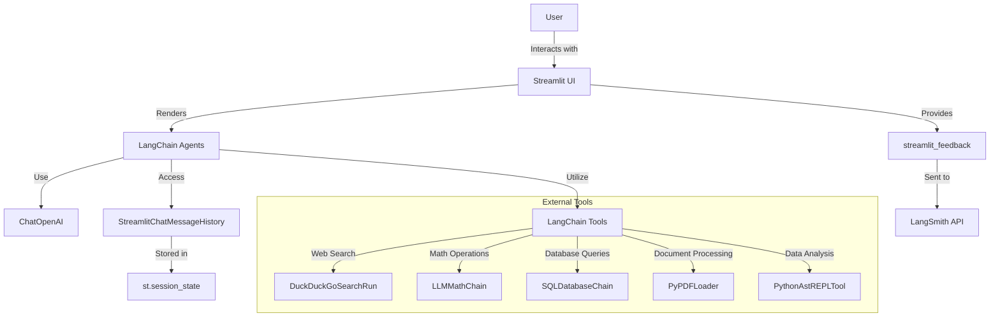
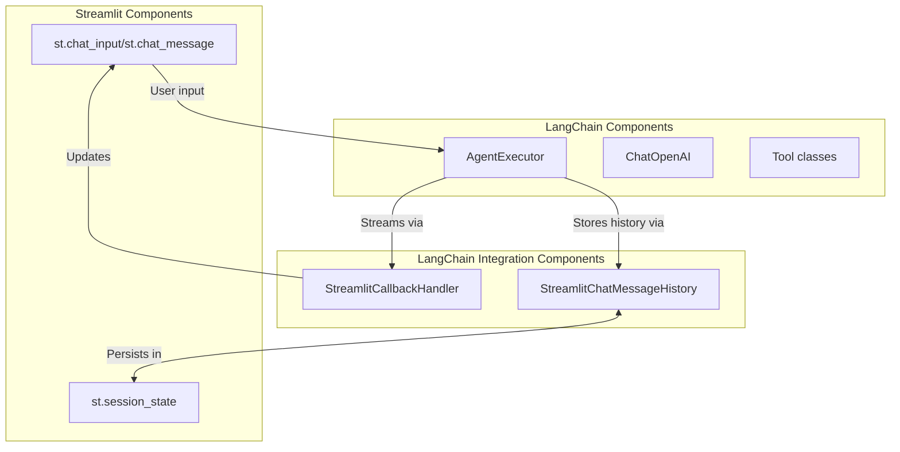
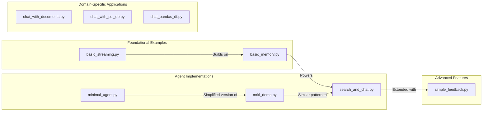
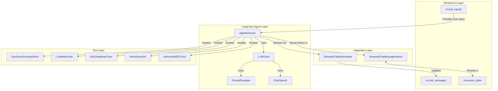

<!-- source: DeepWiki mcp.deepwiki.com · repo langchain-ai/streamlit-agent · page 1 Overview · fetched 2026-10-26 -->

# Overview

Relevant source files

The following files were used as context for generating this wiki page:

- [README.md](README.md)
- [pyproject.toml](pyproject.toml)

This wiki page introduces the streamlit-agent repository, a collection of reference implementations showcasing the integration between Streamlit and LangChain for building LLM-powered web applications.

## Purpose and Scope

The streamlit-agent repository provides example applications that demonstrate different patterns for building LLM-powered applications using `Streamlit` for the user interface and `LangChain` for the agent framework. These examples range from simple chat interfaces to complex agents with domain-specific capabilities:

- Real-time streaming of LLM responses
- Conversation memory persistence
- Web search integration
- Document and PDF analysis
- SQL database interaction
- Pandas DataFrame querying
- User feedback collection

For setup instructions, see [Getting Started](#1.2). For deployment options, see [Deployment](#4).

Sources: [README.md:1-21]()

## High-Level System Architecture

The following diagram illustrates the core architecture shared across applications in the repository:

This architecture shows how users interact with a `Streamlit` UI that connects to `LangChain` agents. The agents utilize `ChatOpenAI` language models and access various tools from the LangChain ecosystem. Conversation memory is maintained using `StreamlitChatMessageHistory` which stores data in Streamlit's `st.session_state`.

Sources: [README.md:4-16](), [pyproject.toml:10-27]()

## Core Integration Components

The repository demonstrates two key integration points between Streamlit and LangChain:

This diagram illustrates the key integration components:

1. `StreamlitCallbackHandler`: Captures output from LangChain agents/chains and streams it to the Streamlit UI
2. `StreamlitChatMessageHistory`: Memory implementation that stores conversation history in `st.session_state`

Sources: [README.md:18-20]()

## Example Applications

The repository includes multiple example applications that demonstrate different capabilities:

| Application | Description | Key Classes/Components |
|-------------|-------------|------------------------|
| `basic_streaming.py` | Simple streaming app | `ChatOpenAI`, `StreamlitCallbackHandler` |
| `basic_memory.py` | App with conversation memory | `StreamlitChatMessageHistory` |
| `mrkl_demo.py` | MRKL agent implementation | `initialize_agent`, `DuckDuckGoSearchRun`, `LLMMathChain` |
| `minimal_agent.py` | Minimal agent with search | `initialize_agent`, `DuckDuckGoSearchRun` |
| `search_and_chat.py` | Search-enabled chatbot with memory | `AgentExecutor`, `DuckDuckGoSearchRun`, `StreamlitChatMessageHistory` |
| `simple_feedback.py` | Chat app with user feedback | `streamlit_feedback`, LangSmith integration |
| `chat_with_documents.py` | Document Q&A chatbot | `PyPDFLoader`, `FAISS` |
| `chat_with_sql_db.py` | SQL database chatbot | `SQLDatabaseChain` |
| `chat_pandas_df.py` | Pandas DataFrame chatbot | `PythonAstREPLTool`, `pandas` |

The applications are organized from basic functionality to more complex, domain-specific implementations:

For more detailed information on these applications, see [Example Applications](#3).

Sources: [README.md:7-16]()

## Implementation Details

The following table provides more technical implementation details for each example application:

| Application | Implementation Pattern |
|-------------|------------------------|
| `basic_streaming.py` | `chat = ChatOpenAI(streaming=True)` with `StreamlitCallbackHandler` |
| `basic_memory.py` | `msgs = StreamlitChatMessageHistory(key="langchain_messages")` |
| `mrkl_demo.py` | `tools = [search_tool, llm_math_chain]` with `AgentType.ZERO_SHOT_REACT_DESCRIPTION` |
| `minimal_agent.py` | `tools = [search_tool]` with `initialize_agent` |
| `search_and_chat.py` | `memory = ConversationBufferMemory(memory_key="chat_history", chat_memory=msgs)` |
| `simple_feedback.py` | `feedback = feedback_component(feedback_type="thumbs")` |
| `chat_with_documents.py` | `embeddings = OpenAIEmbeddings()` with `vectorstore = FAISS.from_documents(docs, embeddings)` |
| `chat_with_sql_db.py` | `db_chain = SQLDatabaseChain.from_llm(llm, db)` |
| `chat_pandas_df.py` | `df_tool = PythonAstREPLTool(locals={"df": df})` |

## Component Architecture

The following diagram shows the component architecture for a typical agent application in the repository:

This architecture illustrates how the different components interact in a typical agent application, from the Streamlit UI through the integration layer to the LangChain agent and tool layers.

Sources: [README.md:7-16](), [pyproject.toml:10-27]()

## Project Dependencies

Key dependencies used across the applications include:

| Dependency | Purpose |
|------------|---------|
| `langchain` | Core framework for building LLM applications |
| `openai` | Integration with OpenAI models |
| `streamlit` | Web application framework |
| `duckduckgo-search` | Web search capability |
| `pypdf` | PDF document processing |
| `sentence-transformers` | Text embedding generation |
| `streamlit-feedback` | User feedback collection component |
| `langsmith` | Evaluation and monitoring (implied by feedback integration) |

For a complete list of dependencies, see [Project Dependencies](#1.1).

Sources: [pyproject.toml:10-27]()

## References

- For detailed project dependencies, see [Project Dependencies](#1.1)
- For setup instructions, see [Getting Started](#1.2)
- For system architecture details, see [System Architecture](#2)
- For example applications overview, see [Example Applications](#3)
- For deployment information, see [Deployment](#4)
- For development practices, see [Development Practices](#5)

Sources: [README.md:32-52](), [pyproject.toml:10-36]()

---

