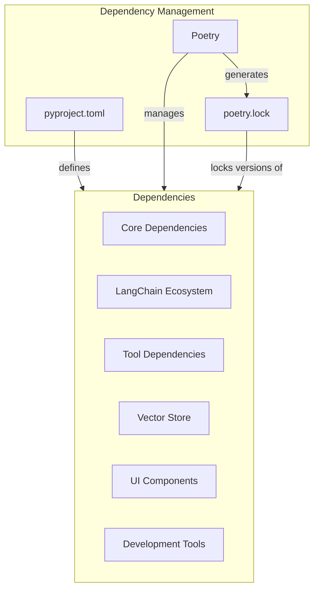
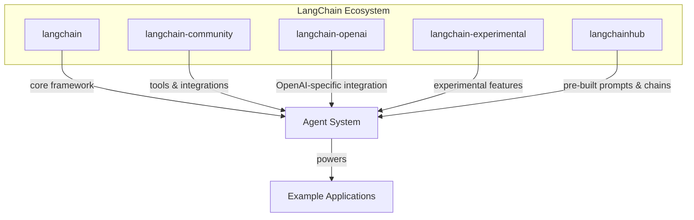
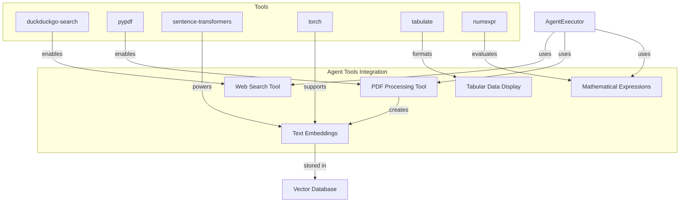
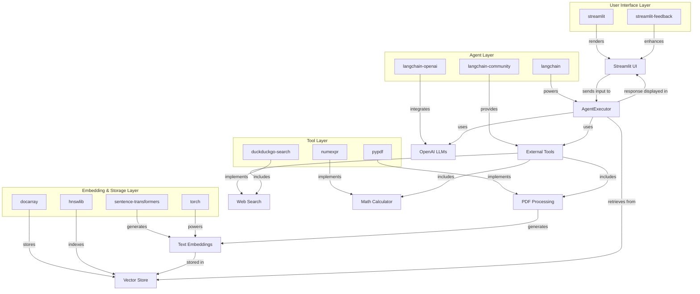

<!-- source: DeepWiki mcp.deepwiki.com · repo langchain-ai/streamlit-agent · page 1.1 Project Dependencies · fetched 2026-10-26 -->

# Project Dependencies

<details>
<summary>Relevant source files</summary>

The following files were used as context for generating this wiki page:

- [poetry.lock](poetry.lock)
- [pyproject.toml](pyproject.toml)

</details>


## Purpose and Scope

This document details the core dependencies of the streamlit-agent repository and explains their role in the system. It focuses on the technical requirements needed to run the example applications that integrate Streamlit with LangChain. For instructions on setting up the environment and running the applications, see [Getting Started](#1.2).

## Dependency Management

The streamlit-agent project uses Poetry for dependency management. Dependencies are defined in the `pyproject.toml` file, which specifies both runtime dependencies and development dependencies.



Sources: [pyproject.toml:1-37]()

## Core Dependencies

The application relies on several foundational libraries:

| Dependency | Version | Purpose |
|------------|---------|---------|
| Python | >=3.10,<4.0 | Runtime environment |
| langchain | >=0.1.0 | Core LLM application framework |
| openai | >=1.6.1 | OpenAI API integration |
| streamlit | >=1.26 | Web application framework |

These dependencies form the essential stack for building the interactive AI applications in this repository.

Sources: [pyproject.toml:10-21]()

## LangChain Ecosystem Dependencies

The project utilizes several packages from the LangChain ecosystem:



| Dependency | Version | Purpose |
|------------|---------|---------|
| langchain-community | ^0.0.12 | Community-maintained integrations |
| langchain-openai | ^0.0.2.post1 | OpenAI-specific integrations |
| langchain-experimental | ^0.0.49 | Experimental LangChain features |
| langchainhub | ^0.1.14 | Pre-built prompts and chains |

Sources: [pyproject.toml:12-24]()

## Tool Dependencies

The repository incorporates various tools that extend the capabilities of the agents:



| Dependency | Version | Purpose |
|------------|---------|---------|
| duckduckgo-search | >4.0 | Web search capabilities |
| pypdf | ^3.12.2 | PDF document processing |
| sentence-transformers | ^2.2.2 | Text embedding generation |
| torch | >=2.0.0, !=2.0.1 | Machine learning backend |
| tabulate | ^0.9.0 | Table formatting for display |
| numexpr | ^2.8.8 | Mathematical expression evaluation |

Sources: [pyproject.toml:14-26]()

## Vector Store Dependencies

For storing and retrieving embeddings of documents:

| Dependency | Version | Purpose |
|------------|---------|---------|
| docarray | ^0.38.0 | Document storage and retrieval |
| hnswlib | ^0.7.0 | Approximate nearest neighbor search |

These dependencies enable the application to perform semantic search on documents, particularly in the chat with documents example.

Sources: [pyproject.toml:22-23]()

## UI Enhancement Dependencies

To improve the user experience:

| Dependency | Version | Purpose |
|------------|---------|---------|
| streamlit-feedback | ^0.0.9 | User feedback collection component |

This dependency is used in the feedback collection examples to gather user ratings on responses.

Sources: [pyproject.toml:19]()

## Development Dependencies

Tools used during development but not required at runtime:

| Dependency | Version | Purpose |
|------------|---------|---------|
| black | ^23.3.0 | Code formatting |
| mypy | ^1.4.1 | Static type checking |
| pre-commit | ^3.3.3 | Git pre-commit hook management |

These tools help maintain code quality and consistency across the codebase.

Sources: [pyproject.toml:29-32]()

## Dependency Relationship to System Components

The following diagram illustrates how the dependencies relate to the main system components:



Sources: [pyproject.toml:10-26]()

## Build System

The project uses Poetry's build system:

```
[build-system]
requires = ["poetry-core"]
build-backend = "poetry.core.masonry.api"
```

This configuration ensures that Poetry's core functionality is used for building and packaging the project.

Sources: [pyproject.toml:34-36]()

---

