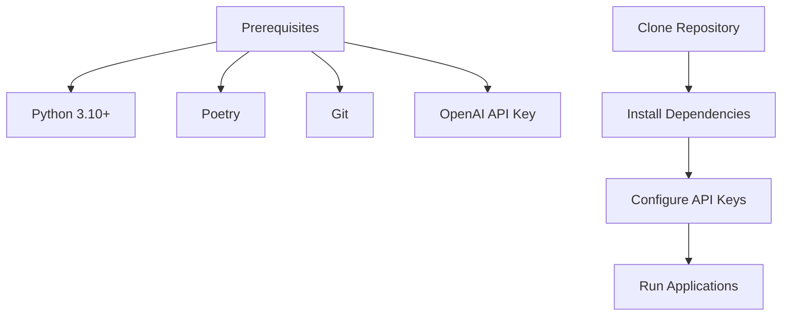
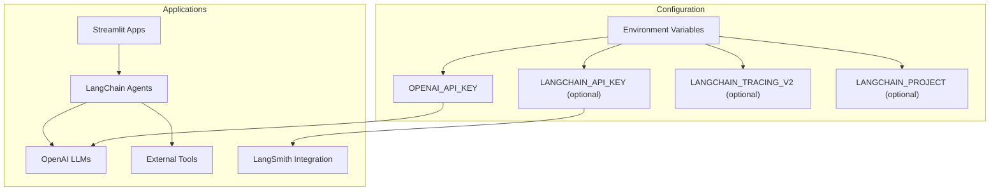
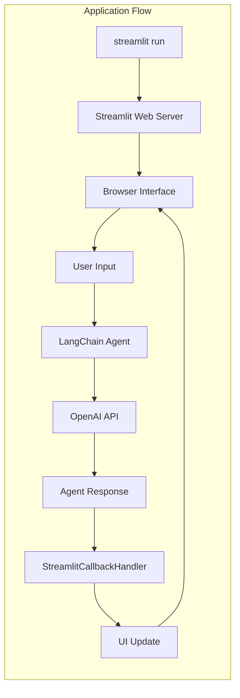
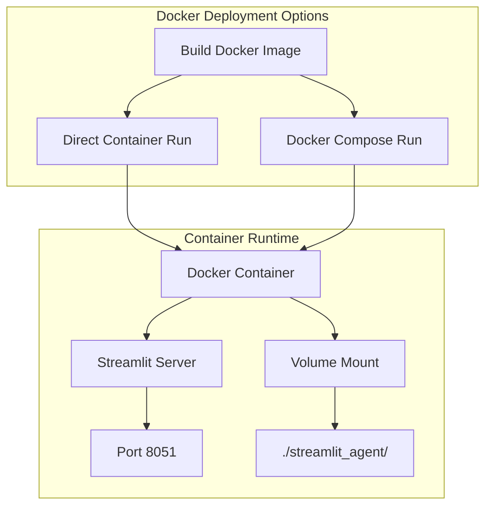
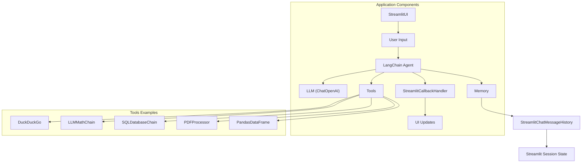

<!-- source: DeepWiki mcp.deepwiki.com · repo langchain-ai/streamlit-agent · page 1.2 Getting Started · fetched 2026-10-26 -->

# Getting Started

<details>
<summary>Relevant source files</summary>

The following files were used as context for generating this wiki page:

- [README.md](README.md)
- [pyproject.toml](pyproject.toml)

</details>


This guide provides instructions for setting up and running the streamlit-agent applications locally. It covers environment setup, configuration, and different methods for running the applications. For information about project dependencies, see [Project Dependencies](#1.1).

## Prerequisites

Before getting started with the streamlit-agent repository, ensure you have the following installed:

- Python 3.10 or later
- [Poetry](https://python-poetry.org/) (for dependency management)
- Git (for cloning the repository)
- OpenAI API key



Sources: [pyproject.toml:11-12](), [README.md:32-43]()

## Environment Setup

### Clone the Repository

Start by cloning the repository to your local machine:

```
git clone https://github.com/langchain-ai/streamlit-agent.git
cd streamlit-agent
```

### Install Dependencies

The project uses Poetry for dependency management. Install all required dependencies with:

```
poetry install
```

This command creates a virtual environment and installs all dependencies specified in the `pyproject.toml` file.

### Set Up Pre-commit Hooks (Optional)

For development purposes, you can install pre-commit hooks to ensure code quality:

```
poetry shell
pre-commit install
```

Sources: [README.md:32-43](), [pyproject.toml:9-36]()

## Configuration

### API Keys

The applications require an OpenAI API key to function. Set this as an environment variable:

```
export OPENAI_API_KEY=your_openai_api_key
```

Some applications (like `simple_feedback.py`) can integrate with LangSmith for tracing and feedback. If you want to use this feature, set the following environment variables:

```
export LANGCHAIN_API_KEY=your_langsmith_api_key
export LANGCHAIN_TRACING_V2=true
export LANGCHAIN_PROJECT=your_project_name
```



Sources: [README.md:10-16]()

## Running Applications

The repository contains several example applications demonstrating different capabilities. Run any application using Streamlit:

```
streamlit run streamlit_agent/[application_name].py
```

### Available Applications

| Application | Description | Command |
|-------------|-------------|---------|
| basic_streaming.py | Simple streaming example | `streamlit run streamlit_agent/basic_streaming.py` |
| basic_memory.py | Demonstrates conversation memory | `streamlit run streamlit_agent/basic_memory.py` |
| mrkl_demo.py | MRKL agent implementation | `streamlit run streamlit_agent/mrkl_demo.py` |
| minimal_agent.py | Minimal agent with search | `streamlit run streamlit_agent/minimal_agent.py` |
| search_and_chat.py | Search-enabled chatbot with history | `streamlit run streamlit_agent/search_and_chat.py` |
| simple_feedback.py | Demonstrates user feedback collection | `streamlit run streamlit_agent/simple_feedback.py` |
| chat_with_documents.py | Document Q&A capabilities | `streamlit run streamlit_agent/chat_with_documents.py` |
| chat_with_sql_db.py | SQL database interaction | `streamlit run streamlit_agent/chat_with_sql_db.py` |
| chat_pandas_df.py | DataFrame interaction (note: uses potentially unsafe PythonAstREPLTool) | `streamlit run streamlit_agent/chat_pandas_df.py` |



Sources: [README.md:5-20](), [README.md:45-50]()

## Docker Deployment

The repository includes Docker configurations for containerized deployment, which can be helpful for consistent environments or deployment to servers.

### Build the Docker Image

To build the Docker image with DOCKER_BUILDKIT for optimization:

```
DOCKER_BUILDKIT=1 docker build --target=runtime . -t langchain-streamlit-agent:latest
```

### Run with Docker

You can run the container directly:

```
docker run -d --name langchain-streamlit-agent -p 8051:8051 langchain-streamlit-agent:latest
```

### Run with Docker Compose (Recommended)

For easier management, you can use Docker Compose:

1. Edit the command in `docker-compose.yml` to specify which Streamlit app to run
2. Run with:
   ```
   docker-compose up
   ```



Sources: [README.md:52-68]()

## Code Architecture Overview

When working with the streamlit-agent applications, it's helpful to understand the basic architecture pattern used throughout the codebase:



This diagram shows how each application connects Streamlit's UI components with LangChain's agent framework. The `StreamlitCallbackHandler` enables streaming responses from the LLM to the Streamlit UI, while `StreamlitChatMessageHistory` manages conversation history using Streamlit's session state.

Sources: [README.md:5-20](), [README.md:18-20]()

## Next Steps

After getting your environment set up and running the example applications, you may want to:

1. Explore the [System Architecture](#2) to understand how the components work together
2. Learn about specific [Example Applications](#3) in more detail
3. Study the [Streamlit Integration with LangChain](#2.1) to understand the integration patterns

By following this guide, you should have a functional development environment for working with the streamlit-agent examples and be able to run any of the included applications.

---

