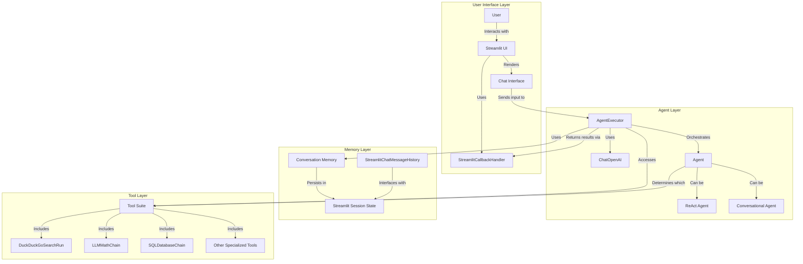
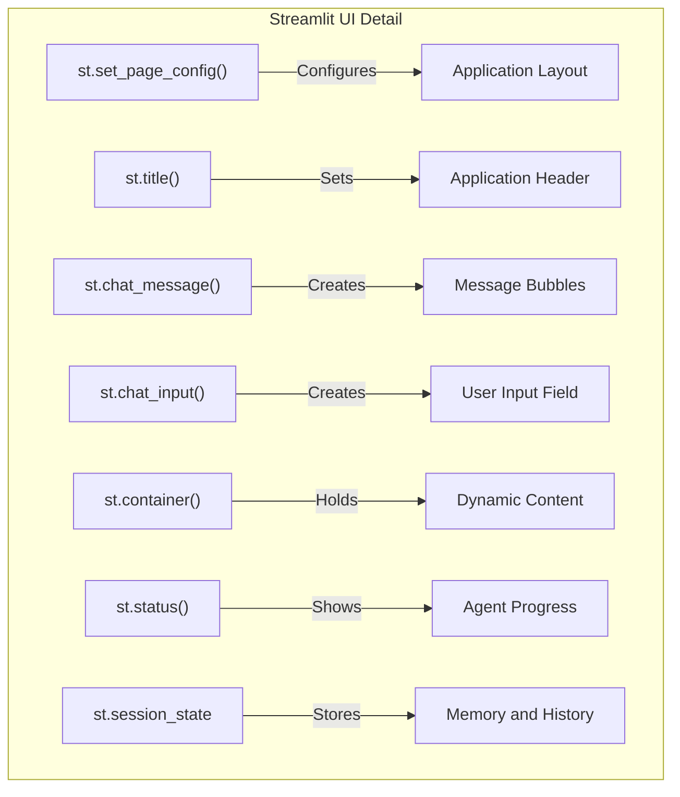
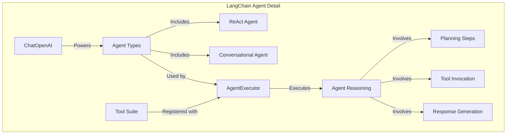
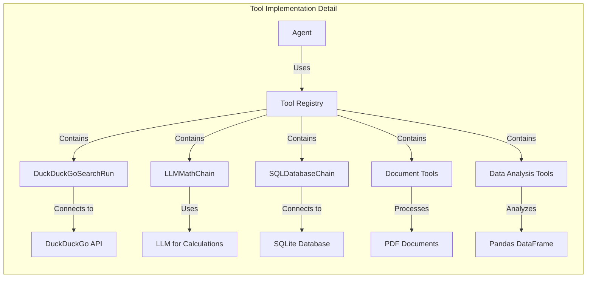
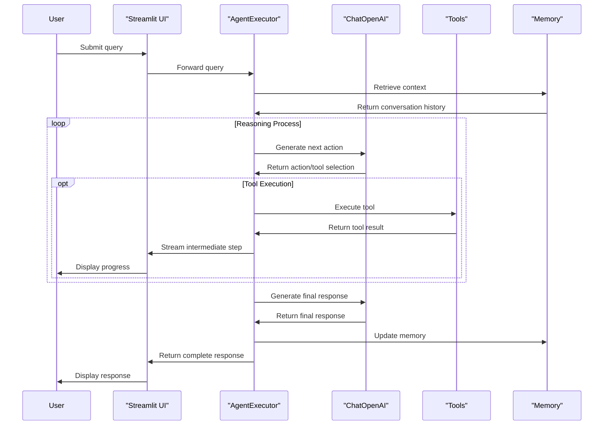

<!-- source: DeepWiki mcp.deepwiki.com · repo langchain-ai/streamlit-agent · page 2 System Architecture · fetched 2026-10-26 -->

# System Architecture

Relevant source files

The following files were used as context for generating this wiki page:

- [README.md](README.md)
- [streamlit_agent/mrkl_demo.py](streamlit_agent/mrkl_demo.py)
- [streamlit_agent/search_and_chat.py](streamlit_agent/search_and_chat.py)

This page describes the high-level architecture shared across all applications in the streamlit-agent repository. It outlines the core components, their relationships, and implementation patterns that enable LLM-powered applications through Streamlit and LangChain integration. For specific details about the integration patterns between these technologies, see [Streamlit Integration with LangChain](#2.1). For information about how conversation history is managed, see [Memory and State Management](#2.2).

## Core Architecture Overview

The repository demonstrates a modular architecture that connects user interfaces with LLM capabilities and external tools.

Sources: [README.md:5-20](), [streamlit_agent/mrkl_demo.py:46-77](), [streamlit_agent/search_and_chat.py:43-53]()

## Key Components

### Streamlit UI Components

The user interface layer handles all user interactions and is implemented using Streamlit's components:

1. **Page Configuration** - Sets up the overall page layout and styling
2. **Chat Interface** - Displays conversation history and provides input mechanisms
3. **Callback Handler** - Enables streaming responses from LLMs to the UI in real-time
4. **Session State** - Persists application state across reruns

Sources: [streamlit_agent/mrkl_demo.py:28-30](), [streamlit_agent/search_and_chat.py:11-35]()

### LangChain Agent Components

The agent layer orchestrates the LLM's interaction with tools and memory:

1. **ChatOpenAI** - Provides the language model capabilities
2. **Agent Types** - Different agent implementations for different reasoning patterns
3. **AgentExecutor** - Manages the execution flow of the agent
4. **Tools** - External capabilities that the agent can leverage

Sources: [streamlit_agent/mrkl_demo.py:46-77](), [streamlit_agent/search_and_chat.py:44-53]()

### Tool Integration

The tool layer provides specialized capabilities that agents can use to solve tasks:

1. **Search** - Web search via DuckDuckGo
2. **Math** - Mathematical operations via LLMMathChain
3. **SQL** - Database queries via SQLDatabaseChain
4. **Document Processing** - PDF and document analysis capabilities
5. **Data Analysis** - DataFrame manipulation via Pandas

Sources: [streamlit_agent/mrkl_demo.py:46-73](), [streamlit_agent/search_and_chat.py:45]()

## Communication Flow

The architecture implements a specific flow of information between components:

Sources: [streamlit_agent/mrkl_demo.py:94-111](), [streamlit_agent/search_and_chat.py:54-60]()

## Implementation Pattern

The repository follows a consistent implementation pattern across examples:

```mermaid
graph TD
    subgraph "Standard Implementation Pattern"
        Step1["1. UI Setup"]
        Step2["2. LLM Configuration"]
        Step3["3. Tool Definition"]
        Step4["4. Agent Creation"]
        Step5["5. Memory Setup"]
        Step6["6. Callback Configuration"]
        Step7["7. Input Handling"]
        Step8["8. Agent Execution"]
        Step9["9. Response Display"]
        
        Step1 -->|"Followed by"| Step2
        Step2 -->|"Followed by"| Step3
        Step3 -->|"Followed by"| Step4
        Step4 -->|"Followed by"| Step5
        Step5 -->|"Followed by"| Step6
        Step6 -->|"Followed by"| Step7
        Step7 -->|"Followed by"| Step8
        Step8 -->|"Followed by"| Step9
    end
```

This pattern is clearly demonstrated in each example application, with specific implementations tailored to showcase different capabilities:

1. **UI Setup**: Configure Streamlit page and create UI components
2. **LLM Configuration**: Initialize the language model with appropriate parameters
3. **Tool Definition**: Define the tools the agent can use
4. **Agent Creation**: Create the appropriate agent type
5. **Memory Setup**: Configure conversation memory (when applicable)
6. **Callback Configuration**: Set up the StreamlitCallbackHandler
7. **Input Handling**: Process user input
8. **Agent Execution**: Execute the agent with the input and display progress
9. **Response Display**: Show the final response to the user

Sources: [streamlit_agent/mrkl_demo.py:28-111](), [streamlit_agent/search_and_chat.py:11-60]()

## Application Variations

While following the same core architecture, each example application in the repository demonstrates different capabilities:

| Application | Key Components | Unique Features |
|-------------|---------------|----------------|
| basic_streaming.py | ChatOpenAI, StreamlitCallbackHandler | Simple streaming of LLM responses |
| basic_memory.py | StreamlitChatMessageHistory | Chat memory persistence |
| mrkl_demo.py | ReAct Agent, Multiple Tools | Multi-tool reasoning |
| search_and_chat.py | ConversationalChatAgent, DuckDuckGoSearchRun | Conversational search with memory |
| chat_with_documents.py | Document processing tools, Vector store | Document Q&A capabilities |
| chat_with_sql_db.py | SQLDatabaseChain | Natural language database queries |
| chat_pandas_df.py | PandasDataFrameTool | DataFrame analysis via natural language |
| simple_feedback.py | Feedback collection, LangSmith | User feedback integration |

Each variation maintains the core architecture while adapting specific components to showcase different LangChain capabilities within the Streamlit environment.

Sources: [README.md:5-16](), [streamlit_agent/mrkl_demo.py](), [streamlit_agent/search_and_chat.py]()

## Integration Points

The architecture features two critical integration points between Streamlit and LangChain:

1. **StreamlitCallbackHandler**: Enables real-time display of streaming responses and intermediate steps from LangChain agents directly in the Streamlit UI.

2. **StreamlitChatMessageHistory**: Provides persistent conversation memory using Streamlit's session state, allowing the agent to maintain context across interactions.

These integration points allow the seamless combination of Streamlit's interactive UI capabilities with LangChain's advanced LLM orchestration features.

Sources: [README.md:18-20](), [streamlit_agent/search_and_chat.py:16-19](), [streamlit_agent/search_and_chat.py:55]()

---

