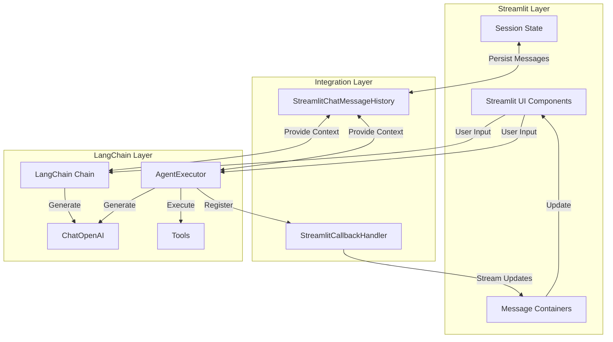
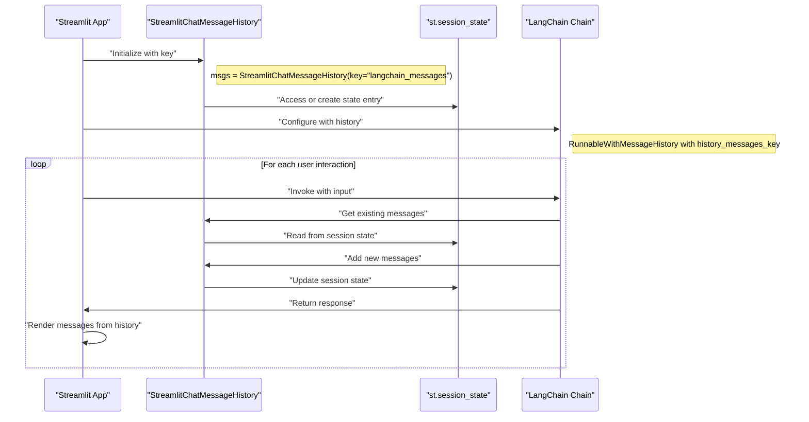
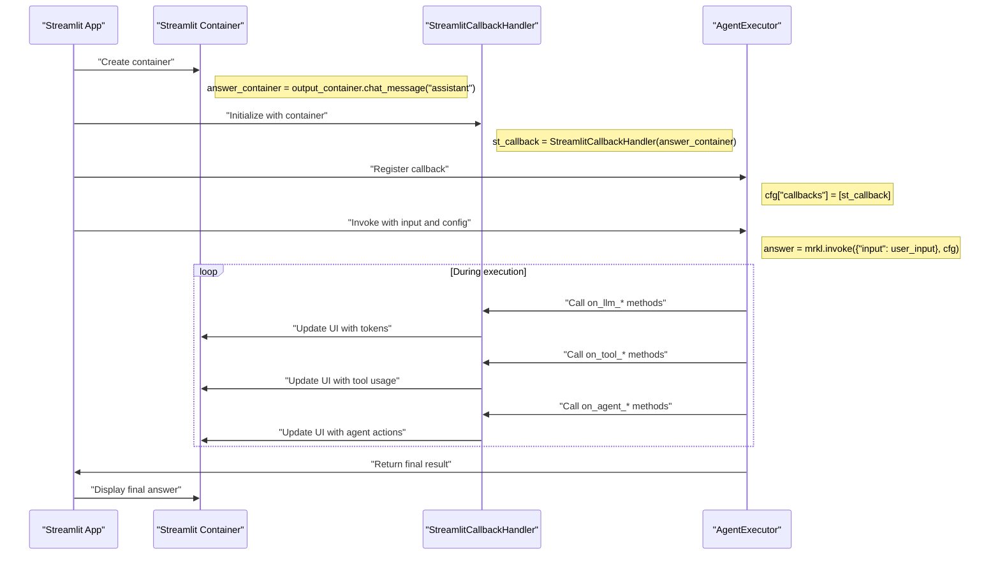
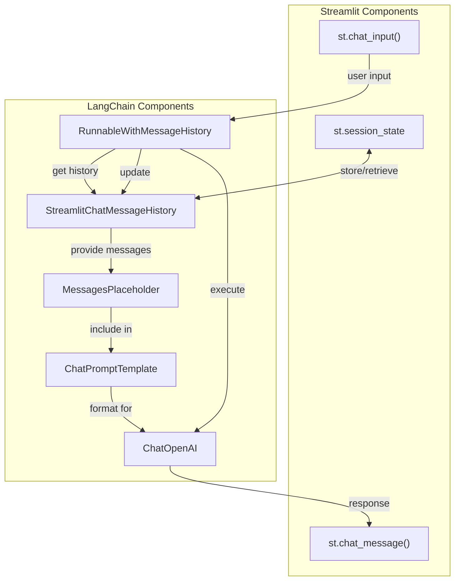
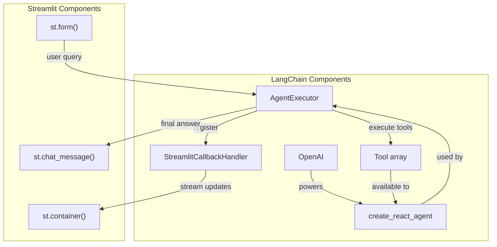

<!-- source: DeepWiki mcp.deepwiki.com · repo langchain-ai/streamlit-agent · page 2.1 Streamlit Integration with LangChain · fetched 2026-10-26 -->

# Streamlit Integration with LangChain

<details>
<summary>Relevant source files</summary>

The following files were used as context for generating this wiki page:

- [streamlit_agent/basic_memory.py](streamlit_agent/basic_memory.py)
- [streamlit_agent/mrkl_demo.py](streamlit_agent/mrkl_demo.py)

</details>


This document explains the core integration patterns between Streamlit and LangChain in the streamlit-agent repository, focusing on the technical components that enable these frameworks to function together effectively.

For information about memory management specifics, see [Memory and State Management](#2.2). For detailed information about the callback system implementation, see [Callback System](#2.3).

## Overview

The Streamlit-LangChain integration creates interactive, conversational AI applications by combining Streamlit's UI capabilities with LangChain's agent framework. This integration is built around two primary components:

1. **StreamlitChatMessageHistory**: Persists conversation history in Streamlit's session state
2. **StreamlitCallbackHandler**: Streams LangChain execution results to Streamlit UI components

## Integration Architecture



Sources: [streamlit_agent/basic_memory.py:1-74](), [streamlit_agent/mrkl_demo.py:1-111]()

## StreamlitChatMessageHistory

The `StreamlitChatMessageHistory` class serves as the bridge between LangChain's memory system and Streamlit's session state, enabling conversation persistence across app reruns.

### Implementation Pattern



Key implementation steps:
1. Initialize `StreamlitChatMessageHistory` with a session state key
2. Configure LangChain component with the history object
3. Use `RunnableWithMessageHistory` to automatically manage message history
4. Render messages from history in the UI

**Example Code References:**
- Initialize history: [streamlit_agent/basic_memory.py:19-21]()
- Configure chain with history: [streamlit_agent/basic_memory.py:44-50]()
- Render messages from history: [streamlit_agent/basic_memory.py:53-54]()

Sources: [streamlit_agent/basic_memory.py:1-74]()

## StreamlitCallbackHandler

The `StreamlitCallbackHandler` enables real-time streaming of LangChain execution results to Streamlit UI components, providing interactive feedback during agent processing.

### Implementation Pattern



Key implementation steps:
1. Create a Streamlit container for displaying the agent's output
2. Initialize `StreamlitCallbackHandler` with this container
3. Configure the agent with the callback
4. Invoke the agent with user input and callback config
5. Display the final result in the UI

**Example Code References:**
- Create container and callback: [streamlit_agent/mrkl_demo.py:96-97]()
- Configure with callback: [streamlit_agent/mrkl_demo.py:98-99]()
- Invoke agent with configuration: [streamlit_agent/mrkl_demo.py:109]()

Sources: [streamlit_agent/mrkl_demo.py:91-111]()

## Common Integration Patterns

### Basic Memory-Enabled Chat

This pattern implements a simple conversational interface with memory persistence:



**Implementation References:**
- Component setup: [streamlit_agent/basic_memory.py:36-50]()
- Execution flow: [streamlit_agent/basic_memory.py:57-62]()

Sources: [streamlit_agent/basic_memory.py:1-74]()

### Agent with Streaming Responses

This pattern implements a more complex agent interface with multiple tools and streaming feedback:



**Implementation References:**
- Tools & agent setup: [streamlit_agent/mrkl_demo.py:46-77]()
- UI & callback handling: [streamlit_agent/mrkl_demo.py:91-111]()

Sources: [streamlit_agent/mrkl_demo.py:1-111]()

## Technical Implementation Details

### Memory Implementation

The `StreamlitChatMessageHistory` class:
1. Initializes with a session state key for storing messages
2. Implements the `ChatMessageHistory` interface from LangChain
3. Automatically reads from and writes to Streamlit's session state
4. Preserves message history across app reruns

```python
# Key operations:
msgs = StreamlitChatMessageHistory(key="langchain_messages")  # Initialize
msgs.add_ai_message("How can I help you?")  # Add message
chain_with_history = RunnableWithMessageHistory(  # Configure chain with history
    chain,
    lambda session_id: msgs,  # History provider function
    input_messages_key="question",
    history_messages_key="history",
)
```

Sources: [streamlit_agent/basic_memory.py:19-50]()

### Callback Implementation

The `StreamlitCallbackHandler` class:
1. Initializes with a Streamlit container
2. Implements the `BaseCallbackHandler` interface from LangChain
3. Overrides callback methods to update the UI
4. Streams tokens, tool usage, and agent actions in real-time

```python
# Key operations:
answer_container = output_container.chat_message("assistant")  # Create container
st_callback = StreamlitCallbackHandler(answer_container)  # Initialize callback
cfg = RunnableConfig()
cfg["callbacks"] = [st_callback]  # Configure with callback
answer = mrkl.invoke({"input": user_input}, cfg)  # Invoke with config
```

Sources: [streamlit_agent/mrkl_demo.py:96-109]()

## Summary

The integration between Streamlit and LangChain revolves around two key components:

1. **StreamlitChatMessageHistory**: Enables persistent conversation history using Streamlit's session state
2. **StreamlitCallbackHandler**: Provides real-time streaming of agent execution to Streamlit UI components

These integration components allow developers to create interactive AI applications with:
- Persistent conversation memory across Streamlit app reruns
- Real-time streaming of agent reasoning, tool usage, and responses
- Structured UI presentation of complex agent workflows

The repository demonstrates these integrations in various contexts, from simple chat interfaces to complex multi-tool agents.

Sources: [streamlit_agent/basic_memory.py:1-74](), [streamlit_agent/mrkl_demo.py:1-111]()

---

