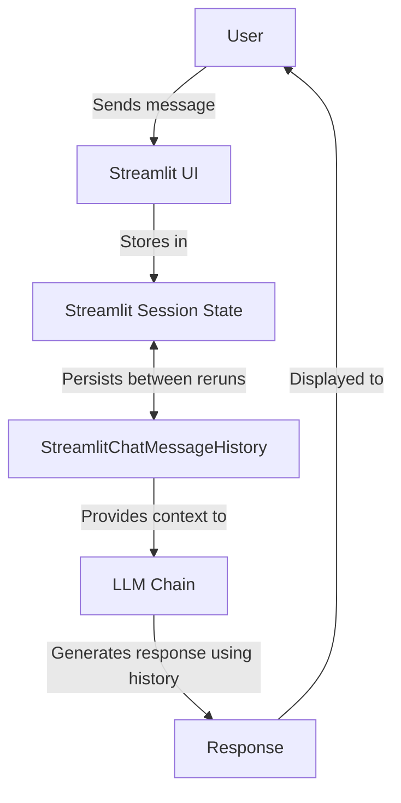
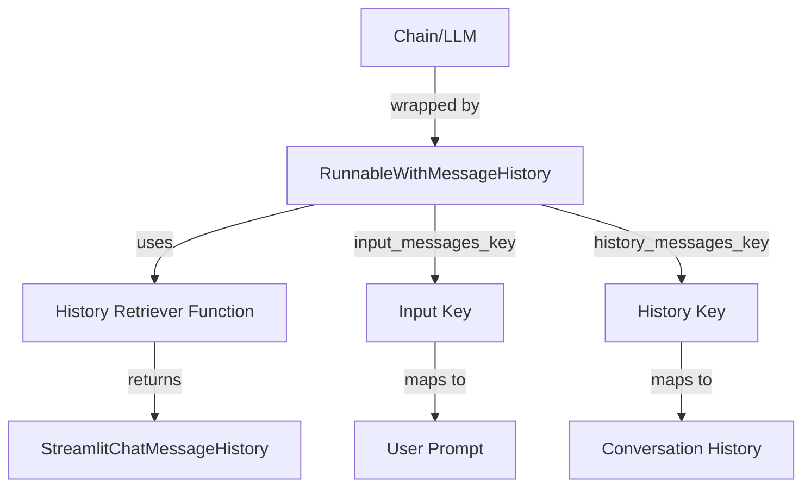
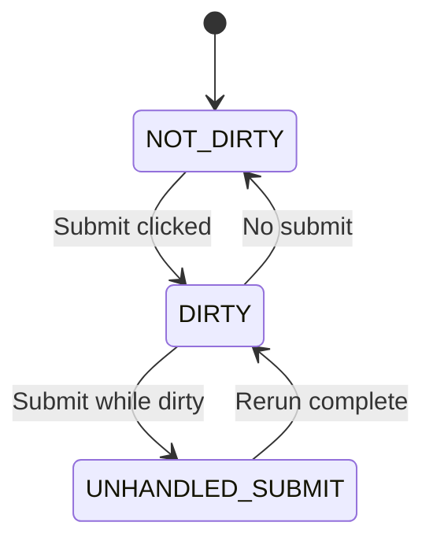

<!-- source: DeepWiki mcp.deepwiki.com · repo langchain-ai/streamlit-agent · page 2.2 Memory and State Management · fetched 2026-10-26 -->

# Memory and State Management

<details>
<summary>Relevant source files</summary>

The following files were used as context for generating this wiki page:

- [streamlit_agent/basic_memory.py](streamlit_agent/basic_memory.py)
- [streamlit_agent/clear_results.py](streamlit_agent/clear_results.py)

</details>


This document explains how conversation history and application state are managed in Streamlit LangChain applications. It covers the integration between Streamlit's session state and LangChain's memory components, enabling stateful conversations with LLM agents. For information about the callback system used for streaming responses, see [Callback System](#2.3).

## 1. Overview of Memory in Conversational Applications

Conversational AI applications require memory to maintain context across user interactions. In Streamlit applications using LangChain, this memory is implemented through two key mechanisms:

1. **Streamlit Session State**: The underlying persistence layer that maintains state between reruns
2. **LangChain Memory Components**: Specialized classes that interface with session state to store conversation history



**Memory Flow Diagram: Conversation State Management in Streamlit LangChain Applications**

Sources: [streamlit_agent/basic_memory.py:18-21](), [streamlit_agent/basic_memory.py:44-50]()

## 2. Streamlit Session State

Streamlit's session state provides persistent storage that survives across reruns of the application. This is crucial for maintaining conversation history in chatbot applications.

### Key Features

- Persists data between reruns of the Streamlit app
- Accessed through the `st.session_state` dictionary
- Acts as the foundation for LangChain's memory components
- Values can be any Python object, including complex message history structures

In the example applications, conversation history is stored in session state under designated keys, making it accessible across multiple interactions.

Sources: [streamlit_agent/basic_memory.py:19-21](), [streamlit_agent/basic_memory.py:73-74]()

## 3. StreamlitChatMessageHistory Component

The `StreamlitChatMessageHistory` class from LangChain provides a bridge between LangChain's message history system and Streamlit's session state.

### Implementation Details

```mermaid
classDiagram
    class StreamlitChatMessageHistory {
        +String key
        +List messages
        +add_user_message(text)
        +add_ai_message(text)
        +clear()
    }
    
    StreamlitChatMessageHistory --> "st.session_state" : stores messages in
    StreamlitChatMessageHistory --> "BaseChatMessageHistory" : inherits from
```

**StreamlitChatMessageHistory Class Diagram**

### Key Methods and Properties

| Method/Property | Description |
|----------------|-------------|
| `__init__(key)` | Constructor that specifies the session state key for storage |
| `messages` | Property that returns the list of messages |
| `add_user_message()` | Adds a human/user message to history |
| `add_ai_message()` | Adds an AI/assistant message to history |
| `clear()` | Clears all messages from history |

### Usage Example

The `StreamlitChatMessageHistory` is initialized with a key parameter that specifies where in the session state the messages will be stored:

```python
msgs = StreamlitChatMessageHistory(key="langchain_messages")
```

If needed, you can initialize the conversation with a default AI message:

```python
if len(msgs.messages) == 0:
    msgs.add_ai_message("How can I help you?")
```

Sources: [streamlit_agent/basic_memory.py:19-21](), [streamlit_agent/basic_memory.py:53-54](), [streamlit_agent/basic_memory.py:66-74]()

## 4. Integration with LangChain Chains

To make LangChain chains and agents use the message history, the repository employs the `RunnableWithMessageHistory` wrapper, which connects a chain to the message history system.

### RunnableWithMessageHistory Configuration



**RunnableWithMessageHistory Integration Diagram**

The integration requires:

1. A base chain or LLM to wrap
2. A function that returns the message history object
3. Configuration for input and history message keys

### Implementation Example

```python
# Create a chain with a system prompt and history placeholder
prompt = ChatPromptTemplate.from_messages([
    ("system", "You are an AI chatbot having a conversation with a human."),
    MessagesPlaceholder(variable_name="history"),
    ("human", "{question}"),
])

# Combine prompt with LLM
chain = prompt | ChatOpenAI(api_key=openai_api_key)

# Wrap with history management
chain_with_history = RunnableWithMessageHistory(
    chain,
    lambda session_id: msgs,  # Function that returns message history
    input_messages_key="question",  # Key for user input
    history_messages_key="history",  # Key for history in prompt
)
```

During invocation, a session ID is passed to identify which conversation history to use:

```python
config = {"configurable": {"session_id": "any"}}
response = chain_with_history.invoke({"question": prompt}, config)
```

Sources: [streamlit_agent/basic_memory.py:36-50](), [streamlit_agent/basic_memory.py:60-62]()

## 5. State Management Patterns

### 5.1 Rendering Messages from History

Messages from history are typically rendered in the Streamlit UI using the `st.chat_message` component:

```python
for msg in msgs.messages:
    st.chat_message(msg.type).write(msg.content)
```

### 5.2 Handling New Inputs

When users enter new prompts, the application:
1. Captures the input
2. Adds it to the UI
3. Passes it to the chain with history
4. Displays the response

```python
if prompt := st.chat_input():
    st.chat_message("human").write(prompt)
    # Messages saved automatically during chain execution
    response = chain_with_history.invoke({"question": prompt}, config)
    st.chat_message("ai").write(response.content)
```

Sources: [streamlit_agent/basic_memory.py:53-62]()

### 5.3 Clearing Previous Results

The repository includes a custom state management pattern to handle clearing previous results when submitting new prompts, solving a common issue with Streamlit's rerun behavior.



**DirtyState State Transition Diagram**

The `DirtyState` class defines three states:
- `NOT_DIRTY`: Initial state, no pending submissions
- `DIRTY`: A submission has occurred and results are displayed
- `UNHANDLED_SUBMIT`: A new submission occurred while results were displayed

The `with_clear_container` function manages these state transitions to ensure clean reruns when new user input is provided.

Sources: [streamlit_agent/clear_results.py:4-32]()

## 6. Best Practices for Memory Management

### 6.1 Message History Initialization

Always initialize message history with a key that's descriptive and unique:

```python
msgs = StreamlitChatMessageHistory(key="langchain_messages")
```

### 6.2 Session State Debugging

Use expanders to show session state contents during development:

```python
view_messages = st.expander("View message contents")
with view_messages:
    view_messages.json(st.session_state.langchain_messages)
```

### 6.3 Memory Space Considerations

Be mindful that Streamlit session state has size limitations. For applications requiring extensive history:
- Consider implementing pagination of message history
- Add logic to summarize or truncate older messages
- For production applications, consider external persistence (database)

### 6.4 Message Rendering Order

Place the message rendering code strategically:
- Before user input collection to show existing messages
- After new response generation to immediately show new responses

Sources: [streamlit_agent/basic_memory.py:23](), [streamlit_agent/basic_memory.py:65-74]()

## 7. Advanced Memory Patterns

Beyond basic conversation history, more complex applications might need:

1. **Structured memory**: Storing specific entities or facts mentioned in conversation
2. **Summarization memory**: Condensing long conversations to stay within context limits
3. **Multiple memory streams**: Maintaining separate conversation threads
4. **Persistent storage**: Saving conversations to external databases for long-term storage

These advanced patterns can be implemented by extending the basic memory architecture described in this document, typically by creating custom memory classes that interface with Streamlit's session state.

---

