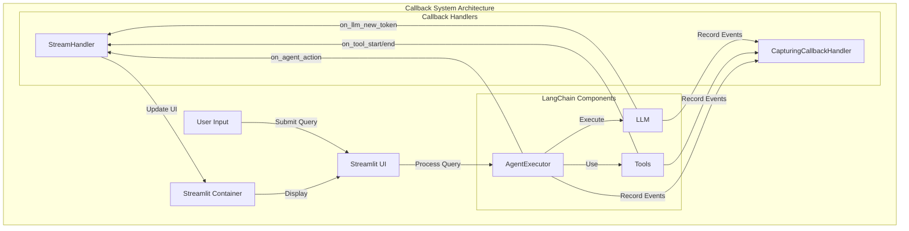
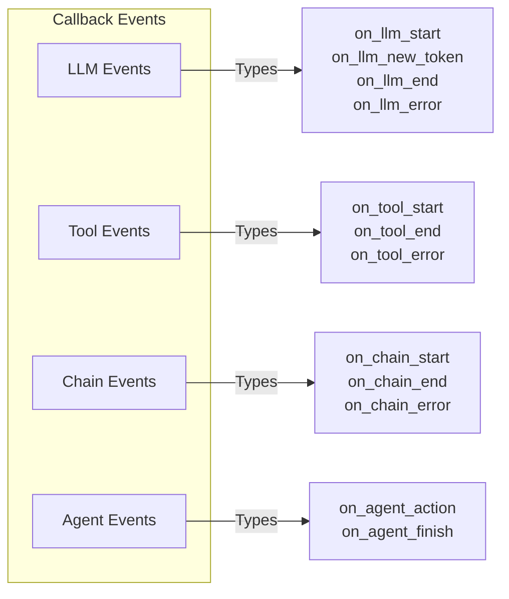
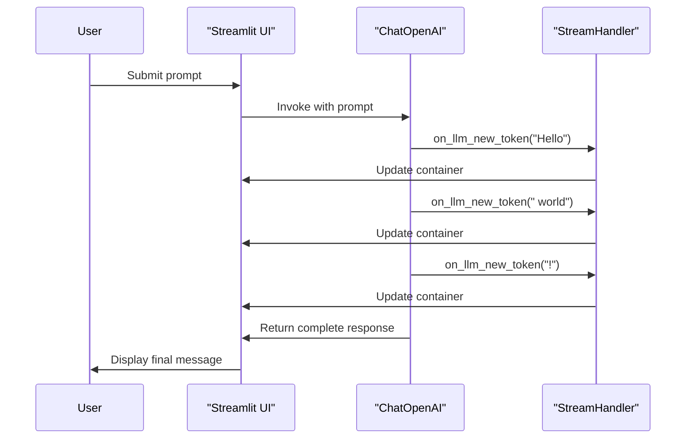
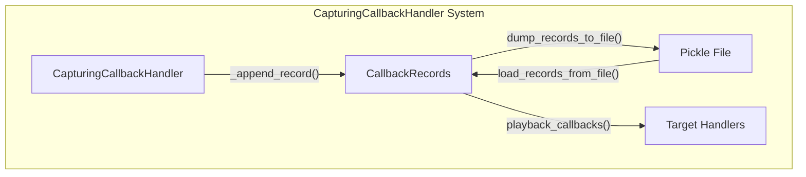
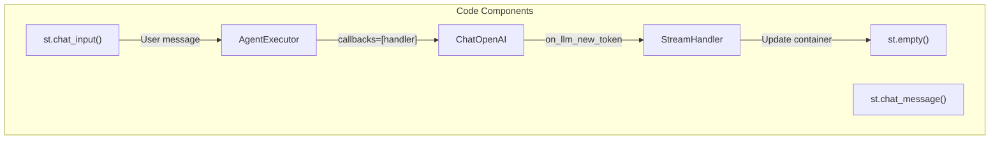

<!-- source: DeepWiki mcp.deepwiki.com · repo langchain-ai/streamlit-agent · page 2.3 Callback System · fetched 2026-10-26 -->

# Callback System

<details>
<summary>Relevant source files</summary>

The following files were used as context for generating this wiki page:

- [streamlit_agent/basic_streaming.py](streamlit_agent/basic_streaming.py)
- [streamlit_agent/callbacks/capturing_callback_handler.py](streamlit_agent/callbacks/capturing_callback_handler.py)

</details>


The Callback System in the streamlit-agent repository provides a crucial integration layer between LangChain components and the Streamlit UI. This system enables real-time streaming of LLM outputs, tool executions, and agent actions directly to the Streamlit interface, creating a responsive user experience. This page documents the callback architecture and implementation patterns used throughout the applications.

For information about how conversation history is maintained across interactions, see [Memory and State Management](#2.2).

## Callback Architecture Overview

The callback system leverages LangChain's `BaseCallbackHandler` interface to capture events during chain, LLM, tool, and agent execution. These events are then processed to update the Streamlit UI in real-time.



Sources: [streamlit_agent/basic_streaming.py:7-14](), [streamlit_agent/callbacks/capturing_callback_handler.py:100-155]()

## Callback Types and Events

The callback system captures various types of events during execution, allowing applications to respond to specific stages in the processing pipeline.



Sources: [streamlit_agent/callbacks/capturing_callback_handler.py:14-27]()

## StreamHandler for Real-Time UI Updates

The `StreamHandler` is a lightweight callback handler designed specifically for streaming LLM outputs to the Streamlit UI. It's used in the simplest applications to provide a real-time response experience.



### Implementation Details

The `StreamHandler` class is a minimal implementation that focuses exclusively on handling token streaming:

```python
class StreamHandler(BaseCallbackHandler):
    def __init__(self, container, initial_text=""):
        self.container = container
        self.text = initial_text

    def on_llm_new_token(self, token: str, **kwargs) -> None:
        self.text += token
        self.container.markdown(self.text)
```

Usage pattern:

1. Create a Streamlit container with `st.empty()`
2. Initialize the StreamHandler with this container
3. Pass the handler to the LLM with `streaming=True`
4. The handler will update the container as new tokens arrive

Sources: [streamlit_agent/basic_streaming.py:7-14](), [streamlit_agent/basic_streaming.py:34-38]()

## CapturingCallbackHandler for Advanced Use Cases

The `CapturingCallbackHandler` provides more comprehensive callback capabilities, enabling applications to record and replay interactions. This is particularly useful for:

1. Debugging complex agent behaviors
2. Creating demo recordings
3. Implementing offline playback capabilities



### Key Components

The `CapturingCallbackHandler` system consists of several interconnected parts:

1. **CallbackType**: Constants defining the types of callbacks that can be captured
2. **CallbackRecord**: TypedDict for storing callback information:
   - `callback_type`: The type of callback event
   - `args` and `kwargs`: The arguments passed to the callback
   - `time_delta`: Time elapsed since the previous event

3. **CapturingCallbackHandler**: The main handler class that implements all callback methods

4. **Utility Functions**:
   - `load_records_from_file`: Loads recorded callbacks from a pickle file
   - `playback_callbacks`: Replays recorded callbacks to a list of handler instances

Sources: [streamlit_agent/callbacks/capturing_callback_handler.py:14-27](), [streamlit_agent/callbacks/capturing_callback_handler.py:32-36](), [streamlit_agent/callbacks/capturing_callback_handler.py:100-155]()

## Callback Integration with Streamlit

The integration between callbacks and Streamlit UI components follows a consistent pattern across applications in the repository:



### Integration Pattern

The standard pattern for integrating callbacks with Streamlit UI involves:

1. Creating placeholder containers with `st.empty()` for dynamic content
2. Initializing callback handlers with these containers
3. Passing the handlers to LangChain components during execution
4. The callback handlers update the UI in response to events

This pattern is exemplified in the `basic_streaming.py` example:

```python
with st.chat_message("assistant"):
    stream_handler = StreamHandler(st.empty())
    llm = ChatOpenAI(
        openai_api_key=openai_api_key, 
        streaming=True, 
        callbacks=[stream_handler]
    )
    response = llm.invoke(st.session_state.messages)
```

Sources: [streamlit_agent/basic_streaming.py:34-38]()

## Best Practices for Using Callbacks

When implementing callbacks in Streamlit-LangChain applications, consider these best practices:

1. **Separate UI Updates from Business Logic**: Use callbacks to handle UI updates while keeping the core application logic clean
2. **Handle Multiple Callback Types**: For complex applications, implement handlers for various callback types (not just token streaming)
3. **Manage Container State**: Be mindful of Streamlit's container lifecycle when updating UI elements
4. **Error Handling**: Implement error callback methods to gracefully handle failures

### Common Callback Use Cases

| Use Case | Callback Methods | UI Implementation |
|----------|------------------|-------------------|
| Token Streaming | `on_llm_new_token` | Update markdown container |
| Tool Execution Progress | `on_tool_start`, `on_tool_end` | Show spinner or progress bar |
| Agent Reasoning | `on_agent_action` | Display thought process |
| Error Handling | `on_llm_error`, `on_tool_error` | Show error messages |

Sources: [streamlit_agent/basic_streaming.py:7-14](), [streamlit_agent/callbacks/capturing_callback_handler.py:118-155]()

## Summary

The Callback System serves as a vital bridge between LangChain's execution model and Streamlit's reactive UI framework. By leveraging callbacks, applications can provide real-time feedback to users as complex operations like LLM generation, tool execution, and agent reasoning occur behind the scenes.

The repository implements two primary callback handlers:
1. `StreamHandler`: A lightweight implementation focused on token streaming
2. `CapturingCallbackHandler`: A comprehensive implementation that captures all events for recording and playback

These callback handlers enable the responsive, interactive experiences that make the Streamlit-LangChain integration powerful and user-friendly.

---

