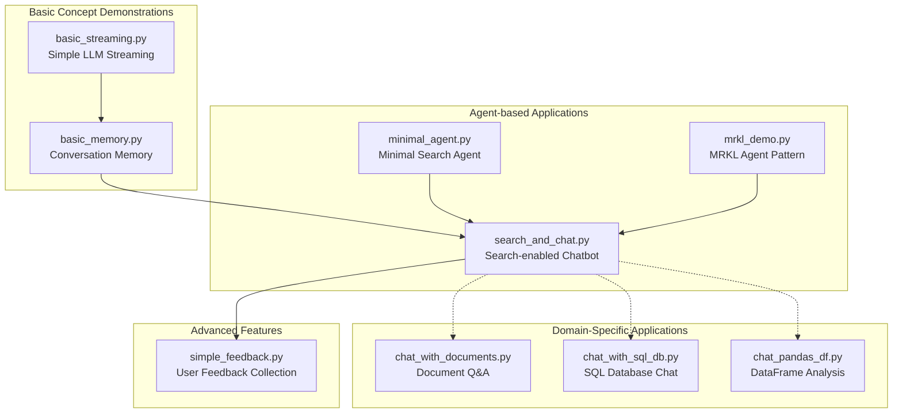
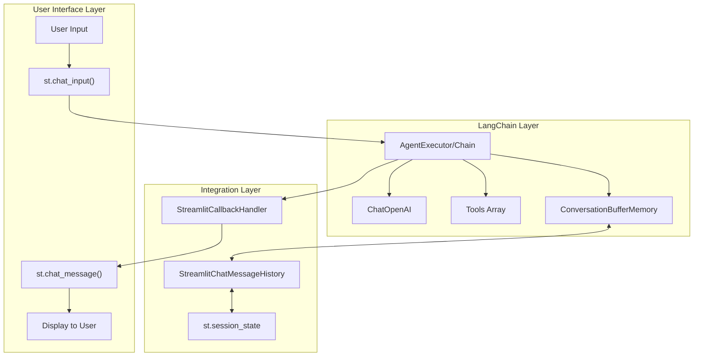
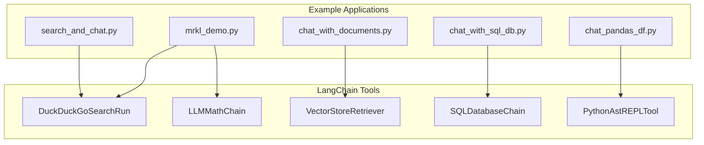

<!-- source: DeepWiki mcp.deepwiki.com · repo langchain-ai/streamlit-agent · page 3 Example Applications · fetched 2026-10-26 -->

# Example Applications

Relevant source files

The following files were used as context for generating this wiki page:

- [README.md](README.md)

This page provides an overview of the example applications included in the streamlit-agent repository. These applications demonstrate various integration patterns between Streamlit and LangChain, showcasing different agent types and use cases. For detailed information on system architecture and integration patterns, see [System Architecture](#2).

## Application Categories

The repository contains several example applications organized into the following categories:

1. **Basic Concept Demonstrations**: Fundamental examples that showcase core functionality
2. **Agent-based Applications**: Applications implementing different LangChain agent patterns
3. **Domain-Specific Applications**: Applications tailored for specific data sources or domains
4. **Advanced Features**: Examples demonstrating additional capabilities like feedback collection

### Application Organization

Sources: [README.md:5-16]()

## Application Descriptions

### Basic Concept Demonstrations

These applications provide the foundation for understanding the integration between Streamlit and LangChain:

1. **Basic Streaming** (`basic_streaming.py`): Demonstrates how to implement streaming responses from LLMs in a Streamlit interface using the `StreamlitCallbackHandler`.

2. **Basic Memory** (`basic_memory.py`): Shows how to use `StreamlitChatMessageHistory` to maintain conversation history between the user and the LLM.

### Agent-based Applications

These applications showcase different patterns for implementing LangChain agents:

3. **MRKL Demo** (`mrkl_demo.py`): Replicates the Multi-Repository Knowledge Lookup (MRKL) pattern, allowing the agent to use tools like web search and a calculator.

4. **Minimal Agent** (`minimal_agent.py`): A simplified implementation of a search-enabled agent, showing the essential components needed.

5. **Search and Chat** (`search_and_chat.py`): Combines search capabilities with conversational memory to create a more powerful chatbot that can look up information online.

### Domain-Specific Applications

These applications focus on specific data types or domains:

6. **Chat with Documents** (`chat_with_documents.py`): Enables conversational interaction with PDF documents using vector storage and retrieval.

7. **Chat with SQL Database** (`chat_with_sql_db.py`): Allows natural language interaction with SQL databases, translating questions into SQL queries.

8. **Chat with Pandas DataFrame** (`chat_pandas_df.py`): Implements a natural language interface for analyzing pandas DataFrames using the `PythonAstREPLTool`.

### Advanced Features

9. **Simple Feedback** (`simple_feedback.py`): Extends the chat interface with user feedback collection using streamlit-feedback and integration with LangSmith for evaluation.

Sources: [README.md:5-16](), [README.md:18-20]()

## Application Components and Flow

The example applications follow a common pattern of components and data flow, though each implements different variations:

Sources: [README.md:18-20]()

## Tool Integration by Application Type

Different applications integrate various LangChain tools to expand agent capabilities:

Sources: [README.md:5-16]()

## Feature Comparison

The following table compares key features across the example applications:

| Application | Memory | Streaming | External Tools | Domain-specific | Feedback |
|-------------|--------|-----------|----------------|-----------------|----------|
| basic_streaming.py | ❌ | ✅ | ❌ | ❌ | ❌ |
| basic_memory.py | ✅ | ✅ | ❌ | ❌ | ❌ |
| mrkl_demo.py | ✅ | ✅ | ✅ | ❌ | ❌ |
| minimal_agent.py | ❌ | ✅ | ✅ | ❌ | ❌ |
| search_and_chat.py | ✅ | ✅ | ✅ | ❌ | ❌ |
| simple_feedback.py | ✅ | ✅ | ✅ | ❌ | ✅ |
| chat_with_documents.py | ✅ | ✅ | ✅ | Documents | ❌ |
| chat_with_sql_db.py | ✅ | ✅ | ✅ | SQL Database | ❌ |
| chat_pandas_df.py | ✅ | ✅ | ✅ | DataFrame | ❌ |

Sources: [README.md:5-16]()

## Application Complexity Progression

The examples in the repository follow a progression of increasing complexity, each building upon concepts demonstrated in previous examples:

1. **Basic Streaming**: Introduces streaming responses
2. **Basic Memory**: Adds conversation memory
3. **Agent Applications**: Incorporate external tools
4. **Domain-Specific Applications**: Apply agent patterns to specific data types
5. **Advanced Features**: Add evaluation and feedback mechanisms

For detailed information about each category of applications, refer to:
- [Basic Applications](#3.1)
- [Agent Applications](#3.2)
- [Document Interaction](#3.3)
- [Database Interaction](#3.4)
- [DataFrame Interaction](#3.5)
- [User Feedback Collection](#3.6)

Sources: [README.md:5-16]()

---

