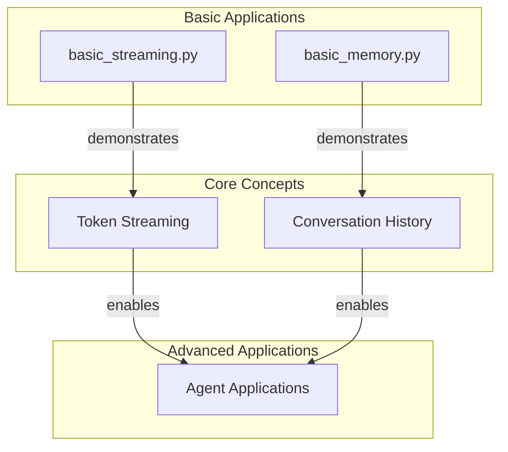
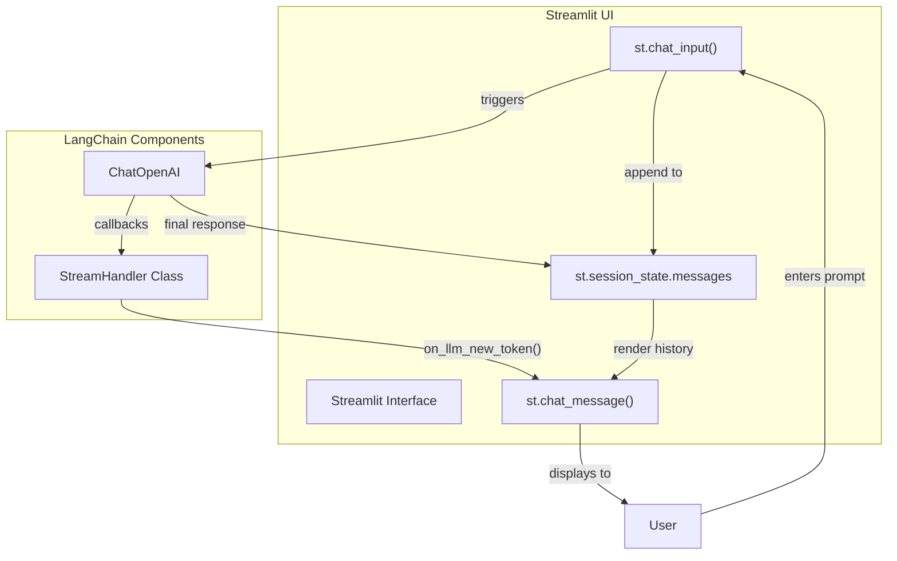
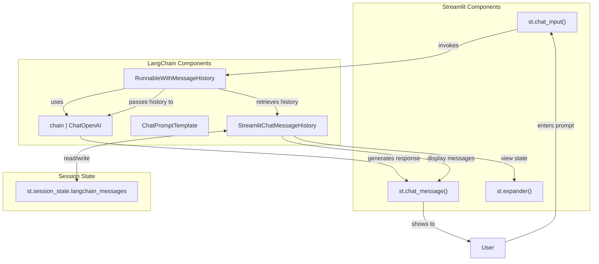
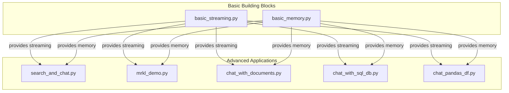

<!-- source: DeepWiki mcp.deepwiki.com · repo langchain-ai/streamlit-agent · page 3.1 Basic Applications · fetched 2026-10-26 -->

# Basic Applications

<details>
<summary>Relevant source files</summary>

The following files were used as context for generating this wiki page:

- [streamlit_agent/basic_memory.py](streamlit_agent/basic_memory.py)
- [streamlit_agent/basic_streaming.py](streamlit_agent/basic_streaming.py)

</details>


This document covers the foundational Streamlit-LangChain applications that demonstrate core concepts for building LLM-powered chat interfaces. These basic applications serve as building blocks for more complex agent implementations covered in [Agent Applications](#3.2).

The examples focus on two fundamental concepts:
1. Streaming LLM responses in real-time
2. Maintaining conversation memory across interactions

## Overview of Basic Applications

The repository provides two entry-level applications that demonstrate essential concepts in building LLM applications with Streamlit:

| Application | File | Key Concept | Description |
|-------------|------|-------------|-------------|
| Basic Streaming | `basic_streaming.py` | Real-time token streaming | Demonstrates how to stream LLM responses token-by-token in a Streamlit interface |
| Basic Memory | `basic_memory.py` | Conversation history | Shows how to maintain persistent chat history across interactions |



Sources: [streamlit_agent/basic_streaming.py:1-39](), [streamlit_agent/basic_memory.py:1-75]()

## Basic Streaming Application

The Basic Streaming application demonstrates how to stream tokens from an LLM in real-time, providing a more responsive user experience compared to waiting for the complete response.

### Architecture



### Key Components

1. **StreamHandler Class**: Custom callback handler that processes tokens as they're generated
   ```python
   class StreamHandler(BaseCallbackHandler):
       def __init__(self, container, initial_text=""):
           self.container = container
           self.text = initial_text

       def on_llm_new_token(self, token: str, **kwargs) -> None:
           self.text += token
           self.container.markdown(self.text)
   ```

2. **Session State Management**: Stores conversation history across reruns
   ```python
   if "messages" not in st.session_state:
       st.session_state["messages"] = [ChatMessage(role="assistant", content="How can I help you?")]
   ```

3. **ChatOpenAI with Streaming**: Configured to stream responses through the callback handler
   ```python
   llm = ChatOpenAI(
       openai_api_key=openai_api_key, 
       streaming=True, 
       callbacks=[stream_handler]
   )
   ```

### Implementation Flow

1. The application initializes session state to store messages if it doesn't exist already
2. It renders existing messages from the session state
3. When a user submits a message via the chat input:
   - The message is added to session state
   - A `StreamHandler` is created with an empty Streamlit container
   - The `ChatOpenAI` instance is created with streaming enabled and the handler
   - The LLM processes the input and streams tokens to the UI
   - The final response is added to session state for persistence

Sources: [streamlit_agent/basic_streaming.py:1-39]()

## Basic Memory Application

The Basic Memory application demonstrates how to maintain conversation history using `StreamlitChatMessageHistory`, enabling the LLM to reference previous interactions.

### Architecture



### Key Components

1. **StreamlitChatMessageHistory**: LangChain utility that stores messages in Streamlit's session state
   ```python
   msgs = StreamlitChatMessageHistory(key="langchain_messages")
   ```

2. **ChatPromptTemplate**: Defines the structure of the conversation including system message and history
   ```python
   prompt = ChatPromptTemplate.from_messages([
       ("system", "You are an AI chatbot having a conversation with a human."),
       MessagesPlaceholder(variable_name="history"),
       ("human", "{question}"),
   ])
   ```

3. **RunnableWithMessageHistory**: Augments a chain with message history capabilities
   ```python
   chain_with_history = RunnableWithMessageHistory(
       chain,
       lambda session_id: msgs,
       input_messages_key="question",
       history_messages_key="history",
   )
   ```

### Implementation Flow

1. The application initializes the `StreamlitChatMessageHistory` with a key for session state storage
2. If there are no messages, it adds an initial AI message
3. The LangChain is set up with a prompt template that includes a placeholder for history
4. `RunnableWithMessageHistory` connects the chain to the message history
5. The UI renders all existing messages
6. When a user inputs a prompt:
   - The application invokes the chain with the prompt
   - The chain automatically retrieves and includes the message history
   - New messages are automatically saved to history during the run
   - The response is displayed to the user

Sources: [streamlit_agent/basic_memory.py:1-75]()

## Comparing Basic Applications

These two applications introduce different fundamental concepts that are combined in more advanced examples:

| Feature | Basic Streaming | Basic Memory |
|---------|----------------|--------------|
| **Core Concept** | Token-by-token response | Conversation persistence |
| **Key Class** | `StreamHandler` | `StreamlitChatMessageHistory` |
| **Message Storage** | Simple list in session state | LangChain message store in session state |
| **LangChain Integration** | Basic LLM invocation | `RunnableWithMessageHistory` |
| **UI Features** | Progressive response rendering | Message history viewing |
| **LLM Context** | Single turn | Multi-turn with history |



Sources: [streamlit_agent/basic_streaming.py:1-39](), [streamlit_agent/basic_memory.py:1-75]()

## Integration with Streamlit

Both applications leverage Streamlit's unique features to create interactive chat interfaces:

1. **Session State**: Both use Streamlit's session state to maintain data across reruns
   - Basic Streaming: `st.session_state.messages`
   - Basic Memory: `st.session_state.langchain_messages`

2. **UI Components**:
   - Chat Interface: `st.chat_message()` and `st.chat_input()`
   - Dynamic Updates: `st.empty()` for streaming updates
   - Debug Views: `st.expander()` for viewing state

3. **LangChain Integration**:
   - Custom callbacks that work with Streamlit's UI updating system
   - Persistence adapters built specifically for Streamlit's state management

The integration patterns demonstrated in these basic applications form the foundation for all more complex LangChain-Streamlit applications in the repository.

Sources: [streamlit_agent/basic_streaming.py:20-38](), [streamlit_agent/basic_memory.py:19-74]()

---

