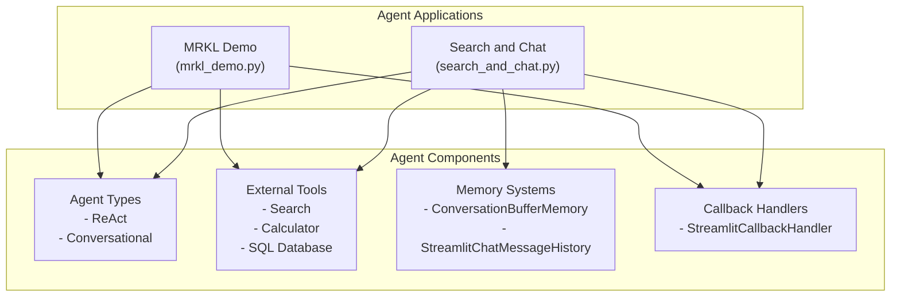
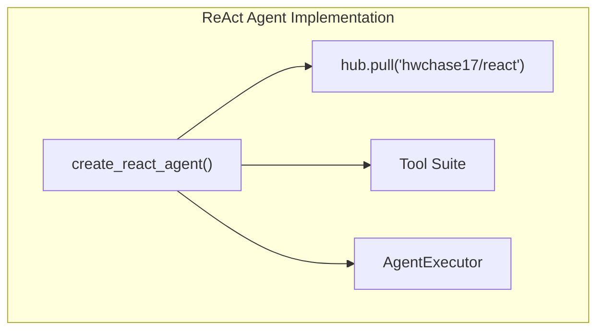
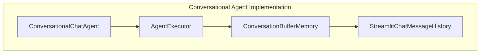
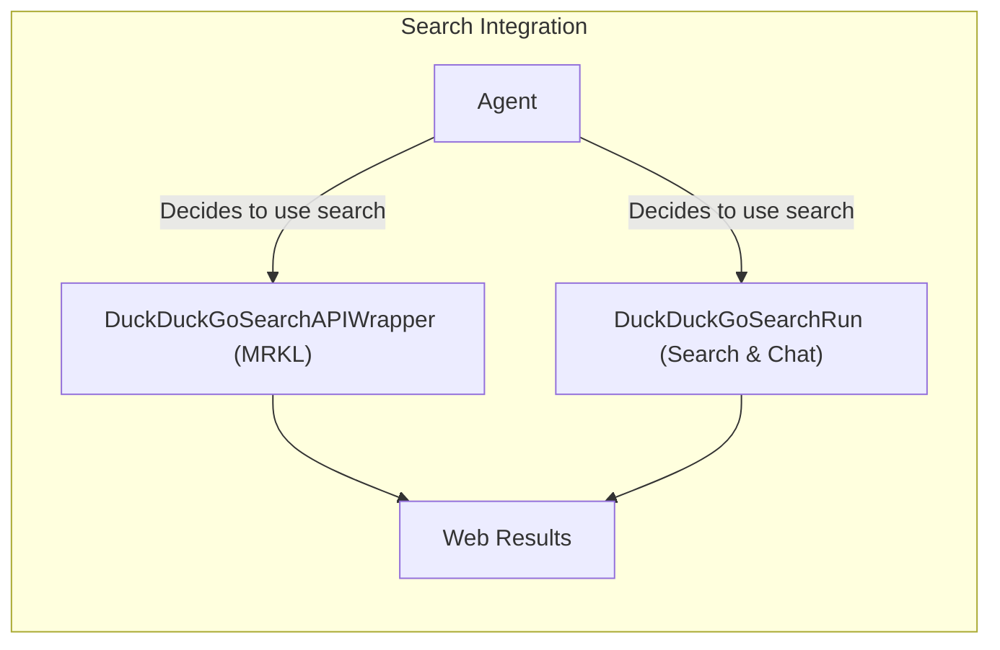
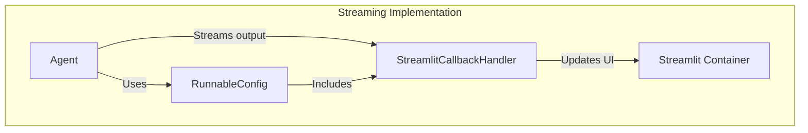
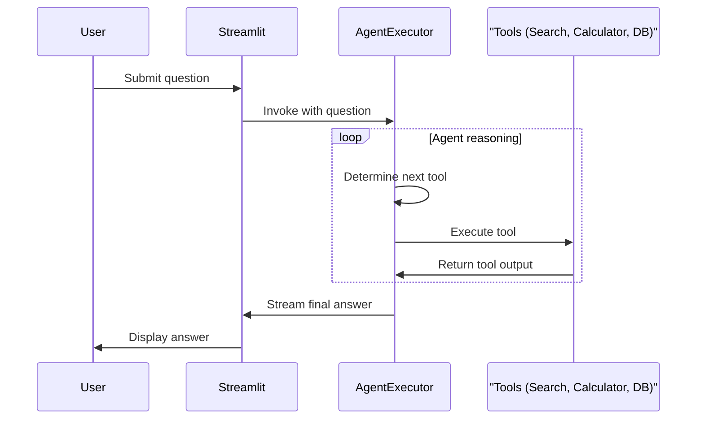
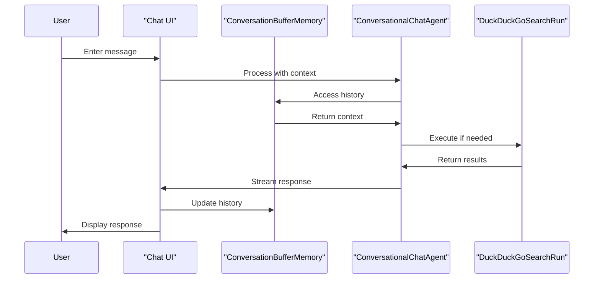
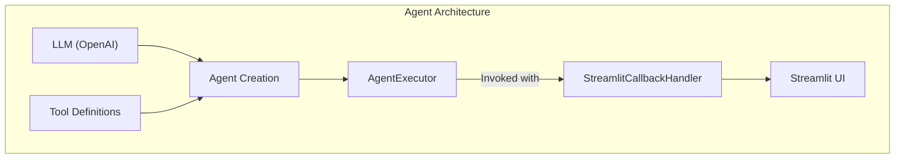

<!-- source: DeepWiki mcp.deepwiki.com · repo langchain-ai/streamlit-agent · page 3.2 Agent Applications · fetched 2026-10-26 -->

# Agent Applications

<details>
<summary>Relevant source files</summary>

The following files were used as context for generating this wiki page:

- [streamlit_agent/mrkl_demo.py](streamlit_agent/mrkl_demo.py)
- [streamlit_agent/runs/alanis.pickle](streamlit_agent/runs/alanis.pickle)
- [streamlit_agent/runs/leo.pickle](streamlit_agent/runs/leo.pickle)
- [streamlit_agent/search_and_chat.py](streamlit_agent/search_and_chat.py)

</details>


This page describes the agent applications implemented in the streamlit-agent repository. These applications demonstrate how to integrate LangChain agents with Streamlit's interactive UI features to create powerful, reasoning-enabled chatbots and assistants. For information about basic applications without agent capabilities, see [Basic Applications](#3.1).

## 1. Overview of Agent Applications

Agent applications in this repository use LangChain's agent framework, which enables language models to interact with external tools and make decisions about which tools to use based on user queries. The repository contains two main agent application examples:

1. **MRKL Demo**: A multi-tool agent that can search the web, perform calculations, and query a SQL database
2. **Search and Chat**: A conversational agent with web search capabilities and memory



Sources: [streamlit_agent/mrkl_demo.py](), [streamlit_agent/search_and_chat.py]()

## 2. Agent Types

The repository demonstrates two main agent types from LangChain:

### 2.1 ReAct Agents

The ReAct (Reasoning + Acting) pattern is implemented in the MRKL demo. These agents:
- Follow a structured reasoning process with explicit thought steps
- Make decisions about which tools to use based on user input
- Show their reasoning process, including tool selection and observation



Sources: [streamlit_agent/mrkl_demo.py:76-77]()

### 2.2 Conversational Agents

The Search and Chat demo uses a conversational agent that:
- Maintains conversation history
- Uses a more natural chat-oriented interface
- Can integrate multiple tools while maintaining context



Sources: [streamlit_agent/search_and_chat.py:46-53]()

## 3. Tool Integration

Both agent applications demonstrate tool integration, showing how to connect LLMs to external systems:

### 3.1 Search Tools

The DuckDuckGo search API is used to provide web search capabilities:



Sources: [streamlit_agent/mrkl_demo.py:48-61](), [streamlit_agent/search_and_chat.py:45]()

### 3.2 Computational Tools

The MRKL demo includes a calculator tool using `LLMMathChain`:

```python
llm_math_chain = LLMMathChain.from_llm(llm)
```

This allows the agent to solve mathematical problems by generating Python expressions and evaluating them.

Sources: [streamlit_agent/mrkl_demo.py:49-50]()

### 3.3 Database Tools

The MRKL demo includes SQL database access:

```python
db = SQLDatabase(create_engine("sqlite:///", creator=creator))
db_chain = SQLDatabaseChain.from_llm(llm, db)
```

This allows the agent to convert natural language queries into SQL and retrieve database information.

Sources: [streamlit_agent/mrkl_demo.py:52-56]()

## 4. Agent UI Integration

The applications demonstrate several UI integration patterns:

### 4.1 Streaming Responses

Both applications use `StreamlitCallbackHandler` to stream agent responses and thought processes in real-time:



Sources: [streamlit_agent/mrkl_demo.py:97-99](), [streamlit_agent/search_and_chat.py:55-58]()

### 4.2 Visualizing Agent Reasoning

The Search and Chat application visualizes intermediate reasoning steps:

```python
for step in st.session_state.steps.get(str(idx), []):
    if step[0].tool == "_Exception":
        continue
    with st.status(f"**{step[0].tool}**: {step[0].tool_input}", state="complete"):
        st.write(step[0].log)
        st.write(step[1])
```

This creates a step-by-step visualization of the agent's reasoning process.

Sources: [streamlit_agent/search_and_chat.py:29-34]()

## 5. Example Application Details

### 5.1 MRKL Demo

The MRKL (Modular Reasoning, Knowledge, and Language) demo showcases an agent that can:
- Search the web using DuckDuckGo
- Perform calculations
- Query a SQL database (Chinook.db)



Key implementation features:
- Uses ReAct agent pattern with multiple tools
- Offers sample questions with prerecorded runs
- Supports both demo mode and live execution

Sources: [streamlit_agent/mrkl_demo.py]()

### 5.2 Search and Chat

The Search and Chat application provides:
- Conversational interface with memory
- Web search capabilities
- Visualization of agent reasoning steps



Key implementation features:
- Uses Streamlit chat messaging interface
- Maintains conversation history across interactions
- Visualizes intermediate reasoning steps

Sources: [streamlit_agent/search_and_chat.py]()

## 6. Agent Code Architecture

The agent implementations follow a consistent pattern:



Key architectural components:
1. **LLM Configuration**: Typically using `OpenAI` or `ChatOpenAI`
2. **Tool Definition**: Creating tools with name, function, and description
3. **Agent Creation**: Using an appropriate agent constructor
4. **Agent Execution**: Using `AgentExecutor` to run the agent
5. **Callback Integration**: Using `StreamlitCallbackHandler` for UI updates

Sources: [streamlit_agent/mrkl_demo.py:47-77](), [streamlit_agent/search_and_chat.py:44-58]()

## 7. Extending Agent Applications

To create your own agent application based on these examples:

1. **Choose an agent type**:
   - ReAct for complex multi-tool reasoning
   - Conversational for chat applications with memory

2. **Define appropriate tools**:
   - Consider what external capabilities your agent needs
   - Implement each as a LangChain Tool

3. **Configure UI streaming**:
   - Use `StreamlitCallbackHandler` for real-time updates
   - Consider how to visualize intermediate steps

4. **Add memory if needed**:
   - Use `StreamlitChatMessageHistory` and appropriate memory class
   - Configure session state persistence

Sources: [streamlit_agent/mrkl_demo.py](), [streamlit_agent/search_and_chat.py]()

---

