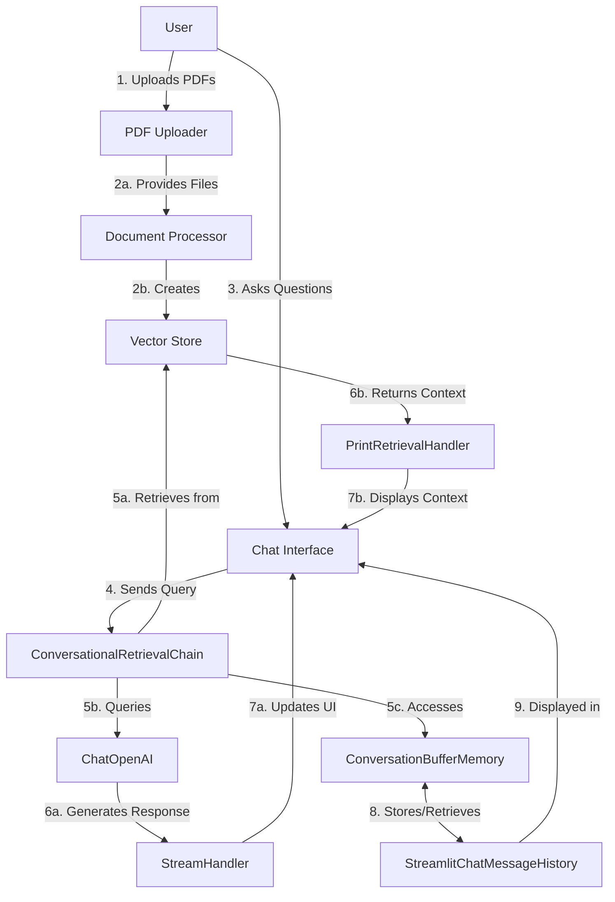
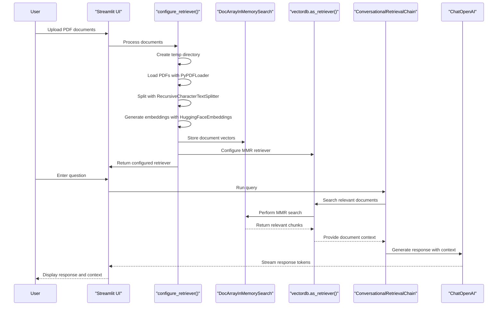
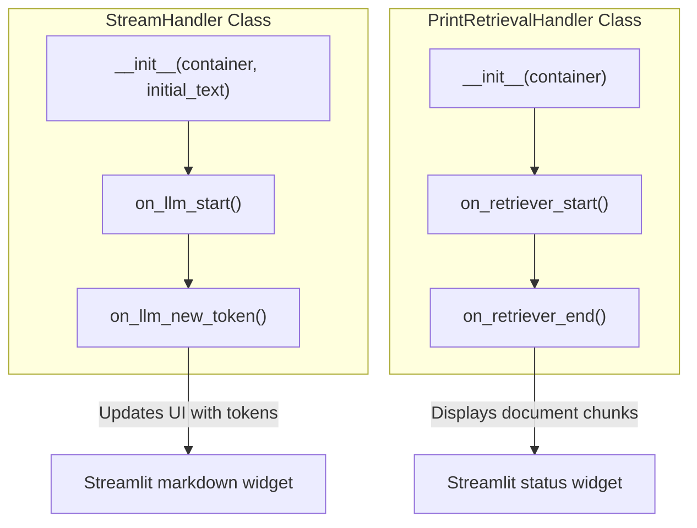
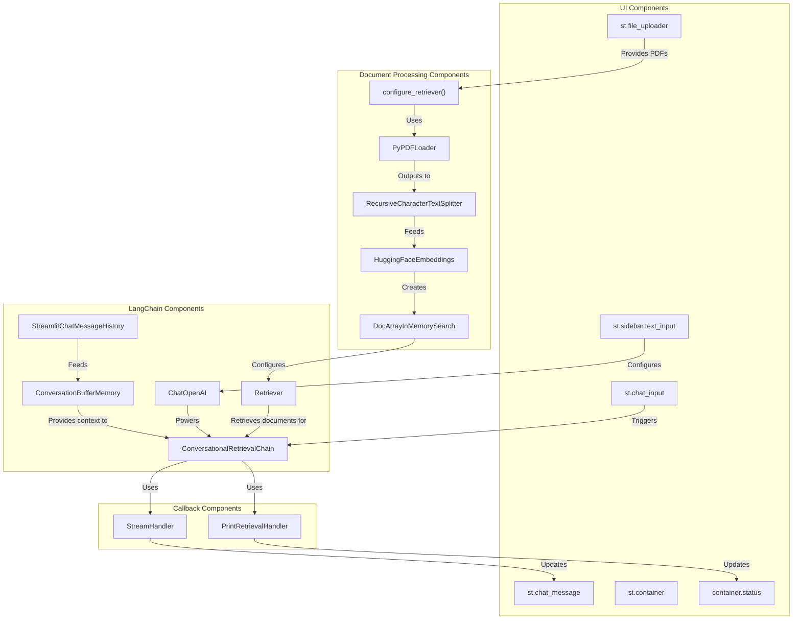

<!-- source: DeepWiki mcp.deepwiki.com · repo langchain-ai/streamlit-agent · page 3.3 Document Interaction · fetched 2026-10-26 -->

# Document Interaction

Relevant source files

The following files were used as context for generating this wiki page:

- [streamlit_agent/chat_with_documents.py](streamlit_agent/chat_with_documents.py)

This page explains how the Chat with Documents feature enables conversational interactions with PDF documents in the streamlit-agent repository. Users can upload PDF files, then ask questions and receive responses based on the document content in a natural language conversation flow.

For information on other application types like database interaction, see [Database Interaction](#3.4), or for DataFrame manipulation, see [DataFrame Interaction](#3.5).

## Document Interaction System Architecture

The document interaction system combines document processing, vector storage, and conversational AI to create a seamless chat experience with PDFs.

Sources: [streamlit_agent/chat_with_documents.py:1-119]()

## Document Processing Pipeline

The document processing pipeline converts PDFs into searchable vector representations:

Sources: [streamlit_agent/chat_with_documents.py:18-41]()

## Key Components

### 1. Document Processing with `configure_retriever`

The `configure_retriever` function handles all document processing:

| Component | Configuration | Purpose |
|-----------|---------------|---------|
| PyPDFLoader | - | Extracts text from PDF files |
| RecursiveCharacterTextSplitter | chunk_size=1500, chunk_overlap=200 | Splits documents into manageable chunks |
| HuggingFaceEmbeddings | model_name="all-MiniLM-L6-v2" | Generates embeddings for document chunks |
| DocArrayInMemorySearch | - | Stores document vectors in memory |
| Retriever | search_type="mmr", k=2, fetch_k=4 | Retrieves relevant document chunks using Maximum Marginal Relevance |

Sources: [streamlit_agent/chat_with_documents.py:18-41]()

### 2. Custom Callback Handlers

Two callback handlers manage the streaming UI experience:

- **StreamHandler**: Handles token-by-token streaming of the LLM response
- **PrintRetrievalHandler**: Displays retrieved document chunks and their sources

Sources: [streamlit_agent/chat_with_documents.py:44-75]()

### 3. Conversation Components

The conversation system integrates:

| Component | Configuration | Purpose |
|-----------|---------------|---------|
| StreamlitChatMessageHistory | - | Stores chat messages in Streamlit session state |
| ConversationBufferMemory | memory_key="chat_history", return_messages=True | Maintains conversation context |
| ChatOpenAI | model_name="gpt-3.5-turbo", temperature=0, streaming=True | Generates responses |
| ConversationalRetrievalChain | - | Orchestrates retrieval-augmented generation |

Sources: [streamlit_agent/chat_with_documents.py:92-102]()

## Implementation Details

### Code Structure Diagram

Sources: [streamlit_agent/chat_with_documents.py:1-119]()

### Document Loading and Processing

1. The system uses a temporary directory to save uploaded PDFs
2. `PyPDFLoader` extracts text from each PDF
3. Documents are split into chunks of 1500 characters with 200 character overlap
4. Embeddings are generated using a local HuggingFace model
5. Document vectors are stored in an in-memory vector database
6. The retriever is configured to use Maximum Marginal Relevance (MMR) search

The `configure_retriever` function is cached with `@st.cache_resource(ttl="1h")` to avoid reprocessing documents when the app reruns within an hour.

Sources: [streamlit_agent/chat_with_documents.py:18-41]()

### Conversation Flow

When a user asks a question:

1. The query is passed to the `ConversationalRetrievalChain`
2. The chain uses the retriever to find relevant document chunks
3. `PrintRetrievalHandler` displays these chunks in the UI
4. The context, query, and conversation history are sent to the LLM
5. `StreamHandler` streams the response tokens to the UI
6. The conversation history is updated for future context

Sources: [streamlit_agent/chat_with_documents.py:112-118]()

### UI Implementation

The Streamlit UI features:

1. A sidebar for API key input and PDF file uploads
2. A chat interface with alternating user/assistant messages
3. A status component that displays retrieved document chunks
4. A chat input field for user questions

The UI handles these states:
- Initial loading (requires API key and document uploads)
- Document processing (shows progress)
- Conversation (displays message history and new responses)

Sources: [streamlit_agent/chat_with_documents.py:77-111]()

## Technical Limitations

- **Memory Constraints**: Document processing happens in-memory, so very large documents may cause performance issues
- **Local Embeddings**: Uses HuggingFace embeddings locally, which may be slower than API-based alternatives
- **Document Types**: Currently only supports PDF files
- **Persistence**: Document context is lost when the Streamlit application is restarted

Sources: [streamlit_agent/chat_with_documents.py:18-41]()

## Usage Example

A typical usage flow:

1. User uploads PDF documents via the sidebar
2. System processes documents and creates vector embeddings
3. User asks a question about the documents
4. System displays retrieved document chunks as context
5. System generates and streams a response based on the documents
6. Conversation continues with maintained context

For more advanced document implementations, the current pattern could be extended with multi-document comparison or structured data extraction capabilities.

Sources: [streamlit_agent/chat_with_documents.py:112-118]()

---

