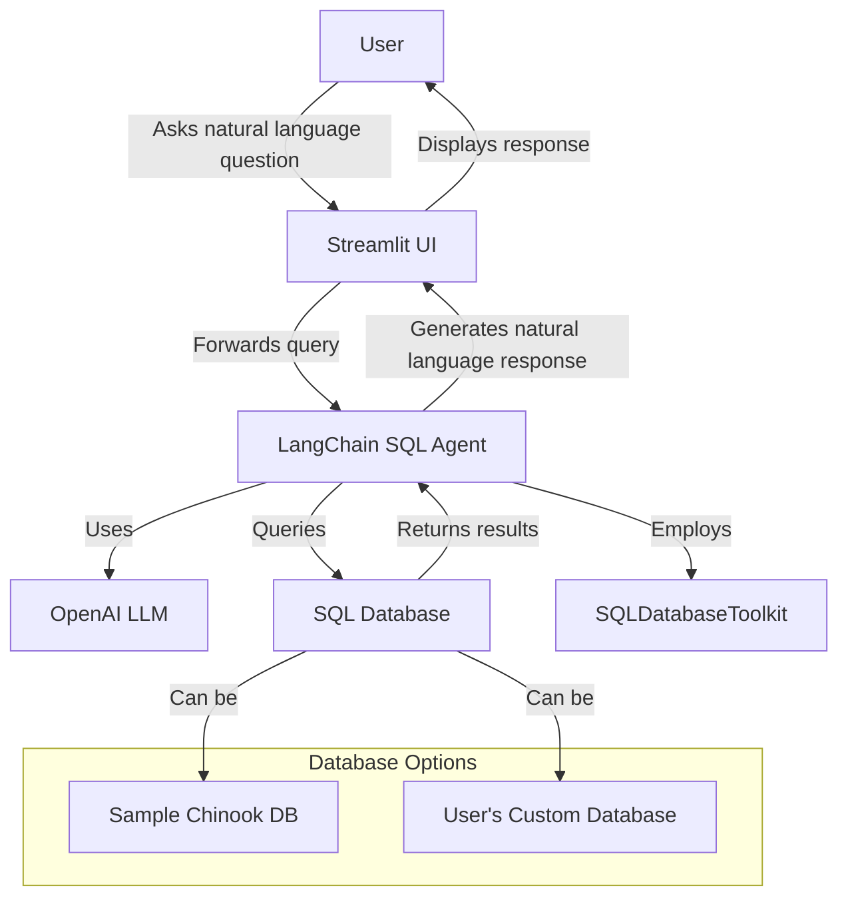
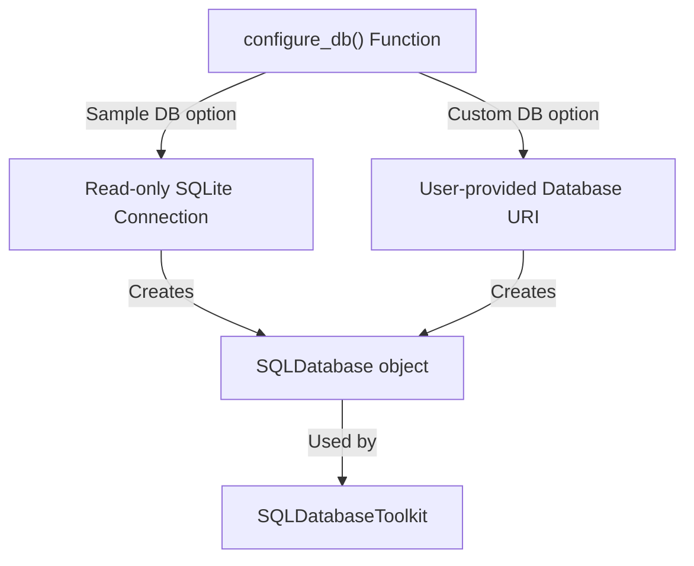
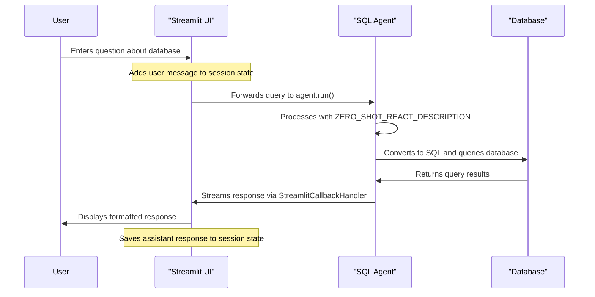
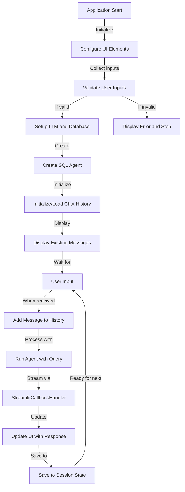

<!-- source: DeepWiki mcp.deepwiki.com · repo langchain-ai/streamlit-agent · page 3.4 Database Interaction · fetched 2026-10-26 -->

# Database Interaction

<details>
<summary>Relevant source files</summary>

The following files were used as context for generating this wiki page:

- [.gitignore](.gitignore)
- [streamlit_agent/Chinook.db](streamlit_agent/Chinook.db)
- [streamlit_agent/callbacks/__init__.py](streamlit_agent/callbacks/__init__.py)
- [streamlit_agent/chat_with_sql_db.py](streamlit_agent/chat_with_sql_db.py)

</details>


## Purpose and Scope

This document explains how to build applications that interact with SQL databases through natural language using the streamlit-agent repository. The implementation allows users to ask questions about database content in plain English, which are then translated into SQL queries, executed, and returned as human-readable responses. For information about interacting with unstructured documents like PDFs, see [Document Interaction](#3.3). For information about working with structured data in Pandas DataFrames, see [DataFrame Interaction](#3.5).

## Architecture Overview

The database interaction capabilities are implemented in the `chat_with_sql_db.py` example application, which demonstrates how to connect LangChain's SQL agent with a Streamlit interface.



Sources: [streamlit_agent/chat_with_sql_db.py:1-89]()

## Key Components

### SQL Database Connection

The application provides two ways to connect to a database:

1. **Sample Database**: Uses a pre-configured SQLite database (Chinook.db)
2. **Custom Database**: Allows users to connect to their own SQL database via a URI

The database connection is cached for performance and configured with security considerations in mind.



Sources: [streamlit_agent/chat_with_sql_db.py:50-58]()

### SQL Agent Setup

The SQL agent is responsible for:
1. Interpreting natural language queries
2. Converting them to SQL
3. Executing the SQL against the database
4. Formatting the results into natural language responses

```python
# Key components for SQL agent setup
db = configure_db(db_uri)
toolkit = SQLDatabaseToolkit(db=db, llm=llm)
agent = create_sql_agent(
    llm=llm,
    toolkit=toolkit,
    verbose=True,
    agent_type=AgentType.ZERO_SHOT_REACT_DESCRIPTION,
)
```

Sources: [streamlit_agent/chat_with_sql_db.py:61-70]()

## Implementation Details

### User Interface Components

The Streamlit interface consists of:
- A sidebar for configuration options (database selection, API key input)
- Chat history display
- Input field for user queries
- Response area that shows streaming responses from the agent

| Component | Purpose |
|-----------|---------|
| Sidebar radio buttons | Choose between sample DB or custom DB |
| Text input field | Enter database URI (for custom DB) |
| Password field | Enter OpenAI API key |
| Chat input | Enter natural language queries about the database |
| Chat message display | Show conversation history and agent responses |

Sources: [streamlit_agent/chat_with_sql_db.py:12-35]()

### Conversation Flow



Sources: [streamlit_agent/chat_with_sql_db.py:71-88]()

## Security Considerations

The SQL agent implementation includes several security measures:

1. **Read-only Database Connection**: For the sample database, a read-only SQLite connection is established to prevent modification of the database.
   
   ```python
   # Read-only connection for SQLite sample database
   creator = lambda: sqlite3.connect(f"file:{db_filepath}?mode=ro", uri=True)
   ```

2. **Prompt Injection Warning**: The UI displays a warning about potential prompt injection vulnerabilities when using custom databases.

3. **Limited Permissions Recommendation**: The application recommends using a database role with limited permissions to minimize risks.

Sources: [streamlit_agent/chat_with_sql_db.py:15-18](), [streamlit_agent/chat_with_sql_db.py:53-57]()

## Example Usage Scenarios

The SQL agent can handle a variety of natural language queries, such as:

1. **Simple Data Retrieval**: "How many customers are there in the database?"
2. **Complex Joins**: "What are the top 5 albums by sales?"
3. **Aggregations**: "Calculate the average invoice amount by country."
4. **Data Analysis**: "Which employees sold the most in 2009?"

When a query is received, the agent:
1. Analyzes the question to understand the intent
2. Examines the database schema to identify relevant tables and columns
3. Constructs appropriate SQL queries
4. Executes the queries against the database
5. Formats the results into a natural language response

## Implementation Walkthrough

The implementation follows these key steps:

1. **Initial Setup**: Configure Streamlit page and UI elements
2. **User Input Handling**: Collect database connection details and API key
3. **Agent Configuration**: Create the SQL agent with appropriate tools and LLM
4. **Conversation Management**: Maintain conversation history in session state
5. **Query Processing**: Send user queries to the agent and display responses



Sources: [streamlit_agent/chat_with_sql_db.py:1-89]()

## Conclusion

The database interaction functionality in the streamlit-agent repository demonstrates how to create a natural language interface for SQL databases using Streamlit and LangChain. This approach makes database querying accessible to users without SQL knowledge while providing developers with a template for building similar applications.

---

