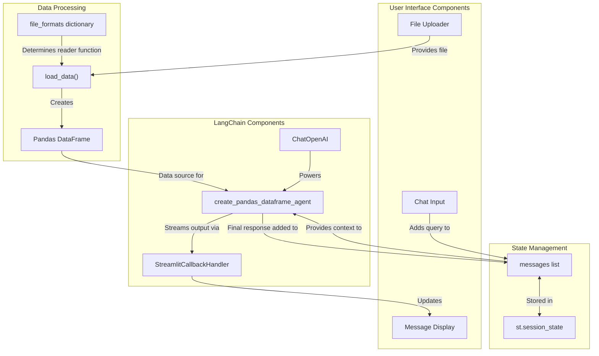
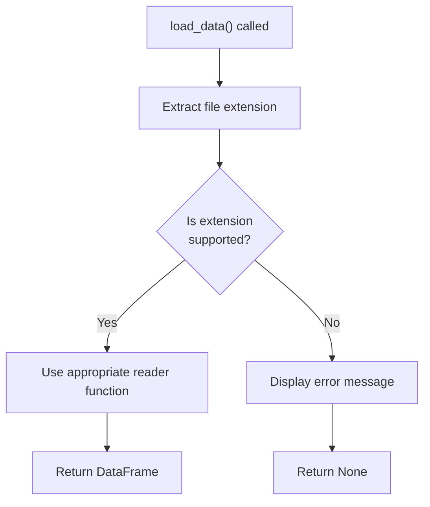
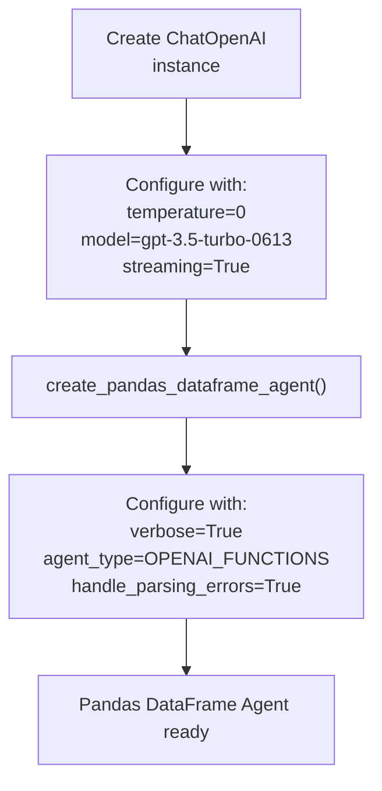
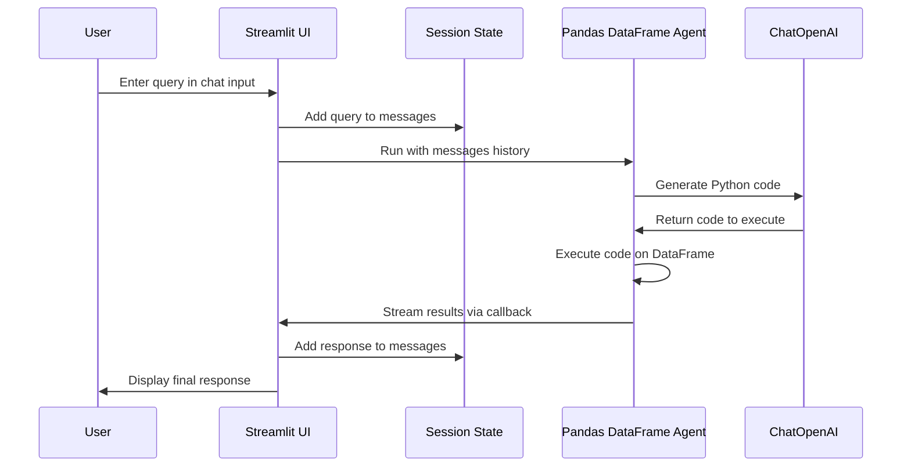
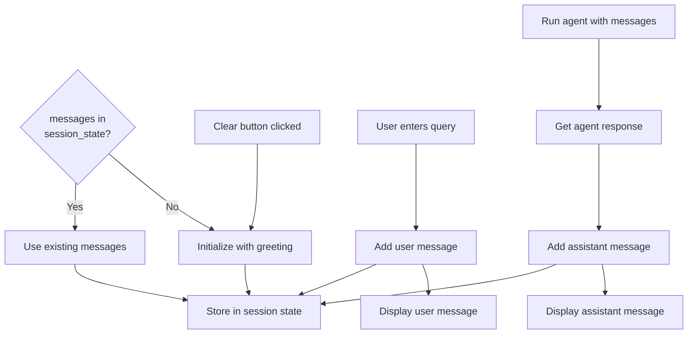
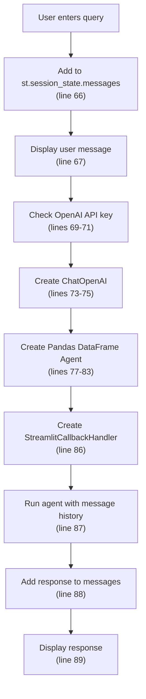

<!-- source: DeepWiki mcp.deepwiki.com · repo langchain-ai/streamlit-agent · page 3.5 DataFrame Interaction · fetched 2026-10-26 -->

# DataFrame Interaction

<details>
<summary>Relevant source files</summary>

The following files were used as context for generating this wiki page:

- [streamlit_agent/chat_pandas_df.py](streamlit_agent/chat_pandas_df.py)

</details>


## Purpose and Scope

This document explains how the streamlit-agent repository implements natural language interaction with Pandas DataFrames. This feature allows users to upload tabular data files and query them using conversational language without writing any Python code. For related functionality with SQL databases, see [Database Interaction](#3.4).

## System Overview

The DataFrame interaction functionality is implemented in `chat_pandas_df.py`, which creates a Streamlit application that integrates with LangChain's Pandas DataFrame agent to enable natural language querying of tabular data.



Sources: [streamlit_agent/chat_pandas_df.py:1-90]()

## Key Components

### File Loading System

The application supports multiple file formats through a dictionary that maps file extensions to appropriate Pandas reader functions:

```python
file_formats = {
    "csv": pd.read_csv,
    "xls": pd.read_excel,
    "xlsx": pd.read_excel,
    "xlsm": pd.read_excel,
    "xlsb": pd.read_excel,
}
```

The `load_data` function handles file extension detection and loading:



Sources: [streamlit_agent/chat_pandas_df.py:9-37]()

### LangChain Integration

The application creates a Pandas DataFrame agent using LangChain's experimental module:



Sources: [streamlit_agent/chat_pandas_df.py:73-83]()

### Query Processing Flow

When a user submits a query, the system follows this processing flow:



Sources: [streamlit_agent/chat_pandas_df.py:65-89]()

## Implementation Details

### Data File Processing

The application uses Streamlit's file uploader to accept CSV and Excel files:

```python
uploaded_file = st.file_uploader(
    "Upload a Data file",
    type=list(file_formats.keys()),
    help="Various File formats are Support",
    on_change=clear_submit,
)
```

Once uploaded, the file is processed using the `load_data` function, which is optimized with Streamlit's caching mechanism to improve performance:

```python
@st.cache_data(ttl="2h")
def load_data(uploaded_file):
    # Extracts extension and uses appropriate reader
```

Sources: [streamlit_agent/chat_pandas_df.py:27-47]()

### Agent Creation and Configuration

The Pandas DataFrame agent is created with specific settings:

1. Uses ChatOpenAI with temperature=0 for deterministic responses
2. Configured with OPENAI_FUNCTIONS agent type for structured outputs
3. Has parsing error handling enabled to manage LLM output errors
4. Verbose mode enabled to show reasoning steps

```python
pandas_df_agent = create_pandas_dataframe_agent(
    llm,
    df,
    verbose=True,
    agent_type=AgentType.OPENAI_FUNCTIONS,
    handle_parsing_errors=True,
)
```

Sources: [streamlit_agent/chat_pandas_df.py:77-83]()

### Conversation Management

The application stores conversation history in Streamlit's session state:



Sources: [streamlit_agent/chat_pandas_df.py:59-64]()

### Response Streaming

The application uses the `StreamlitCallbackHandler` to provide real-time feedback:

```python
with st.chat_message("assistant"):
    st_cb = StreamlitCallbackHandler(st.container(), expand_new_thoughts=False)
    response = pandas_df_agent.run(st.session_state.messages, callbacks=[st_cb])
    st.session_state.messages.append({"role": "assistant", "content": response})
    st.write(response)
```

This allows users to see:
1. The agent's thought process in real-time
2. Intermediate steps and calculations
3. The final response once processing is complete

Sources: [streamlit_agent/chat_pandas_df.py:85-89]()

## Security Considerations

The application displays a warning about security concerns:

```python
st.warning(
    "This app uses LangChain's `PythonAstREPLTool` which is vulnerable to arbitrary code execution. Please use caution in deploying and sharing this app."
)
```

This is important because the Pandas DataFrame agent utilizes Python's AST (Abstract Syntax Tree) to execute code generated by the language model, which could potentially execute arbitrary Python code if not properly sandboxed.

Sources: [streamlit_agent/chat_pandas_df.py:50-53]()

## Technical Capabilities

The DataFrame interaction system can perform a wide range of operations through natural language, including:

| Capability Category | Examples |
|---------------------|----------|
| Data Exploration | View statistics, summary information, data head/tail |
| Data Filtering | Filter rows/columns based on conditions |
| Data Transformation | Create new columns, apply functions, normalize data |
| Data Analysis | Calculate correlations, run statistical tests |
| Data Visualization | Generate plots and charts (described in text) |
| Data Cleaning | Handle missing values, duplicates, outliers |

The system passes the entire conversation history to the agent when processing queries, allowing for contextual follow-up questions.

Sources: [streamlit_agent/chat_pandas_df.py:65-89]()

## Code Execution Flow



Sources: [streamlit_agent/chat_pandas_df.py:65-89]()

## Limitations

1. The agent executes Python code generated by the LLM, which introduces security risks
2. Performance may degrade with very large datasets
3. Complex analytical questions may require multiple iterations or clarifications
4. Visualization capabilities are limited to text descriptions of plots rather than actual rendered visualizations

Sources: [streamlit_agent/chat_pandas_df.py:50-53]()

## Integration Points

The DataFrame interaction system integrates with:

1. **Streamlit Components**:
   - File uploader for data input
   - Chat interface for query input and response display
   - Session state for memory management

2. **LangChain Components**:
   - Pandas DataFrame agent for query processing
   - StreamlitCallbackHandler for real-time response streaming
   - ChatOpenAI for natural language understanding

3. **External Libraries**:
   - Pandas for data manipulation
   - OpenAI API for language model access

Sources: [streamlit_agent/chat_pandas_df.py:1-5]()

---

