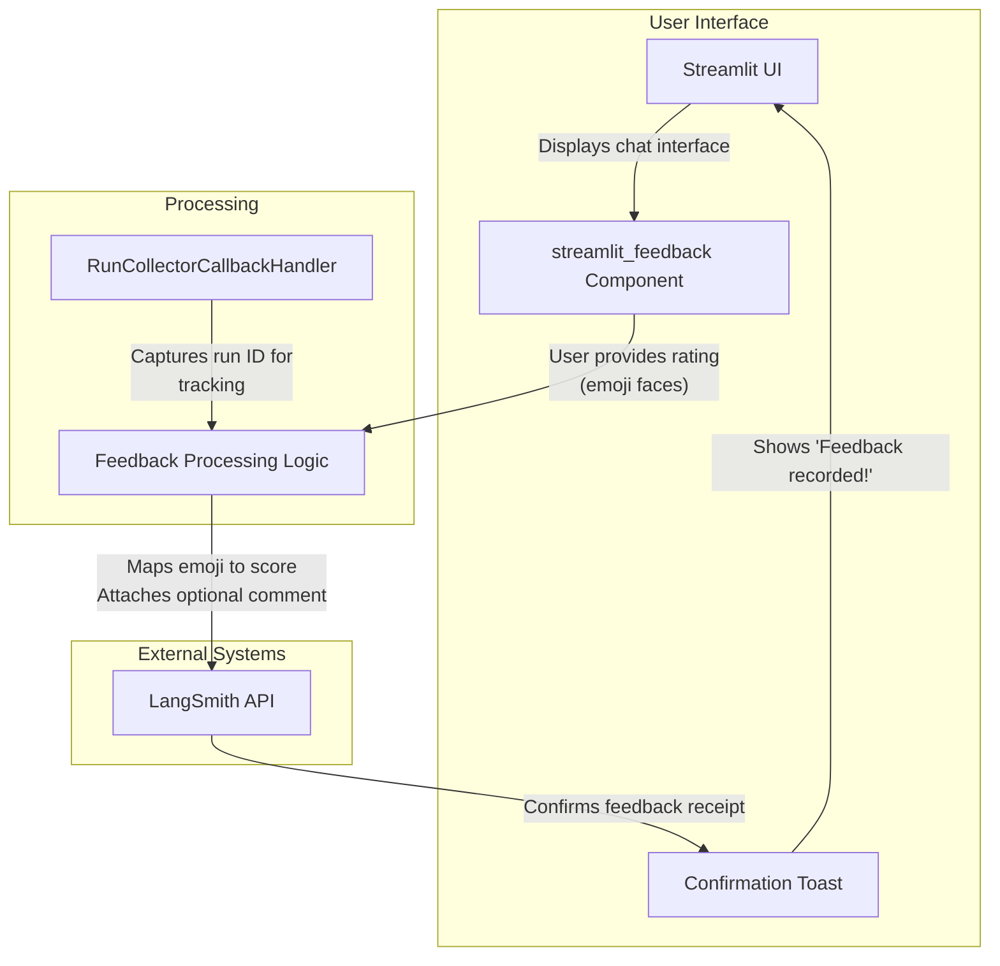
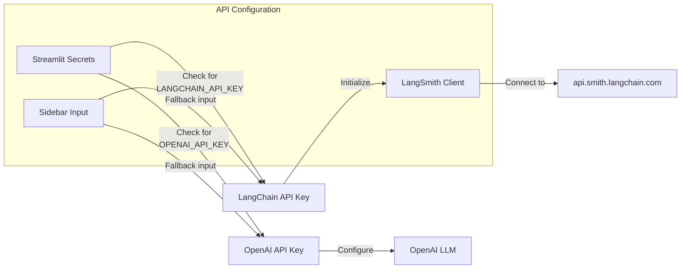
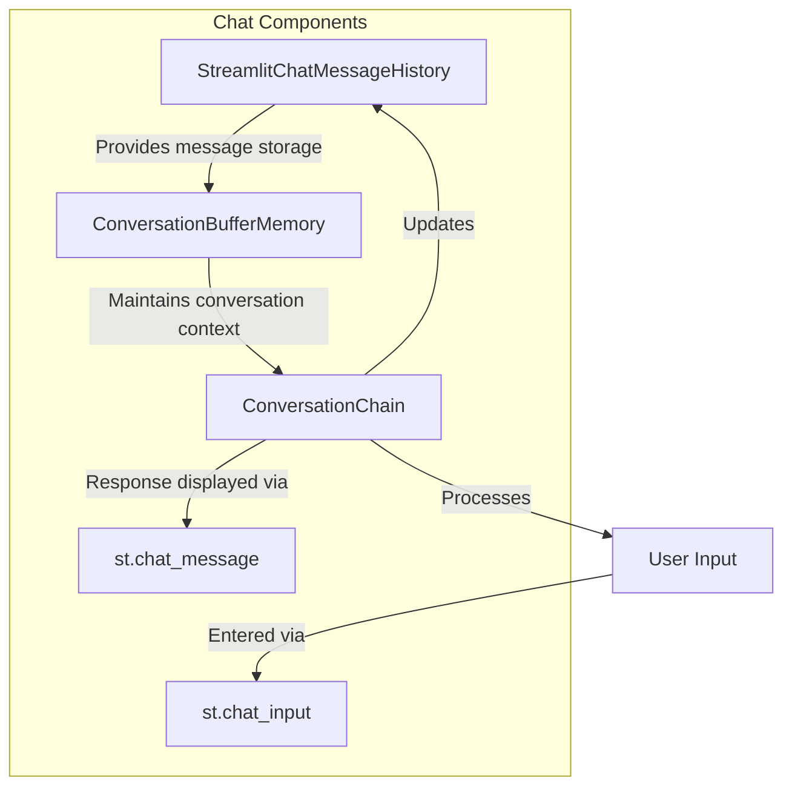
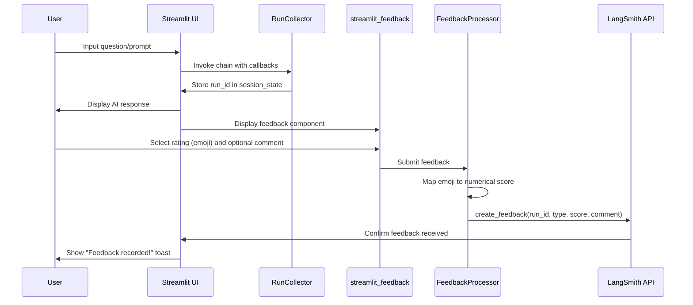
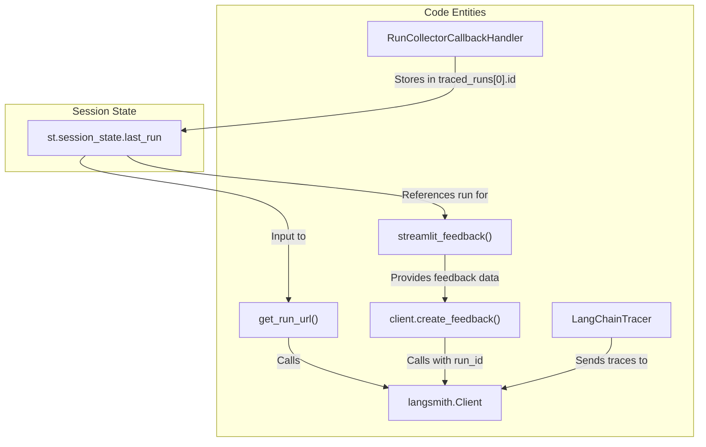

<!-- source: DeepWiki mcp.deepwiki.com · repo langchain-ai/streamlit-agent · page 3.6 User Feedback Collection · fetched 2026-10-26 -->

# User Feedback Collection

Relevant source files

The following files were used as context for generating this wiki page:

- [streamlit_agent/simple_feedback.py](streamlit_agent/simple_feedback.py)

## Purpose and Scope

This document explains the user feedback collection system implemented in the streamlit-agent repository. It details how the system enables applications to collect, process, and store user feedback on LLM-generated responses using LangSmith integration. For information about general callback systems used for streaming responses, see [Callback System](#2.3).

## Overview

The feedback collection system allows users to rate and comment on AI responses, storing this data in LangSmith for later analysis and model improvement. This functionality is demonstrated in the `simple_feedback.py` example application.

Sources: [streamlit_agent/simple_feedback.py:1-80]()

## Key Components

### 1. API Integration

The feedback system requires two API keys to function:
- OpenAI API key for LLM access
- LangChain API key for LangSmith access

The system attempts to load these from Streamlit secrets first, falling back to UI inputs if not found.

Sources: [streamlit_agent/simple_feedback.py:16-29]()

### 2. Tracing and Run Collection

The system uses two key callback handlers:
- `LangChainTracer`: Sends trace data to LangSmith
- `RunCollectorCallbackHandler`: Collects run information for feedback reference

These callbacks are configured when initializing the conversation chain:

| Component | Purpose |
|-----------|---------|
| LangChainTracer | Records detailed trace information to the specified LangSmith project |
| RunCollectorCallbackHandler | Collects run IDs and metadata in memory for reference |
| RunnableConfig | Configuration object that attaches callbacks to the chain |

Sources: [streamlit_agent/simple_feedback.py:30-33](), [streamlit_agent/simple_feedback.py:52-54]()

### 3. Chat Interface

The system uses Streamlit's chat components to create an interactive interface:

Sources: [streamlit_agent/simple_feedback.py:35-54]()

### 4. Feedback Collection Flow

The feedback collection process is triggered after each AI response:

Sources: [streamlit_agent/simple_feedback.py:56-79]()

### 5. Feedback Scoring System

The system uses a simple emoji-based rating system that maps to numerical scores:

| Emoji | Numerical Score |
|-------|----------------|
| 😀    | 1.0            |
| 🙂    | 0.75           |
| 😐    | 0.5            |
| 🙁    | 0.25           |
| 😞    | 0.0            |

These scores are sent to LangSmith along with any optional text comments provided by the user.

Sources: [streamlit_agent/simple_feedback.py:66-78]()

## Implementation Details

### LangSmith Integration

The system connects to LangSmith using the `Client` class from the `langsmith` package:

1. Initializes client with API URL and key
2. Creates a project-specific tracer
3. Captures run IDs for each conversation turn
4. Generates a trace URL for debugging/analysis
5. Submits feedback associated with specific runs

The system also provides a link to the LangSmith trace in the sidebar, allowing developers to view detailed execution information.

Sources: [streamlit_agent/simple_feedback.py:27-30](), [streamlit_agent/simple_feedback.py:57-65]()

### Component Relationships

Sources: [streamlit_agent/simple_feedback.py:30-33](), [streamlit_agent/simple_feedback.py:63-79]()

## Usage Example

To implement user feedback collection in a Streamlit-LangChain application:

1. Set up LangSmith API keys in Streamlit secrets or via sidebar input
2. Configure a LangSmith client and tracer
3. Add a RunCollectorCallbackHandler to capture run IDs
4. Store the run ID in session state after each LLM response
5. Display the streamlit_feedback component, referencing the stored run ID
6. Process feedback submissions and send to LangSmith
7. Confirm feedback receipt to the user

This pattern can be adapted to collect different types of feedback and integrated into any Streamlit-LangChain application that would benefit from user feedback collection.

Sources: [streamlit_agent/simple_feedback.py:1-80]()

---

