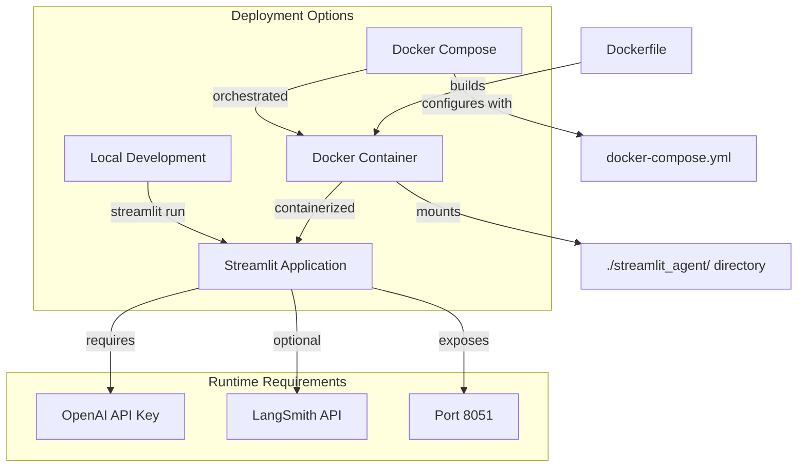
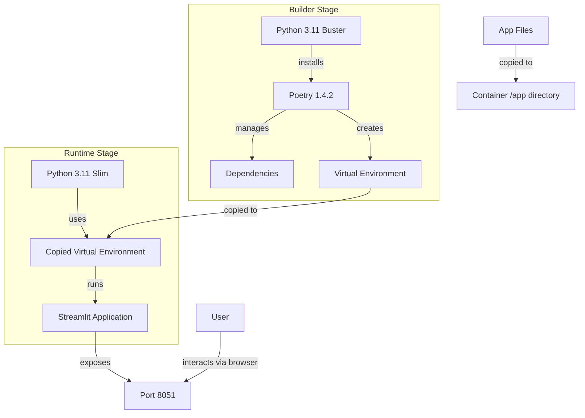
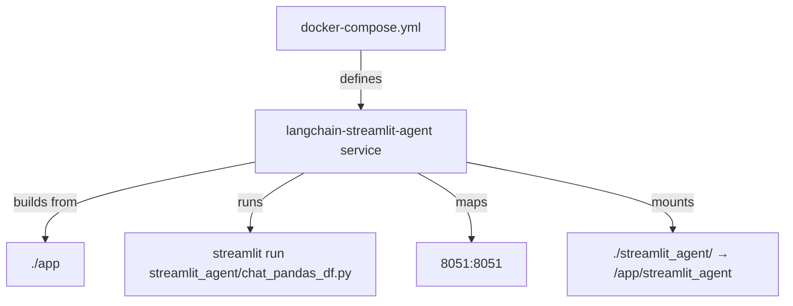

<!-- source: DeepWiki mcp.deepwiki.com · repo langchain-ai/streamlit-agent · page 4 Deployment · fetched 2026-10-26 -->

# Deployment

<details>
<summary>Relevant source files</summary>

The following files were used as context for generating this wiki page:

- [.dockerignore](.dockerignore)
- [Dockerfile](Dockerfile)
- [docker-compose.yml](docker-compose.yml)

</details>


This document covers the deployment options and processes for the streamlit-agent applications. It focuses on containerized deployment using Docker and Docker Compose, which enables consistent and reproducible application execution across different environments. For information about local development setup, see [Getting Started](#1.2).

## Deployment Architecture

The streamlit-agent repository supports multiple deployment options, with Docker being the primary recommended approach for production or shared deployments. The deployment architecture is designed to be simple and containerized, allowing for easy deployment on any system that supports Docker.



Sources: [Dockerfile](). [docker-compose.yml]().

## Docker Deployment

The repository uses a multi-stage Docker build process to create a lightweight container while properly managing dependencies.

### Docker Container Structure



Sources: [Dockerfile:1-31]().

### Single Container Deployment

To deploy using a single Docker container:

1. Build the Docker image:
   ```bash
   docker build -t langchain-streamlit-agent .
   ```

2. Run the container:
   ```bash
   docker run -p 8051:8051 -e OPENAI_API_KEY=your_key_here langchain-streamlit-agent
   ```

### Docker Compose Deployment

For a more manageable deployment, especially during development, Docker Compose provides a simplified approach:

1. Start the application with Docker Compose:
   ```bash
   docker-compose up
   ```

2. For background execution:
   ```bash
   docker-compose up -d
   ```

The Docker Compose configuration:



Sources: [docker-compose.yml:1-10]().

## Dockerfile Details

The Dockerfile uses a multi-stage build to optimize image size and build efficiency:

1. **Builder Stage**: Uses Python 3.11 on Debian Buster to:
   - Install Poetry
   - Set up Poetry configuration
   - Copy and install dependencies
   - Create a virtual environment

2. **Runtime Stage**: Uses a slim Python image to:
   - Copy the virtual environment from the builder stage
   - Copy application code
   - Run the Streamlit application

Key configurations:

| Configuration | Value | Purpose |
|---------------|-------|---------|
| Base Images | python:3.11-buster (builder)<br>python:3.11-slim-buster (runtime) | Provides Python environment |
| Poetry Version | 1.4.2 | Manages Python dependencies |
| Exposed Port | 8051 | Default Streamlit port for the app |
| Default App | chat_pandas_df.py | Default application to run |
| Volume Mount | ./streamlit_agent/ | For live code updates |

Sources: [Dockerfile:1-31]().

## Environment Configuration

When deploying the application, several environment variables can be configured:

| Environment Variable | Purpose | Required |
|----------------------|---------|----------|
| OPENAI_API_KEY | Authentication for OpenAI API | Yes |
| LANGCHAIN_TRACING_V2 | Enable LangSmith tracing | No |
| LANGCHAIN_API_KEY | Authentication for LangSmith | If tracing enabled |
| LANGCHAIN_PROJECT | Project name in LangSmith | No |

These variables can be passed to the Docker container using the `-e` flag or defined in the Docker Compose file.

## Deployment Considerations

When deploying the application, consider the following:

1. **API Keys**: Securely manage your OpenAI API key and optionally LangSmith API key
2. **Port Exposure**: The default configuration exposes port 8051
3. **Volume Mounting**: The docker-compose setup mounts the local code directory for development
4. **Application Selection**: The default application is chat_pandas_df.py, but you can modify the command to run any example

For production deployments, consider:
- Removing the volume mount to avoid unintended code modifications
- Using environment variables for configuration rather than hard-coded values
- Implementing proper security measures for API key management
- Using a reverse proxy like Nginx for TLS termination and path routing

Sources: [Dockerfile](). [docker-compose.yml]().

## Changing the Default Application

The default Docker configuration runs the `chat_pandas_df.py` application. To run a different example, modify the command in the Dockerfile or docker-compose.yml:

```bash
# Example Docker run command for a different application
docker run -p 8051:8051 -e OPENAI_API_KEY=your_key_here langchain-streamlit-agent streamlit run streamlit_agent/search_and_chat.py --server.port 8051
```

Or in docker-compose.yml:
```yaml
command: streamlit run streamlit_agent/search_and_chat.py --server.port 8051
```

For more details about the Docker configuration options and specific settings, see [Docker Configuration](#4.1).

---

