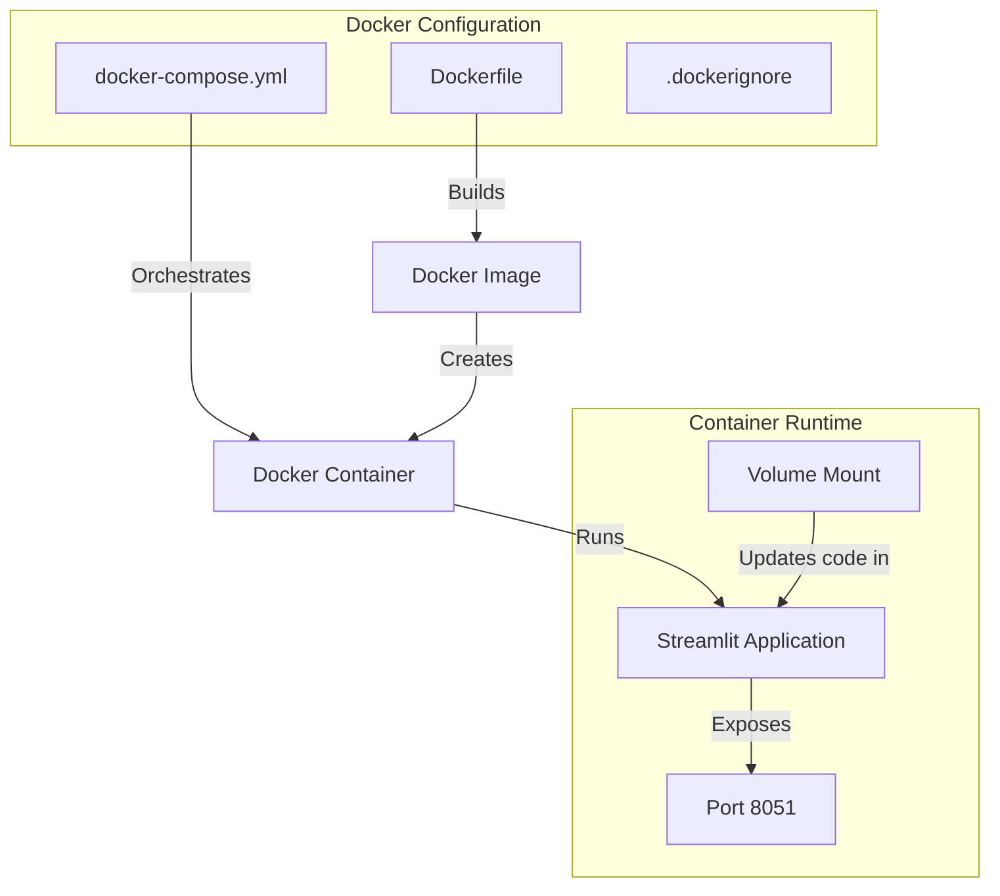
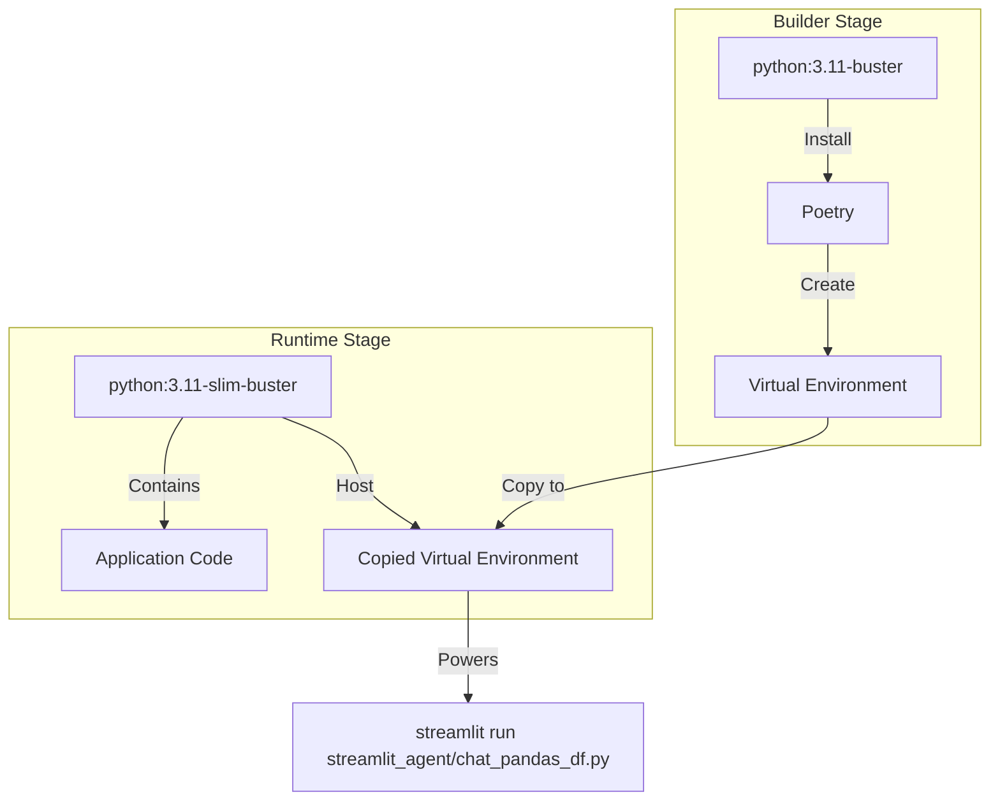
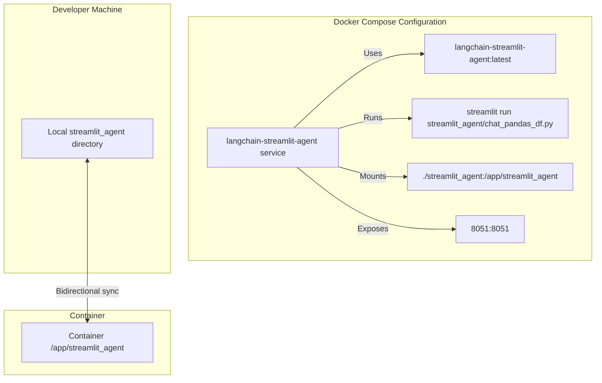
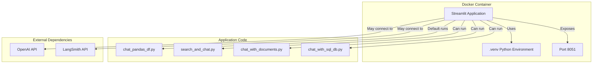
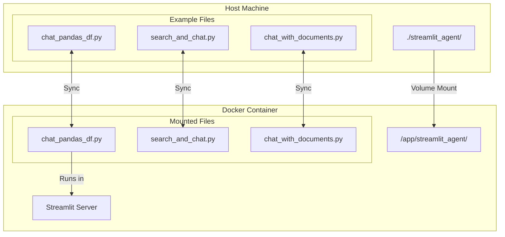

<!-- source: DeepWiki mcp.deepwiki.com · repo langchain-ai/streamlit-agent · page 4.1 Docker Configuration · fetched 2026-10-26 -->

# Docker Configuration

<details>
<summary>Relevant source files</summary>

The following files were used as context for generating this wiki page:

- [.dockerignore](.dockerignore)
- [Dockerfile](Dockerfile)
- [docker-compose.yml](docker-compose.yml)

</details>


## Purpose and Scope

This document explains the Docker configuration for the streamlit-agent repository, detailing how to build, run, and customize Docker containers for both development and deployment purposes. It covers the Dockerfile structure, Docker Compose configuration, and usage patterns for containerizing LangChain Streamlit applications.

For general deployment information, see [Deployment](#4).

## Docker Setup Overview

The repository uses a containerized approach to ensure consistent environments and simplify deployment of the LangChain Streamlit applications. The Docker configuration consists of:

1. A multi-stage `Dockerfile` for efficient and optimized image builds
2. A `docker-compose.yml` file for development convenience
3. Volume mounting support for real-time code changes during development



Sources: [Dockerfile:1-32](), [docker-compose.yml:1-10]()

## Dockerfile Structure

The `Dockerfile` uses a multi-stage build process to create an optimized container image:



### Builder Stage
The first stage creates a Python environment with all dependencies installed:

1. Uses `python:3.11-buster` as base image
2. Installs Poetry for dependency management
3. Configures Poetry to create virtual environments inside the project
4. Copies project dependency files (`pyproject.toml` and `poetry.lock`)
5. Installs dependencies into a virtual environment

### Runtime Stage
The second stage creates a slim runtime container:

1. Uses `python:3.11-slim-buster` as a lightweight base image
2. Copies only the virtual environment from the builder stage
3. Copies the application code
4. Sets the default command to run a Streamlit application

Sources: [Dockerfile:1-32]()

## Docker Compose Configuration

The `docker-compose.yml` file simplifies development by providing:

1. Service definition for the LangChain Streamlit agent
2. Volume mounting for real-time code changes
3. Port exposure for accessing the application
4. Command configuration



The volume mounting (`./streamlit_agent/:/app/streamlit_agent`) is particularly useful for development as it allows changes to the code on the host machine to be immediately reflected in the running container without rebuilding the image.

Sources: [docker-compose.yml:1-10]()

## Using Docker for Development

### Building and Running the Docker Image

To build and run the application using Docker:

1. Build the Docker image:
   ```bash
   docker build -t langchain-streamlit-agent .
   ```

2. Run the container:
   ```bash
   docker run -p 8051:8051 langchain-streamlit-agent
   ```

### Using Docker Compose for Development

For a more convenient development experience:

1. Start the application with Docker Compose:
   ```bash
   docker-compose up
   ```

2. Make changes to files in the `./streamlit_agent/` directory, and they will automatically reflect in the running application.

3. Access the application at `http://localhost:8051`

### Customizing the Default Application

The default application is set to `streamlit_agent/chat_pandas_df.py`, but you can run any of the example applications by modifying:

1. The `CMD` instruction in the `Dockerfile`
2. The `command` property in `docker-compose.yml`

For example, to run the search and chat example instead:

```yaml
command: streamlit run streamlit_agent/search_and_chat.py --server.port 8051
```

Sources: [Dockerfile:31](), [docker-compose.yml:6]()

## Environment Variables and Configuration

The Docker setup respects environment variables needed for API credentials and other configurations. These can be passed at runtime:

```bash
docker run -p 8051:8051 -e OPENAI_API_KEY=your_key_here langchain-streamlit-agent
```

For Docker Compose, you can add environment variables in the service definition:

```yaml
services:
  langchain-streamlit-agent:
    # existing configuration...
    environment:
      - OPENAI_API_KEY=your_key_here
      - LANGCHAIN_TRACING_V2=true
      - LANGCHAIN_ENDPOINT=https://api.smith.langchain.com
      - LANGCHAIN_API_KEY=your_langsmith_key
```

## Docker Container Architecture

The following diagram shows the architecture of the running Docker container and how it relates to the code entities:



Sources: [Dockerfile:23-31](), [docker-compose.yml:4-10]()

## Volume Mounting for Development

The volume mounting configuration creates a bidirectional sync between the host and container:



This setup allows for:
- Real-time code changes without rebuilding
- Testing different examples by modifying the run command
- Development workflow that preserves a consistent environment

Sources: [docker-compose.yml:7-8]()

## Summary

The Docker configuration in the streamlit-agent repository provides a consistent and efficient way to build, develop, and deploy LangChain Streamlit applications. The multi-stage build process creates optimized images, while the Docker Compose setup enables a productive development experience with real-time code changes through volume mounting.

---

