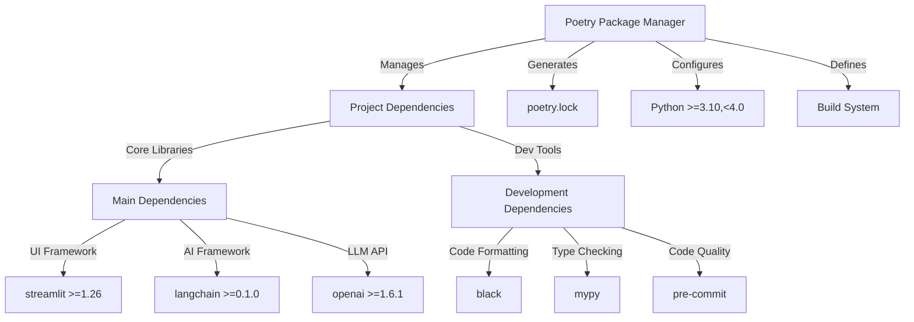
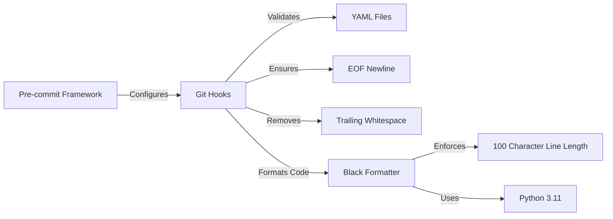
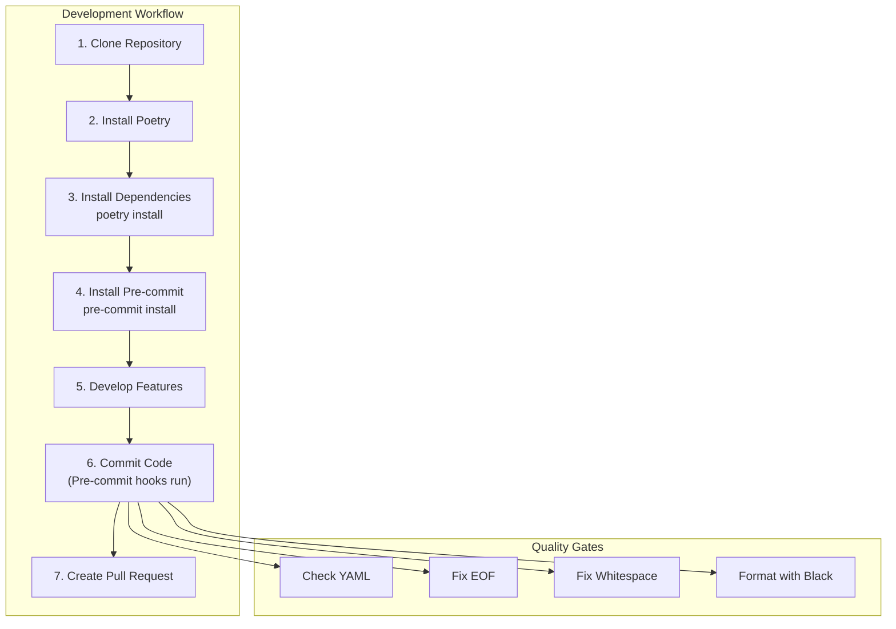
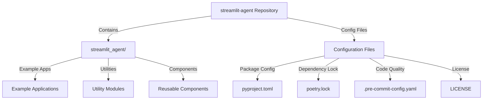

<!-- source: DeepWiki mcp.deepwiki.com · repo langchain-ai/streamlit-agent · page 5 Development Practices · fetched 2026-10-26 -->

# Development Practices

Relevant source files

The following files were used as context for generating this wiki page:

- [.pre-commit-config.yaml](.pre-commit-config.yaml)
- [LICENSE](LICENSE)
- [pyproject.toml](pyproject.toml)

This document outlines the development practices, tools, and standards used in the streamlit-agent repository. It covers dependency management, code quality enforcement, version control practices, and licensing information that contributors and developers should follow when working with this codebase.

For information about deploying the applications, see [Deployment](#4).

## Development Environment Setup

The streamlit-agent repository uses Poetry for dependency management and packaging, which provides consistent, reproducible environments for development.

### Poetry Configuration

The project is configured through the `pyproject.toml` file, which defines all the project metadata, dependencies, and development requirements.

Sources: [pyproject.toml:1-36]()

### Key Dependencies

The project relies on the following main dependencies:

| Category | Dependencies | Purpose |
|----------|--------------|---------|
| Core Frameworks | langchain, streamlit | Provides the foundation for building LLM-powered web applications |
| LLM Integration | openai, langchain-openai | Integrates with OpenAI's language models |
| Tool Components | duckduckgo-search, pypdf, sentence-transformers | Provides functionality for specific agent tools |
| Data Processing | torch, tabulate, numexpr, pandas | Enables data processing capabilities |
| Vector Storage | docarray, hnswlib | Supports document embeddings and similarity search |
| User Experience | streamlit-feedback | Enables user feedback collection |

Sources: [pyproject.toml:10-27]()

## Code Quality Standards

The repository enforces code quality through automated tools and standardized formatting.

### Pre-commit Hooks

Pre-commit hooks automatically check code quality before commits are accepted, ensuring consistency across the codebase.

Sources: [.pre-commit-config.yaml:1-18]()

### Formatting Standards

The codebase adheres to the following formatting standards:

- **Black** code formatter with a line length of 100 characters
- Elimination of trailing whitespace
- Proper newlines at end of files
- Consistent YAML formatting

These standards are enforced through pre-commit hooks, ensuring all code meets the same style guidelines regardless of contributor.

Sources: [.pre-commit-config.yaml:4-17]()

## Development Workflow

The development workflow combines Poetry for dependency management with pre-commit hooks for code quality, creating a standardized process for contributions.

### Type Checking

The project uses mypy for static type checking, helping to catch type-related errors before runtime.

Sources: [pyproject.toml:29-32]()

## Package Structure

The streamlit-agent repository follows a standard Python package structure, with the core code housed in the `streamlit_agent` package.

Sources: [pyproject.toml:8]()

## Licensing

The streamlit-agent repository is licensed under the Apache License 2.0, which allows for free use, modification, and distribution of the code with certain conditions.

Key aspects of the Apache 2.0 license:

- Allows free use, modification, and distribution
- Requires preservation of copyright and license notices
- Provides an express grant of patent rights from contributors
- Requires a notice of any changes made to the files
- Disclaims warranty and limits liability

Any contributions to the project are expected to be made under the same license terms.

Sources: [LICENSE:1-202]()

## Contribution Guidelines

When contributing to the streamlit-agent repository, follow these guidelines:

1. Set up the development environment with Poetry
2. Ensure pre-commit hooks are installed and running
3. Follow the code formatting standards enforced by Black
4. Run type checking with mypy before submitting changes
5. Ensure all examples and applications work as expected
6. Submit contributions under the Apache 2.0 license

These practices ensure code consistency, quality, and compatibility with the project's goals of demonstrating effective integration between Streamlit and LangChain for building LLM-powered applications.