# Page: Overview

# Overview

<details>
<summary>Relevant source files</summary>

The following files were used as context for generating this wiki page:

- [README.md](README.md)
- [pyproject.toml](pyproject.toml)

</details>


This wiki page introduces the streamlit-agent repository, a collection of reference implementations showcasing the integration between Streamlit and LangChain for building LLM-powered web applications.

## Purpose and Scope

The streamlit-agent repository provides example applications that demonstrate different patterns for building LLM-powered applications using `Streamlit` for the user interface and `LangChain` for the agent framework. These examples range from simple chat interfaces to complex agents with domain-specific capabilities:

- Real-time streaming of LLM responses
- Conversation memory persistence
- Web search integration
- Document and PDF analysis
- SQL database interaction
- Pandas DataFrame querying
- User feedback collection

For setup instructions, see [Getting Started](#1.2). For deployment options, see [Deployment](#4).

Sources: [README.md:1-21]()

## High-Level System Architecture

The following diagram illustrates the core architecture shared across applications in the repository:

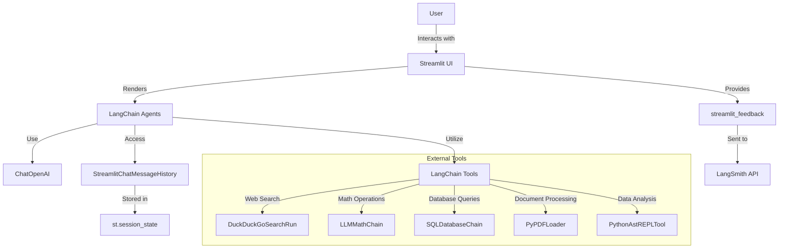

This architecture shows how users interact with a `Streamlit` UI that connects to `LangChain` agents. The agents utilize `ChatOpenAI` language models and access various tools from the LangChain ecosystem. Conversation memory is maintained using `StreamlitChatMessageHistory` which stores data in Streamlit's `st.session_state`.

Sources: [README.md:4-16](), [pyproject.toml:10-27]()

## Core Integration Components

The repository demonstrates two key integration points between Streamlit and LangChain:

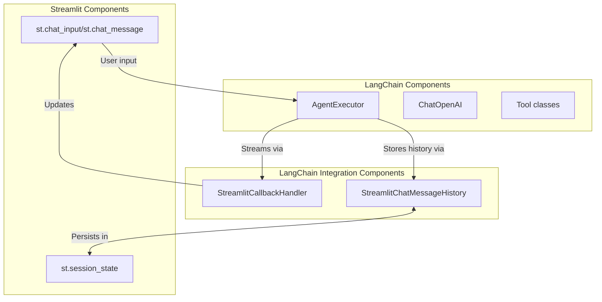

This diagram illustrates the key integration components:

1. `StreamlitCallbackHandler`: Captures output from LangChain agents/chains and streams it to the Streamlit UI
2. `StreamlitChatMessageHistory`: Memory implementation that stores conversation history in `st.session_state`

Sources: [README.md:18-20]()

## Example Applications

The repository includes multiple example applications that demonstrate different capabilities:

| Application | Description | Key Classes/Components |
|-------------|-------------|------------------------|
| `basic_streaming.py` | Simple streaming app | `ChatOpenAI`, `StreamlitCallbackHandler` |
| `basic_memory.py` | App with conversation memory | `StreamlitChatMessageHistory` |
| `mrkl_demo.py` | MRKL agent implementation | `initialize_agent`, `DuckDuckGoSearchRun`, `LLMMathChain` |
| `minimal_agent.py` | Minimal agent with search | `initialize_agent`, `DuckDuckGoSearchRun` |
| `search_and_chat.py` | Search-enabled chatbot with memory | `AgentExecutor`, `DuckDuckGoSearchRun`, `StreamlitChatMessageHistory` |
| `simple_feedback.py` | Chat app with user feedback | `streamlit_feedback`, LangSmith integration |
| `chat_with_documents.py` | Document Q&A chatbot | `PyPDFLoader`, `FAISS` |
| `chat_with_sql_db.py` | SQL database chatbot | `SQLDatabaseChain` |
| `chat_pandas_df.py` | Pandas DataFrame chatbot | `PythonAstREPLTool`, `pandas` |

The applications are organized from basic functionality to more complex, domain-specific implementations:

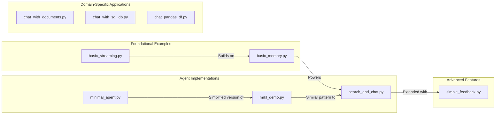

For more detailed information on these applications, see [Example Applications](#3).

Sources: [README.md:7-16]()

## Implementation Details

The following table provides more technical implementation details for each example application:

| Application | Implementation Pattern |
|-------------|------------------------|
| `basic_streaming.py` | `chat = ChatOpenAI(streaming=True)` with `StreamlitCallbackHandler` |
| `basic_memory.py` | `msgs = StreamlitChatMessageHistory(key="langchain_messages")` |
| `mrkl_demo.py` | `tools = [search_tool, llm_math_chain]` with `AgentType.ZERO_SHOT_REACT_DESCRIPTION` |
| `minimal_agent.py` | `tools = [search_tool]` with `initialize_agent` |
| `search_and_chat.py` | `memory = ConversationBufferMemory(memory_key="chat_history", chat_memory=msgs)` |
| `simple_feedback.py` | `feedback = feedback_component(feedback_type="thumbs")` |
| `chat_with_documents.py` | `embeddings = OpenAIEmbeddings()` with `vectorstore = FAISS.from_documents(docs, embeddings)` |
| `chat_with_sql_db.py` | `db_chain = SQLDatabaseChain.from_llm(llm, db)` |
| `chat_pandas_df.py` | `df_tool = PythonAstREPLTool(locals={"df": df})` |

## Component Architecture

The following diagram shows the component architecture for a typical agent application in the repository:

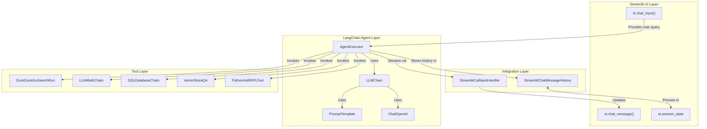

This architecture illustrates how the different components interact in a typical agent application, from the Streamlit UI through the integration layer to the LangChain agent and tool layers.

Sources: [README.md:7-16](), [pyproject.toml:10-27]()

## Project Dependencies

Key dependencies used across the applications include:

| Dependency | Purpose |
|------------|---------|
| `langchain` | Core framework for building LLM applications |
| `openai` | Integration with OpenAI models |
| `streamlit` | Web application framework |
| `duckduckgo-search` | Web search capability |
| `pypdf` | PDF document processing |
| `sentence-transformers` | Text embedding generation |
| `streamlit-feedback` | User feedback collection component |
| `langsmith` | Evaluation and monitoring (implied by feedback integration) |

For a complete list of dependencies, see [Project Dependencies](#1.1).

Sources: [pyproject.toml:10-27]()

## References

- For detailed project dependencies, see [Project Dependencies](#1.1)
- For setup instructions, see [Getting Started](#1.2)
- For system architecture details, see [System Architecture](#2)
- For example applications overview, see [Example Applications](#3)
- For deployment information, see [Deployment](#4)
- For development practices, see [Development Practices](#5)

Sources: [README.md:32-52](), [pyproject.toml:10-36]()

---

# Page: Project Dependencies

# Project Dependencies

<details>
<summary>Relevant source files</summary>

The following files were used as context for generating this wiki page:

- [poetry.lock](poetry.lock)
- [pyproject.toml](pyproject.toml)

</details>


## Purpose and Scope

This document details the core dependencies of the streamlit-agent repository and explains their role in the system. It focuses on the technical requirements needed to run the example applications that integrate Streamlit with LangChain. For instructions on setting up the environment and running the applications, see [Getting Started](#1.2).

## Dependency Management

The streamlit-agent project uses Poetry for dependency management. Dependencies are defined in the `pyproject.toml` file, which specifies both runtime dependencies and development dependencies.

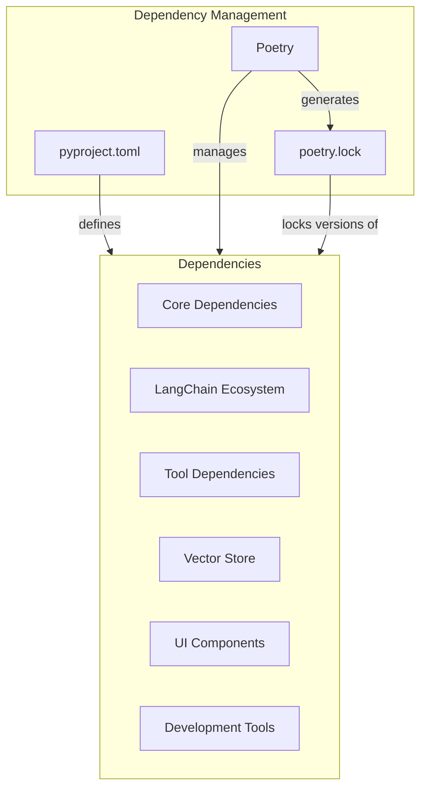

Sources: [pyproject.toml:1-37]()

## Core Dependencies

The application relies on several foundational libraries:

| Dependency | Version | Purpose |
|------------|---------|---------|
| Python | >=3.10,<4.0 | Runtime environment |
| langchain | >=0.1.0 | Core LLM application framework |
| openai | >=1.6.1 | OpenAI API integration |
| streamlit | >=1.26 | Web application framework |

These dependencies form the essential stack for building the interactive AI applications in this repository.

Sources: [pyproject.toml:10-21]()

## LangChain Ecosystem Dependencies

The project utilizes several packages from the LangChain ecosystem:

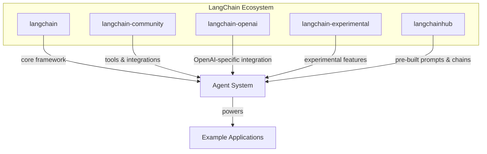

| Dependency | Version | Purpose |
|------------|---------|---------|
| langchain-community | ^0.0.12 | Community-maintained integrations |
| langchain-openai | ^0.0.2.post1 | OpenAI-specific integrations |
| langchain-experimental | ^0.0.49 | Experimental LangChain features |
| langchainhub | ^0.1.14 | Pre-built prompts and chains |

Sources: [pyproject.toml:12-24]()

## Tool Dependencies

The repository incorporates various tools that extend the capabilities of the agents:

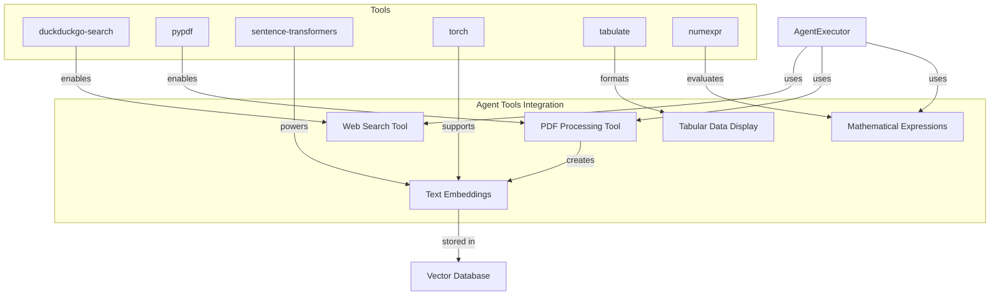

| Dependency | Version | Purpose |
|------------|---------|---------|
| duckduckgo-search | >4.0 | Web search capabilities |
| pypdf | ^3.12.2 | PDF document processing |
| sentence-transformers | ^2.2.2 | Text embedding generation |
| torch | >=2.0.0, !=2.0.1 | Machine learning backend |
| tabulate | ^0.9.0 | Table formatting for display |
| numexpr | ^2.8.8 | Mathematical expression evaluation |

Sources: [pyproject.toml:14-26]()

## Vector Store Dependencies

For storing and retrieving embeddings of documents:

| Dependency | Version | Purpose |
|------------|---------|---------|
| docarray | ^0.38.0 | Document storage and retrieval |
| hnswlib | ^0.7.0 | Approximate nearest neighbor search |

These dependencies enable the application to perform semantic search on documents, particularly in the chat with documents example.

Sources: [pyproject.toml:22-23]()

## UI Enhancement Dependencies

To improve the user experience:

| Dependency | Version | Purpose |
|------------|---------|---------|
| streamlit-feedback | ^0.0.9 | User feedback collection component |

This dependency is used in the feedback collection examples to gather user ratings on responses.

Sources: [pyproject.toml:19]()

## Development Dependencies

Tools used during development but not required at runtime:

| Dependency | Version | Purpose |
|------------|---------|---------|
| black | ^23.3.0 | Code formatting |
| mypy | ^1.4.1 | Static type checking |
| pre-commit | ^3.3.3 | Git pre-commit hook management |

These tools help maintain code quality and consistency across the codebase.

Sources: [pyproject.toml:29-32]()

## Dependency Relationship to System Components

The following diagram illustrates how the dependencies relate to the main system components:

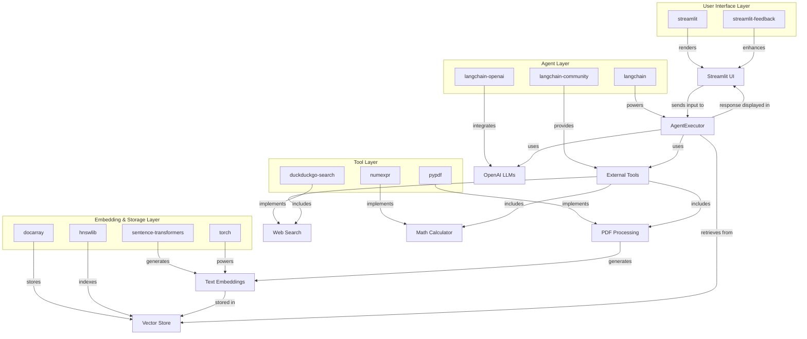

Sources: [pyproject.toml:10-26]()

## Build System

The project uses Poetry's build system:

```
[build-system]
requires = ["poetry-core"]
build-backend = "poetry.core.masonry.api"
```

This configuration ensures that Poetry's core functionality is used for building and packaging the project.

Sources: [pyproject.toml:34-36]()

---

# Page: Getting Started

# Getting Started

<details>
<summary>Relevant source files</summary>

The following files were used as context for generating this wiki page:

- [README.md](README.md)
- [pyproject.toml](pyproject.toml)

</details>


This guide provides instructions for setting up and running the streamlit-agent applications locally. It covers environment setup, configuration, and different methods for running the applications. For information about project dependencies, see [Project Dependencies](#1.1).

## Prerequisites

Before getting started with the streamlit-agent repository, ensure you have the following installed:

- Python 3.10 or later
- [Poetry](https://python-poetry.org/) (for dependency management)
- Git (for cloning the repository)
- OpenAI API key

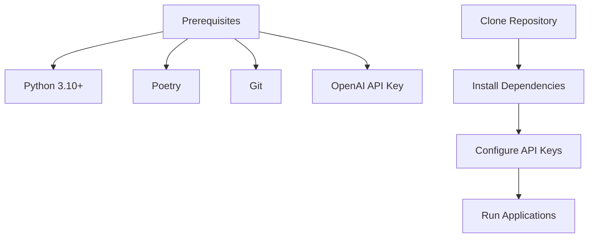

Sources: [pyproject.toml:11-12](), [README.md:32-43]()

## Environment Setup

### Clone the Repository

Start by cloning the repository to your local machine:

```
git clone https://github.com/langchain-ai/streamlit-agent.git
cd streamlit-agent
```

### Install Dependencies

The project uses Poetry for dependency management. Install all required dependencies with:

```
poetry install
```

This command creates a virtual environment and installs all dependencies specified in the `pyproject.toml` file.

### Set Up Pre-commit Hooks (Optional)

For development purposes, you can install pre-commit hooks to ensure code quality:

```
poetry shell
pre-commit install
```

Sources: [README.md:32-43](), [pyproject.toml:9-36]()

## Configuration

### API Keys

The applications require an OpenAI API key to function. Set this as an environment variable:

```
export OPENAI_API_KEY=your_openai_api_key
```

Some applications (like `simple_feedback.py`) can integrate with LangSmith for tracing and feedback. If you want to use this feature, set the following environment variables:

```
export LANGCHAIN_API_KEY=your_langsmith_api_key
export LANGCHAIN_TRACING_V2=true
export LANGCHAIN_PROJECT=your_project_name
```

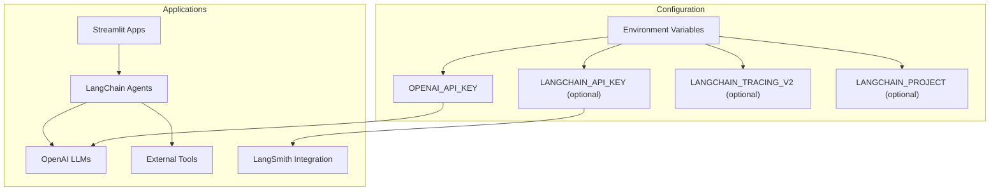

Sources: [README.md:10-16]()

## Running Applications

The repository contains several example applications demonstrating different capabilities. Run any application using Streamlit:

```
streamlit run streamlit_agent/[application_name].py
```

### Available Applications

| Application | Description | Command |
|-------------|-------------|---------|
| basic_streaming.py | Simple streaming example | `streamlit run streamlit_agent/basic_streaming.py` |
| basic_memory.py | Demonstrates conversation memory | `streamlit run streamlit_agent/basic_memory.py` |
| mrkl_demo.py | MRKL agent implementation | `streamlit run streamlit_agent/mrkl_demo.py` |
| minimal_agent.py | Minimal agent with search | `streamlit run streamlit_agent/minimal_agent.py` |
| search_and_chat.py | Search-enabled chatbot with history | `streamlit run streamlit_agent/search_and_chat.py` |
| simple_feedback.py | Demonstrates user feedback collection | `streamlit run streamlit_agent/simple_feedback.py` |
| chat_with_documents.py | Document Q&A capabilities | `streamlit run streamlit_agent/chat_with_documents.py` |
| chat_with_sql_db.py | SQL database interaction | `streamlit run streamlit_agent/chat_with_sql_db.py` |
| chat_pandas_df.py | DataFrame interaction (note: uses potentially unsafe PythonAstREPLTool) | `streamlit run streamlit_agent/chat_pandas_df.py` |

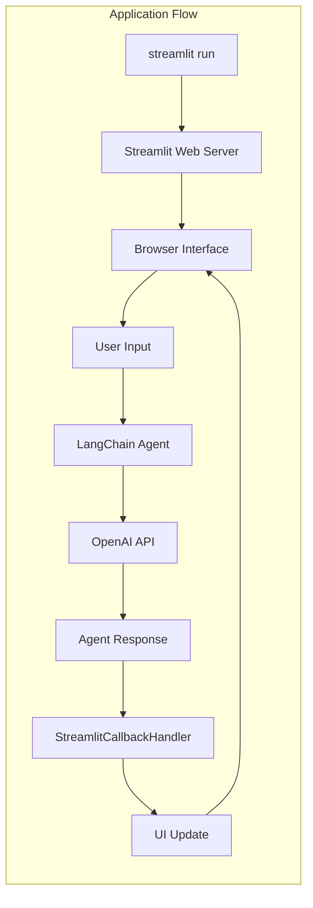

Sources: [README.md:5-20](), [README.md:45-50]()

## Docker Deployment

The repository includes Docker configurations for containerized deployment, which can be helpful for consistent environments or deployment to servers.

### Build the Docker Image

To build the Docker image with DOCKER_BUILDKIT for optimization:

```
DOCKER_BUILDKIT=1 docker build --target=runtime . -t langchain-streamlit-agent:latest
```

### Run with Docker

You can run the container directly:

```
docker run -d --name langchain-streamlit-agent -p 8051:8051 langchain-streamlit-agent:latest
```

### Run with Docker Compose (Recommended)

For easier management, you can use Docker Compose:

1. Edit the command in `docker-compose.yml` to specify which Streamlit app to run
2. Run with:
   ```
   docker-compose up
   ```

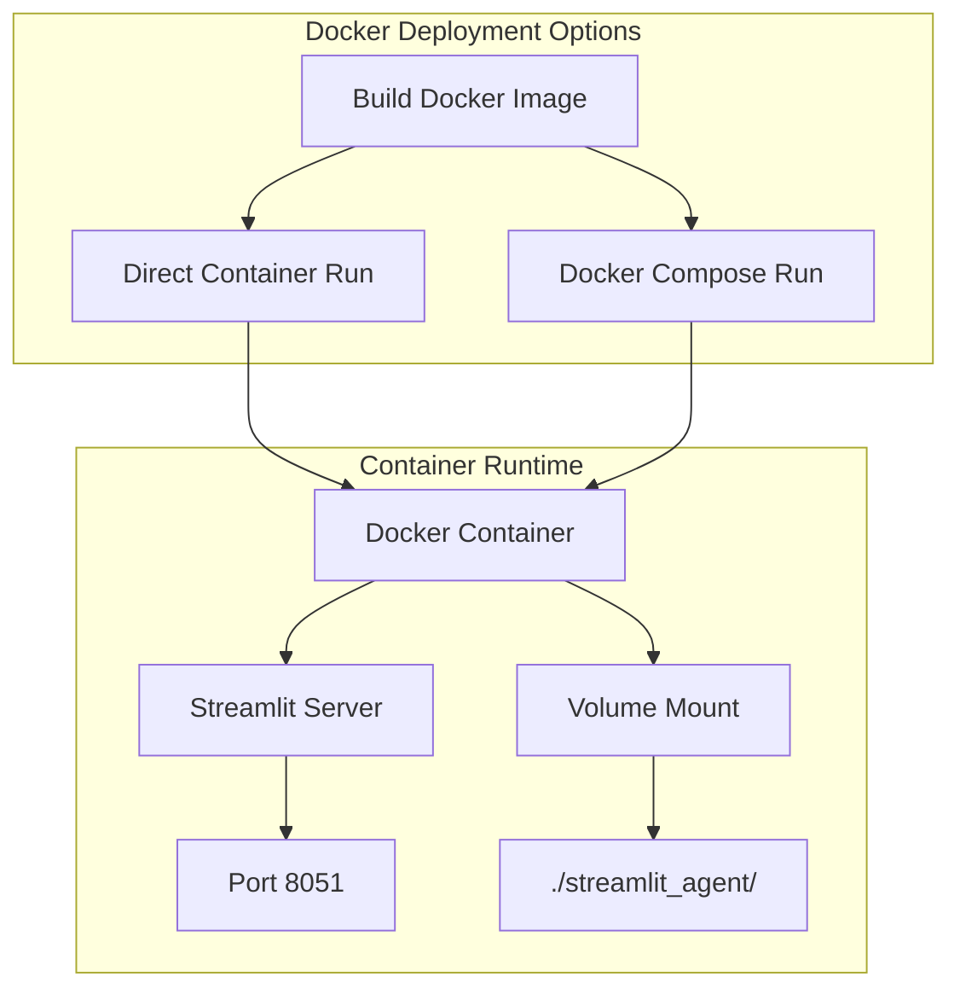

Sources: [README.md:52-68]()

## Code Architecture Overview

When working with the streamlit-agent applications, it's helpful to understand the basic architecture pattern used throughout the codebase:

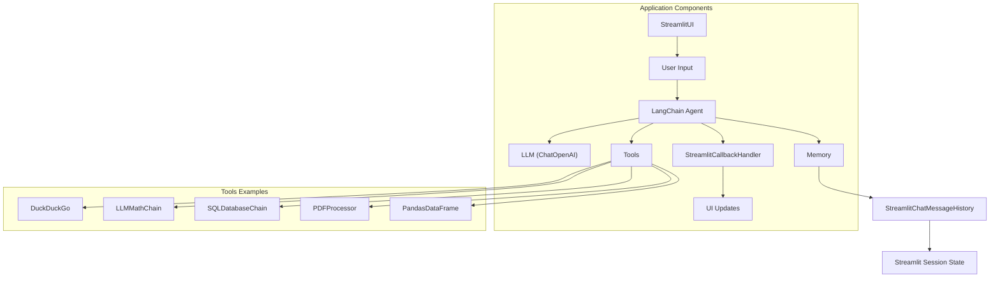

This diagram shows how each application connects Streamlit's UI components with LangChain's agent framework. The `StreamlitCallbackHandler` enables streaming responses from the LLM to the Streamlit UI, while `StreamlitChatMessageHistory` manages conversation history using Streamlit's session state.

Sources: [README.md:5-20](), [README.md:18-20]()

## Next Steps

After getting your environment set up and running the example applications, you may want to:

1. Explore the [System Architecture](#2) to understand how the components work together
2. Learn about specific [Example Applications](#3) in more detail
3. Study the [Streamlit Integration with LangChain](#2.1) to understand the integration patterns

By following this guide, you should have a functional development environment for working with the streamlit-agent examples and be able to run any of the included applications.

---

# Page: System Architecture

# System Architecture

<details>
<summary>Relevant source files</summary>

The following files were used as context for generating this wiki page:

- [README.md](README.md)
- [streamlit_agent/mrkl_demo.py](streamlit_agent/mrkl_demo.py)
- [streamlit_agent/search_and_chat.py](streamlit_agent/search_and_chat.py)

</details>


This page describes the high-level architecture shared across all applications in the streamlit-agent repository. It outlines the core components, their relationships, and implementation patterns that enable LLM-powered applications through Streamlit and LangChain integration. For specific details about the integration patterns between these technologies, see [Streamlit Integration with LangChain](#2.1). For information about how conversation history is managed, see [Memory and State Management](#2.2).

## Core Architecture Overview

The repository demonstrates a modular architecture that connects user interfaces with LLM capabilities and external tools.

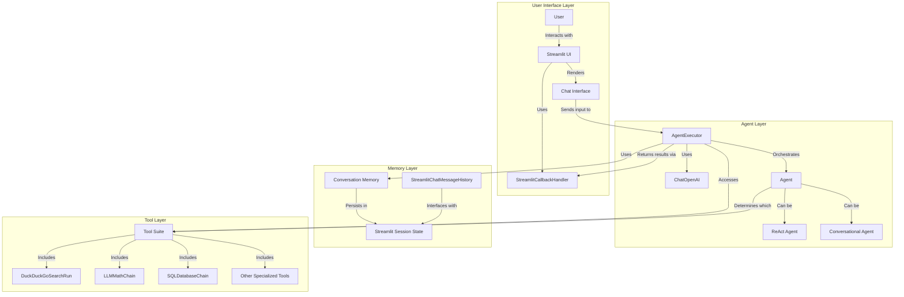

Sources: [README.md:5-20](), [streamlit_agent/mrkl_demo.py:46-77](), [streamlit_agent/search_and_chat.py:43-53]()

## Key Components

### Streamlit UI Components

The user interface layer handles all user interactions and is implemented using Streamlit's components:

1. **Page Configuration** - Sets up the overall page layout and styling
2. **Chat Interface** - Displays conversation history and provides input mechanisms
3. **Callback Handler** - Enables streaming responses from LLMs to the UI in real-time
4. **Session State** - Persists application state across reruns

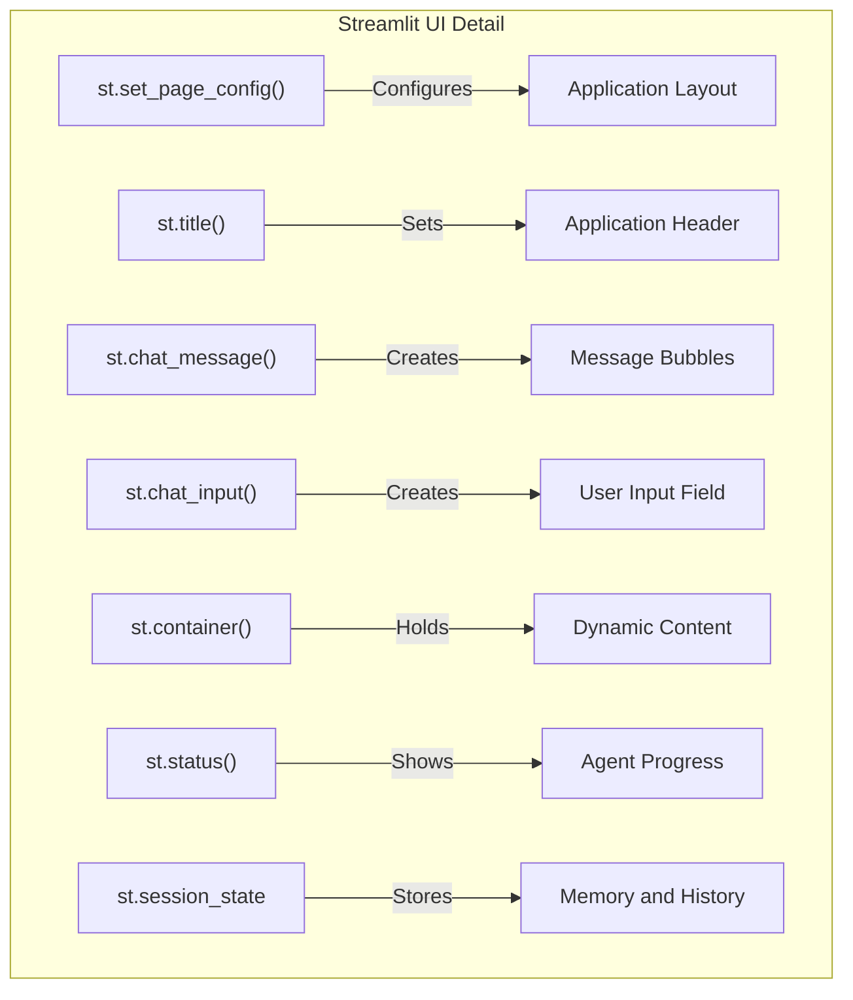

Sources: [streamlit_agent/mrkl_demo.py:28-30](), [streamlit_agent/search_and_chat.py:11-35]()

### LangChain Agent Components

The agent layer orchestrates the LLM's interaction with tools and memory:

1. **ChatOpenAI** - Provides the language model capabilities
2. **Agent Types** - Different agent implementations for different reasoning patterns
3. **AgentExecutor** - Manages the execution flow of the agent
4. **Tools** - External capabilities that the agent can leverage

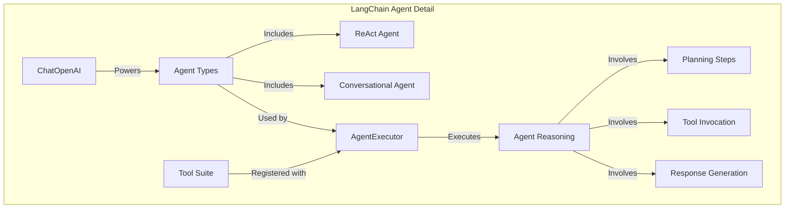

Sources: [streamlit_agent/mrkl_demo.py:46-77](), [streamlit_agent/search_and_chat.py:44-53]()

### Tool Integration

The tool layer provides specialized capabilities that agents can use to solve tasks:

1. **Search** - Web search via DuckDuckGo
2. **Math** - Mathematical operations via LLMMathChain
3. **SQL** - Database queries via SQLDatabaseChain
4. **Document Processing** - PDF and document analysis capabilities
5. **Data Analysis** - DataFrame manipulation via Pandas

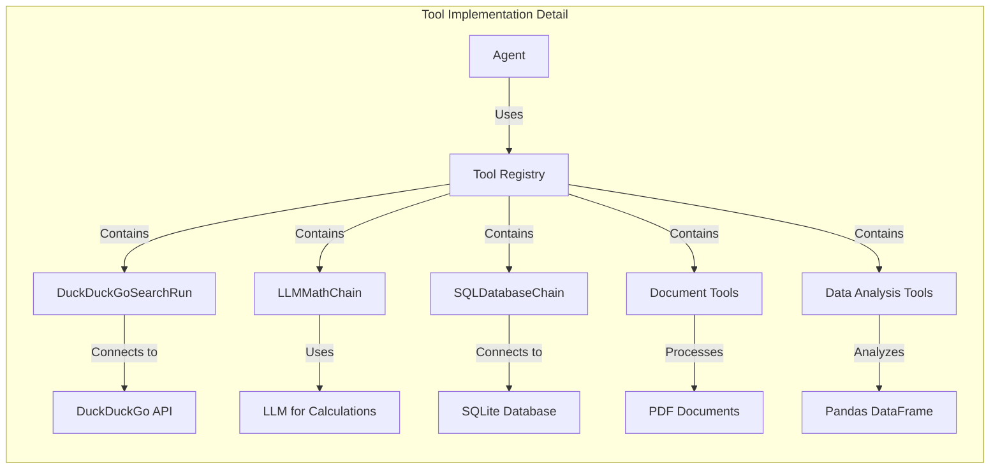

Sources: [streamlit_agent/mrkl_demo.py:46-73](), [streamlit_agent/search_and_chat.py:45]()

## Communication Flow

The architecture implements a specific flow of information between components:

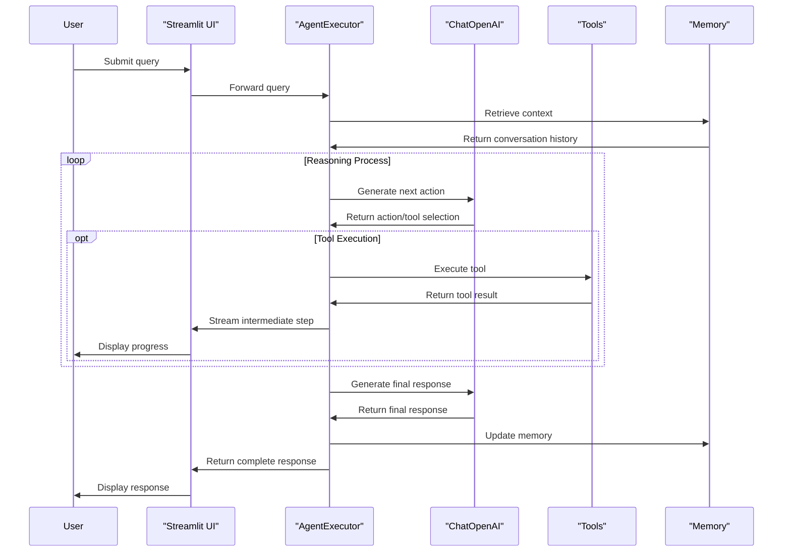

Sources: [streamlit_agent/mrkl_demo.py:94-111](), [streamlit_agent/search_and_chat.py:54-60]()

## Implementation Pattern

The repository follows a consistent implementation pattern across examples:

```mermaid
graph TD
    subgraph "Standard Implementation Pattern"
        Step1["1. UI Setup"]
        Step2["2. LLM Configuration"]
        Step3["3. Tool Definition"]
        Step4["4. Agent Creation"]
        Step5["5. Memory Setup"]
        Step6["6. Callback Configuration"]
        Step7["7. Input Handling"]
        Step8["8. Agent Execution"]
        Step9["9. Response Display"]
        
        Step1 -->|"Followed by"| Step2
        Step2 -->|"Followed by"| Step3
        Step3 -->|"Followed by"| Step4
        Step4 -->|"Followed by"| Step5
        Step5 -->|"Followed by"| Step6
        Step6 -->|"Followed by"| Step7
        Step7 -->|"Followed by"| Step8
        Step8 -->|"Followed by"| Step9
    end
```

This pattern is clearly demonstrated in each example application, with specific implementations tailored to showcase different capabilities:

1. **UI Setup**: Configure Streamlit page and create UI components
2. **LLM Configuration**: Initialize the language model with appropriate parameters
3. **Tool Definition**: Define the tools the agent can use
4. **Agent Creation**: Create the appropriate agent type
5. **Memory Setup**: Configure conversation memory (when applicable)
6. **Callback Configuration**: Set up the StreamlitCallbackHandler
7. **Input Handling**: Process user input
8. **Agent Execution**: Execute the agent with the input and display progress
9. **Response Display**: Show the final response to the user

Sources: [streamlit_agent/mrkl_demo.py:28-111](), [streamlit_agent/search_and_chat.py:11-60]()

## Application Variations

While following the same core architecture, each example application in the repository demonstrates different capabilities:

| Application | Key Components | Unique Features |
|-------------|---------------|----------------|
| basic_streaming.py | ChatOpenAI, StreamlitCallbackHandler | Simple streaming of LLM responses |
| basic_memory.py | StreamlitChatMessageHistory | Chat memory persistence |
| mrkl_demo.py | ReAct Agent, Multiple Tools | Multi-tool reasoning |
| search_and_chat.py | ConversationalChatAgent, DuckDuckGoSearchRun | Conversational search with memory |
| chat_with_documents.py | Document processing tools, Vector store | Document Q&A capabilities |
| chat_with_sql_db.py | SQLDatabaseChain | Natural language database queries |
| chat_pandas_df.py | PandasDataFrameTool | DataFrame analysis via natural language |
| simple_feedback.py | Feedback collection, LangSmith | User feedback integration |

Each variation maintains the core architecture while adapting specific components to showcase different LangChain capabilities within the Streamlit environment.

Sources: [README.md:5-16](), [streamlit_agent/mrkl_demo.py](), [streamlit_agent/search_and_chat.py]()

## Integration Points

The architecture features two critical integration points between Streamlit and LangChain:

1. **StreamlitCallbackHandler**: Enables real-time display of streaming responses and intermediate steps from LangChain agents directly in the Streamlit UI.

2. **StreamlitChatMessageHistory**: Provides persistent conversation memory using Streamlit's session state, allowing the agent to maintain context across interactions.

These integration points allow the seamless combination of Streamlit's interactive UI capabilities with LangChain's advanced LLM orchestration features.

Sources: [README.md:18-20](), [streamlit_agent/search_and_chat.py:16-19](), [streamlit_agent/search_and_chat.py:55]()

---

# Page: Streamlit Integration with LangChain

# Streamlit Integration with LangChain

<details>
<summary>Relevant source files</summary>

The following files were used as context for generating this wiki page:

- [streamlit_agent/basic_memory.py](streamlit_agent/basic_memory.py)
- [streamlit_agent/mrkl_demo.py](streamlit_agent/mrkl_demo.py)

</details>


This document explains the core integration patterns between Streamlit and LangChain in the streamlit-agent repository, focusing on the technical components that enable these frameworks to function together effectively.

For information about memory management specifics, see [Memory and State Management](#2.2). For detailed information about the callback system implementation, see [Callback System](#2.3).

## Overview

The Streamlit-LangChain integration creates interactive, conversational AI applications by combining Streamlit's UI capabilities with LangChain's agent framework. This integration is built around two primary components:

1. **StreamlitChatMessageHistory**: Persists conversation history in Streamlit's session state
2. **StreamlitCallbackHandler**: Streams LangChain execution results to Streamlit UI components

## Integration Architecture

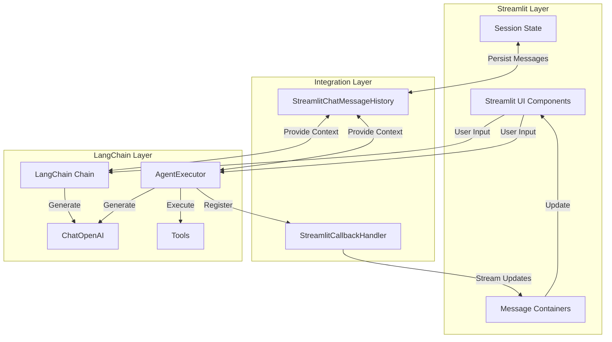

Sources: [streamlit_agent/basic_memory.py:1-74](), [streamlit_agent/mrkl_demo.py:1-111]()

## StreamlitChatMessageHistory

The `StreamlitChatMessageHistory` class serves as the bridge between LangChain's memory system and Streamlit's session state, enabling conversation persistence across app reruns.

### Implementation Pattern

```mermaid
sequenceDiagram
    participant App as "Streamlit App"
    participant History as "StreamlitChatMessageHistory"
    participant State as "st.session_state"
    participant Chain as "LangChain Chain"
    
    App->>History: "Initialize with key"
    Note right of History: msgs = StreamlitChatMessageHistory(key="langchain_messages")
    History->>State: "Access or create state entry"
    App->>Chain: "Configure with history"
    Note right of Chain: RunnableWithMessageHistory with history_messages_key
    
    loop For each user interaction
        App->>Chain: "Invoke with input"
        Chain->>History: "Get existing messages"
        History->>State: "Read from session state"
        Chain->>History: "Add new messages"
        History->>State: "Update session state"
        Chain->>App: "Return response"
        App->>App: "Render messages from history"
    end
```

Key implementation steps:
1. Initialize `StreamlitChatMessageHistory` with a session state key
2. Configure LangChain component with the history object
3. Use `RunnableWithMessageHistory` to automatically manage message history
4. Render messages from history in the UI

**Example Code References:**
- Initialize history: [streamlit_agent/basic_memory.py:19-21]()
- Configure chain with history: [streamlit_agent/basic_memory.py:44-50]()
- Render messages from history: [streamlit_agent/basic_memory.py:53-54]()

Sources: [streamlit_agent/basic_memory.py:1-74]()

## StreamlitCallbackHandler

The `StreamlitCallbackHandler` enables real-time streaming of LangChain execution results to Streamlit UI components, providing interactive feedback during agent processing.

### Implementation Pattern

```mermaid
sequenceDiagram
    participant App as "Streamlit App"
    participant Container as "Streamlit Container"
    participant Callback as "StreamlitCallbackHandler"
    participant Agent as "AgentExecutor"
    
    App->>Container: "Create container"
    Note right of Container: answer_container = output_container.chat_message("assistant")
    App->>Callback: "Initialize with container"
    Note right of Callback: st_callback = StreamlitCallbackHandler(answer_container)
    App->>Agent: "Register callback"
    Note right of Agent: cfg["callbacks"] = [st_callback]
    App->>Agent: "Invoke with input and config"
    Note right of Agent: answer = mrkl.invoke({"input": user_input}, cfg)
    
    loop During execution
        Agent->>Callback: "Call on_llm_* methods"
        Callback->>Container: "Update UI with tokens"
        Agent->>Callback: "Call on_tool_* methods"
        Callback->>Container: "Update UI with tool usage"
        Agent->>Callback: "Call on_agent_* methods"
        Callback->>Container: "Update UI with agent actions"
    end
    
    Agent->>App: "Return final result"
    App->>Container: "Display final answer"
```

Key implementation steps:
1. Create a Streamlit container for displaying the agent's output
2. Initialize `StreamlitCallbackHandler` with this container
3. Configure the agent with the callback
4. Invoke the agent with user input and callback config
5. Display the final result in the UI

**Example Code References:**
- Create container and callback: [streamlit_agent/mrkl_demo.py:96-97]()
- Configure with callback: [streamlit_agent/mrkl_demo.py:98-99]()
- Invoke agent with configuration: [streamlit_agent/mrkl_demo.py:109]()

Sources: [streamlit_agent/mrkl_demo.py:91-111]()

## Common Integration Patterns

### Basic Memory-Enabled Chat

This pattern implements a simple conversational interface with memory persistence:

```mermaid
graph TD
    subgraph "Streamlit Components"
        ChatInput["st.chat_input()"]
        ChatMessage["st.chat_message()"]
        SessionState["st.session_state"]
    end
    
    subgraph "LangChain Components"
        History["StreamlitChatMessageHistory"]
        Prompt["ChatPromptTemplate"]
        Placeholder["MessagesPlaceholder"]
        LLM["ChatOpenAI"]
        RunnableWithHistory["RunnableWithMessageHistory"]
    end
    
    SessionState <-->|"store/retrieve"| History
    History -->|"provide messages"| Placeholder
    Placeholder -->|"include in"| Prompt
    Prompt -->|"format for"| LLM
    ChatInput -->|"user input"| RunnableWithHistory
    RunnableWithHistory -->|"get history"| History
    RunnableWithHistory -->|"execute"| LLM
    LLM -->|"response"| ChatMessage
    RunnableWithHistory -->|"update"| History
```

**Implementation References:**
- Component setup: [streamlit_agent/basic_memory.py:36-50]()
- Execution flow: [streamlit_agent/basic_memory.py:57-62]()

Sources: [streamlit_agent/basic_memory.py:1-74]()

### Agent with Streaming Responses

This pattern implements a more complex agent interface with multiple tools and streaming feedback:

```mermaid
graph TD
    subgraph "Streamlit Components"
        Form["st.form()"]
        Container["st.container()"]
        ChatMessage["st.chat_message()"]
    end
    
    subgraph "LangChain Components"
        Tools["Tool array"]
        LLM["OpenAI"]
        ReactAgent["create_react_agent"]
        AgentExecutor["AgentExecutor"]
        CallbackHandler["StreamlitCallbackHandler"]
    end
    
    Form -->|"user query"| AgentExecutor
    LLM -->|"powers"| ReactAgent
    Tools -->|"available to"| ReactAgent
    ReactAgent -->|"used by"| AgentExecutor
    AgentExecutor -->|"register"| CallbackHandler
    AgentExecutor -->|"execute tools"| Tools
    CallbackHandler -->|"stream updates"| Container
    AgentExecutor -->|"final answer"| ChatMessage
```

**Implementation References:**
- Tools & agent setup: [streamlit_agent/mrkl_demo.py:46-77]()
- UI & callback handling: [streamlit_agent/mrkl_demo.py:91-111]()

Sources: [streamlit_agent/mrkl_demo.py:1-111]()

## Technical Implementation Details

### Memory Implementation

The `StreamlitChatMessageHistory` class:
1. Initializes with a session state key for storing messages
2. Implements the `ChatMessageHistory` interface from LangChain
3. Automatically reads from and writes to Streamlit's session state
4. Preserves message history across app reruns

```python
# Key operations:
msgs = StreamlitChatMessageHistory(key="langchain_messages")  # Initialize
msgs.add_ai_message("How can I help you?")  # Add message
chain_with_history = RunnableWithMessageHistory(  # Configure chain with history
    chain,
    lambda session_id: msgs,  # History provider function
    input_messages_key="question",
    history_messages_key="history",
)
```

Sources: [streamlit_agent/basic_memory.py:19-50]()

### Callback Implementation

The `StreamlitCallbackHandler` class:
1. Initializes with a Streamlit container
2. Implements the `BaseCallbackHandler` interface from LangChain
3. Overrides callback methods to update the UI
4. Streams tokens, tool usage, and agent actions in real-time

```python
# Key operations:
answer_container = output_container.chat_message("assistant")  # Create container
st_callback = StreamlitCallbackHandler(answer_container)  # Initialize callback
cfg = RunnableConfig()
cfg["callbacks"] = [st_callback]  # Configure with callback
answer = mrkl.invoke({"input": user_input}, cfg)  # Invoke with config
```

Sources: [streamlit_agent/mrkl_demo.py:96-109]()

## Summary

The integration between Streamlit and LangChain revolves around two key components:

1. **StreamlitChatMessageHistory**: Enables persistent conversation history using Streamlit's session state
2. **StreamlitCallbackHandler**: Provides real-time streaming of agent execution to Streamlit UI components

These integration components allow developers to create interactive AI applications with:
- Persistent conversation memory across Streamlit app reruns
- Real-time streaming of agent reasoning, tool usage, and responses
- Structured UI presentation of complex agent workflows

The repository demonstrates these integrations in various contexts, from simple chat interfaces to complex multi-tool agents.

Sources: [streamlit_agent/basic_memory.py:1-74](), [streamlit_agent/mrkl_demo.py:1-111]()

---

# Page: Memory and State Management

# Memory and State Management

<details>
<summary>Relevant source files</summary>

The following files were used as context for generating this wiki page:

- [streamlit_agent/basic_memory.py](streamlit_agent/basic_memory.py)
- [streamlit_agent/clear_results.py](streamlit_agent/clear_results.py)

</details>


This document explains how conversation history and application state are managed in Streamlit LangChain applications. It covers the integration between Streamlit's session state and LangChain's memory components, enabling stateful conversations with LLM agents. For information about the callback system used for streaming responses, see [Callback System](#2.3).

## 1. Overview of Memory in Conversational Applications

Conversational AI applications require memory to maintain context across user interactions. In Streamlit applications using LangChain, this memory is implemented through two key mechanisms:

1. **Streamlit Session State**: The underlying persistence layer that maintains state between reruns
2. **LangChain Memory Components**: Specialized classes that interface with session state to store conversation history

```mermaid
graph TD
    User["User"] -->|"Sends message"| StreamlitUI["Streamlit UI"]
    StreamlitUI -->|"Stores in"| SessionState["Streamlit Session State"]
    SessionState <-->|"Persists between reruns"| StreamlitChatMessageHistory["StreamlitChatMessageHistory"]
    StreamlitChatMessageHistory -->|"Provides context to"| LLMChain["LLM Chain"]
    LLMChain -->|"Generates response using history"| Response["Response"]
    Response -->|"Displayed to"| User
```

**Memory Flow Diagram: Conversation State Management in Streamlit LangChain Applications**

Sources: [streamlit_agent/basic_memory.py:18-21](), [streamlit_agent/basic_memory.py:44-50]()

## 2. Streamlit Session State

Streamlit's session state provides persistent storage that survives across reruns of the application. This is crucial for maintaining conversation history in chatbot applications.

### Key Features

- Persists data between reruns of the Streamlit app
- Accessed through the `st.session_state` dictionary
- Acts as the foundation for LangChain's memory components
- Values can be any Python object, including complex message history structures

In the example applications, conversation history is stored in session state under designated keys, making it accessible across multiple interactions.

Sources: [streamlit_agent/basic_memory.py:19-21](), [streamlit_agent/basic_memory.py:73-74]()

## 3. StreamlitChatMessageHistory Component

The `StreamlitChatMessageHistory` class from LangChain provides a bridge between LangChain's message history system and Streamlit's session state.

### Implementation Details

```mermaid
classDiagram
    class StreamlitChatMessageHistory {
        +String key
        +List messages
        +add_user_message(text)
        +add_ai_message(text)
        +clear()
    }
    
    StreamlitChatMessageHistory --> "st.session_state" : stores messages in
    StreamlitChatMessageHistory --> "BaseChatMessageHistory" : inherits from
```

**StreamlitChatMessageHistory Class Diagram**

### Key Methods and Properties

| Method/Property | Description |
|----------------|-------------|
| `__init__(key)` | Constructor that specifies the session state key for storage |
| `messages` | Property that returns the list of messages |
| `add_user_message()` | Adds a human/user message to history |
| `add_ai_message()` | Adds an AI/assistant message to history |
| `clear()` | Clears all messages from history |

### Usage Example

The `StreamlitChatMessageHistory` is initialized with a key parameter that specifies where in the session state the messages will be stored:

```python
msgs = StreamlitChatMessageHistory(key="langchain_messages")
```

If needed, you can initialize the conversation with a default AI message:

```python
if len(msgs.messages) == 0:
    msgs.add_ai_message("How can I help you?")
```

Sources: [streamlit_agent/basic_memory.py:19-21](), [streamlit_agent/basic_memory.py:53-54](), [streamlit_agent/basic_memory.py:66-74]()

## 4. Integration with LangChain Chains

To make LangChain chains and agents use the message history, the repository employs the `RunnableWithMessageHistory` wrapper, which connects a chain to the message history system.

### RunnableWithMessageHistory Configuration

```mermaid
graph TD
    Chain["Chain/LLM"] -->|"wrapped by"| RunnableWithMessageHistory["RunnableWithMessageHistory"]
    RunnableWithMessageHistory -->|"uses"| HistoryRetriever["History Retriever Function"]
    HistoryRetriever -->|"returns"| StreamlitChatMessageHistory["StreamlitChatMessageHistory"]
    RunnableWithMessageHistory -->|"input_messages_key"| InputKey["Input Key"]
    RunnableWithMessageHistory -->|"history_messages_key"| HistoryKey["History Key"]
    
    InputKey -->|"maps to"| UserPrompt["User Prompt"]
    HistoryKey -->|"maps to"| ConversationHistory["Conversation History"]
```

**RunnableWithMessageHistory Integration Diagram**

The integration requires:

1. A base chain or LLM to wrap
2. A function that returns the message history object
3. Configuration for input and history message keys

### Implementation Example

```python
# Create a chain with a system prompt and history placeholder
prompt = ChatPromptTemplate.from_messages([
    ("system", "You are an AI chatbot having a conversation with a human."),
    MessagesPlaceholder(variable_name="history"),
    ("human", "{question}"),
])

# Combine prompt with LLM
chain = prompt | ChatOpenAI(api_key=openai_api_key)

# Wrap with history management
chain_with_history = RunnableWithMessageHistory(
    chain,
    lambda session_id: msgs,  # Function that returns message history
    input_messages_key="question",  # Key for user input
    history_messages_key="history",  # Key for history in prompt
)
```

During invocation, a session ID is passed to identify which conversation history to use:

```python
config = {"configurable": {"session_id": "any"}}
response = chain_with_history.invoke({"question": prompt}, config)
```

Sources: [streamlit_agent/basic_memory.py:36-50](), [streamlit_agent/basic_memory.py:60-62]()

## 5. State Management Patterns

### 5.1 Rendering Messages from History

Messages from history are typically rendered in the Streamlit UI using the `st.chat_message` component:

```python
for msg in msgs.messages:
    st.chat_message(msg.type).write(msg.content)
```

### 5.2 Handling New Inputs

When users enter new prompts, the application:
1. Captures the input
2. Adds it to the UI
3. Passes it to the chain with history
4. Displays the response

```python
if prompt := st.chat_input():
    st.chat_message("human").write(prompt)
    # Messages saved automatically during chain execution
    response = chain_with_history.invoke({"question": prompt}, config)
    st.chat_message("ai").write(response.content)
```

Sources: [streamlit_agent/basic_memory.py:53-62]()

### 5.3 Clearing Previous Results

The repository includes a custom state management pattern to handle clearing previous results when submitting new prompts, solving a common issue with Streamlit's rerun behavior.

```mermaid
stateDiagram-v2
    [*] --> NOT_DIRTY
    NOT_DIRTY --> DIRTY: Submit clicked
    DIRTY --> UNHANDLED_SUBMIT: Submit while dirty
    UNHANDLED_SUBMIT --> DIRTY: Rerun complete
    DIRTY --> NOT_DIRTY: No submit
```

**DirtyState State Transition Diagram**

The `DirtyState` class defines three states:
- `NOT_DIRTY`: Initial state, no pending submissions
- `DIRTY`: A submission has occurred and results are displayed
- `UNHANDLED_SUBMIT`: A new submission occurred while results were displayed

The `with_clear_container` function manages these state transitions to ensure clean reruns when new user input is provided.

Sources: [streamlit_agent/clear_results.py:4-32]()

## 6. Best Practices for Memory Management

### 6.1 Message History Initialization

Always initialize message history with a key that's descriptive and unique:

```python
msgs = StreamlitChatMessageHistory(key="langchain_messages")
```

### 6.2 Session State Debugging

Use expanders to show session state contents during development:

```python
view_messages = st.expander("View message contents")
with view_messages:
    view_messages.json(st.session_state.langchain_messages)
```

### 6.3 Memory Space Considerations

Be mindful that Streamlit session state has size limitations. For applications requiring extensive history:
- Consider implementing pagination of message history
- Add logic to summarize or truncate older messages
- For production applications, consider external persistence (database)

### 6.4 Message Rendering Order

Place the message rendering code strategically:
- Before user input collection to show existing messages
- After new response generation to immediately show new responses

Sources: [streamlit_agent/basic_memory.py:23](), [streamlit_agent/basic_memory.py:65-74]()

## 7. Advanced Memory Patterns

Beyond basic conversation history, more complex applications might need:

1. **Structured memory**: Storing specific entities or facts mentioned in conversation
2. **Summarization memory**: Condensing long conversations to stay within context limits
3. **Multiple memory streams**: Maintaining separate conversation threads
4. **Persistent storage**: Saving conversations to external databases for long-term storage

These advanced patterns can be implemented by extending the basic memory architecture described in this document, typically by creating custom memory classes that interface with Streamlit's session state.

---

# Page: Callback System

# Callback System

<details>
<summary>Relevant source files</summary>

The following files were used as context for generating this wiki page:

- [streamlit_agent/basic_streaming.py](streamlit_agent/basic_streaming.py)
- [streamlit_agent/callbacks/capturing_callback_handler.py](streamlit_agent/callbacks/capturing_callback_handler.py)

</details>


The Callback System in the streamlit-agent repository provides a crucial integration layer between LangChain components and the Streamlit UI. This system enables real-time streaming of LLM outputs, tool executions, and agent actions directly to the Streamlit interface, creating a responsive user experience. This page documents the callback architecture and implementation patterns used throughout the applications.

For information about how conversation history is maintained across interactions, see [Memory and State Management](#2.2).

## Callback Architecture Overview

The callback system leverages LangChain's `BaseCallbackHandler` interface to capture events during chain, LLM, tool, and agent execution. These events are then processed to update the Streamlit UI in real-time.

```mermaid
graph TD
    subgraph "Callback System Architecture"
        User["User Input"] -->|"Submit Query"| StreamlitUI["Streamlit UI"]
        StreamlitUI -->|"Process Query"| AgentExecutor["AgentExecutor"]
        
        subgraph "LangChain Components"
            AgentExecutor -->|"Execute"| LLM["LLM"]
            AgentExecutor -->|"Use"| Tools["Tools"]
        end

        subgraph "Callback Handlers"
            StreamHandler["StreamHandler"]
            CapturingHandler["CapturingCallbackHandler"]
        end

        LLM -->|"on_llm_new_token"| StreamHandler
        Tools -->|"on_tool_start/end"| StreamHandler
        AgentExecutor -->|"on_agent_action"| StreamHandler
        
        StreamHandler -->|"Update UI"| StreamlitOutput["Streamlit Container"]
        StreamlitOutput -->|"Display"| StreamlitUI
        
        LLM -->|"Record Events"| CapturingHandler
        Tools -->|"Record Events"| CapturingHandler
        AgentExecutor -->|"Record Events"| CapturingHandler
    end
```

Sources: [streamlit_agent/basic_streaming.py:7-14](), [streamlit_agent/callbacks/capturing_callback_handler.py:100-155]()

## Callback Types and Events

The callback system captures various types of events during execution, allowing applications to respond to specific stages in the processing pipeline.

```mermaid
graph LR
    subgraph "Callback Events"
        LLMEvents["LLM Events"]
        ToolEvents["Tool Events"]
        ChainEvents["Chain Events"]
        AgentEvents["Agent Events"]
    end

    LLMEvents -->|"Types"| LLMTypes["on_llm_start\non_llm_new_token\non_llm_end\non_llm_error"]
    ToolEvents -->|"Types"| ToolTypes["on_tool_start\non_tool_end\non_tool_error"]
    ChainEvents -->|"Types"| ChainTypes["on_chain_start\non_chain_end\non_chain_error"]
    AgentEvents -->|"Types"| AgentTypes["on_agent_action\non_agent_finish"]
```

Sources: [streamlit_agent/callbacks/capturing_callback_handler.py:14-27]()

## StreamHandler for Real-Time UI Updates

The `StreamHandler` is a lightweight callback handler designed specifically for streaming LLM outputs to the Streamlit UI. It's used in the simplest applications to provide a real-time response experience.

```mermaid
sequenceDiagram
    participant User
    participant Streamlit as "Streamlit UI"
    participant LLM as "ChatOpenAI"
    participant Handler as "StreamHandler"
    
    User->>Streamlit: Submit prompt
    Streamlit->>LLM: Invoke with prompt
    LLM->>Handler: on_llm_new_token("Hello")
    Handler->>Streamlit: Update container
    LLM->>Handler: on_llm_new_token(" world")
    Handler->>Streamlit: Update container
    LLM->>Handler: on_llm_new_token("!")
    Handler->>Streamlit: Update container
    LLM->>Streamlit: Return complete response
    Streamlit->>User: Display final message
```

### Implementation Details

The `StreamHandler` class is a minimal implementation that focuses exclusively on handling token streaming:

```python
class StreamHandler(BaseCallbackHandler):
    def __init__(self, container, initial_text=""):
        self.container = container
        self.text = initial_text

    def on_llm_new_token(self, token: str, **kwargs) -> None:
        self.text += token
        self.container.markdown(self.text)
```

Usage pattern:

1. Create a Streamlit container with `st.empty()`
2. Initialize the StreamHandler with this container
3. Pass the handler to the LLM with `streaming=True`
4. The handler will update the container as new tokens arrive

Sources: [streamlit_agent/basic_streaming.py:7-14](), [streamlit_agent/basic_streaming.py:34-38]()

## CapturingCallbackHandler for Advanced Use Cases

The `CapturingCallbackHandler` provides more comprehensive callback capabilities, enabling applications to record and replay interactions. This is particularly useful for:

1. Debugging complex agent behaviors
2. Creating demo recordings
3. Implementing offline playback capabilities

```mermaid
graph TD
    subgraph "CapturingCallbackHandler System"
        Handler["CapturingCallbackHandler"]
        Records["CallbackRecords"]
        Storage["Pickle File"]
        
        Handler -->|"_append_record()"| Records
        Records -->|"dump_records_to_file()"| Storage
        Storage -->|"load_records_from_file()"| Records
        Records -->|"playback_callbacks()"| NewHandlers["Target Handlers"]
    end
```

### Key Components

The `CapturingCallbackHandler` system consists of several interconnected parts:

1. **CallbackType**: Constants defining the types of callbacks that can be captured
2. **CallbackRecord**: TypedDict for storing callback information:
   - `callback_type`: The type of callback event
   - `args` and `kwargs`: The arguments passed to the callback
   - `time_delta`: Time elapsed since the previous event

3. **CapturingCallbackHandler**: The main handler class that implements all callback methods

4. **Utility Functions**:
   - `load_records_from_file`: Loads recorded callbacks from a pickle file
   - `playback_callbacks`: Replays recorded callbacks to a list of handler instances

Sources: [streamlit_agent/callbacks/capturing_callback_handler.py:14-27](), [streamlit_agent/callbacks/capturing_callback_handler.py:32-36](), [streamlit_agent/callbacks/capturing_callback_handler.py:100-155]()

## Callback Integration with Streamlit

The integration between callbacks and Streamlit UI components follows a consistent pattern across applications in the repository:

```mermaid
graph TD
    subgraph "Code Components"
        ChatInput["st.chat_input()"]
        EmptyContainer["st.empty()"]
        ChatMessage["st.chat_message()"]
        
        LLM["ChatOpenAI"]
        Agent["AgentExecutor"]
        
        StreamHandler["StreamHandler"]
        
        ChatInput -->|"User message"| Agent
        Agent -->|"callbacks=[handler]"| LLM
        StreamHandler -->|"Update container"| EmptyContainer
        LLM -->|"on_llm_new_token"| StreamHandler
    end
```

### Integration Pattern

The standard pattern for integrating callbacks with Streamlit UI involves:

1. Creating placeholder containers with `st.empty()` for dynamic content
2. Initializing callback handlers with these containers
3. Passing the handlers to LangChain components during execution
4. The callback handlers update the UI in response to events

This pattern is exemplified in the `basic_streaming.py` example:

```python
with st.chat_message("assistant"):
    stream_handler = StreamHandler(st.empty())
    llm = ChatOpenAI(
        openai_api_key=openai_api_key, 
        streaming=True, 
        callbacks=[stream_handler]
    )
    response = llm.invoke(st.session_state.messages)
```

Sources: [streamlit_agent/basic_streaming.py:34-38]()

## Best Practices for Using Callbacks

When implementing callbacks in Streamlit-LangChain applications, consider these best practices:

1. **Separate UI Updates from Business Logic**: Use callbacks to handle UI updates while keeping the core application logic clean
2. **Handle Multiple Callback Types**: For complex applications, implement handlers for various callback types (not just token streaming)
3. **Manage Container State**: Be mindful of Streamlit's container lifecycle when updating UI elements
4. **Error Handling**: Implement error callback methods to gracefully handle failures

### Common Callback Use Cases

| Use Case | Callback Methods | UI Implementation |
|----------|------------------|-------------------|
| Token Streaming | `on_llm_new_token` | Update markdown container |
| Tool Execution Progress | `on_tool_start`, `on_tool_end` | Show spinner or progress bar |
| Agent Reasoning | `on_agent_action` | Display thought process |
| Error Handling | `on_llm_error`, `on_tool_error` | Show error messages |

Sources: [streamlit_agent/basic_streaming.py:7-14](), [streamlit_agent/callbacks/capturing_callback_handler.py:118-155]()

## Summary

The Callback System serves as a vital bridge between LangChain's execution model and Streamlit's reactive UI framework. By leveraging callbacks, applications can provide real-time feedback to users as complex operations like LLM generation, tool execution, and agent reasoning occur behind the scenes.

The repository implements two primary callback handlers:
1. `StreamHandler`: A lightweight implementation focused on token streaming
2. `CapturingCallbackHandler`: A comprehensive implementation that captures all events for recording and playback

These callback handlers enable the responsive, interactive experiences that make the Streamlit-LangChain integration powerful and user-friendly.

---

# Page: Example Applications

# Example Applications

<details>
<summary>Relevant source files</summary>

The following files were used as context for generating this wiki page:

- [README.md](README.md)

</details>


This page provides an overview of the example applications included in the streamlit-agent repository. These applications demonstrate various integration patterns between Streamlit and LangChain, showcasing different agent types and use cases. For detailed information on system architecture and integration patterns, see [System Architecture](#2).

## Application Categories

The repository contains several example applications organized into the following categories:

1. **Basic Concept Demonstrations**: Fundamental examples that showcase core functionality
2. **Agent-based Applications**: Applications implementing different LangChain agent patterns
3. **Domain-Specific Applications**: Applications tailored for specific data sources or domains
4. **Advanced Features**: Examples demonstrating additional capabilities like feedback collection

### Application Organization

```mermaid
flowchart TD
    subgraph "Basic Concept Demonstrations"
        basic_streaming["basic_streaming.py\nSimple LLM Streaming"]
        basic_memory["basic_memory.py\nConversation Memory"]
    end
    
    subgraph "Agent-based Applications"
        mrkl_demo["mrkl_demo.py\nMRKL Agent Pattern"]
        minimal_agent["minimal_agent.py\nMinimal Search Agent"]
        search_chat["search_and_chat.py\nSearch-enabled Chatbot"]
    end
    
    subgraph "Domain-Specific Applications"
        doc_chat["chat_with_documents.py\nDocument Q&A"]
        sql_chat["chat_with_sql_db.py\nSQL Database Chat"]
        pandas_chat["chat_pandas_df.py\nDataFrame Analysis"]
    end
    
    subgraph "Advanced Features"
        feedback["simple_feedback.py\nUser Feedback Collection"]
    end
    
    basic_streaming --> basic_memory
    basic_memory --> search_chat
    minimal_agent --> search_chat
    mrkl_demo --> search_chat
    search_chat --> feedback
    search_chat -.-> doc_chat
    search_chat -.-> sql_chat
    search_chat -.-> pandas_chat
```

Sources: [README.md:5-16]()

## Application Descriptions

### Basic Concept Demonstrations

These applications provide the foundation for understanding the integration between Streamlit and LangChain:

1. **Basic Streaming** (`basic_streaming.py`): Demonstrates how to implement streaming responses from LLMs in a Streamlit interface using the `StreamlitCallbackHandler`.

2. **Basic Memory** (`basic_memory.py`): Shows how to use `StreamlitChatMessageHistory` to maintain conversation history between the user and the LLM.

### Agent-based Applications

These applications showcase different patterns for implementing LangChain agents:

3. **MRKL Demo** (`mrkl_demo.py`): Replicates the Multi-Repository Knowledge Lookup (MRKL) pattern, allowing the agent to use tools like web search and a calculator.

4. **Minimal Agent** (`minimal_agent.py`): A simplified implementation of a search-enabled agent, showing the essential components needed.

5. **Search and Chat** (`search_and_chat.py`): Combines search capabilities with conversational memory to create a more powerful chatbot that can look up information online.

### Domain-Specific Applications

These applications focus on specific data types or domains:

6. **Chat with Documents** (`chat_with_documents.py`): Enables conversational interaction with PDF documents using vector storage and retrieval.

7. **Chat with SQL Database** (`chat_with_sql_db.py`): Allows natural language interaction with SQL databases, translating questions into SQL queries.

8. **Chat with Pandas DataFrame** (`chat_pandas_df.py`): Implements a natural language interface for analyzing pandas DataFrames using the `PythonAstREPLTool`.

### Advanced Features

9. **Simple Feedback** (`simple_feedback.py`): Extends the chat interface with user feedback collection using streamlit-feedback and integration with LangSmith for evaluation.

Sources: [README.md:5-16](), [README.md:18-20]()

## Application Components and Flow

The example applications follow a common pattern of components and data flow, though each implements different variations:

```mermaid
flowchart TD
    subgraph "User Interface Layer"
        user["User Input"] --> chat_input["st.chat_input()"]
        messages["st.chat_message()"] --> user_display["Display to User"]
    end
    
    subgraph "Integration Layer"
        callback["StreamlitCallbackHandler"] 
        message_history["StreamlitChatMessageHistory"]
        session_state["st.session_state"]
    end
    
    subgraph "LangChain Layer" 
        agent["AgentExecutor/Chain"]
        llm["ChatOpenAI"]
        tools["Tools Array"]
        memory["ConversationBufferMemory"]
    end
    
    chat_input --> agent
    agent --> llm
    agent --> tools
    agent --> memory
    memory <--> message_history
    message_history <--> session_state
    agent --> callback
    callback --> messages
```

Sources: [README.md:18-20]()

## Tool Integration by Application Type

Different applications integrate various LangChain tools to expand agent capabilities:

```mermaid
flowchart TD
    subgraph "Example Applications"
        mrkl["mrkl_demo.py"]
        search["search_and_chat.py"]
        doc["chat_with_documents.py"]
        sql["chat_with_sql_db.py"]
        pandas["chat_pandas_df.py"]
    end
    
    subgraph "LangChain Tools"
        search_tool["DuckDuckGoSearchRun"]
        llm_math["LLMMathChain"]
        vectorstore["VectorStoreRetriever"]
        sql_db["SQLDatabaseChain"]
        python_repl["PythonAstREPLTool"]
    end
    
    mrkl --> search_tool
    mrkl --> llm_math
    
    search --> search_tool
    
    doc --> vectorstore
    
    sql --> sql_db
    
    pandas --> python_repl
```

Sources: [README.md:5-16]()

## Feature Comparison

The following table compares key features across the example applications:

| Application | Memory | Streaming | External Tools | Domain-specific | Feedback |
|-------------|--------|-----------|----------------|-----------------|----------|
| basic_streaming.py | ❌ | ✅ | ❌ | ❌ | ❌ |
| basic_memory.py | ✅ | ✅ | ❌ | ❌ | ❌ |
| mrkl_demo.py | ✅ | ✅ | ✅ | ❌ | ❌ |
| minimal_agent.py | ❌ | ✅ | ✅ | ❌ | ❌ |
| search_and_chat.py | ✅ | ✅ | ✅ | ❌ | ❌ |
| simple_feedback.py | ✅ | ✅ | ✅ | ❌ | ✅ |
| chat_with_documents.py | ✅ | ✅ | ✅ | Documents | ❌ |
| chat_with_sql_db.py | ✅ | ✅ | ✅ | SQL Database | ❌ |
| chat_pandas_df.py | ✅ | ✅ | ✅ | DataFrame | ❌ |

Sources: [README.md:5-16]()

## Application Complexity Progression

The examples in the repository follow a progression of increasing complexity, each building upon concepts demonstrated in previous examples:

1. **Basic Streaming**: Introduces streaming responses
2. **Basic Memory**: Adds conversation memory
3. **Agent Applications**: Incorporate external tools
4. **Domain-Specific Applications**: Apply agent patterns to specific data types
5. **Advanced Features**: Add evaluation and feedback mechanisms

For detailed information about each category of applications, refer to:
- [Basic Applications](#3.1)
- [Agent Applications](#3.2)
- [Document Interaction](#3.3)
- [Database Interaction](#3.4)
- [DataFrame Interaction](#3.5)
- [User Feedback Collection](#3.6)

Sources: [README.md:5-16]()

---

# Page: Basic Applications

# Basic Applications

<details>
<summary>Relevant source files</summary>

The following files were used as context for generating this wiki page:

- [streamlit_agent/basic_memory.py](streamlit_agent/basic_memory.py)
- [streamlit_agent/basic_streaming.py](streamlit_agent/basic_streaming.py)

</details>


This document covers the foundational Streamlit-LangChain applications that demonstrate core concepts for building LLM-powered chat interfaces. These basic applications serve as building blocks for more complex agent implementations covered in [Agent Applications](#3.2).

The examples focus on two fundamental concepts:
1. Streaming LLM responses in real-time
2. Maintaining conversation memory across interactions

## Overview of Basic Applications

The repository provides two entry-level applications that demonstrate essential concepts in building LLM applications with Streamlit:

| Application | File | Key Concept | Description |
|-------------|------|-------------|-------------|
| Basic Streaming | `basic_streaming.py` | Real-time token streaming | Demonstrates how to stream LLM responses token-by-token in a Streamlit interface |
| Basic Memory | `basic_memory.py` | Conversation history | Shows how to maintain persistent chat history across interactions |

```mermaid
graph TD
    subgraph "Basic Applications"
        BS["basic_streaming.py"]
        BM["basic_memory.py"]
    end

    subgraph "Core Concepts"
        TS["Token Streaming"]
        CH["Conversation History"]
    end

    BS -->|"demonstrates"| TS
    BM -->|"demonstrates"| CH

    subgraph "Advanced Applications"
        AA["Agent Applications"]
    end

    TS -->|"enables"| AA
    CH -->|"enables"| AA
```

Sources: [streamlit_agent/basic_streaming.py:1-39](), [streamlit_agent/basic_memory.py:1-75]()

## Basic Streaming Application

The Basic Streaming application demonstrates how to stream tokens from an LLM in real-time, providing a more responsive user experience compared to waiting for the complete response.

### Architecture

```mermaid
graph TD
    subgraph "Streamlit UI"
        UI["Streamlit Interface"]
        Input["st.chat_input()"]
        Output["st.chat_message()"]
        SessionState["st.session_state.messages"]
    end

    subgraph "LangChain Components"
        StreamHandler["StreamHandler Class"]
        LLM["ChatOpenAI"]
    end

    User["User"] -->|"enters prompt"| Input
    Input -->|"append to"| SessionState
    Input -->|"triggers"| LLM
    LLM -->|"callbacks"| StreamHandler
    StreamHandler -->|"on_llm_new_token()"| Output
    Output -->|"displays to"| User
    LLM -->|"final response"| SessionState
    SessionState -->|"render history"| Output
```

### Key Components

1. **StreamHandler Class**: Custom callback handler that processes tokens as they're generated
   ```python
   class StreamHandler(BaseCallbackHandler):
       def __init__(self, container, initial_text=""):
           self.container = container
           self.text = initial_text

       def on_llm_new_token(self, token: str, **kwargs) -> None:
           self.text += token
           self.container.markdown(self.text)
   ```

2. **Session State Management**: Stores conversation history across reruns
   ```python
   if "messages" not in st.session_state:
       st.session_state["messages"] = [ChatMessage(role="assistant", content="How can I help you?")]
   ```

3. **ChatOpenAI with Streaming**: Configured to stream responses through the callback handler
   ```python
   llm = ChatOpenAI(
       openai_api_key=openai_api_key, 
       streaming=True, 
       callbacks=[stream_handler]
   )
   ```

### Implementation Flow

1. The application initializes session state to store messages if it doesn't exist already
2. It renders existing messages from the session state
3. When a user submits a message via the chat input:
   - The message is added to session state
   - A `StreamHandler` is created with an empty Streamlit container
   - The `ChatOpenAI` instance is created with streaming enabled and the handler
   - The LLM processes the input and streams tokens to the UI
   - The final response is added to session state for persistence

Sources: [streamlit_agent/basic_streaming.py:1-39]()

## Basic Memory Application

The Basic Memory application demonstrates how to maintain conversation history using `StreamlitChatMessageHistory`, enabling the LLM to reference previous interactions.

### Architecture

```mermaid
graph TD
    subgraph "Streamlit Components"
        Input["st.chat_input()"]
        Output["st.chat_message()"]
        Expander["st.expander()"]
    end

    subgraph "LangChain Components"
        SCMH["StreamlitChatMessageHistory"]
        Prompt["ChatPromptTemplate"]
        Chain["chain | ChatOpenAI"]
        RunnableMH["RunnableWithMessageHistory"]
    end

    subgraph "Session State"
        SS["st.session_state.langchain_messages"]
    end

    User["User"] -->|"enters prompt"| Input
    Input -->|"invokes"| RunnableMH
    SCMH <-->|"read/write"| SS
    RunnableMH -->|"uses"| Chain
    RunnableMH -->|"passes history to"| Chain
    RunnableMH -->|"retrieves history"| SCMH
    Chain -->|"generates response"| Output
    SCMH -->|"display messages"| Output
    SCMH -->|"view state"| Expander
    Output -->|"shows to"| User
```

### Key Components

1. **StreamlitChatMessageHistory**: LangChain utility that stores messages in Streamlit's session state
   ```python
   msgs = StreamlitChatMessageHistory(key="langchain_messages")
   ```

2. **ChatPromptTemplate**: Defines the structure of the conversation including system message and history
   ```python
   prompt = ChatPromptTemplate.from_messages([
       ("system", "You are an AI chatbot having a conversation with a human."),
       MessagesPlaceholder(variable_name="history"),
       ("human", "{question}"),
   ])
   ```

3. **RunnableWithMessageHistory**: Augments a chain with message history capabilities
   ```python
   chain_with_history = RunnableWithMessageHistory(
       chain,
       lambda session_id: msgs,
       input_messages_key="question",
       history_messages_key="history",
   )
   ```

### Implementation Flow

1. The application initializes the `StreamlitChatMessageHistory` with a key for session state storage
2. If there are no messages, it adds an initial AI message
3. The LangChain is set up with a prompt template that includes a placeholder for history
4. `RunnableWithMessageHistory` connects the chain to the message history
5. The UI renders all existing messages
6. When a user inputs a prompt:
   - The application invokes the chain with the prompt
   - The chain automatically retrieves and includes the message history
   - New messages are automatically saved to history during the run
   - The response is displayed to the user

Sources: [streamlit_agent/basic_memory.py:1-75]()

## Comparing Basic Applications

These two applications introduce different fundamental concepts that are combined in more advanced examples:

| Feature | Basic Streaming | Basic Memory |
|---------|----------------|--------------|
| **Core Concept** | Token-by-token response | Conversation persistence |
| **Key Class** | `StreamHandler` | `StreamlitChatMessageHistory` |
| **Message Storage** | Simple list in session state | LangChain message store in session state |
| **LangChain Integration** | Basic LLM invocation | `RunnableWithMessageHistory` |
| **UI Features** | Progressive response rendering | Message history viewing |
| **LLM Context** | Single turn | Multi-turn with history |

```mermaid
graph TD
    subgraph "Basic Building Blocks"
        direction LR
        BS["basic_streaming.py"]
        BM["basic_memory.py"]
    end

    subgraph "Advanced Applications"
        SC["search_and_chat.py"]
        MD["mrkl_demo.py"]
        CD["chat_with_documents.py"] 
        SQ["chat_with_sql_db.py"]
        PD["chat_pandas_df.py"]
    end

    BS -->|"provides streaming"| SC
    BS -->|"provides streaming"| MD
    BS -->|"provides streaming"| CD
    BS -->|"provides streaming"| SQ
    BS -->|"provides streaming"| PD

    BM -->|"provides memory"| SC
    BM -->|"provides memory"| MD
    BM -->|"provides memory"| CD
    BM -->|"provides memory"| SQ
    BM -->|"provides memory"| PD
```

Sources: [streamlit_agent/basic_streaming.py:1-39](), [streamlit_agent/basic_memory.py:1-75]()

## Integration with Streamlit

Both applications leverage Streamlit's unique features to create interactive chat interfaces:

1. **Session State**: Both use Streamlit's session state to maintain data across reruns
   - Basic Streaming: `st.session_state.messages`
   - Basic Memory: `st.session_state.langchain_messages`

2. **UI Components**:
   - Chat Interface: `st.chat_message()` and `st.chat_input()`
   - Dynamic Updates: `st.empty()` for streaming updates
   - Debug Views: `st.expander()` for viewing state

3. **LangChain Integration**:
   - Custom callbacks that work with Streamlit's UI updating system
   - Persistence adapters built specifically for Streamlit's state management

The integration patterns demonstrated in these basic applications form the foundation for all more complex LangChain-Streamlit applications in the repository.

Sources: [streamlit_agent/basic_streaming.py:20-38](), [streamlit_agent/basic_memory.py:19-74]()

---

# Page: Agent Applications

# Agent Applications

<details>
<summary>Relevant source files</summary>

The following files were used as context for generating this wiki page:

- [streamlit_agent/mrkl_demo.py](streamlit_agent/mrkl_demo.py)
- [streamlit_agent/runs/alanis.pickle](streamlit_agent/runs/alanis.pickle)
- [streamlit_agent/runs/leo.pickle](streamlit_agent/runs/leo.pickle)
- [streamlit_agent/search_and_chat.py](streamlit_agent/search_and_chat.py)

</details>


This page describes the agent applications implemented in the streamlit-agent repository. These applications demonstrate how to integrate LangChain agents with Streamlit's interactive UI features to create powerful, reasoning-enabled chatbots and assistants. For information about basic applications without agent capabilities, see [Basic Applications](#3.1).

## 1. Overview of Agent Applications

Agent applications in this repository use LangChain's agent framework, which enables language models to interact with external tools and make decisions about which tools to use based on user queries. The repository contains two main agent application examples:

1. **MRKL Demo**: A multi-tool agent that can search the web, perform calculations, and query a SQL database
2. **Search and Chat**: A conversational agent with web search capabilities and memory

```mermaid
graph TD
    subgraph "Agent Applications"
        MRKL["MRKL Demo<br>(mrkl_demo.py)"]
        SearchChat["Search and Chat<br>(search_and_chat.py)"]
    end
    
    subgraph "Agent Components"
        AgentTypes["Agent Types<br>- ReAct<br>- Conversational"]
        Tools["External Tools<br>- Search<br>- Calculator<br>- SQL Database"]
        Memory["Memory Systems<br>- ConversationBufferMemory<br>- StreamlitChatMessageHistory"]
        Callbacks["Callback Handlers<br>- StreamlitCallbackHandler"]
    end
    
    MRKL --> AgentTypes
    MRKL --> Tools
    MRKL --> Callbacks
    
    SearchChat --> AgentTypes
    SearchChat --> Tools
    SearchChat --> Memory
    SearchChat --> Callbacks
```

Sources: [streamlit_agent/mrkl_demo.py](), [streamlit_agent/search_and_chat.py]()

## 2. Agent Types

The repository demonstrates two main agent types from LangChain:

### 2.1 ReAct Agents

The ReAct (Reasoning + Acting) pattern is implemented in the MRKL demo. These agents:
- Follow a structured reasoning process with explicit thought steps
- Make decisions about which tools to use based on user input
- Show their reasoning process, including tool selection and observation

```mermaid
graph TD
    subgraph "ReAct Agent Implementation"
        ReactAgent["create_react_agent()"]
        HubPrompt["hub.pull('hwchase17/react')"]
        AgentExec["AgentExecutor"]
        Tools["Tool Suite"]
    end
    
    ReactAgent --> HubPrompt
    ReactAgent --> Tools
    ReactAgent --> AgentExec
```

Sources: [streamlit_agent/mrkl_demo.py:76-77]()

### 2.2 Conversational Agents

The Search and Chat demo uses a conversational agent that:
- Maintains conversation history
- Uses a more natural chat-oriented interface
- Can integrate multiple tools while maintaining context

```mermaid
graph TD
    subgraph "Conversational Agent Implementation"
        ConvAgent["ConversationalChatAgent"]
        AgentExec["AgentExecutor"]
        Memory["ConversationBufferMemory"]
        ChatHistory["StreamlitChatMessageHistory"]
    end
    
    ConvAgent --> AgentExec
    Memory --> ChatHistory
    AgentExec --> Memory
```

Sources: [streamlit_agent/search_and_chat.py:46-53]()

## 3. Tool Integration

Both agent applications demonstrate tool integration, showing how to connect LLMs to external systems:

### 3.1 Search Tools

The DuckDuckGo search API is used to provide web search capabilities:

```mermaid
graph LR
    subgraph "Search Integration"
        SearchTool["DuckDuckGoSearchAPIWrapper (MRKL)"]
        SearchRun["DuckDuckGoSearchRun (Search & Chat)"]
        Agent["Agent"]
        Web["Web Results"]
    end
    
    Agent -- "Decides to use search" --> SearchTool
    Agent -- "Decides to use search" --> SearchRun
    SearchTool --> Web
    SearchRun --> Web
```

Sources: [streamlit_agent/mrkl_demo.py:48-61](), [streamlit_agent/search_and_chat.py:45]()

### 3.2 Computational Tools

The MRKL demo includes a calculator tool using `LLMMathChain`:

```python
llm_math_chain = LLMMathChain.from_llm(llm)
```

This allows the agent to solve mathematical problems by generating Python expressions and evaluating them.

Sources: [streamlit_agent/mrkl_demo.py:49-50]()

### 3.3 Database Tools

The MRKL demo includes SQL database access:

```python
db = SQLDatabase(create_engine("sqlite:///", creator=creator))
db_chain = SQLDatabaseChain.from_llm(llm, db)
```

This allows the agent to convert natural language queries into SQL and retrieve database information.

Sources: [streamlit_agent/mrkl_demo.py:52-56]()

## 4. Agent UI Integration

The applications demonstrate several UI integration patterns:

### 4.1 Streaming Responses

Both applications use `StreamlitCallbackHandler` to stream agent responses and thought processes in real-time:

```mermaid
graph TD
    subgraph "Streaming Implementation"
        Agent["Agent"]
        Callback["StreamlitCallbackHandler"]
        Container["Streamlit Container"]
        Config["RunnableConfig"]
    end
    
    Agent -- "Streams output" --> Callback
    Callback -- "Updates UI" --> Container
    Config -- "Includes" --> Callback
    Agent -- "Uses" --> Config
```

Sources: [streamlit_agent/mrkl_demo.py:97-99](), [streamlit_agent/search_and_chat.py:55-58]()

### 4.2 Visualizing Agent Reasoning

The Search and Chat application visualizes intermediate reasoning steps:

```python
for step in st.session_state.steps.get(str(idx), []):
    if step[0].tool == "_Exception":
        continue
    with st.status(f"**{step[0].tool}**: {step[0].tool_input}", state="complete"):
        st.write(step[0].log)
        st.write(step[1])
```

This creates a step-by-step visualization of the agent's reasoning process.

Sources: [streamlit_agent/search_and_chat.py:29-34]()

## 5. Example Application Details

### 5.1 MRKL Demo

The MRKL (Modular Reasoning, Knowledge, and Language) demo showcases an agent that can:
- Search the web using DuckDuckGo
- Perform calculations
- Query a SQL database (Chinook.db)

```mermaid
sequenceDiagram
    participant User
    participant Streamlit
    participant Agent as AgentExecutor
    participant Tools as "Tools (Search, Calculator, DB)"
    
    User->>Streamlit: Submit question
    Streamlit->>Agent: Invoke with question
    loop Agent reasoning
        Agent->>Agent: Determine next tool
        Agent->>Tools: Execute tool
        Tools->>Agent: Return tool output
    end
    Agent->>Streamlit: Stream final answer
    Streamlit->>User: Display answer
```

Key implementation features:
- Uses ReAct agent pattern with multiple tools
- Offers sample questions with prerecorded runs
- Supports both demo mode and live execution

Sources: [streamlit_agent/mrkl_demo.py]()

### 5.2 Search and Chat

The Search and Chat application provides:
- Conversational interface with memory
- Web search capabilities
- Visualization of agent reasoning steps

```mermaid
sequenceDiagram
    participant User
    participant ChatUI as "Chat UI"
    participant Memory as "ConversationBufferMemory"
    participant Agent as "ConversationalChatAgent"
    participant Search as "DuckDuckGoSearchRun"
    
    User->>ChatUI: Enter message
    ChatUI->>Agent: Process with context
    Agent->>Memory: Access history
    Memory->>Agent: Return context
    Agent->>Search: Execute if needed
    Search->>Agent: Return results
    Agent->>ChatUI: Stream response
    ChatUI->>Memory: Update history
    ChatUI->>User: Display response
```

Key implementation features:
- Uses Streamlit chat messaging interface
- Maintains conversation history across interactions
- Visualizes intermediate reasoning steps

Sources: [streamlit_agent/search_and_chat.py]()

## 6. Agent Code Architecture

The agent implementations follow a consistent pattern:

```mermaid
graph TD
    subgraph "Agent Architecture"
        LLM["LLM (OpenAI)"]
        Tools["Tool Definitions"]
        Agent["Agent Creation"]
        Executor["AgentExecutor"]
        Callbacks["StreamlitCallbackHandler"]
        UI["Streamlit UI"]
    end
    
    LLM --> Agent
    Tools --> Agent
    Agent --> Executor
    Executor -- "Invoked with" --> Callbacks
    Callbacks --> UI
```

Key architectural components:
1. **LLM Configuration**: Typically using `OpenAI` or `ChatOpenAI`
2. **Tool Definition**: Creating tools with name, function, and description
3. **Agent Creation**: Using an appropriate agent constructor
4. **Agent Execution**: Using `AgentExecutor` to run the agent
5. **Callback Integration**: Using `StreamlitCallbackHandler` for UI updates

Sources: [streamlit_agent/mrkl_demo.py:47-77](), [streamlit_agent/search_and_chat.py:44-58]()

## 7. Extending Agent Applications

To create your own agent application based on these examples:

1. **Choose an agent type**:
   - ReAct for complex multi-tool reasoning
   - Conversational for chat applications with memory

2. **Define appropriate tools**:
   - Consider what external capabilities your agent needs
   - Implement each as a LangChain Tool

3. **Configure UI streaming**:
   - Use `StreamlitCallbackHandler` for real-time updates
   - Consider how to visualize intermediate steps

4. **Add memory if needed**:
   - Use `StreamlitChatMessageHistory` and appropriate memory class
   - Configure session state persistence

Sources: [streamlit_agent/mrkl_demo.py](), [streamlit_agent/search_and_chat.py]()

---

# Page: Document Interaction

# Document Interaction

<details>
<summary>Relevant source files</summary>

The following files were used as context for generating this wiki page:

- [streamlit_agent/chat_with_documents.py](streamlit_agent/chat_with_documents.py)

</details>


This page explains how the Chat with Documents feature enables conversational interactions with PDF documents in the streamlit-agent repository. Users can upload PDF files, then ask questions and receive responses based on the document content in a natural language conversation flow.

For information on other application types like database interaction, see [Database Interaction](#3.4), or for DataFrame manipulation, see [DataFrame Interaction](#3.5).

## Document Interaction System Architecture

The document interaction system combines document processing, vector storage, and conversational AI to create a seamless chat experience with PDFs.

```mermaid
graph TD
    User["User"] -->|"1. Uploads PDFs"| PDFUploader["PDF Uploader"]
    User -->|"3. Asks Questions"| ChatInterface["Chat Interface"]
    
    PDFUploader -->|"2a. Provides Files"| DocumentProcessor["Document Processor"]
    DocumentProcessor -->|"2b. Creates"| VectorStore["Vector Store"]
    
    ChatInterface -->|"4. Sends Query"| ConvRetrieval["ConversationalRetrievalChain"]
    ConvRetrieval -->|"5a. Retrieves from"| VectorStore
    ConvRetrieval -->|"5b. Queries"| LLM["ChatOpenAI"]
    ConvRetrieval -->|"5c. Accesses"| Memory["ConversationBufferMemory"]
    
    LLM -->|"6a. Generates Response"| StreamHandler["StreamHandler"]
    VectorStore -->|"6b. Returns Context"| RetrievalHandler["PrintRetrievalHandler"]
    
    StreamHandler -->|"7a. Updates UI"| ChatInterface
    RetrievalHandler -->|"7b. Displays Context"| ChatInterface
    
    Memory <-->|"8. Stores/Retrieves"| ChatHistory["StreamlitChatMessageHistory"]
    ChatHistory -->|"9. Displayed in"| ChatInterface
```

Sources: [streamlit_agent/chat_with_documents.py:1-119]()

## Document Processing Pipeline

The document processing pipeline converts PDFs into searchable vector representations:

```mermaid
sequenceDiagram
    participant User
    participant UI as "Streamlit UI"
    participant Processor as "configure_retriever()"
    participant VectorDB as "DocArrayInMemorySearch"
    participant Retriever as "vectordb.as_retriever()"
    participant Chain as "ConversationalRetrievalChain"
    participant LLM as "ChatOpenAI"
    
    User->>UI: Upload PDF documents
    UI->>Processor: Process documents
    Processor->>Processor: Create temp directory
    Processor->>Processor: Load PDFs with PyPDFLoader
    Processor->>Processor: Split with RecursiveCharacterTextSplitter
    Processor->>Processor: Generate embeddings with HuggingFaceEmbeddings
    Processor->>VectorDB: Store document vectors
    Processor->>Retriever: Configure MMR retriever
    Processor->>UI: Return configured retriever
    
    User->>UI: Enter question
    UI->>Chain: Run query
    Chain->>Retriever: Search relevant documents
    Retriever->>VectorDB: Perform MMR search
    VectorDB-->>Retriever: Return relevant chunks
    Retriever-->>Chain: Provide document context
    Chain->>LLM: Generate response with context
    LLM-->>UI: Stream response tokens
    UI-->>User: Display response and context
```

Sources: [streamlit_agent/chat_with_documents.py:18-41]()

## Key Components

### 1. Document Processing with `configure_retriever`

The `configure_retriever` function handles all document processing:

| Component | Configuration | Purpose |
|-----------|---------------|---------|
| PyPDFLoader | - | Extracts text from PDF files |
| RecursiveCharacterTextSplitter | chunk_size=1500, chunk_overlap=200 | Splits documents into manageable chunks |
| HuggingFaceEmbeddings | model_name="all-MiniLM-L6-v2" | Generates embeddings for document chunks |
| DocArrayInMemorySearch | - | Stores document vectors in memory |
| Retriever | search_type="mmr", k=2, fetch_k=4 | Retrieves relevant document chunks using Maximum Marginal Relevance |

Sources: [streamlit_agent/chat_with_documents.py:18-41]()

### 2. Custom Callback Handlers

Two callback handlers manage the streaming UI experience:

```mermaid
graph TD
    subgraph "StreamHandler Class"
        SHInit["__init__(container, initial_text)"]
        SHStart["on_llm_start()"]
        SHToken["on_llm_new_token()"]
    end
    
    subgraph "PrintRetrievalHandler Class"
        PRHInit["__init__(container)"]
        PRHStart["on_retriever_start()"]
        PRHEnd["on_retriever_end()"]
    end
    
    SHInit --> SHStart
    SHStart --> SHToken
    SHToken -->|"Updates UI with tokens"| StreamUI["Streamlit markdown widget"]
    
    PRHInit --> PRHStart
    PRHStart --> PRHEnd
    PRHEnd -->|"Displays document chunks"| ContextUI["Streamlit status widget"]
```

- **StreamHandler**: Handles token-by-token streaming of the LLM response
- **PrintRetrievalHandler**: Displays retrieved document chunks and their sources

Sources: [streamlit_agent/chat_with_documents.py:44-75]()

### 3. Conversation Components

The conversation system integrates:

| Component | Configuration | Purpose |
|-----------|---------------|---------|
| StreamlitChatMessageHistory | - | Stores chat messages in Streamlit session state |
| ConversationBufferMemory | memory_key="chat_history", return_messages=True | Maintains conversation context |
| ChatOpenAI | model_name="gpt-3.5-turbo", temperature=0, streaming=True | Generates responses |
| ConversationalRetrievalChain | - | Orchestrates retrieval-augmented generation |

Sources: [streamlit_agent/chat_with_documents.py:92-102]()

## Implementation Details

### Code Structure Diagram

```mermaid
graph TD
    subgraph "Document Processing Components"
        ConfigureRetriever["configure_retriever()"]
        PyPDFLoader["PyPDFLoader"]
        TextSplitter["RecursiveCharacterTextSplitter"]
        Embeddings["HuggingFaceEmbeddings"]
        VectorDB["DocArrayInMemorySearch"]
    end
    
    subgraph "UI Components"
        FileUploader["st.file_uploader"]
        APIInput["st.sidebar.text_input"]
        ChatMessages["st.chat_message"]
        ChatInput["st.chat_input"]
        Container["st.container"]
        Status["container.status"]
    end
    
    subgraph "Callback Components"
        StreamHandlerClass["StreamHandler"]
        RetrievalHandlerClass["PrintRetrievalHandler"]
    end
    
    subgraph "LangChain Components"
        LLM["ChatOpenAI"]
        Memory["ConversationBufferMemory"]
        ChatHistory["StreamlitChatMessageHistory"]
        QAChain["ConversationalRetrievalChain"]
        Retriever["Retriever"]
    end
    
    FileUploader -->|"Provides PDFs"| ConfigureRetriever
    ConfigureRetriever -->|"Uses"| PyPDFLoader
    PyPDFLoader -->|"Outputs to"| TextSplitter
    TextSplitter -->|"Feeds"| Embeddings
    Embeddings -->|"Creates"| VectorDB
    VectorDB -->|"Configures"| Retriever
    
    ChatHistory -->|"Feeds"| Memory
    Memory -->|"Provides context to"| QAChain
    LLM -->|"Powers"| QAChain
    Retriever -->|"Retrieves documents for"| QAChain
    
    ChatInput -->|"Triggers"| QAChain
    QAChain -->|"Uses"| StreamHandlerClass
    QAChain -->|"Uses"| RetrievalHandlerClass
    
    StreamHandlerClass -->|"Updates"| ChatMessages
    RetrievalHandlerClass -->|"Updates"| Status
    
    APIInput -->|"Configures"| LLM
```

Sources: [streamlit_agent/chat_with_documents.py:1-119]()

### Document Loading and Processing

1. The system uses a temporary directory to save uploaded PDFs
2. `PyPDFLoader` extracts text from each PDF
3. Documents are split into chunks of 1500 characters with 200 character overlap
4. Embeddings are generated using a local HuggingFace model
5. Document vectors are stored in an in-memory vector database
6. The retriever is configured to use Maximum Marginal Relevance (MMR) search

The `configure_retriever` function is cached with `@st.cache_resource(ttl="1h")` to avoid reprocessing documents when the app reruns within an hour.

Sources: [streamlit_agent/chat_with_documents.py:18-41]()

### Conversation Flow

When a user asks a question:

1. The query is passed to the `ConversationalRetrievalChain`
2. The chain uses the retriever to find relevant document chunks
3. `PrintRetrievalHandler` displays these chunks in the UI
4. The context, query, and conversation history are sent to the LLM
5. `StreamHandler` streams the response tokens to the UI
6. The conversation history is updated for future context

Sources: [streamlit_agent/chat_with_documents.py:112-118]()

### UI Implementation

The Streamlit UI features:

1. A sidebar for API key input and PDF file uploads
2. A chat interface with alternating user/assistant messages
3. A status component that displays retrieved document chunks
4. A chat input field for user questions

The UI handles these states:
- Initial loading (requires API key and document uploads)
- Document processing (shows progress)
- Conversation (displays message history and new responses)

Sources: [streamlit_agent/chat_with_documents.py:77-111]()

## Technical Limitations

- **Memory Constraints**: Document processing happens in-memory, so very large documents may cause performance issues
- **Local Embeddings**: Uses HuggingFace embeddings locally, which may be slower than API-based alternatives
- **Document Types**: Currently only supports PDF files
- **Persistence**: Document context is lost when the Streamlit application is restarted

Sources: [streamlit_agent/chat_with_documents.py:18-41]()

## Usage Example

A typical usage flow:

1. User uploads PDF documents via the sidebar
2. System processes documents and creates vector embeddings
3. User asks a question about the documents
4. System displays retrieved document chunks as context
5. System generates and streams a response based on the documents
6. Conversation continues with maintained context

For more advanced document implementations, the current pattern could be extended with multi-document comparison or structured data extraction capabilities.

Sources: [streamlit_agent/chat_with_documents.py:112-118]()

---

# Page: Database Interaction

# Database Interaction

<details>
<summary>Relevant source files</summary>

The following files were used as context for generating this wiki page:

- [.gitignore](.gitignore)
- [streamlit_agent/Chinook.db](streamlit_agent/Chinook.db)
- [streamlit_agent/callbacks/__init__.py](streamlit_agent/callbacks/__init__.py)
- [streamlit_agent/chat_with_sql_db.py](streamlit_agent/chat_with_sql_db.py)

</details>


## Purpose and Scope

This document explains how to build applications that interact with SQL databases through natural language using the streamlit-agent repository. The implementation allows users to ask questions about database content in plain English, which are then translated into SQL queries, executed, and returned as human-readable responses. For information about interacting with unstructured documents like PDFs, see [Document Interaction](#3.3). For information about working with structured data in Pandas DataFrames, see [DataFrame Interaction](#3.5).

## Architecture Overview

The database interaction capabilities are implemented in the `chat_with_sql_db.py` example application, which demonstrates how to connect LangChain's SQL agent with a Streamlit interface.

```mermaid
graph TD
    User["User"] -->|"Asks natural language question"| StUI["Streamlit UI"]
    StUI -->|"Forwards query"| SQLAgent["LangChain SQL Agent"]
    SQLAgent -->|"Uses"| LLM["OpenAI LLM"]
    SQLAgent -->|"Queries"| DB["SQL Database"]
    SQLAgent -->|"Employs"| SQLToolkit["SQLDatabaseToolkit"]
    DB -->|"Returns results"| SQLAgent
    SQLAgent -->|"Generates natural language response"| StUI
    StUI -->|"Displays response"| User
    
    subgraph "Database Options"
        SampleDB["Sample Chinook DB"]
        CustomDB["User's Custom Database"]
    end
    
    DB -->|"Can be"| SampleDB
    DB -->|"Can be"| CustomDB
```

Sources: [streamlit_agent/chat_with_sql_db.py:1-89]()

## Key Components

### SQL Database Connection

The application provides two ways to connect to a database:

1. **Sample Database**: Uses a pre-configured SQLite database (Chinook.db)
2. **Custom Database**: Allows users to connect to their own SQL database via a URI

The database connection is cached for performance and configured with security considerations in mind.

```mermaid
graph TD
    ConfigDB["configure_db() Function"] -->|"Sample DB option"| ReadOnly["Read-only SQLite Connection"]
    ConfigDB -->|"Custom DB option"| CustomURI["User-provided Database URI"]
    ReadOnly -->|"Creates"| SQLObj["SQLDatabase object"]
    CustomURI -->|"Creates"| SQLObj
    SQLObj -->|"Used by"| Toolkit["SQLDatabaseToolkit"]
```

Sources: [streamlit_agent/chat_with_sql_db.py:50-58]()

### SQL Agent Setup

The SQL agent is responsible for:
1. Interpreting natural language queries
2. Converting them to SQL
3. Executing the SQL against the database
4. Formatting the results into natural language responses

```python
# Key components for SQL agent setup
db = configure_db(db_uri)
toolkit = SQLDatabaseToolkit(db=db, llm=llm)
agent = create_sql_agent(
    llm=llm,
    toolkit=toolkit,
    verbose=True,
    agent_type=AgentType.ZERO_SHOT_REACT_DESCRIPTION,
)
```

Sources: [streamlit_agent/chat_with_sql_db.py:61-70]()

## Implementation Details

### User Interface Components

The Streamlit interface consists of:
- A sidebar for configuration options (database selection, API key input)
- Chat history display
- Input field for user queries
- Response area that shows streaming responses from the agent

| Component | Purpose |
|-----------|---------|
| Sidebar radio buttons | Choose between sample DB or custom DB |
| Text input field | Enter database URI (for custom DB) |
| Password field | Enter OpenAI API key |
| Chat input | Enter natural language queries about the database |
| Chat message display | Show conversation history and agent responses |

Sources: [streamlit_agent/chat_with_sql_db.py:12-35]()

### Conversation Flow

```mermaid
sequenceDiagram
    participant User
    participant UI as "Streamlit UI"
    participant Agent as "SQL Agent"
    participant DB as "Database"
    
    User->>UI: Enters question about database
    Note over UI: Adds user message to session state
    UI->>Agent: Forwards query to agent.run()
    Agent->>Agent: Processes with ZERO_SHOT_REACT_DESCRIPTION
    Agent->>DB: Converts to SQL and queries database
    DB->>Agent: Returns query results
    Agent->>UI: Streams response via StreamlitCallbackHandler
    UI->>User: Displays formatted response
    Note over UI: Saves assistant response to session state
```

Sources: [streamlit_agent/chat_with_sql_db.py:71-88]()

## Security Considerations

The SQL agent implementation includes several security measures:

1. **Read-only Database Connection**: For the sample database, a read-only SQLite connection is established to prevent modification of the database.
   
   ```python
   # Read-only connection for SQLite sample database
   creator = lambda: sqlite3.connect(f"file:{db_filepath}?mode=ro", uri=True)
   ```

2. **Prompt Injection Warning**: The UI displays a warning about potential prompt injection vulnerabilities when using custom databases.

3. **Limited Permissions Recommendation**: The application recommends using a database role with limited permissions to minimize risks.

Sources: [streamlit_agent/chat_with_sql_db.py:15-18](), [streamlit_agent/chat_with_sql_db.py:53-57]()

## Example Usage Scenarios

The SQL agent can handle a variety of natural language queries, such as:

1. **Simple Data Retrieval**: "How many customers are there in the database?"
2. **Complex Joins**: "What are the top 5 albums by sales?"
3. **Aggregations**: "Calculate the average invoice amount by country."
4. **Data Analysis**: "Which employees sold the most in 2009?"

When a query is received, the agent:
1. Analyzes the question to understand the intent
2. Examines the database schema to identify relevant tables and columns
3. Constructs appropriate SQL queries
4. Executes the queries against the database
5. Formats the results into a natural language response

## Implementation Walkthrough

The implementation follows these key steps:

1. **Initial Setup**: Configure Streamlit page and UI elements
2. **User Input Handling**: Collect database connection details and API key
3. **Agent Configuration**: Create the SQL agent with appropriate tools and LLM
4. **Conversation Management**: Maintain conversation history in session state
5. **Query Processing**: Send user queries to the agent and display responses

```mermaid
graph TD
    Start["Application Start"] -->|"Initialize"| Config["Configure UI Elements"]
    Config -->|"Collect inputs"| Validate["Validate User Inputs"]
    Validate -->|"If valid"| Setup["Setup LLM and Database"]
    Validate -->|"If invalid"| Stop["Display Error and Stop"]
    Setup -->|"Create"| Agent["Create SQL Agent"]
    Agent -->|"Initialize"| History["Initialize/Load Chat History"]
    History -->|"Display"| Messages["Display Existing Messages"]
    Messages -->|"Wait for"| UserInput["User Input"]
    UserInput -->|"When received"| AddMessage["Add Message to History"]
    AddMessage -->|"Process with"| RunAgent["Run Agent with Query"]
    RunAgent -->|"Stream via"| Callback["StreamlitCallbackHandler"]
    Callback -->|"Update"| UI["Update UI with Response"]
    UI -->|"Save to"| SaveHistory["Save to Session State"]
    SaveHistory -->|"Ready for next"| UserInput
```

Sources: [streamlit_agent/chat_with_sql_db.py:1-89]()

## Conclusion

The database interaction functionality in the streamlit-agent repository demonstrates how to create a natural language interface for SQL databases using Streamlit and LangChain. This approach makes database querying accessible to users without SQL knowledge while providing developers with a template for building similar applications.

---

# Page: DataFrame Interaction

# DataFrame Interaction

<details>
<summary>Relevant source files</summary>

The following files were used as context for generating this wiki page:

- [streamlit_agent/chat_pandas_df.py](streamlit_agent/chat_pandas_df.py)

</details>


## Purpose and Scope

This document explains how the streamlit-agent repository implements natural language interaction with Pandas DataFrames. This feature allows users to upload tabular data files and query them using conversational language without writing any Python code. For related functionality with SQL databases, see [Database Interaction](#3.4).

## System Overview

The DataFrame interaction functionality is implemented in `chat_pandas_df.py`, which creates a Streamlit application that integrates with LangChain's Pandas DataFrame agent to enable natural language querying of tabular data.

```mermaid
graph TD
    subgraph "User Interface Components"
        Upload["File Uploader"]
        ChatInput["Chat Input"]
        ChatDisplay["Message Display"]
    end
    
    subgraph "Data Processing"
        LoadData["load_data()"]
        FileFormats["file_formats dictionary"]
        DataFrame["Pandas DataFrame"]
    end
    
    subgraph "LangChain Components"
        PandasAgent["create_pandas_dataframe_agent"]
        LLMModel["ChatOpenAI"]
        CallbackHandler["StreamlitCallbackHandler"]
    end
    
    subgraph "State Management"
        SessionState["st.session_state"]
        Messages["messages list"]
    end
    
    Upload -->|"Provides file"| LoadData
    FileFormats -->|"Determines reader function"| LoadData
    LoadData -->|"Creates"| DataFrame
    
    ChatInput -->|"Adds query to"| Messages
    Messages -->|"Provides context to"| PandasAgent
    DataFrame -->|"Data source for"| PandasAgent
    LLMModel -->|"Powers"| PandasAgent
    
    PandasAgent -->|"Streams output via"| CallbackHandler
    CallbackHandler -->|"Updates"| ChatDisplay
    PandasAgent -->|"Final response added to"| Messages
    Messages <-->|"Stored in"| SessionState
```

Sources: [streamlit_agent/chat_pandas_df.py:1-90]()

## Key Components

### File Loading System

The application supports multiple file formats through a dictionary that maps file extensions to appropriate Pandas reader functions:

```python
file_formats = {
    "csv": pd.read_csv,
    "xls": pd.read_excel,
    "xlsx": pd.read_excel,
    "xlsm": pd.read_excel,
    "xlsb": pd.read_excel,
}
```

The `load_data` function handles file extension detection and loading:

```mermaid
flowchart TD
    Start["load_data() called"] --> ExtractExt["Extract file extension"]
    ExtractExt --> CheckSupport{"Is extension\nsupported?"}
    CheckSupport -->|"Yes"| UseReader["Use appropriate reader function"]
    CheckSupport -->|"No"| ShowError["Display error message"]
    UseReader --> ReturnDF["Return DataFrame"]
    ShowError --> ReturnNone["Return None"]
```

Sources: [streamlit_agent/chat_pandas_df.py:9-37]()

### LangChain Integration

The application creates a Pandas DataFrame agent using LangChain's experimental module:

```mermaid
flowchart TD
    CreateLLM["Create ChatOpenAI\ninstance"] --> ConfigureLLM["Configure with:\ntemperature=0\nmodel=gpt-3.5-turbo-0613\nstreaming=True"]
    ConfigureLLM --> CreateAgent["create_pandas_dataframe_agent()"]
    CreateAgent --> AgentConfig["Configure with:\nverbose=True\nagent_type=OPENAI_FUNCTIONS\nhandle_parsing_errors=True"]
    AgentConfig --> AgentReady["Pandas DataFrame Agent ready"]
```

Sources: [streamlit_agent/chat_pandas_df.py:73-83]()

### Query Processing Flow

When a user submits a query, the system follows this processing flow:

```mermaid
sequenceDiagram
    participant User
    participant UI as Streamlit UI
    participant State as Session State
    participant Agent as Pandas DataFrame Agent
    participant LLM as ChatOpenAI
    
    User->>UI: Enter query in chat input
    UI->>State: Add query to messages
    UI->>Agent: Run with messages history
    Agent->>LLM: Generate Python code
    LLM->>Agent: Return code to execute
    Agent->>Agent: Execute code on DataFrame
    Agent->>UI: Stream results via callback
    UI->>State: Add response to messages
    UI->>User: Display final response
```

Sources: [streamlit_agent/chat_pandas_df.py:65-89]()

## Implementation Details

### Data File Processing

The application uses Streamlit's file uploader to accept CSV and Excel files:

```python
uploaded_file = st.file_uploader(
    "Upload a Data file",
    type=list(file_formats.keys()),
    help="Various File formats are Support",
    on_change=clear_submit,
)
```

Once uploaded, the file is processed using the `load_data` function, which is optimized with Streamlit's caching mechanism to improve performance:

```python
@st.cache_data(ttl="2h")
def load_data(uploaded_file):
    # Extracts extension and uses appropriate reader
```

Sources: [streamlit_agent/chat_pandas_df.py:27-47]()

### Agent Creation and Configuration

The Pandas DataFrame agent is created with specific settings:

1. Uses ChatOpenAI with temperature=0 for deterministic responses
2. Configured with OPENAI_FUNCTIONS agent type for structured outputs
3. Has parsing error handling enabled to manage LLM output errors
4. Verbose mode enabled to show reasoning steps

```python
pandas_df_agent = create_pandas_dataframe_agent(
    llm,
    df,
    verbose=True,
    agent_type=AgentType.OPENAI_FUNCTIONS,
    handle_parsing_errors=True,
)
```

Sources: [streamlit_agent/chat_pandas_df.py:77-83]()

### Conversation Management

The application stores conversation history in Streamlit's session state:

```mermaid
flowchart TD
    CheckMessages{"messages in\nsession_state?"} -->|"No"| Initialize["Initialize with greeting"]
    CheckMessages -->|"Yes"| UseExisting["Use existing messages"]
    ClearButton["Clear button clicked"] --> Initialize
    
    UserInput["User enters query"] --> AddUser["Add user message"]
    AddUser --> DisplayUser["Display user message"]
    
    RunAgent["Run agent with messages"] --> GetResponse["Get agent response"]
    GetResponse --> AddAssistant["Add assistant message"]
    AddAssistant --> DisplayAssistant["Display assistant message"]
    
    Initialize --> StoreState["Store in session state"]
    UseExisting --> StoreState
    AddUser --> StoreState
    AddAssistant --> StoreState
```

Sources: [streamlit_agent/chat_pandas_df.py:59-64]()

### Response Streaming

The application uses the `StreamlitCallbackHandler` to provide real-time feedback:

```python
with st.chat_message("assistant"):
    st_cb = StreamlitCallbackHandler(st.container(), expand_new_thoughts=False)
    response = pandas_df_agent.run(st.session_state.messages, callbacks=[st_cb])
    st.session_state.messages.append({"role": "assistant", "content": response})
    st.write(response)
```

This allows users to see:
1. The agent's thought process in real-time
2. Intermediate steps and calculations
3. The final response once processing is complete

Sources: [streamlit_agent/chat_pandas_df.py:85-89]()

## Security Considerations

The application displays a warning about security concerns:

```python
st.warning(
    "This app uses LangChain's `PythonAstREPLTool` which is vulnerable to arbitrary code execution. Please use caution in deploying and sharing this app."
)
```

This is important because the Pandas DataFrame agent utilizes Python's AST (Abstract Syntax Tree) to execute code generated by the language model, which could potentially execute arbitrary Python code if not properly sandboxed.

Sources: [streamlit_agent/chat_pandas_df.py:50-53]()

## Technical Capabilities

The DataFrame interaction system can perform a wide range of operations through natural language, including:

| Capability Category | Examples |
|---------------------|----------|
| Data Exploration | View statistics, summary information, data head/tail |
| Data Filtering | Filter rows/columns based on conditions |
| Data Transformation | Create new columns, apply functions, normalize data |
| Data Analysis | Calculate correlations, run statistical tests |
| Data Visualization | Generate plots and charts (described in text) |
| Data Cleaning | Handle missing values, duplicates, outliers |

The system passes the entire conversation history to the agent when processing queries, allowing for contextual follow-up questions.

Sources: [streamlit_agent/chat_pandas_df.py:65-89]()

## Code Execution Flow

```mermaid
flowchart TD
    Start["User enters query"] --> AddMessage["Add to st.session_state.messages\n(line 66)"]
    AddMessage --> DisplayMessage["Display user message\n(line 67)"]
    DisplayMessage --> CheckAPI["Check OpenAI API key\n(lines 69-71)"]
    CheckAPI --> CreateLLM["Create ChatOpenAI\n(lines 73-75)"]
    CreateLLM --> CreateAgent["Create Pandas DataFrame Agent\n(lines 77-83)"]
    CreateAgent --> SetupCallback["Create StreamlitCallbackHandler\n(line 86)"]
    SetupCallback --> RunAgent["Run agent with message history\n(line 87)"]
    RunAgent --> SaveResponse["Add response to messages\n(line 88)"]
    SaveResponse --> DisplayResponse["Display response\n(line 89)"]
```

Sources: [streamlit_agent/chat_pandas_df.py:65-89]()

## Limitations

1. The agent executes Python code generated by the LLM, which introduces security risks
2. Performance may degrade with very large datasets
3. Complex analytical questions may require multiple iterations or clarifications
4. Visualization capabilities are limited to text descriptions of plots rather than actual rendered visualizations

Sources: [streamlit_agent/chat_pandas_df.py:50-53]()

## Integration Points

The DataFrame interaction system integrates with:

1. **Streamlit Components**:
   - File uploader for data input
   - Chat interface for query input and response display
   - Session state for memory management

2. **LangChain Components**:
   - Pandas DataFrame agent for query processing
   - StreamlitCallbackHandler for real-time response streaming
   - ChatOpenAI for natural language understanding

3. **External Libraries**:
   - Pandas for data manipulation
   - OpenAI API for language model access

Sources: [streamlit_agent/chat_pandas_df.py:1-5]()

---

# Page: User Feedback Collection

# User Feedback Collection

<details>
<summary>Relevant source files</summary>

The following files were used as context for generating this wiki page:

- [streamlit_agent/simple_feedback.py](streamlit_agent/simple_feedback.py)

</details>


## Purpose and Scope

This document explains the user feedback collection system implemented in the streamlit-agent repository. It details how the system enables applications to collect, process, and store user feedback on LLM-generated responses using LangSmith integration. For information about general callback systems used for streaming responses, see [Callback System](#2.3).

## Overview

The feedback collection system allows users to rate and comment on AI responses, storing this data in LangSmith for later analysis and model improvement. This functionality is demonstrated in the `simple_feedback.py` example application.

```mermaid
graph TD
    subgraph "User Interface"
        UI["Streamlit UI"]
        Feedback["streamlit_feedback Component"]
        Toast["Confirmation Toast"]
    end
    
    subgraph "Processing"
        RunCollector["RunCollectorCallbackHandler"]
        FeedbackProcessor["Feedback Processing Logic"]
    end
    
    subgraph "External Systems"
        LangSmith["LangSmith API"]
    end
    
    UI -->|"Displays chat interface"| Feedback
    Feedback -->|"User provides rating\n(emoji faces)"| FeedbackProcessor
    FeedbackProcessor -->|"Maps emoji to score\nAttaches optional comment"| LangSmith
    RunCollector -->|"Captures run ID for\ntracking"| FeedbackProcessor
    LangSmith -->|"Confirms feedback receipt"| Toast
    Toast -->|"Shows 'Feedback recorded!'"| UI
```

Sources: [streamlit_agent/simple_feedback.py:1-80]()

## Key Components

### 1. API Integration

The feedback system requires two API keys to function:
- OpenAI API key for LLM access
- LangChain API key for LangSmith access

The system attempts to load these from Streamlit secrets first, falling back to UI inputs if not found.

```mermaid
graph LR
    subgraph "API Configuration"
        Secrets["Streamlit Secrets"]
        SidebarInput["Sidebar Input"]
        Client["LangSmith Client"]
    end
    
    Secrets -->|"Check for\nOPENAI_API_KEY"| OpenAIKey["OpenAI API Key"]
    Secrets -->|"Check for\nLANGCHAIN_API_KEY"| LangChainKey["LangChain API Key"]
    SidebarInput -->|"Fallback input"| OpenAIKey
    SidebarInput -->|"Fallback input"| LangChainKey
    OpenAIKey -->|"Configure"| LLM["OpenAI LLM"]
    LangChainKey -->|"Initialize"| Client
    Client -->|"Connect to"| LangSmithAPI["api.smith.langchain.com"]
```

Sources: [streamlit_agent/simple_feedback.py:16-29]()

### 2. Tracing and Run Collection

The system uses two key callback handlers:
- `LangChainTracer`: Sends trace data to LangSmith
- `RunCollectorCallbackHandler`: Collects run information for feedback reference

These callbacks are configured when initializing the conversation chain:

| Component | Purpose |
|-----------|---------|
| LangChainTracer | Records detailed trace information to the specified LangSmith project |
| RunCollectorCallbackHandler | Collects run IDs and metadata in memory for reference |
| RunnableConfig | Configuration object that attaches callbacks to the chain |

Sources: [streamlit_agent/simple_feedback.py:30-33](), [streamlit_agent/simple_feedback.py:52-54]()

### 3. Chat Interface

The system uses Streamlit's chat components to create an interactive interface:

```mermaid
graph TD
    subgraph "Chat Components"
        Messages["StreamlitChatMessageHistory"]
        Memory["ConversationBufferMemory"]
        Chain["ConversationChain"]
        ChatInput["st.chat_input"]
        ChatMessage["st.chat_message"]
    end
    
    Messages -->|"Provides message storage"| Memory
    Memory -->|"Maintains conversation context"| Chain
    Chain -->|"Processes"| UserInput["User Input"]
    UserInput -->|"Entered via"| ChatInput
    Chain -->|"Response displayed via"| ChatMessage
    Chain -->|"Updates"| Messages
```

Sources: [streamlit_agent/simple_feedback.py:35-54]()

### 4. Feedback Collection Flow

The feedback collection process is triggered after each AI response:

```mermaid
sequenceDiagram
    participant User
    participant UI as Streamlit UI
    participant Collector as RunCollector
    participant FeedbackUI as streamlit_feedback
    participant Processor as FeedbackProcessor
    participant LangSmith as LangSmith API

    User->>UI: Input question/prompt
    UI->>Collector: Invoke chain with callbacks
    Collector->>UI: Store run_id in session_state
    UI->>User: Display AI response
    UI->>FeedbackUI: Display feedback component
    User->>FeedbackUI: Select rating (emoji) and optional comment
    FeedbackUI->>Processor: Submit feedback
    Processor->>Processor: Map emoji to numerical score
    Processor->>LangSmith: create_feedback(run_id, type, score, comment)
    LangSmith->>UI: Confirm feedback received
    UI->>User: Show "Feedback recorded!" toast
```

Sources: [streamlit_agent/simple_feedback.py:56-79]()

### 5. Feedback Scoring System

The system uses a simple emoji-based rating system that maps to numerical scores:

| Emoji | Numerical Score |
|-------|----------------|
| 😀    | 1.0            |
| 🙂    | 0.75           |
| 😐    | 0.5            |
| 🙁    | 0.25           |
| 😞    | 0.0            |

These scores are sent to LangSmith along with any optional text comments provided by the user.

Sources: [streamlit_agent/simple_feedback.py:66-78]()

## Implementation Details

### LangSmith Integration

The system connects to LangSmith using the `Client` class from the `langsmith` package:

1. Initializes client with API URL and key
2. Creates a project-specific tracer
3. Captures run IDs for each conversation turn
4. Generates a trace URL for debugging/analysis
5. Submits feedback associated with specific runs

The system also provides a link to the LangSmith trace in the sidebar, allowing developers to view detailed execution information.

Sources: [streamlit_agent/simple_feedback.py:27-30](), [streamlit_agent/simple_feedback.py:57-65]()

### Component Relationships

```mermaid
graph TD
    subgraph "Code Entities"
        StreamlitFeedback["streamlit_feedback()"]
        RunCollector["RunCollectorCallbackHandler"]
        LSTracer["LangChainTracer"]
        LSClient["langsmith.Client"]
        CreateFeedback["client.create_feedback()"]
        GetRunUrl["get_run_url()"]
    end
    
    subgraph "Session State"
        LastRun["st.session_state.last_run"]
    end
    
    RunCollector -->|"Stores in traced_runs[0].id"| LastRun
    LastRun -->|"References run for"| StreamlitFeedback
    LastRun -->|"Input to"| GetRunUrl
    GetRunUrl -->|"Calls"| LSClient
    StreamlitFeedback -->|"Provides feedback data"| CreateFeedback
    CreateFeedback -->|"Calls with run_id"| LSClient
    LSTracer -->|"Sends traces to"| LSClient
```

Sources: [streamlit_agent/simple_feedback.py:30-33](), [streamlit_agent/simple_feedback.py:63-79]()

## Usage Example

To implement user feedback collection in a Streamlit-LangChain application:

1. Set up LangSmith API keys in Streamlit secrets or via sidebar input
2. Configure a LangSmith client and tracer
3. Add a RunCollectorCallbackHandler to capture run IDs
4. Store the run ID in session state after each LLM response
5. Display the streamlit_feedback component, referencing the stored run ID
6. Process feedback submissions and send to LangSmith
7. Confirm feedback receipt to the user

This pattern can be adapted to collect different types of feedback and integrated into any Streamlit-LangChain application that would benefit from user feedback collection.

Sources: [streamlit_agent/simple_feedback.py:1-80]()

---

# Page: Deployment

# Deployment

<details>
<summary>Relevant source files</summary>

The following files were used as context for generating this wiki page:

- [.dockerignore](.dockerignore)
- [Dockerfile](Dockerfile)
- [docker-compose.yml](docker-compose.yml)

</details>


This document covers the deployment options and processes for the streamlit-agent applications. It focuses on containerized deployment using Docker and Docker Compose, which enables consistent and reproducible application execution across different environments. For information about local development setup, see [Getting Started](#1.2).

## Deployment Architecture

The streamlit-agent repository supports multiple deployment options, with Docker being the primary recommended approach for production or shared deployments. The deployment architecture is designed to be simple and containerized, allowing for easy deployment on any system that supports Docker.

```mermaid
flowchart TD
    subgraph "Deployment Options"
        LocalDev["Local Development"] -->|"streamlit run"| StApp["Streamlit Application"]
        DockerSingle["Docker Container"] -->|"containerized"| StApp
        DockerCompose["Docker Compose"] -->|"orchestrated"| DockerSingle
    end

    subgraph "Runtime Requirements"
        StApp -->|"requires"| APIKey["OpenAI API Key"]
        StApp -->|"optional"| LangSmith["LangSmith API"]
        StApp -->|"exposes"| Port["Port 8051"]
    end

    DockerBuild["Dockerfile"] -->|"builds"| DockerSingle
    DockerCompose -->|"configures with"| ComposeFile["docker-compose.yml"]
    DockerSingle -->|"mounts"| AppCode["./streamlit_agent/ directory"]
```

Sources: [Dockerfile](). [docker-compose.yml]().

## Docker Deployment

The repository uses a multi-stage Docker build process to create a lightweight container while properly managing dependencies.

### Docker Container Structure

```mermaid
flowchart TD
    subgraph "Builder Stage"
        Python311["Python 3.11 Buster"] -->|"installs"| Poetry["Poetry 1.4.2"]
        Poetry -->|"manages"| Dependencies["Dependencies"]
        Poetry -->|"creates"| VEnv["Virtual Environment"]
    end

    subgraph "Runtime Stage"
        PythonSlim["Python 3.11 Slim"] -->|"uses"| VEnvCopy["Copied Virtual Environment"]
        VEnvCopy -->|"runs"| StreamlitApp["Streamlit Application"]
    end

    VEnv -->|"copied to"| VEnvCopy
    AppFiles["App Files"] -->|"copied to"| AppDir["Container /app directory"]
    StreamlitApp -->|"exposes"| Port["Port 8051"]
    User -->|"interacts via browser"| Port
```

Sources: [Dockerfile:1-31]().

### Single Container Deployment

To deploy using a single Docker container:

1. Build the Docker image:
   ```bash
   docker build -t langchain-streamlit-agent .
   ```

2. Run the container:
   ```bash
   docker run -p 8051:8051 -e OPENAI_API_KEY=your_key_here langchain-streamlit-agent
   ```

### Docker Compose Deployment

For a more manageable deployment, especially during development, Docker Compose provides a simplified approach:

1. Start the application with Docker Compose:
   ```bash
   docker-compose up
   ```

2. For background execution:
   ```bash
   docker-compose up -d
   ```

The Docker Compose configuration:

```mermaid
flowchart TD
    ComposeFile["docker-compose.yml"] -->|"defines"| Service["langchain-streamlit-agent service"]
    Service -->|"builds from"| Dockerfile["./app"]
    Service -->|"runs"| Command["streamlit run streamlit_agent/chat_pandas_df.py"]
    Service -->|"maps"| PortMapping["8051:8051"]
    Service -->|"mounts"| Volume["./streamlit_agent/ → /app/streamlit_agent"]
```

Sources: [docker-compose.yml:1-10]().

## Dockerfile Details

The Dockerfile uses a multi-stage build to optimize image size and build efficiency:

1. **Builder Stage**: Uses Python 3.11 on Debian Buster to:
   - Install Poetry
   - Set up Poetry configuration
   - Copy and install dependencies
   - Create a virtual environment

2. **Runtime Stage**: Uses a slim Python image to:
   - Copy the virtual environment from the builder stage
   - Copy application code
   - Run the Streamlit application

Key configurations:

| Configuration | Value | Purpose |
|---------------|-------|---------|
| Base Images | python:3.11-buster (builder)<br>python:3.11-slim-buster (runtime) | Provides Python environment |
| Poetry Version | 1.4.2 | Manages Python dependencies |
| Exposed Port | 8051 | Default Streamlit port for the app |
| Default App | chat_pandas_df.py | Default application to run |
| Volume Mount | ./streamlit_agent/ | For live code updates |

Sources: [Dockerfile:1-31]().

## Environment Configuration

When deploying the application, several environment variables can be configured:

| Environment Variable | Purpose | Required |
|----------------------|---------|----------|
| OPENAI_API_KEY | Authentication for OpenAI API | Yes |
| LANGCHAIN_TRACING_V2 | Enable LangSmith tracing | No |
| LANGCHAIN_API_KEY | Authentication for LangSmith | If tracing enabled |
| LANGCHAIN_PROJECT | Project name in LangSmith | No |

These variables can be passed to the Docker container using the `-e` flag or defined in the Docker Compose file.

## Deployment Considerations

When deploying the application, consider the following:

1. **API Keys**: Securely manage your OpenAI API key and optionally LangSmith API key
2. **Port Exposure**: The default configuration exposes port 8051
3. **Volume Mounting**: The docker-compose setup mounts the local code directory for development
4. **Application Selection**: The default application is chat_pandas_df.py, but you can modify the command to run any example

For production deployments, consider:
- Removing the volume mount to avoid unintended code modifications
- Using environment variables for configuration rather than hard-coded values
- Implementing proper security measures for API key management
- Using a reverse proxy like Nginx for TLS termination and path routing

Sources: [Dockerfile](). [docker-compose.yml]().

## Changing the Default Application

The default Docker configuration runs the `chat_pandas_df.py` application. To run a different example, modify the command in the Dockerfile or docker-compose.yml:

```bash
# Example Docker run command for a different application
docker run -p 8051:8051 -e OPENAI_API_KEY=your_key_here langchain-streamlit-agent streamlit run streamlit_agent/search_and_chat.py --server.port 8051
```

Or in docker-compose.yml:
```yaml
command: streamlit run streamlit_agent/search_and_chat.py --server.port 8051
```

For more details about the Docker configuration options and specific settings, see [Docker Configuration](#4.1).

---

# Page: Docker Configuration

# Docker Configuration

<details>
<summary>Relevant source files</summary>

The following files were used as context for generating this wiki page:

- [.dockerignore](.dockerignore)
- [Dockerfile](Dockerfile)
- [docker-compose.yml](docker-compose.yml)

</details>


## Purpose and Scope

This document explains the Docker configuration for the streamlit-agent repository, detailing how to build, run, and customize Docker containers for both development and deployment purposes. It covers the Dockerfile structure, Docker Compose configuration, and usage patterns for containerizing LangChain Streamlit applications.

For general deployment information, see [Deployment](#4).

## Docker Setup Overview

The repository uses a containerized approach to ensure consistent environments and simplify deployment of the LangChain Streamlit applications. The Docker configuration consists of:

1. A multi-stage `Dockerfile` for efficient and optimized image builds
2. A `docker-compose.yml` file for development convenience
3. Volume mounting support for real-time code changes during development

```mermaid
graph TD
    subgraph "Docker Configuration"
        DF["Dockerfile"]
        DC["docker-compose.yml"]
        DI[".dockerignore"]
    end

    subgraph "Container Runtime"
        SA["Streamlit Application"]
        Port["Port 8051"]
        VM["Volume Mount"]
    end

    DF -->|"Builds"| IMG["Docker Image"]
    DC -->|"Orchestrates"| CNT["Docker Container"]
    IMG -->|"Creates"| CNT
    CNT -->|"Runs"| SA
    SA -->|"Exposes"| Port
    VM -->|"Updates code in"| SA
```

Sources: [Dockerfile:1-32](), [docker-compose.yml:1-10]()

## Dockerfile Structure

The `Dockerfile` uses a multi-stage build process to create an optimized container image:

```mermaid
graph TD
    subgraph "Builder Stage"
        PB["python:3.11-buster"]
        PO["Poetry"]
        VE["Virtual Environment"]
    end

    subgraph "Runtime Stage"
        PS["python:3.11-slim-buster"]
        APP["Application Code"]
        COPY_VE["Copied Virtual Environment"]
    end

    PB -->|"Install"| PO
    PO -->|"Create"| VE
    VE -->|"Copy to"| COPY_VE
    PS -->|"Host"| COPY_VE
    PS -->|"Contains"| APP
    COPY_VE -->|"Powers"| CMD["streamlit run streamlit_agent/chat_pandas_df.py"]
```

### Builder Stage
The first stage creates a Python environment with all dependencies installed:

1. Uses `python:3.11-buster` as base image
2. Installs Poetry for dependency management
3. Configures Poetry to create virtual environments inside the project
4. Copies project dependency files (`pyproject.toml` and `poetry.lock`)
5. Installs dependencies into a virtual environment

### Runtime Stage
The second stage creates a slim runtime container:

1. Uses `python:3.11-slim-buster` as a lightweight base image
2. Copies only the virtual environment from the builder stage
3. Copies the application code
4. Sets the default command to run a Streamlit application

Sources: [Dockerfile:1-32]()

## Docker Compose Configuration

The `docker-compose.yml` file simplifies development by providing:

1. Service definition for the LangChain Streamlit agent
2. Volume mounting for real-time code changes
3. Port exposure for accessing the application
4. Command configuration

```mermaid
graph TD
    subgraph "Docker Compose Configuration"
        Service["langchain-streamlit-agent service"]
        Image["langchain-streamlit-agent:latest"]
        Command["streamlit run streamlit_agent/chat_pandas_df.py"]
        Volume["./streamlit_agent:/app/streamlit_agent"]
        Port["8051:8051"]
    end

    Service -->|"Uses"| Image
    Service -->|"Runs"| Command
    Service -->|"Mounts"| Volume
    Service -->|"Exposes"| Port

    subgraph "Developer Machine"
        LocalCode["Local streamlit_agent directory"]
    end

    subgraph "Container"
        AppCode["Container /app/streamlit_agent"]
    end

    LocalCode <-->|"Bidirectional sync"| AppCode
```

The volume mounting (`./streamlit_agent/:/app/streamlit_agent`) is particularly useful for development as it allows changes to the code on the host machine to be immediately reflected in the running container without rebuilding the image.

Sources: [docker-compose.yml:1-10]()

## Using Docker for Development

### Building and Running the Docker Image

To build and run the application using Docker:

1. Build the Docker image:
   ```bash
   docker build -t langchain-streamlit-agent .
   ```

2. Run the container:
   ```bash
   docker run -p 8051:8051 langchain-streamlit-agent
   ```

### Using Docker Compose for Development

For a more convenient development experience:

1. Start the application with Docker Compose:
   ```bash
   docker-compose up
   ```

2. Make changes to files in the `./streamlit_agent/` directory, and they will automatically reflect in the running application.

3. Access the application at `http://localhost:8051`

### Customizing the Default Application

The default application is set to `streamlit_agent/chat_pandas_df.py`, but you can run any of the example applications by modifying:

1. The `CMD` instruction in the `Dockerfile`
2. The `command` property in `docker-compose.yml`

For example, to run the search and chat example instead:

```yaml
command: streamlit run streamlit_agent/search_and_chat.py --server.port 8051
```

Sources: [Dockerfile:31](), [docker-compose.yml:6]()

## Environment Variables and Configuration

The Docker setup respects environment variables needed for API credentials and other configurations. These can be passed at runtime:

```bash
docker run -p 8051:8051 -e OPENAI_API_KEY=your_key_here langchain-streamlit-agent
```

For Docker Compose, you can add environment variables in the service definition:

```yaml
services:
  langchain-streamlit-agent:
    # existing configuration...
    environment:
      - OPENAI_API_KEY=your_key_here
      - LANGCHAIN_TRACING_V2=true
      - LANGCHAIN_ENDPOINT=https://api.smith.langchain.com
      - LANGCHAIN_API_KEY=your_langsmith_key
```

## Docker Container Architecture

The following diagram shows the architecture of the running Docker container and how it relates to the code entities:

```mermaid
graph TD
    subgraph "Docker Container"
        App["Streamlit Application"]
        VEnv[".venv Python Environment"]
        Port["Port 8051"]
    end

    subgraph "Application Code"
        PandasDF["chat_pandas_df.py"]
        SearchChat["search_and_chat.py"]
        DocChat["chat_with_documents.py"]
        SQLChat["chat_with_sql_db.py"]
    end

    subgraph "External Dependencies"
        OpenAI["OpenAI API"]
        LangSmith["LangSmith API"]
    end

    App -->|"Default runs"| PandasDF
    App -->|"Can run"| SearchChat
    App -->|"Can run"| DocChat
    App -->|"Can run"| SQLChat
    
    App -->|"Uses"| VEnv
    App -->|"Exposes"| Port
    
    App -->|"May connect to"| OpenAI
    App -->|"May connect to"| LangSmith
```

Sources: [Dockerfile:23-31](), [docker-compose.yml:4-10]()

## Volume Mounting for Development

The volume mounting configuration creates a bidirectional sync between the host and container:

```mermaid
graph TD
    subgraph "Host Machine"
        SrcDir["./streamlit_agent/"]
        subgraph "Example Files"
            PandasDF_Host["chat_pandas_df.py"]
            SearchChat_Host["search_and_chat.py"]
            DocChat_Host["chat_with_documents.py"]
        end
    end

    subgraph "Docker Container"
        MountPoint["/app/streamlit_agent/"]
        subgraph "Mounted Files"
            PandasDF_Container["chat_pandas_df.py"]
            SearchChat_Container["search_and_chat.py"] 
            DocChat_Container["chat_with_documents.py"]
        end
        Streamlit["Streamlit Server"]
    end

    SrcDir -->|"Volume Mount"| MountPoint
    PandasDF_Host <-->|"Sync"| PandasDF_Container
    SearchChat_Host <-->|"Sync"| SearchChat_Container
    DocChat_Host <-->|"Sync"| DocChat_Container
    
    PandasDF_Container -->|"Runs in"| Streamlit
```

This setup allows for:
- Real-time code changes without rebuilding
- Testing different examples by modifying the run command
- Development workflow that preserves a consistent environment

Sources: [docker-compose.yml:7-8]()

## Summary

The Docker configuration in the streamlit-agent repository provides a consistent and efficient way to build, develop, and deploy LangChain Streamlit applications. The multi-stage build process creates optimized images, while the Docker Compose setup enables a productive development experience with real-time code changes through volume mounting.

---

# Page: Development Practices

# Development Practices

<details>
<summary>Relevant source files</summary>

The following files were used as context for generating this wiki page:

- [.pre-commit-config.yaml](.pre-commit-config.yaml)
- [LICENSE](LICENSE)
- [pyproject.toml](pyproject.toml)

</details>


This document outlines the development practices, tools, and standards used in the streamlit-agent repository. It covers dependency management, code quality enforcement, version control practices, and licensing information that contributors and developers should follow when working with this codebase.

For information about deploying the applications, see [Deployment](#4).

## Development Environment Setup

The streamlit-agent repository uses Poetry for dependency management and packaging, which provides consistent, reproducible environments for development.

### Poetry Configuration

The project is configured through the `pyproject.toml` file, which defines all the project metadata, dependencies, and development requirements.

```mermaid
graph TD
    Poetry["Poetry Package Manager"] -->|Manages| Dependencies["Project Dependencies"]
    Poetry -->|Generates| LockFile["poetry.lock"]
    Poetry -->|Configures| PythonVersion["Python >=3.10,<4.0"]
    Poetry -->|Defines| BuildSystem["Build System"]
    
    Dependencies -->|Core Libraries| MainDeps["Main Dependencies"]
    Dependencies -->|Dev Tools| DevDeps["Development Dependencies"]
    
    MainDeps -->|UI Framework| Streamlit["streamlit >=1.26"]
    MainDeps -->|AI Framework| LangChain["langchain >=0.1.0"]
    MainDeps -->|LLM API| OpenAI["openai >=1.6.1"]
    
    DevDeps -->|Code Formatting| Black["black"]
    DevDeps -->|Type Checking| MyPy["mypy"]
    DevDeps -->|Code Quality| PreCommit["pre-commit"]
```

Sources: [pyproject.toml:1-36]()

### Key Dependencies

The project relies on the following main dependencies:

| Category | Dependencies | Purpose |
|----------|--------------|---------|
| Core Frameworks | langchain, streamlit | Provides the foundation for building LLM-powered web applications |
| LLM Integration | openai, langchain-openai | Integrates with OpenAI's language models |
| Tool Components | duckduckgo-search, pypdf, sentence-transformers | Provides functionality for specific agent tools |
| Data Processing | torch, tabulate, numexpr, pandas | Enables data processing capabilities |
| Vector Storage | docarray, hnswlib | Supports document embeddings and similarity search |
| User Experience | streamlit-feedback | Enables user feedback collection |

Sources: [pyproject.toml:10-27]()

## Code Quality Standards

The repository enforces code quality through automated tools and standardized formatting.

### Pre-commit Hooks

Pre-commit hooks automatically check code quality before commits are accepted, ensuring consistency across the codebase.

```mermaid
graph LR
    PreCommit["Pre-commit Framework"] -->|Configures| Hooks["Git Hooks"]
    Hooks -->|Validates| YAMLFiles["YAML Files"]
    Hooks -->|Ensures| EOFNewline["EOF Newline"]
    Hooks -->|Removes| TrailingWhitespace["Trailing Whitespace"]
    Hooks -->|Formats Code| BlackFormatter["Black Formatter"]
    
    BlackFormatter -->|Enforces| LineLength["100 Character Line Length"]
    BlackFormatter -->|Uses| Python311["Python 3.11"]
```

Sources: [.pre-commit-config.yaml:1-18]()

### Formatting Standards

The codebase adheres to the following formatting standards:

- **Black** code formatter with a line length of 100 characters
- Elimination of trailing whitespace
- Proper newlines at end of files
- Consistent YAML formatting

These standards are enforced through pre-commit hooks, ensuring all code meets the same style guidelines regardless of contributor.

Sources: [.pre-commit-config.yaml:4-17]()

## Development Workflow

The development workflow combines Poetry for dependency management with pre-commit hooks for code quality, creating a standardized process for contributions.

```mermaid
graph TD
    subgraph "Development Workflow"
        Clone["1. Clone Repository"] --> InstallPoetry["2. Install Poetry"]
        InstallPoetry --> InstallDeps["3. Install Dependencies\npoetry install"]
        InstallDeps --> InstallPreCommit["4. Install Pre-commit\npre-commit install"]
        InstallPreCommit --> Develop["5. Develop Features"]
        Develop --> CommitCode["6. Commit Code\n(Pre-commit hooks run)"]
        CommitCode --> CreatePR["7. Create Pull Request"]
    end
    
    subgraph "Quality Gates"
        CommitCode --> CheckYAML["Check YAML"]
        CommitCode --> FixEOF["Fix EOF"]
        CommitCode --> FixWhitespace["Fix Whitespace"]
        CommitCode --> FormatCode["Format with Black"]
    end
```

### Type Checking

The project uses mypy for static type checking, helping to catch type-related errors before runtime.

Sources: [pyproject.toml:29-32]()

## Package Structure

The streamlit-agent repository follows a standard Python package structure, with the core code housed in the `streamlit_agent` package.

```mermaid
graph TD
    Project["streamlit-agent Repository"] -->|Contains| PackageDir["streamlit_agent/"]
    Project -->|Config Files| ConfigFiles["Configuration Files"]
    
    ConfigFiles -->|Package Config| PyProject["pyproject.toml"]
    ConfigFiles -->|Dependency Lock| PoetryLock["poetry.lock"]
    ConfigFiles -->|Code Quality| PreCommitConfig[".pre-commit-config.yaml"]
    ConfigFiles -->|License| License["LICENSE"]
    
    PackageDir -->|Example Apps| ExampleApps["Example Applications"]
    PackageDir -->|Utilities| Utils["Utility Modules"]
    PackageDir -->|Components| Components["Reusable Components"]
```

Sources: [pyproject.toml:8]()

## Licensing

The streamlit-agent repository is licensed under the Apache License 2.0, which allows for free use, modification, and distribution of the code with certain conditions.

Key aspects of the Apache 2.0 license:

- Allows free use, modification, and distribution
- Requires preservation of copyright and license notices
- Provides an express grant of patent rights from contributors
- Requires a notice of any changes made to the files
- Disclaims warranty and limits liability

Any contributions to the project are expected to be made under the same license terms.

Sources: [LICENSE:1-202]()

## Contribution Guidelines

When contributing to the streamlit-agent repository, follow these guidelines:

1. Set up the development environment with Poetry
2. Ensure pre-commit hooks are installed and running
3. Follow the code formatting standards enforced by Black
4. Run type checking with mypy before submitting changes
5. Ensure all examples and applications work as expected
6. Submit contributions under the Apache 2.0 license

These practices ensure code consistency, quality, and compatibility with the project's goals of demonstrating effective integration between Streamlit and LangChain for building LLM-powered applications.