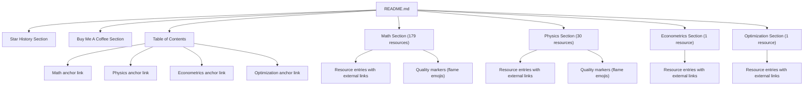
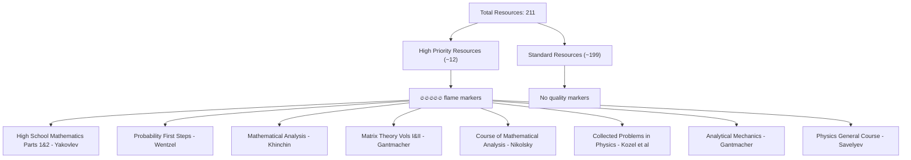
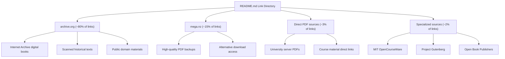
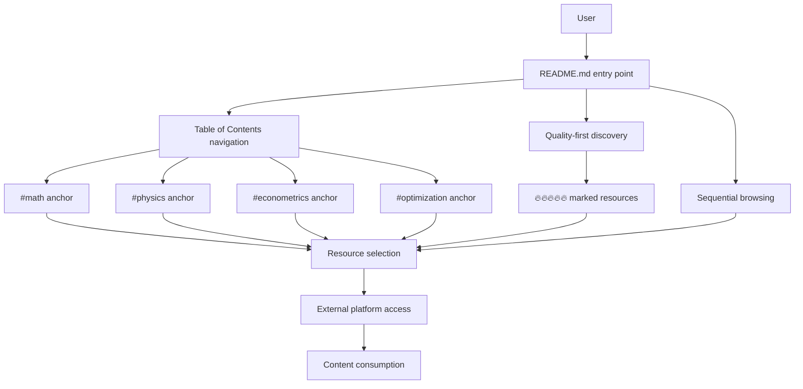

<!-- source: DeepWiki mcp.deepwiki.com · repo valeman/Awesome_Math_Books · page 1 Overview · fetched 2026-10-30 -->

# Overview

Relevant source files

The following files were used as context for generating this wiki page:

- [README.md](README.md)

## Purpose and Scope

The Awesome_Math_Books repository serves as a centralized, curated bibliography of educational resources in mathematics, physics, econometrics, and optimization. The system operates through a single-file architecture centered on [README.md:1-266](), functioning as both a content catalog and user interface for accessing 211 educational resources hosted across external platforms.

This document covers the repository's architectural design, content organization, and curation methodology. For detailed coverage of individual content categories, see [Mathematics Resources](#3.1), [Physics Resources](#3.2), and [Econometrics and Optimization Resources](#3.3). For information about the quality rating system, see [Quality Curation System](#4).

## Repository Architecture

The repository implements a minimalist single-file design where all functionality is concentrated in the `README.md` file. This architecture serves multiple roles simultaneously: content directory, user interface, navigation system, and metadata repository.

### Single-File System Design

**Sources:** [README.md:1-266]()

### Content Distribution and Structure

The repository contains 211 total resources distributed across four categories with significant variance in content density:

| Category | Resource Count | Percentage | Line Range |
|----------|----------------|------------|------------|
| Math | 179 | 85% | [README.md:21-217]() |
| Physics | 30 | 14% | [README.md:218-252]() |
| Econometrics | 1 | 0.5% | [README.md:253-255]() |
| Optimization | 1 | 0.5% | [README.md:256-258]() |

### Quality Curation System

**Sources:** [README.md:23](), [README.md:66-67](), [README.md:78-79](), [README.md:82](), [README.md:103-104](), [README.md:171-172](), [README.md:227](), [README.md:233](), [README.md:238](), [README.md:251]()

## External Dependencies Architecture

The repository relies entirely on external hosting platforms for content delivery, implementing a distributed storage strategy with primary and backup sources.

### Hosting Platform Distribution

**Sources:** [README.md:25](), [README.md:39](), [README.md:40](), [README.md:71](), [README.md:142](), [README.md:157](), [README.md:187-188]()

### Link Structure and Redundancy

The system implements a strategic redundancy approach where critical resources have multiple access points:

- **Primary access**: archive.org links for most resources
- **Backup access**: mega.nz download links for high-priority items  
- **Alternative access**: Direct PDF links for specialized content

Example redundancy pattern from high-priority resources:
- [README.md:40](): Kolmogorov/Fomin with both archive.org and mega.nz links
- [README.md:47](): Elsgolts with both archive.org and mega.nz links
- [README.md:103](): Worked Problems with archive.org primary and mega.nz backup

## Navigation and Access Patterns

### User Flow Architecture

**Sources:** [README.md:14-19](), [README.md:21](), [README.md:218](), [README.md:253](), [README.md:256]()

### Internal Linking System

The repository uses standard Markdown anchor linking for navigation:

- Table of Contents section: [README.md:14-19]()
- Section anchors: `#math`, `#physics`, `#econometrics`, `#optimization`
- Direct section jumps without intermediate navigation layers

This creates a flat, efficient navigation hierarchy that minimizes user friction while maintaining organization.

**Sources:** [README.md:14-19](), [README.md:21](), [README.md:218](), [README.md:253](), [README.md:256]()

---

