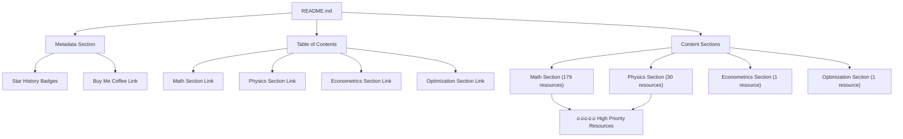
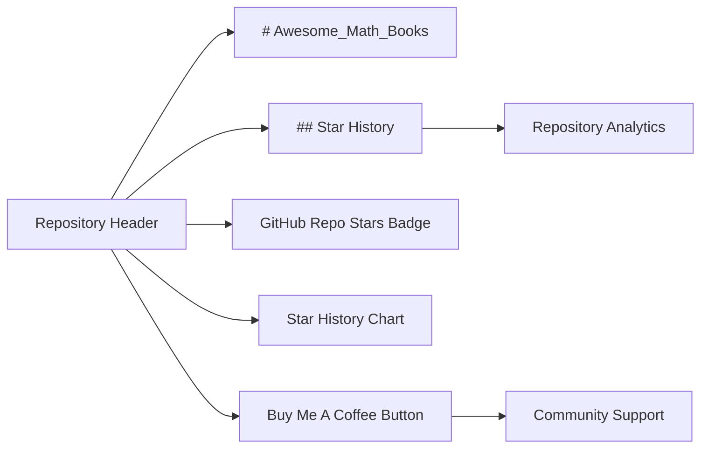
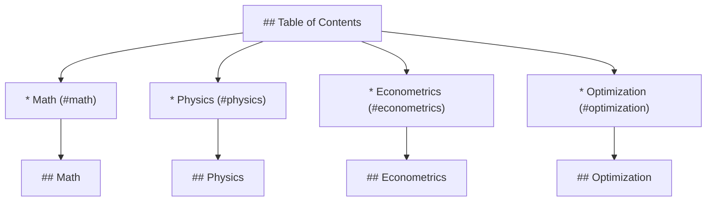
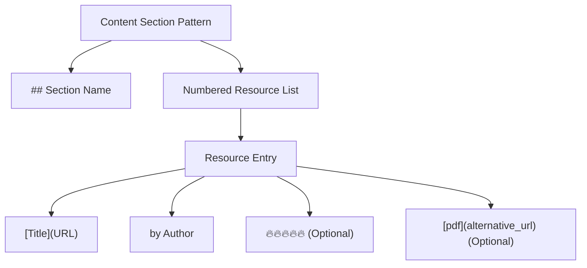
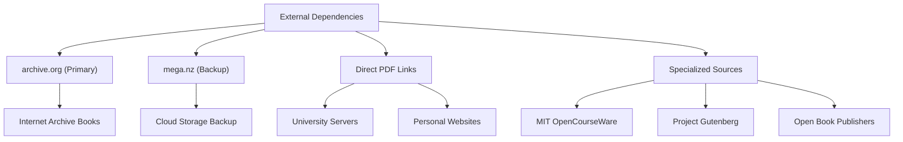
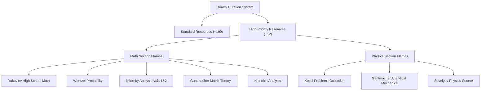

<!-- source: DeepWiki mcp.deepwiki.com · repo valeman/Awesome_Math_Books · page 2 Repository Architecture · fetched 2026-10-30 -->

# Repository Architecture

Relevant source files

The following files were used as context for generating this wiki page:

- [README.md](README.md)

This document explains the architectural design of the Awesome_Math_Books repository, focusing on its single-file centralized approach and external resource management system. The architecture centers around `README.md` as both the user interface and the complete system implementation.

For information about the specific content categories and their organization, see [Content Categories](#3). For details about the quality rating system, see [Quality Curation System](#4). For external hosting strategies, see [External Dependencies and Resource Access](#5).

## Core Architecture Overview

The Awesome_Math_Books repository implements a minimalist single-file architecture where `README.md` serves as the entire system - acting simultaneously as the user interface, content catalog, navigation system, and administrative dashboard.

### Single-File System Design

**Sources:** [README.md:1-266]()

### Repository Structure

The repository contains only one significant file, creating an extremely simple but effective architecture:

| Component | File Path | Lines | Purpose |
|-----------|-----------|-------|---------|
| Main System | `README.md` | 1-266 | Complete application |
| Repository Metadata | `README.md` | 3-10 | Badges and donation links |
| Navigation System | `README.md` | 14-19 | Table of contents |
| Content Catalog | `README.md` | 21-257 | Resource collections |

**Sources:** [README.md:1-266]()

## File Structure and Content Organization

### Header and Metadata System

The repository implements a metadata system at the top of `README.md` that serves both promotional and statistical purposes:

**Sources:** [README.md:1-11]()

### Table of Contents Implementation

The navigation system uses markdown anchor linking to create an internal routing system:

**Sources:** [README.md:14-19]()

## Content Organization System

### Section-Based Architecture

Each content section follows a consistent organizational pattern with numbered lists and external links:

**Sources:** [README.md:21-257]()

### High-Priority Resource Marking

The system implements a quality curation mechanism using flame emojis (`🔥🔥🔥🔥🔥`) to mark exceptional resources:

| Section | High-Priority Resources | Examples |
|---------|------------------------|-----------|
| Math | ~8 resources | Yakovlev High School Mathematics, Nikolsky Analysis, Gantmacher Matrix Theory |
| Physics | ~4 resources | Kozel Problems Collection, Gantmacher Analytical Mechanics, Savelyev Physics Course |

**Sources:** [README.md:23](), [README.md:66](), [README.md:67](), [README.md:78](), [README.md:79](), [README.md:82](), [README.md:103](), [README.md:104](), [README.md:107](), [README.md:171](), [README.md:172](), [README.md:227](), [README.md:233](), [README.md:238](), [README.md:251]()

## External Dependency Architecture

### Link Distribution Strategy

The repository implements a multi-source external dependency strategy to ensure resource availability:

**Sources:** [README.md:21-257]()

### Resource Accessibility Patterns

The system provides multiple access methods for critical resources:

| Pattern | Implementation | Example |
|---------|----------------|---------|
| Primary Only | Single archive.org link | Most resources |
| Primary + Backup | archive.org + mega.nz | [README.md:39-40](), [README.md:47-48]() |
| Multiple Formats | Multiple volume links | [README.md:44-45](), [README.md:67-68]() |

**Sources:** [README.md:39](), [README.md:40](), [README.md:44](), [README.md:45](), [README.md:47](), [README.md:48](), [README.md:67](), [README.md:68]()

## Navigation System Implementation

### Internal Linking Architecture

The navigation system uses HTML anchor tags to create a single-page application experience:

**Sources:** [README.md:16-19]()

### Section Anchor System

Each major section implements a consistent anchor naming scheme:

| Section Header | Anchor ID | Line Reference |
|----------------|-----------|----------------|
| `## Math` | `#math` | [README.md:21]() |
| `## Physics` | `#physics` | [README.md:218]() |
| `## Econometrics` | `#econometrics` | [README.md:253]() |
| `## Optimization` | `#optimization` | [README.md:256]() |

**Sources:** [README.md:16](), [README.md:17](), [README.md:18](), [README.md:19](), [README.md:21](), [README.md:218](), [README.md:253](), [README.md:256]()

## Quality Curation Implementation

### Flame Rating System

The repository implements a binary quality system using five flame emojis (`🔥🔥🔥🔥🔥`) to mark resources of exceptional educational value:

**Sources:** [README.md:23](), [README.md:66](), [README.md:67](), [README.md:78](), [README.md:79](), [README.md:82](), [README.md:103](), [README.md:104](), [README.md:107](), [README.md:171](), [README.md:172](), [README.md:227](), [README.md:233](), [README.md:238](), [README.md:251]()

The architecture successfully balances simplicity with functionality, creating a robust educational resource system through careful organization and external dependency management within a single markdown file.

---

