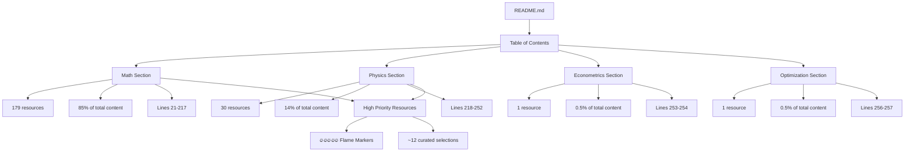
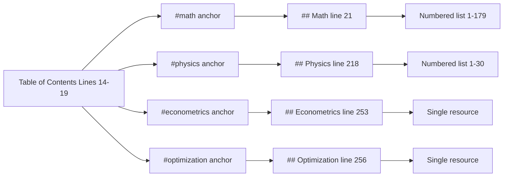
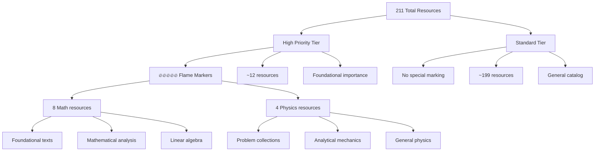

<!-- source: DeepWiki mcp.deepwiki.com · repo valeman/Awesome_Math_Books · page 3 Content Categories · fetched 2026-10-30 -->

# Content Categories

Relevant source files

The following files were used as context for generating this wiki page:

- [README.md](README.md)

This document provides an overview of the four main content categories in the Awesome_Math_Books repository and their organizational structure. It covers the distribution statistics, hierarchical arrangement, and navigation principles that govern how the 211 educational resources are categorized and accessed within the centralized README.md system.

For information about specific resources within each category, see [Mathematics Resources](#3.1), [Physics Resources](#3.2), and [Econometrics and Optimization Resources](#3.3). For details about the quality rating system, see [Quality Curation System](#4).

## Content Distribution and Organization

The repository implements a four-tier categorical system with highly uneven distribution, reflecting the mathematical focus of the collection.

**Content Distribution Overview**
| Category | Resources | Percentage | Line Range |
|----------|-----------|------------|------------|
| Math | 179 | 85.0% | 21-217 |
| Physics | 30 | 14.2% | 218-252 |
| Econometrics | 1 | 0.5% | 253-254 |
| Optimization | 1 | 0.5% | 256-257 |
| **Total** | **211** | **100%** | **21-257** |

Sources: [README.md:14-19](), [README.md:21-257]()

## Navigation Architecture

The categorical system implements a hierarchical navigation structure anchored by the table of contents and internal section linking.

Sources: [README.md:14-19](), [README.md:21](), [README.md:218](), [README.md:253](), [README.md:256]()

## Categorical Content Profiles

### Mathematics Dominance Pattern

The Math section exhibits a comprehensive hierarchical structure spanning foundational through advanced topics, with explicit quality curation through flame emoji markers.

**Key Characteristics:**
- **Foundational Coverage**: High school mathematics, elementary handbooks
- **Advanced Topics**: Mathematical analysis, linear algebra, complex analysis
- **Problem Collections**: USSR Olympiad problems, worked examples
- **Quality Markers**: 🔥🔥🔥🔥🔥 system for premium resources

**High-Priority Math Resources** (flame-marked):
- `High School Mathematics Part 1 & 2` by Yakovlev [README.md:89-90]()
- `Probability - First Steps` by Wentzel [README.md:23]()
- `Theory of matrices, Volume I & II` by Gantmacher [README.md:103-104]()
- `A Course of Mathematical Analysis` by Khinchin [README.md:107]()
- `A Course Of Mathematical Analysis Vol 1 & 2` by Nikolsky [README.md:202-203]()

### Physics Concentration Pattern

The Physics section maintains focused coverage on core physics domains with strategic problem collections and theoretical foundations.

**Content Distribution:**
- **General Physics**: Problem collections and handbooks
- **Mechanics**: Classical and analytical mechanics
- **Electromagnetism**: Basic laws and applications
- **Quantum Mechanics**: Fundamental concepts

**High-Priority Physics Resources** (flame-marked):
- `Collected Problems In Physics` by Kozel et al. [README.md:227]()
- `Lectures in analytical mechanics` by Gantmacher [README.md:233]()
- `Physics - a general course` by Savelyev [README.md:238]()

### Specialized Domains

The Econometrics and Optimization sections represent targeted, single-resource domains addressing specific technical needs.

**Econometrics**: `Basic Econometrics` by Lucchetti [README.md:254]()
**Optimization**: `Algorithms for optimization` by Kochenderfer & Wheeler [README.md:257]()

Sources: [README.md:23](), [README.md:89-90](), [README.md:103-104](), [README.md:107](), [README.md:202-203](), [README.md:227](), [README.md:233](), [README.md:238](), [README.md:254](), [README.md:257]()

## Quality Stratification System

The repository implements a two-tier quality system distinguishing high-priority resources from standard catalog entries.

**Quality Distribution:**
- **High Priority**: ~5.7% of resources (12/211)
- **Standard**: ~94.3% of resources (199/211)
- **Math Priority**: 8 flame-marked resources
- **Physics Priority**: 4 flame-marked resources

Sources: [README.md:23](), [README.md:89-90](), [README.md:103-104](), [README.md:107](), [README.md:202-203](), [README.md:227](), [README.md:233](), [README.md:238](), [README.md:251]()

## Organizational Principles

The categorical system follows several key organizational principles:

1. **Domain Hierarchy**: Mathematical sciences as primary focus, physical sciences as secondary
2. **Progressive Complexity**: Within categories, resources range from elementary to advanced
3. **Quality-First Curation**: Flame emoji system highlights foundational resources
4. **Accessibility Balance**: Mix of introductory texts and specialized references
5. **Problem-Solution Pairing**: Theory texts complemented by problem collections

The single-file architecture in `README.md` enables this organizational structure through markdown section headers, numbered lists, and internal anchor linking, creating a navigable hierarchy despite the flat file structure.

Sources: [README.md:1-266]()

---

