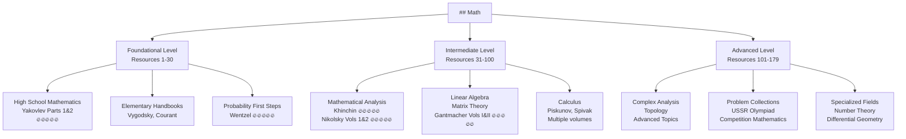
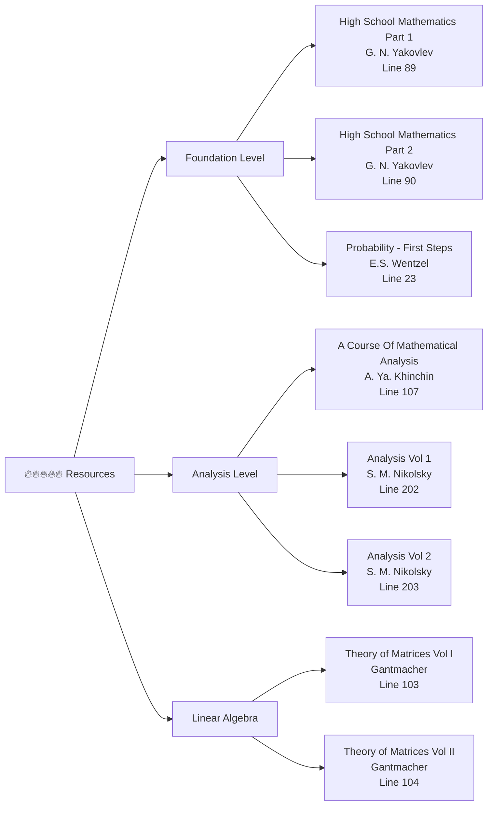
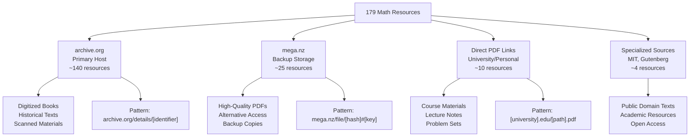
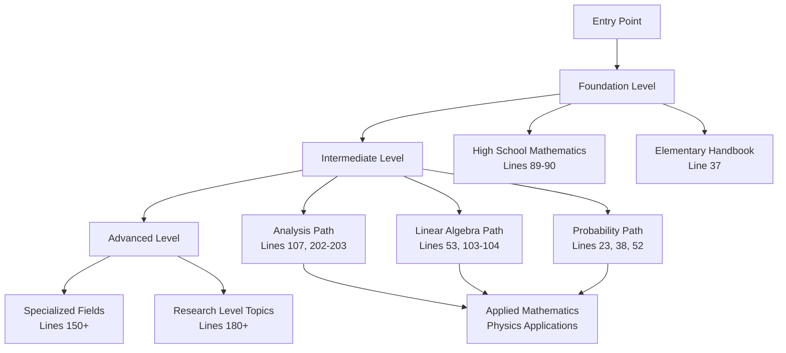

<!-- source: DeepWiki mcp.deepwiki.com · repo valeman/Awesome_Math_Books · page 3.1 Mathematics Resources · fetched 2026-10-30 -->

# Mathematics Resources

Relevant source files

The following files were used as context for generating this wiki page:

- [README.md](README.md)

This document covers the Mathematics section of the Awesome_Math_Books repository, which contains 179 curated mathematical resources representing 85% of the total collection. The section spans from foundational high school mathematics through advanced university-level topics, with a special emphasis on high-priority resources marked with flame emojis (🔥🔥🔥🔥🔥).

For information about the other content categories, see [Physics Resources](#3.2) and [Econometrics and Optimization Resources](#3.3). For details on the quality curation system, see [Quality Curation System](#4).

## Resource Organization and Structure

The mathematics collection follows a hierarchical organization from foundational to advanced topics, with strategic curation highlighting exceptional educational resources.

Sources: [README.md:21-214]()

## High-Priority Resources

The collection includes 8 flame-marked resources that represent the core foundation of mathematical education, carefully selected for their pedagogical excellence and comprehensive coverage.

Sources: [README.md:23](), [README.md:89-90](), [README.md:103-104](), [README.md:107](), [README.md:202-203]()

## Topic Distribution and Coverage

| Mathematical Field | Resource Count | Key Authors | Notable Works |
|-------------------|----------------|-------------|---------------|
| Mathematical Analysis | ~35 | Khinchin, Nikolsky, Piskunov | Course of Mathematical Analysis series |
| Linear Algebra | ~20 | Gantmacher, Voyevodin, Shilov | Matrix Theory, Linear Algebra texts |
| Probability & Statistics | ~25 | Wentzel, Kolmogorov, Gnedenko | Probability First Steps, Foundations |
| Calculus | ~15 | Spivak, Tarasov, Bermant | Calculus, Differential/Integral texts |
| Geometry | ~12 | Pogorelov, Postnikov, Modenov | Analytic Geometry, Problems collections |
| Problem Collections | ~18 | Yaglom, Kordemsky, Olimpiad authors | USSR Olympiad, Moscow Puzzles |
| Advanced Topics | ~54 | Various specialists | Complex Analysis, Topology, Number Theory |

Sources: [README.md:21-214]()

## External Resource Architecture

The mathematics resources are hosted across multiple external platforms with strategic redundancy for content preservation.

Sources: [README.md:23-214]()

## Learning Pathways and Progression

The collection supports multiple learning pathways from high school through advanced graduate-level mathematics.

### Foundational Track
1. **High School Mathematics Parts 1&2** (Yakovlev) 🔥🔥🔥🔥🔥 - [README.md:89-90]()
2. **Elementary Mathematical Handbook** (Vygodsky) - [README.md:37]()
3. **What is Mathematics** (Courant & Robbins) - [README.md:26]()

### Analysis Track  
1. **Mathematical Analysis - Brief Course** (Bermant) - [README.md:33]()
2. **A Course of Mathematical Analysis** (Khinchin) 🔥🔥🔥🔥🔥 - [README.md:107]()
3. **Mathematical Analysis Vols 1&2** (Nikolsky) 🔥🔥🔥🔥🔥 - [README.md:202-203]()

### Linear Algebra Track
1. **Fundamentals of Linear Algebra** (Bugrov, Nikolsky) - [README.md:53]()
2. **Theory of Matrices Vols I&II** (Gantmacher) 🔥🔥🔥🔥🔥 - [README.md:103-104]()
3. **Linear Algebra** (Shilov) - [README.md:70]()

### Probability Track
1. **Probability - First Steps** (Wentzel) 🔥🔥🔥🔥🔥 - [README.md:23]()
2. **Foundations of Theory of Probability** (Kolmogorov) - [README.md:38]()
3. **Theory of Probability** (Gnedenko) - [README.md:52]()

Sources: [README.md:23](), [README.md:37](), [README.md:53](), [README.md:89-90](), [README.md:103-104](), [README.md:107](), [README.md:202-203]()

## Resource Quality Indicators

Beyond the flame emoji system, resources demonstrate quality through several indicators:

- **Author Reputation**: Books by renowned mathematicians (Kolmogorov, Gelfand, Khinchin)
- **Publisher Pedigree**: MIR Publishers, Dover Publications, university presses
- **Historical Significance**: Classic texts that have educated generations
- **Comprehensive Coverage**: Multi-volume series for complete topic mastery
- **Problem Integration**: Books combining theory with extensive problem sets

The collection emphasizes Russian mathematical pedagogy, particularly MIR Publishers translations, known for rigorous exposition and comprehensive problem coverage.

Sources: [README.md:21-214]()

---

